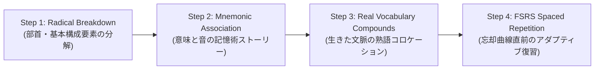
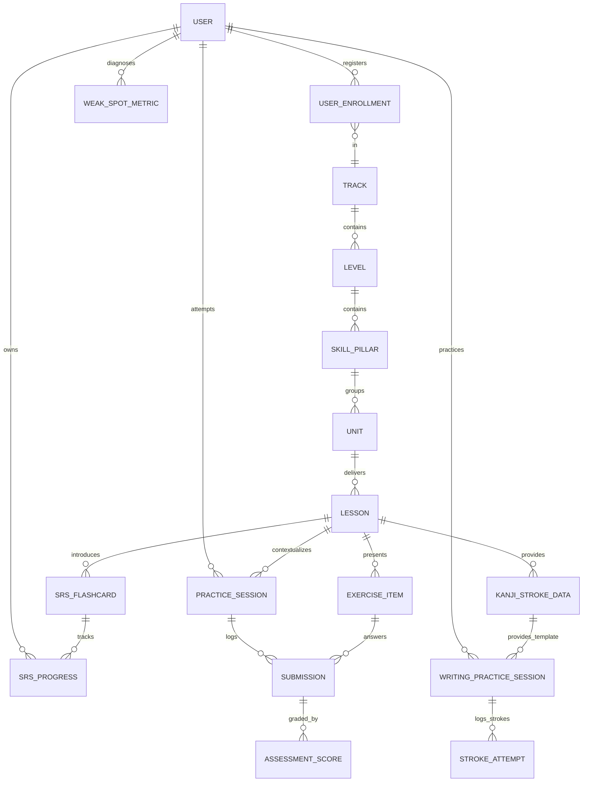

# DOMAIN BLUEPRINT: DUAL-TRACK LANGUAGE PROFICIENCY PLATFORM
## English (IELTS Academic & General) & Japanese (Kana Syllabary & JLPT N5–N1 Progression)

---

## 1. Executive Domain Summary & Architecture

This document establishes the authoritative domain blueprint for a high-stakes, production-grade language learning and test-preparation platform. The platform is architected around two rigorous international standardized assessment ecosystems:

1. **English Track**: The **International English Language Testing System (IELTS)** — covering both **Academic** and **General Training** modules across all 4 core language pillars (Listening, Reading, Writing, Speaking).
2. **Japanese Track**: The **Japanese-Language Proficiency Test (JLPT)** — targeting the intermediate-to-advanced progression ladder (**N3 $\rightarrow$ N2 $\rightarrow$ N1**) across Language Knowledge (Kanji, Vocabulary, Grammar), Reading Comprehension, and Listening Comprehension.

### Dual-Track Architectural Philosophy & Strict Track / Level Isolation
Unlike generic language apps that rely on trivial gamification or unstructured flashcard decks, this platform operates on an **outcome-driven competency model** with **uncompromising track and level isolation**:
* **Strict Track Isolation (Zero Cross-Track Pollution)**:
  * The Japanese Track (`ja_jlpt` / `ja_kana`) and English Track (`en_ielts`) are architecturally segregated at database, API, state management, and UI rendering layers.
  * Under no circumstances can a Japanese lesson, kanji character, or vocabulary item appear in an IELTS view, nor can IELTS reading passages or essays appear in a JLPT view.
  * Contextual query parameters (`trackId`) enforce strict SQL/ORM scoping (`WHERE track_id = ?`).
* **Strict Level Isolation (No Level Fallbacks)**:
  * Selecting a level (e.g., `N4`, `N3`, `N2`, `N1`) strictly queries and displays curriculum units, flashcards, kanji, and exercises authored specifically for that exact level.
  * The system strictly prohibits falling back to lower levels (e.g. falling back to N5 content when an N3 or N2 user opens curriculum or practice). If a level is chosen, the learner interacts with authentic, dedicated content for that level.
* **Equivalence & Alignment**: Every content item, exercise, scoring rule, and rubric strictly adheres to the official standards defined by the IELTS Partners (British Council, IDP, Cambridge Assessment English) and the Japan Foundation / Japan Educational Exchanges and Services (JEES).
* **Dual Mastery Engine**: Combines a modern **Spaced Repetition System (SRS)** (FSRS/SM-2 hybrid) for discrete lexical and grammatical acquisition with **Criterion-Referenced Rubric Evaluators** and **Item Response Simulation** for integrative productive tasks (Writing/Speaking) and receptive timed sections (Reading/Listening).
* **Continuous Diagnostics**: Converts every study session and test event into granular mastery metrics, projecting official band scores (0.0–9.0) and JLPT scaled scores (0–180) with sectional cutoff risk warnings.

---

## 2. Domain Standards & Taxonomy

### 2.1 English IELTS Framework

#### 2.1.1 Test Modules & Structure
IELTS is administered in two distinct test versions:
* **Academic**: Designed for university admissions, professional registration (medical, legal), and high-skilled migration. Emphasizes intellectual discourse, academic prose, data synthesis, and formal argumentation.
* **General Training**: Designed for immigration (e.g., Express Entry to Canada, Australia general migration) and secondary education/work experience. Emphasizes survival social English, workplace communications, and general interest texts.

| Skill Pillar | Module | Timing | Item Count | Structure & Content Characteristics |
| :--- | :--- | :--- | :--- | :--- |
| **Listening** | Shared (Academic & GT) | 30 min (+10 min transfer for paper, 2 min review for computer-delivered) | 40 items across 4 sections | **Section 1**: Everyday social dialogue (transactional, e.g., booking a venue).<br>**Section 2**: Everyday social monologue (e.g., local facility orientation).<br>**Section 3**: Academic/educational dialogue (up to 4 speakers, e.g., tutor and student).<br>**Section 4**: Academic monologue (university lecture). Audio played *once only*. |
| **Reading** | **Academic** | 60 minutes | 40 items across 3 sections | 3 long, complex academic texts (authentic extracts from books, journals, magazines, newspapers; descriptive, analytical, discursive; ~2,150–2,750 total words). |
| **Reading** | **General Training** | 60 minutes | 40 items across 3 sections | **Section 1**: 2–3 short factual texts (daily social survival).<br>**Section 2**: 2 factual workplace texts (staff training, contracts, facilities).<br>**Section 3**: 1 long, more complex general interest text. |
| **Writing** | **Academic** | 60 minutes | 2 tasks | **Task 1 (20 min, $\ge$150 words)**: Visual data report (graph, bar chart, pie chart, table, process diagram, or comparative map). Objective description; no personal opinion.<br>**Task 2 (40 min, $\ge$250 words)**: Formal discursive essay responding to a prompt (opinion, discussion, advantages/disadvantages, problem-solution, direct question). |
| **Writing** | **General Training** | 60 minutes | 2 tasks | **Task 1 (20 min, $\ge$150 words)**: Formal, semi-formal, or informal letter responding to a situation (explaining, requesting, complaining).<br>**Task 2 (40 min, $\ge$250 words)**: Discursive essay (similar structure to Academic Task 2, but prompts may touch more personal/practical angles). |
| **Speaking** | Shared (Academic & GT) | 11–14 minutes | 3 interactive parts | **Part 1 (4–5 min)**: Introduction & familiar topics (work, study, home, hobbies).<br>**Part 2 (3–4 min)**: Individual long turn (Cue card: 1 min preparation, 1–2 min monologue, 1–2 follow-up questions).<br>**Part 3 (4–5 min)**: In-depth abstract two-way discussion thematic to Part 2. |

#### 2.1.2 Official Band Descriptors & 4 Assessment Criteria
IELTS scores are reported on a 9-band scale in 0.5-band increments. Writing and Speaking are assessed across four equally weighted criteria (each scored 0–9):

##### Writing Assessment Criteria (Task 1 & Task 2)
1. **Task Achievement (TA - Task 1) / Task Response (TR - Task 2)**:
   * *Task 1*: Complete coverage of key features, accurate data synthesis, clear overview without irrelevant details.
   * *Task 2*: Clear position throughout, fully developed central ideas, addresses all parts of the prompt, supported arguments without overgeneralization.
2. **Coherence and Cohesion (CC)**:
   * Logical progression of ideas, clear paragraphing (one central topic per paragraph), varied and accurate cohesive devices without mechanical overuse or underuse, accurate referential pronouns.
3. **Lexical Resource (LR)**:
   * Breadth of vocabulary, precision in word choice, natural collocation, awareness of style and register, control of spelling and word formation, ability to paraphrase without distorting meaning.
4. **Grammatical Range and Accuracy (GRA)**:
   * Balance between simple and complex sentence structures, flexibility of clauses (relative, adverbial, conditional, passive), frequency of error-free sentences, accurate punctuation and tense consistency.

##### Speaking Assessment Criteria (Official Cambridge / British Council 9-Band Matrix)

The Speaking examination evaluates communicative competence across four equally weighted criteria (each scored 0.0 to 9.0 in 0.5-band increments):

```
+-----------+---------------------------------+---------------------------------+---------------------------------+---------------------------------+
| Band      | Fluency & Coherence (FC)        | Lexical Resource (LR)           | Grammatical Range & Acc (GRA)   | Pronunciation (PR)              |
+-----------+---------------------------------+---------------------------------+---------------------------------+---------------------------------+
| 9.0       | • 150–175 WPM natural cadence.  | • Full flexibility & precision  | • Effortless, natural variety   | • Full phonological control     |
| (Expert)  | • Zero language hesitation.     |   across all registers.         |   of complex structures.        |   with subtle nuances.          |
|           | • Rare cognitive pauses only.   | • Seamless idiomatic mastery.   | • Consistently error-free.      | • Effortless to understand.     |
+-----------+---------------------------------+---------------------------------+---------------------------------+---------------------------------+
| 8.0       | • 140–160 WPM fluent delivery.  | • Wide vocabulary resource;     | • Wide grammatical flexibility; | • Wide range of phonological    |
| (Very     | • Develops topics coherently.   |   readily uses idioms/phrasals. |   majority of sentences         |   features; flexible stress,    |
|  Good)    | • Occasional repetition/repair. | • Occasional slight inaccuracy. |   are completely error-free.    |   rhythm, and intonation.       |
+-----------+---------------------------------+---------------------------------+---------------------------------+---------------------------------+
| 7.0       | • 125–145 WPM steady speech.    | • Sufficient flexibility to     | • Uses a variety of complex     | • Clear thought groups          |
| (Good)    | • Speaks at length without      |   discuss abstract topics.      |   structures (subordination).   |   and chunking.                 |
|           |   noticeable muscular effort.   | • Uses some less common/idioms. | • Frequently produces           | • Clear sentence stress; easily |
|           | • Some language-related pauses. | • Effective circumlocution.     |   error-free complex clauses.   |   understood throughout.        |
+-----------+---------------------------------+---------------------------------+---------------------------------+---------------------------------+
| 6.0       | • 100–120 WPM moderate cadence. | • Wide enough vocabulary to     | • Uses a mix of simple &        | • Generally intelligible.       |
| (Competent| • Willing to speak at length    |   discuss topics at length.     |   complex sentence forms.       | • Some accent interference;     |
|           |   but loses coherence at times. | • Some inappropriate word usage | • Errors in complex structures  |   occasional mispronunciations  |
|           | • Noticeable hesitations/repair.|   or collocations.              |   rarely cause breakdown.       |   rarely impede communication.  |
+-----------+---------------------------------+---------------------------------+---------------------------------+---------------------------------+
| 5.0       | • 75–95 WPM slow delivery.      | • Manages familiar topics;      | • Produces basic sentences with | • Limited phonological range.   |
| (Modest)  | • Frequent pauses to search     |   struggles with abstract.      |   reasonable accuracy.          | • Frequent mispronunciations    |
|           |   for grammar and vocabulary.   | • Frequent lexical errors       | • Complex structures contain    |   require listener effort.      |
|           | • Overuses simple connectives.  |   and limited paraphrase.       |   systematic errors.            | • Monotone or erratic stress.   |
+-----------+---------------------------------+---------------------------------+---------------------------------+---------------------------------+
| <= 4.0    | • < 70 WPM fragmented speech.   | • Extremely basic word pool;    | • Only simple, memorized        | • Difficult to understand;      |
| (Limited) | • Cannot sustain speech; long   |   cannot convey abstract ideas; |   phrases; frequent severe      |   persistent mispronunciations  |
|           |   silent pauses and breakdown.  |   frequent breakdowns.          |   grammatical distortions.      |   cause severe breakdowns.      |
+-----------+---------------------------------+---------------------------------+---------------------------------+---------------------------------+
```

##### 1. Fluency and Coherence (FC) Deep Mechanics
* **Speech Rate (Words Per Minute / WPM)**:
  * Band 8–9: 145–175 WPM (effortless native-like pace).
  * Band 7: 125–145 WPM (steady, smooth, continuous).
  * Band 6: 100–120 WPM (adequate conversational pace with occasional slowdowns).
  * Band 5: 75–95 WPM (halting, choppy, search-heavy).
* **Hesitation & Pause Topography**:
  * *Cognitive Pauses* (Band 8–9): Pauses are brief ($\le 1.0	ext{s}$) and occur at major semantic boundaries while considering ideas.
  * *Linguistic Pauses* (Band 5–6): Frequent, long mid-sentence silent pauses ($> 1.5	ext{s}$) or acoustic fillers (*um*, *uh*, *er*) indicating a struggle to retrieve syntactic patterns or vocabulary.
* **Discourse Markers & Cohesive Devices**:
  * Overuse of mechanical coordinators (*and, but, because*) limits FC to Band 5.
  * Band 7+ requires flexible conversational discourse markers:
    * Stance markers: *To be perfectly candid...*, *As far as I'm concerned...*, *I'm inclined to believe...*
    * Transition markers: *In terms of...*, *Moving on to the economic side...*, *Conversely...*
    * Nuance & concession: *Mind you...*, *Having said that...*, *That being said...*

##### 2. Lexical Resource (LR) Deep Mechanics
* **Collocational Naturalness**: High-band speakers deploy natural adjective-noun and verb-noun partnerships (*pressing issue*, *drastic repercussions*, *spark widespread debate*, *harbour deep reservations*) rather than clunky direct translations.
* **Idiomatic & Conversational Phrasal Verbs**: Integration of natural spoken phrasal expressions (*come to terms with*, *boil down to*, *phase out*, *iron out differences*).
* **Circumlocution**: When a specific low-frequency term is inaccessible, high-band candidates smoothly paraphrase the concept without pausing or breaking communicative momentum.

##### 3. Grammatical Range and Accuracy (GRA) Deep Mechanics
* **Complex Syntactic Architecture**:
  * Relative clauses (defining and non-defining).
  * Adverbial clauses of concession (*Even though...*, *Whereas...*).
  * Conditional structures, including inverted conditionals (*Had authorities acted decisively, the damage might have been averted*).
  * Speculative modal operators (*It is highly conceivable that...*, *One might speculate that...*).
* **Error-Free Clause Density**: For Band 7+, over 60% of all uttered clauses must be syntactically error-free; for Band 8+, over 80%.

##### 4. Pronunciation (PR) Deep Mechanics
* **Thought Groups & Chunking**: Dividing spoken streams into meaningful phonetic chunks separated by micro-pauses (200–400ms), preventing breathless monotone.
* **Sentence Stress & Rhythm**: Stress-timed English cadence: emphasizing content words (nouns, main verbs, adjectives) while unstressed structural function words undergo vowel reduction to schwa /ə/.
* **Intonation Contours**:
  * Falling pitch for completed, assertive statements.
  * Rising pitch for clarification questions.
  * Fall-rise pitch for qualified statements, polite disagreement, or provisional assertions.

---

#### 2.1.5 Official Cambridge IELTS Speaking Test Structure & Protocols

The official IELTS Speaking test is a structured face-to-face or computer-delivered oral interview lasting **11 to 14 minutes** across three distinct phases:

##### Phase 1: Part 1 — Introduction & Familiar Topics (4 to 5 Minutes)
* **Format**: The examiner verifies candidate identity, then asks general, everyday questions on familiar personal themes.
* **Pacing & Coverage**: 3 distinct topic sets, typically 3 to 4 questions per set (total 10 to 12 questions).
* **Ideal Response Length**: 2 to 4 complete, well-formed sentences per prompt (~15 to 30 seconds per question).
* **The 5 Core Authoritative Topic Clusters**:
  1. *Work & Studies*: Current occupation or academic discipline, rationale for chosen field, daily tasks, future career ambitions.
  2. *Hometown & Living Environment*: Geographic location, standout local features, historical/urban transformations, suitability for young professionals.
  3. *Habits, Leisure & Sports*: Weekend routines, leisure activities, physical exercise habits, relaxation methods.
  4. *Technology, Digital Devices & Internet*: Essential daily applications, screen time habits, digital distraction vs efficiency, intentional disconnection.
  5. *Daily Environment, Weather & Food*: Regional climate effects, traditional culinary preferences, transportation habits.
* **Golden Rule**: Never respond with monosyllabic answers (*"Yes"*, *"No"*, *"It's good"*); always apply the **W-H Elaboration Formula** (Answer + Why + Real Example or Frequency).

##### Phase 2: Part 2 — Individual Long Turn / Cue Card (3 to 4 Minutes)
* **Format**: The examiner presents a printed or digital **Candidate Task Card (Cue Card)** containing a specific topic and 4 mandatory guide prompts.
* **Strict Timing Protocol**:
  * **Preparation Phase (Exactly 60 Seconds)**: Candidate receives a virtual scratchpad and pen/keyboard to record outline notes and keywords. Audio recording is muted.
  * **Speaking Phase (Uninterrupted 120 Seconds)**: Candidate must speak continuously for 1 to 2 full minutes. The examiner does not interrupt until the 2-minute mark is reached.
  * **Rounding-Off Follow-Up (15–30 Seconds)**: 1 or 2 brief follow-up confirmation questions from the examiner.
* **Mandatory Task Card Architecture**:
  * Topic Prompt: *"Describe a [Person / Place / Object / Experience] that..."*
  * 3 Context Prompts: *"You should say: Who/What/Where..., When/How often..., What actions were taken..."*
  * 1 Evaluative / Analytical Prompt: *"And explain why you consider this meaningful / memorable / challenging."*
* **The 4 Canonical Cue Card Archetypes**:
  1. *People Archetype*: A teacher, mentor, family elder, or inspiring public figure.
  2. *Places Archetype*: A tranquil nature retreat, a historic monument, or a vibrant urban neighborhood.
  3. *Objects Archetype*: An indispensable technological gadget, a family heirloom, or a memorable gift.
  4. *Experiences Archetype*: A challenging goal accomplished, an environmental project, or a memorable journey.

##### Phase 3: Part 3 — Two-Way In-Depth Analytical Discussion (4 to 5 Minutes)
* **Format**: A two-way discursive exchange exploring abstract, societal, and philosophical concepts thematic to Part 2.
* **Pedagogical Shift**: Moves completely away from personal self-narrative (*"When I was young..."*) to macro-level sociological, ethical, and universal analysis (*"In contemporary society...", "From an economic standpoint..."*).
* **The 3 Analytical Prompt Typologies**:
  1. *Past vs Present Comparative Evolution*: How societal behaviors, traditions, or technologies have shifted across generations.
  2. *Societal, Ethical & Policy Impact*: The division of responsibility between individual citizen behavior and governmental regulatory mandates.
  3. *Future Speculation & Prognosis*: Projecting technological breakthroughs, cultural trajectories, or ecological consequences over the next 20 to 50 years.


#### 2.1.3 CEFR (Common European Framework of Reference) Mapping
* **Band 9.0**: Expert User $\rightarrow$ **C2** (Mastery)
* **Band 8.0 – 8.5**: Very Good User $\rightarrow$ **C1 / C2**
* **Band 7.0 – 7.5**: Good User $\rightarrow$ **C1** (Effective Operational Proficiency)
* **Band 6.0 – 6.5**: Competent User $\rightarrow$ **B2** (Vantage / Independent)
* **Band 5.0 – 5.5**: Modest User $\rightarrow$ **B1** (Threshold)
* **Band 4.0 – 4.5**: Limited User $\rightarrow$ **A2** (Waystage)
* **Band $\le$ 3.5**: Extremely Limited / Intermittent User $\rightarrow$ **A1 / Below**

---


#### 2.1.4 Official Cambridge & British Council Standard IELTS Lecture Curriculum Architecture

To eliminate shallow, fragmented test preparation, the platform synthesizes the standard pedagogical frameworks established by Cambridge Assessment English (*Cambridge IELTS 1–19*), British Council, IDP, and leading collegiate EAP (English for Academic Purposes) institutes into a comprehensive, multi-tiered lecture curriculum:

```
[ IELTS Master Curriculum Architecture ]
  ├── 1. Listening Strategy & Skill Streams (4 Sections / 16 Core Lecture Modules)
  │    ├── S1: Foundational Transactions (Forms, Numbers, Names, Accents, Distractors)
  │    ├── S2: Public Orientation & Spatial Navigation (Maps, Plans, Flowcharts)
  │    ├── S3: Academic Collaborative Tutorials (Multi-speaker consensus, Stances)
  │    └── S4: High-Register Monologue Lectures (Signposting, Discourse Markers, Technical Notes)
  ├── 2. Academic Reading Strategy & Skill Streams (3 Sections / 20 Core Lecture Modules)
  │    ├── R1-R3: Core Mechanics (Skimming, Scanning, Topic Sentences, Semantic Paraphrasing)
  │    ├── R4-R7: Verification Typologies (TFNG vs YNNG, False vs Not Given Distinction)
  │    ├── R8-R11: Structural Typologies (Matching Headings, Information, Features, Sentence Endings)
  │    └── R12-R16: Completion Typologies (Summary, Note, Table, Flowchart, Diagram Labelling)
  ├── 3. Writing Mastery Streams (Task 1 Visual Data + Task 2 Discursive Argumentation / 18 Modules)
  │    ├── W1: Academic Task 1 Data Synthesizer (Line, Bar, Pie, Table, Process, Map Archetypes)
  │    ├── W2: Academic Task 2 Architecture (Opinion, Discussion, Outweigh, Problem-Solution, Two-Part)
  │    └── W-GT: General Training Task 1 Letter Master (Formal, Semi-Formal, Informal Register)
  ├── 4. Speaking Fluency & Phonological Streams (Parts 1, 2, 3 / 12 Strategy Modules)
  │    ├── SP1: Part 1 Conversational Fluency & W-H Elaboration Formula
  │    ├── SP2: Part 2 The 1-Minute Mind-Mapping Method & 2-Minute Monologue Pacing
  │    └── SP3: Part 3 Abstract Societal Debate, Speculation & Counter-Argumentation
  └── 5. Lexical Resource & Grammatical Range for IELTS (AWL & High-Band Syntactic Inversion)
       ├── AWL: Academic Word List Mastery (Sublists 1–10 with Collocation Contexts)
       └── GRA: Sophisticated Syntactic Structures (Cleft Sentences, Inversion, Participles, Conditionals)
```

##### 1. Listening Curriculum Stream (16 Modules Across 4 Sections)
* **Tier 1 (Section 1: Daily Social Transactions)**:
  * *Lecture L-01*: Numerical Accuracy, Alphanumeric Codes, Addresses & International Currency Traps.
  * *Lecture L-02*: Identifying and Disarming Conversational Distractors ("Actually, no, let me check that...").
  * *Lecture L-03*: Regional Accent Familiarization (Received Pronunciation, Scottish, Australian, North American).
  * *Lecture L-04*: Single-Word and Numerical Limit Discipline (NO MORE THAN TWO WORDS AND/OR A NUMBER).
* **Tier 2 (Section 2: Public Monologues & Social Orientation)**:
  * *Lecture L-05*: Spatial Navigation & Compass Directions (North-East, clockwise, opposite the roundabout).
  * *Lecture L-06*: Dynamic Map & Floor Plan Labelling (Simultaneous tracking of narrator trajectory).
  * *Lecture L-07*: Flowchart & Process Sequencing in Informational Speeches.
  * *Lecture L-08*: Multiple-Choice Elimination in Fast Monologues.
* **Tier 3 (Section 3: Academic Dialogues & Multi-Speaker Discussions)**:
  * *Lecture L-09*: Voice Attribution & Speaker Differentiation (Tutor vs Student A vs Student B).
  * *Lecture L-10*: Recognizing Agreement, Qualified Concession, and Subtle Dissent.
  * *Lecture L-11*: Matching Opinions to Speakers in Collaborative Research Debates.
  * *Lecture L-12*: Note & Table Completion for Academic Project Methodologies.
* **Tier 4 (Section 4: University Lectures & Academic Monologues)**:
  * *Lecture L-13*: Discourse Signposting & Structural Navigation (Introduction of thesis, sub-points, digressions, summation).
  * *Lecture L-14*: Rapid Speech Processing & Technical Lexicon Assimilation (Phonological assimilation, elision).
  * *Lecture L-15*: Cause-and-Effect and Comparative Discourse Markers (*consequently*, *in marked contrast to*, *it follows that*).
  * *Lecture L-16*: High-Density Sentence Completion under Single-Play Audio Constraints.

##### 2. Academic Reading Curriculum Stream (20 Modules Across 3 Passages)
* **Tier 1: Core Reading Mechanics & Foundational Speed**:
  * *Lecture R-01*: Micro-Skimming (60-second structural appraisal of heading, sub-headings, paragraph topic sentences).
  * *Lecture R-02*: Precision Scanning (Finger/cursor tracking for dates, proper nouns, Latin nomenclature, quantitative values).
  * *Lecture R-03*: Semantic Paraphrasing & Lexical Shift Decoding (How the question synonymizes passage verbs and adjectives).
* **Tier 2: Fact Verification & Writer Assertion Typologies**:
  * *Lecture R-04*: True / False / Not Given (TFNG) Mastery: Factual verification against explicit empirical evidence.
  * *Lecture R-05*: The Not Given Diagnostic: The crucial difference between a contradiction (False) and absence of confirmation (Not Given).
  * *Lecture R-06*: Yes / No / Not Given (YNNG) Mastery: Identifying authorial stance, ideological claims, and evaluative tone.
* **Tier 3: Structural & Relational Typologies**:
  * *Lecture R-07*: Matching Headings: Discarding misleading sub-detail distractors to isolate the paragraph's primary thesis.
  * *Lecture R-08*: Matching Information to Paragraphs: Top-down scanning for specific illustrations, definitions, or historical retrospectives.
  * *Lecture R-09*: Matching Features: Tracking historical researchers, theories, or temporal eras across discursive prose.
  * *Lecture R-10*: Matching Sentence Endings: Grammatical collocation and semantic coherence verification.
* **Tier 4: Completion & Synthesis Typologies**:
  * *Lecture R-11*: Summary Completion (Direct Text vs Word Bank Synonyms).
  * *Lecture R-12*: Note & Table Completion: Syntactic prediction of missing parts of speech.
  * *Lecture R-13*: Technical Flowchart & Process Completion.
  * *Lecture R-14*: Diagram Labelling: Cross-referencing visual engineering/biological schematics with descriptive paragraphs.
* **Tier 5: Advanced Discourse & Time Budget Management**:
  * *Lecture R-15*: 4-Option Multiple Choice: Analyzing question stems and methodically eliminating 3 plausible distractors.
  * *Lecture R-16*: Passage Time Budget Allocation (Passage 1: 17 min, Passage 2: 20 min, Passage 3: 23 min).
  * *Lecture R-17*: Passage 1 Descriptive Architecture (Archaeological, historical, industrial evolution).
  * *Lecture R-18*: Passage 2 Empirical Science Architecture (Environmental, ecological, neurobiological studies).
  * *Lecture R-19*: Passage 3 Philosophical & Abstract Debate Architecture (Linguistic relativity, ethics, epistemology).
  * *Lecture R-20*: Computer-Delivered Reading UI Strategies (Highlighting, note-taking, split-pane navigation).

##### 3. Writing Curriculum Stream (Task 1 Visuals & Task 2 Argumentation)
* **Academic Task 1 Visual Synthesis (6 Structural Archetypes)**:
  * *Module W1-A*: Dynamic Line Graphs: Describing trajectories, fluctuations, plateauing, rates of acceleration (*surged*, *plummeted*, *remained plateaued*).
  * *Module W1-B*: Comparative Bar Charts: Grouping categories, identifying significant extremes, making meaningful cross-comparisons.
  * *Module W1-C*: Proportional Pie Charts: Expressing fractions, percentages, market share disparities (*accounted for*, *represented a negligible fraction*).
  * *Module W1-D*: Complex Data Tables: Extracting salient patterns from dense statistical matrices without writing a tedious catalog of numbers.
  * *Module W1-E*: Cyclic & Industrial Process Diagrams: Mastering passive voice, transitional adverbs of sequence (*subsequently*, *prior to entering*).
  * *Module W1-F*: Comparative Maps & Urban Developments: Describing spatial metamorphosis, demolitions, expansions, and infrastructure shifts.
  * *Module W1-G*: The High-Band Task 1 Formula: Paraphrased Introduction + Global Overview (the single most decisive factor for Band 7+) + 2 Body Detail Paragraphs.
* **Academic Task 2 Discursive Argumentation (5 Essay Archetypes)**:
  * *Module W2-A*: Opinion Essays (To what extent do you agree or disagree?): Formulating an unequivocal thesis and defending it consistently.
  * *Module W2-B*: Discussion Essays (Discuss both views and give your opinion): Impartial analysis of counter-perspectives paired with a decisive personal verdict.
  * *Module W2-C*: Advantages vs Disadvantages: Evaluating whether merits outweigh deficiencies using weighed comparative criteria.
  * *Module W2-D*: Problem-Cause-Solution Essays: Systematic diagnosis of systemic causes and concrete, actionable policy remedies.
  * *Module W2-E*: Direct / Two-Part Questions: Answering both prompts comprehensively with equal structural weight.
  * *Module W2-F*: The PEEL Paragraphing Architecture: Point (Topic Sentence) $
ightarrow$ Explanation (Causal rationale) $
ightarrow$ Evidence (Empirical/authentic example) $
ightarrow$ Link (Syntactic wrap-up back to the central thesis).

##### 4. Speaking Curriculum Stream (Parts 1, 2, 3)
* *Module SP-01*: Part 1 Fluency & The W-H Expansion Method (Eliminating robotic 1-sentence answers by expanding with Why, Where, When, How Often).
* *Module SP-02*: Part 1 Idiomatic Naturalness (Appropriate colloquial collocation vs unnatural memorized idioms).
* *Module SP-03*: Part 2 The 1-Minute Mind-Mapping Method (Past-Present-Future temporal scaffolding covering all 4 bullet points).
* *Module SP-04*: Part 2 Monologue Pacing & The 2-Minute Ceiling (Avoiding under-time penalties and maintaining discourse momentum).
* *Module SP-05*: Part 3 Two-Way Analytical Debate: Extending discussion from personal anecdote to universal societal impact.
* *Module SP-06*: Part 3 Speculative Discourse: Using modals of probability (*it is highly conceivable that*, *one might speculate*).
* *Module SP-07*: Pronunciation & Intelligibility: Mastering sentence stress for emphasis and tonal contrast.
* *Module SP-08*: Connected Speech & Elision: Natural linking between consonant-vowel junctions.

##### 5. Academic Word List (AWL) & Grammatical Range Streams
* **AWL Mastery (Sublists 1–10)**: Formal academic lexemes (*constitute*, *arbitrate*, *derive*, *paradigm*, *empirical*, *subsequent*, *intrinsic*).
* **High-Band Grammatical Structures**:
  * Cleft Sentences: *"What remains uncontroversial is the sheer velocity of urbanization."*
  * Conditional Inversions: *"Had the municipal council instituted stricter emission quotas, the atmospheric degradation could have been mitigated."*
  * Negative Inversions: *"Rarely do environmental economists account for the full spectrum of negative externalities."*
  * Participle Clauses: *"Having exhausted conventional energy reserves, the region pivoted decisively toward offshore wind arrays."*

---

#### 2.1.6 Authentic Cambridge & British Council IELTS Listening Architecture & Audio Streaming Engine

The IELTS Listening examination evaluates receptive oral comprehension under strict, irreversible real-time conditions. The platform implements an **Authentic 4-Section Audio Streaming Architecture** strictly conforming to Cambridge Assessment English and British Council Computer-Delivered IELTS (CD-IELTS) testing standards.

##### 1. The 4 Structural Sections & Pedagogical Scaffolding
The examination consists of 40 questions across 4 distinct sections of increasing cognitive and syntactic complexity:

| Section | Communicative Context | Speaker Dynamics | Linguistic & Cognitive Focus | Core Question Typologies | Distractor Traps & Challenges |
| :---: | :--- | :--- | :--- | :--- | :--- |
| **Section 1** | Everyday Social Survival & Commercial Transactions | 2 Speakers (Dialogue) | Alphanumeric precision, personal data, dates, telephone numbers, postal codes, international currencies. | Form Completion, Note Taking, Table Completion (Max 2 words/1 number). | Conversational Self-Correction ("Actually, it is...", "Wait, let me check that..."), spelling of unusual surnames, zero/oh disambiguation. |
| **Section 2** | Public Social Monologue & Orientation | 1 Speaker (Monologue) | Spatial navigation, local amenities, institutional regulations, geographical layout, historical site guides. | Map / Plan / Diagram Labelling, Multiple Choice (Single), Matching Features. | Compass bearings (North/South/East/West), clockwise/counter-clockwise, relative spatial prepositions (*adjacent to, opposite the roundabout*). |
| **Section 3** | Academic Tutorial & Collaborative Research | 3–4 Speakers (Colloquium) | Higher-education discourse, research methodology, student-tutor consultation, peer evaluation, dissertation scope. | Matching Opinions to Speakers, Multiple Choice (Multi-select), Flowchart Completion. | Qualified agreements (*"I take your point, but..."*), subtle dissent, voice attribution confusion across peer speakers. |
| **Section 4** | University Academic Lecture | 1 Speaker (Academic Monologue) | High-register university lecture, disciplinary terminology, macro-discourse markers, dense factual synthesis. | Summary / Note Completion (One Word Only), Classification. | Uninterrupted delivery, absence of conversational pauses, technical Academic Word List (AWL) terms, dense signposting (*Having examined X, we now pivot to Y*). |

##### 2. Audio Streaming Specifications & CD-IELTS Constraints
* **Single-Play Audio Stream Constraint**:
  * In **Strict Exam Mode**, audio streams play strictly **once only** ($N_{\text{play}} = 1$).
  * The audio scrub bar (seek slider), pause button, rewind (-10s), and fast-forward controls are disabled via CSS and DOM event suppression.
  * Section progression is synchronized to audio stream milestones: candidates are given 30 seconds of pre-reading time before each section starts, 30 seconds of mid-section pause where applicable, and 2 minutes of final answer review at the conclusion of Section 4.
* **Practice Mode Audio Flexibility**:
  * In **Practice Mode**, candidates can scrub audio, toggle pause/play, and adjust dynamic playback speed:
    $$\text{speed} \in \{0.8\times, 1.0\times, 1.2\times\}$$
  * **Pitch Preservation**: The audio pipeline sets HTML5 Audio `preservesPitch = true` (or Web Audio API `AudioContext` with time-stretch phase vocoder) so speech frequencies remain natural and intelligible without chipmunk or demonic distortion.
* **Multi-Regional Native Accent Distribution**:
  To replicate authentic international testing environments, audio tracks incorporate certified native English voice talents across four standard geopolitical accent profiles:
  1. **British RP (Received Pronunciation / Standard Southern British)**: ~50% of content.
  2. **Australian English**: ~25% of content (distinctive diphthong shifts, rising inflection).
  3. **Scottish English**: ~15% of content (rhotic 'r', monophthongal vowels).
  4. **General American**: ~10% of content (flapped 't', rhoticity).

##### 3. Official 40-Item Raw-to-Band Score Conversion Matrix
IELTS Listening scores are derived deterministically from the 40 raw marks, mapped to official 9-Band descriptors:

```
+---------------+---------------------+--------------------+--------------------------------------+
| Raw Score (/40| Listening Band Score| CEFR Classification| Official Competency Level Descriptors |
+---------------+---------------------+--------------------+--------------------------------------+
| 39 - 40       | Band 9.0            | C2 (Mastery)       | Expert User (Effortless comprehension)|
| 37 - 38       | Band 8.5            | C1 / C2            | Very Good User (Near-native grasp)   |
| 35 - 36       | Band 8.0            | C1 (Effective)     | Very Good User (Rare inaccuracies)   |
| 32 - 34       | Band 7.5            | C1 (Operational)   | Good User (Complex discourse grasp)  |
| 30 - 31       | Band 7.0            | C1 (Threshold)     | Good User (Generally handles nuance) |
| 26 - 29       | Band 6.5            | B2 (Vantage)       | Competent User (Effective command)   |
| 23 - 25       | Band 6.0            | B2 (Independent)   | Competent User (Occasional confusion)|
| 18 - 22       | Band 5.5            | B1 (Threshold)     | Modest User (Partial understanding)  |
| 16 - 17       | Band 5.0            | B1 (Basic)         | Modest User (Frequent errors)        |
| 13 - 15       | Band 4.5            | A2 (Waystage)      | Limited User (Basic communication)   |
| 10 - 12       | Band 4.0            | A2 (Elementary)    | Limited User (Frequent breakdowns)   |
| <= 9          | Band 0.0 - 3.5      | A1 / Pre-A1        | Intermittent / Non-User              |
+---------------+---------------------+--------------------+--------------------------------------+
```

##### 4. Distraction Traps & Error Typology Taxonomy
The platform evaluates candidate answers against official Cambridge grading conventions:
1. **Word Count Limit Violations (Over-Length Penalty)**:
   * Rule: If the prompt specifies *"NO MORE THAN TWO WORDS AND/OR A NUMBER"*, entering 3 words results in a score of **0**, even if the correct key is contained within the answer string.
   * Example: Correct answer is `leather wallet`. Entering `the red leather wallet` $\rightarrow$ Evaluated as `INCORRECT (0 points)`.
2. **Singular vs Plural Morphological Errors**:
   * English IELTS requires absolute morphological fidelity to the audio stream. If the speaker utters plural `laboratories` or `councillors`, writing the singular form `laboratory` or `councillor` is graded as **0**.
3. **Conversational Distractor Traps & Late Pivot Corrections**:
   * Speakers routinely present an initial plausible value, then retract or modify it:
     - Speaker A: *"We could meet on Tuesday the 14th."*
     - Speaker B: *"I'm swamped then. Could we push it back two days to the 16th?"*
     - Speaker A: *"Thursday the 16th works perfectly."*
     - Correct Key: `16th October` (Writing `14th` incurs 0 points).
4. **Alphanumeric Code & Currency Format Nuances**:
   * Postcodes (e.g. `WA72 4KL` vs `WA724KL`) and currency values (`£150`, `150 pounds`, `150 GBP`) must follow authorized regex patterns.
5. **Orthographic Spelling Equivalence (UK vs US)**:
   * Both standard British and American spellings are accepted without penalty (`theatre` / `theater`, `colour` / `color`, `analyse` / `analyze`).

---

### 2.2 Japanese JLPT Framework (N5 $\rightarrow$ N4 $\rightarrow$ N3 $\rightarrow$ N2 $\rightarrow$ N1)

The JLPT tests Japanese communicative, lexical, orthographic, and academic competence across 5 hierarchical levels. This platform provides full curriculum and pedagogical support across all five tiers, establishing a seamless learning corridor from foundational literacy (N5/N4) to upper-intermediate practical competence (N3) and advanced corporate/academic fluency (N2/N1).

#### 2.2.1 Level Profiles & Competency Definitions
* **N5 (Beginner / Elementary Literacy)**:
  * *Target*: Ability to comprehend foundational Japanese, including hiragana, katakana, and elementary daily kanji.
  * *Kanji*: ~100 kanji.
  * *Vocabulary*: ~800 words.
  * *Reading*: Ability to read and comprehend typical expressions, daily phrases, and basic sentences written in hiragana, katakana, and elementary kanji.
  * *Listening*: Ability to listen and comprehend short, spoken conversations about familiar daily topics and classroom interactions when spoken slowly and clearly.
* **N4 (Upper Elementary / Basic Everyday Fluency)**:
  * *Target*: Ability to understand basic Japanese used in daily life, routine personal activities, and familiar public contexts.
  * *Kanji*: ~300 kanji.
  * *Vocabulary*: ~1,500 words.
  * *Reading*: Ability to read and comprehend passages on familiar daily topics written in basic vocabulary and kanji, as well as notices, basic schedules, and everyday instructions.
  * *Listening*: Ability to comprehend everyday dialogues spoken at slightly slower than natural speed, grasping basic relational context and core action items.
* **N3 (Bridge to Intermediate)**:
  * *Target*: Ability to understand Japanese used in everyday situations to a certain degree.
  * *Kanji*: ~650 kanji.
  * *Vocabulary*: ~3,750 words.
  * *Reading*: Ability to read and understand passages on everyday topics, grasp headlines in newspapers, comprehend summary information.
  * *Listening*: Ability to listen and comprehend coherent conversations in everyday situations spoken at near-natural speed, following relationships and main ideas.
* **N2 (Business & Academic Fluency)**:
  * *Target*: Ability to understand Japanese used in everyday situations, and in a variety of circumstances to a certain degree. Prerequisite for Japanese corporate employment and most university admissions.
  * *Kanji*: ~1,000 kanji.
  * *Vocabulary*: ~6,000 words.
  * *Reading*: Ability to read articles, commentaries, and critiques in newspapers and magazines on general topics, comprehend narrative intent, logical structure, and underlying nuances.
  * *Listening*: Ability to comprehend oral reports, conversations, and news broadcasts spoken at natural speed in diverse situations.
* **N1 (Mastery & High Nuance)**:
  * *Target*: Ability to understand Japanese used in a variety of complex, abstract, and nuanced circumstances.
  * *Kanji*: ~2,136+ (full Jōyō Kanji inventory).
  * *Vocabulary*: ~10,000+ words.
  * *Reading*: Highly sophisticated academic prose, editorials, abstract essays, literary critiques; extracting implicit subtext, subtle tone, and rhetorical devices.
  * *Listening*: Lectures, debates, and complex business/political negotiations at natural or fast speed, grasping nuances, speaker stances, and implicit conclusions.

#### 2.2.2 Test Structure, Scoring Scale & Cutoffs
JLPT uses **Scaled Scoring** based on Item Response Theory (IRT) rather than raw points. Total points range from **0 to 180 points**.

To pass the JLPT, an examinee must satisfy **two independent conditions simultaneously**:
1. **Total Scaled Score** $\ge$ **Overall Pass Threshold**.
2. **Each Individual Sectional Score** $\ge$ **Sectional Cutoff Threshold**. Failure on even one section results in automatic test failure, regardless of total score.

##### Critical Scoring Structure Distinction: 2 Scored Sections (N5 & N4) vs 3 Scored Sections (N1–N3)
* **Foundational Corridor (N5 & N4)**: Official scoring combines Language Knowledge (Vocabulary/Grammar) and Reading into a single **0–120 point** scaled section. Sectional passing requires $\ge 38$ points out of 120 (31.7%). Listening is scored as an independent **0–60 point** section with a cutoff of $\ge 19$ points (31.7%).
* **Intermediate & Advanced Corridor (N1, N2, N3)**: Official scoring splits the test into three independent **0–60 point** sections: Language Knowledge, Reading, and Listening. Each section enforces an individual cutoff of $\ge 19$ points out of 60 (31.7%).

| Level | Test Section 1 (Timing) | Test Section 2 (Timing) | Test Section 3 (Timing) | Total Score | Total Pass Mark | Sectional Cutoff Thresholds |
| :--- | :--- | :--- | :--- | :--- | :--- | :--- |
| **N5** | **Language Knowledge (Vocab)** (20 min) | **Language Knowledge (Grammar) & Reading** (40 min) $\rightarrow$ *Combined scaled to 0–120* | **Listening** (30 min) $\rightarrow$ *Scaled to 0–60* | 180 pts | **80 / 180** (44.4%) | **Lang Knowledge / Reading: 38 / 120** (31.7%)<br>**Listening: 19 / 60** (31.7%) |
| **N4** | **Language Knowledge (Vocab)** (25 min) | **Language Knowledge (Grammar) & Reading** (55 min) $\rightarrow$ *Combined scaled to 0–120* | **Listening** (35 min) $\rightarrow$ *Scaled to 0–60* | 180 pts | **90 / 180** (50.0%) | **Lang Knowledge / Reading: 38 / 120** (31.7%)<br>**Listening: 19 / 60** (31.7%) |
| **N3** | **Language Knowledge (Kanji & Vocab)** (30 min) | **Language Knowledge (Grammar) & Reading** (70 min) $\rightarrow$ *Combined scaled to 0–60 for Vocab/Grammar, 0–60 for Reading* | **Listening** (40 min) $\rightarrow$ *Scaled to 0–60* | 180 pts | **95 / 180** (52.8%) | **Lang Knowledge: 19 / 60** (31.7%)<br>**Reading: 19 / 60** (31.7%)<br>**Listening: 19 / 60** (31.7%) |
| **N2** | **Language Knowledge (Kanji, Vocab, Grammar) & Reading** (105 min) $\rightarrow$ *Scored separately: Lang Knowledge 0–60, Reading 0–60* | — | **Listening** (50 min) $\rightarrow$ *Scaled to 0–60* | 180 pts | **90 / 180** (50.0%) | **Lang Knowledge: 19 / 60** (31.7%)<br>**Reading: 19 / 60** (31.7%)<br>**Listening: 19 / 60** (31.7%) |
| **N1** | **Language Knowledge (Kanji, Vocab, Grammar) & Reading** (110 min) $\rightarrow$ *Scored separately: Lang Knowledge 0–60, Reading 0–60* | — | **Listening** (55 min) $\rightarrow$ *Scaled to 0–60* | 180 pts | **100 / 180** (55.6%) | **Lang Knowledge: 19 / 60** (31.7%)<br>**Reading: 19 / 60** (31.7%)<br>**Listening: 19 / 60** (31.7%) |

#### 2.2.3 JLPT Item Types Breakdown
* **Language Knowledge (Vocabulary/Kanji)**:
  * *Kanji Reading (漢字読み)*: Select hiragana reading for underlined kanji compound.
  * *Orthography / Kanji Writing (表記)* (N3/N2): Select correct kanji for underlined hiragana.
  * *Word Formation (語形成)* (N2): Prefixes/suffixes (e.g., 最〜, 不〜, 〜感, 〜化).
  * *Contextually Defined Expressions (文脈規定)*: Choose best fit word in a sentence blank.
  * *Paraphrases / Synonyms (言い換え類義)*: Choose sentence closest in meaning.
  * *Usage (用法)*: Identify the sentence where a specified word is used grammatically and naturally.
* **Language Knowledge (Grammar)**:
  * *Grammar Form Selection (文法形式の判断)*: Clause connector or particle selection.
  * *Sentence Composition / Star Sentence (文の組み立て)*: Reorder 4 fragments; identify the item placed at the star $(\star)$ position.
  * *Text-Level Grammar (文章の文法)*: Cohesion and conjunctions in a continuous passage.
* **Reading Comprehension**:
  * *Short Passages (短文)* (~200 words, 1 question each).
  * *Medium Passages (中文)* (~500 words, 3 questions each).
  * *Long Passages (長文)* (~900–1000 words, 3–4 questions each).
  * *Integrated Comprehension / Dual Text (統合理解)* (N2/N1, comparison of two texts on one topic).
  * *Thematic / Editorial Assertion (主張理解)* (N1, grasping author’s philosophical stance).
  * *Information Retrieval (情報検索)* (Flyers, tables, official rules, notices).
* **Listening Comprehension**:
  * *Task-Based Comprehension (課題理解)*: What should the person do next?
  * *Key Point Comprehension (ポイント理解)*: Why did it happen?
  * *General Outline (概要理解)*: Monologue summary / topic identification.
  * *Quick Response (即時応答)*: Real-time turn-taking conversational reply.
  * *Integrated Comprehension (統合理解)* (N2/N1): Multi-person dialogue with synthesis task.

#### 2.2.4 Japanese Orthography, Stroke Order Standards (Hitsujun 筆順) & Stroke Topology

To achieve authentic, production-grade Japanese writing pedagogy, the platform implements strict compliance with the **Hitsujun (筆順)** orthographic standards established by the Japanese Ministry of Education (文部科学省 - MEXT) and codified in the *Hitsujun Shidō no Tebiki (筆順指導の手引)*. Correct stroke order is not merely calligraphic etiquette; it directly governs character balance (字形), aesthetic proportion, radical recognition, and stroke count verification in dictionary lookups.

##### 1. The 9 Core Hitsujun Principles (筆順の基本原則)
The stroke order verification engine validates learner input against nine deterministic topological rules:

1. **Top to Bottom (上から下へ)**:
   * Strokes placed in upper zones must precede lower zones.
   * *Canonical Examples*: `三` (upper horizontal $\rightarrow$ middle $\rightarrow$ lower), `言`, `高`.
2. **Left to Right (左から右へ)**:
   * Left-hand components (radicals/偏 - hen) are drawn prior to right-hand components (旁 - tsukuri).
   * *Canonical Examples*: `川` (left vertical $\rightarrow$ middle $\rightarrow$ right), `州`, `側`, `明` (日 $\rightarrow$ 月).
3. **Horizontal Before Vertical When Crossing (横先縦後)**:
   * When a horizontal stroke intersects a vertical stroke, the horizontal stroke is drawn first.
   * *Canonical Examples*: `十` (horizontal `一` $\rightarrow$ vertical `丨`), `井`, `支`.
   * *Special Exception*: Bottom baseline horizontal stroke that terminates/supports a piercing vertical is drawn last (e.g., `土`, `士`, `王`, `工`).
4. **Center Axis Before Flanking Wings (中先両側)**:
   * For bilaterally symmetrical structures where a strong center trunk exists, the center stroke is drawn first, followed by the left and right flanking elements.
   * *Canonical Examples*: `小` (center hook $\rightarrow$ left dot $\rightarrow$ right dot), `水` (center hook $\rightarrow$ left hook $\rightarrow$ right sweeping strokes), `当`, `糸`.
5. **Exterior Enclosure Before Interior Contents (外側先内側後)**:
   * Outer boundary or box framing strokes are initiated first to establish the character's bounding frame before filling inner radicals.
   * *Canonical Examples*: `国` (outer frame left vertical + top-right corner $\rightarrow$ `玉` $\rightarrow$ bottom close), `風`, `同`, `司`.
6. **Close Bottom Enclosure Last (底・閉じる線は最後)**:
   * In enclosed or three-sided box kanji (構え - kamae), the bottom horizontal baseline stroke is executed only after all interior content is completed.
   * *Canonical Examples*: `口` (left vertical $\rightarrow$ top-right bent stroke $\rightarrow$ bottom horizontal close), `日`, `田`, `目`, `四`.
7. **Piercing Through-Strokes Last (貫く線は最後)**:
   * A stroke that bisects, penetrates, or pierces through multiple previously drawn strokes is placed last.
   * *Canonical Examples*: `中` (box `口` completed $\rightarrow$ vertical piercing stroke last), `車` (horizontal and box elements $\rightarrow$ vertical bisecting spine last), `事`, `半`.
8. **Left-Falling Slant Precedes Right-Falling Slant (左払い先右払い後)**:
   * When diagonal slants cross or converge at an apex, the left-falling stroke (hidari-harai) is executed before the right-falling stroke (migi-harai).
   * *Canonical Examples*: `人` (left slant $\rightarrow$ right slant), `八`, `文`, `父`, `木`.
9. **Top/Inner Accent Dots First; Outer/Bottom Dots Last (点の位置順序)**:
   * Structural apex dots or internal dots are placed early (e.g., `犬` has radical dot last; `主` has top crown dot first; `寸` has interior dot last; `代` and `式` have upper-right floating dot last).

##### 2. Stroke Classification & Topology (The 6 Canonical Stroke Categories)
Every kanji stroke is mapped to one of six morphological stroke types, adapted from the classical *Eight Principles of Yong (永字八法 - Eiji Happō)*:

| Stroke Type | Japanese Nomenclature | Kanji / Radical Example | Direction Vector | Termination Dynamic | Geometric Criteria |
| :--- | :--- | :--- | :--- | :--- | :--- |
| **Horizontal** | 横画 (*yokogaku*) | `一` (ichi), top of `天` | Left $\rightarrow$ Right ($0^\circ$ to $+8^\circ$ upward tilt) | Stop (*tome*) with slight press | Straight trajectory, consistent stroke width, minimal y-variance. |
| **Vertical** | 縦画 (*tategaku*) | `丨`, spine of `十`, `中` | Top $\rightarrow$ Bottom ($85^\circ$ to $95^\circ$ downward) | Stop (*tome*) or Taper (*harai*) | Perpendicular spine, minimal x-variance, upright posture. |
| **Left-Falling** | 左払い (*hidari-harai*) / 撇 | `丿`, left of `人`, `八` | Top-Right $\rightarrow$ Bottom-Left ($\approx 210^\circ - 240^\circ$) | Gradual acceleration to thin feather taper | Curved concave path, smooth velocity increase, thinning end. |
| **Right-Falling** | 右払い (*migi-harai*) / 捺 | `乀`, right of `人`, `木` | Top-Left $\rightarrow$ Bottom-Right ($\approx 300^\circ - 330^\circ$) | Swell/press followed by horizontal release | Flat sweep, prominent weight inflection point, flat horizontal exit. |
| **Dot** | 点 (*ten*) | `丶`, apex of `立`, dots in `雨` | Short directional tap ($\approx 100^\circ - 315^\circ$) | Clean lift or short teardrop tail | Compact bounding box ($< 15\%$ canvas height), sharp entry point. |
| **Hook & Bent** | 跳ね (*hane*) / 折れ (*ore*) | `亅`, `乛`, `乙`, `マ` | Dual-vector: Primary line $\rightarrow$ Sharp vertex $\rightarrow$ Flick | Sudden direction deflection ($45^\circ - 120^\circ$) with tapered exit | Definite corner point ($p_{\text{vertex}}$), continuous single stroke, brisk lift. |

---

#### 2.2.5 Global Full-Application Furigana Engine (全画面ふりがな表示エンジン) & W3C Ruby Standards

To eliminate cognitive friction for non-native learners and address beginner literacy anxiety across the entire user journey, the platform provides a **Global Full-Application Furigana Engine**. Rather than confining reading aids to isolated curriculum cards, phonetic Hiragana subtext is an omnipresent, cross-cutting application capability.

##### 1. Primary Global Navigation Header Toggle Architecture
* **Top Navigation Bar Control**: The global application header (Navbar) hosts a persistent, high-visibility switch button:
  * Label: `ふりがな (Furigana / Hiragana Subtext): ON / OFF` (accompanied by calligraphic subtext glyph icon).
  * Scope: Universal across all top-level application screens, sub-views, and modals.
* **Persistent Client State & Storage**:
  * State key: `lingua_furigana_enabled` (boolean).
  * Storage: Persisted in browser `localStorage`.
  * Initial State: Defaults to `true` for all Japanese track learners (N5 through N2), preserving accessibility. Can be toggled at any moment with immediate reactive propagation.
* **DOM State Synchronization**:
  * The root HTML element dynamically reflects the global preference via attribute binding:
    ```html
    <html data-furigana="on" lang="ja"> <!-- or data-furigana="off" -->
    ```
  * Centralized React Context (`FuriganaContext` / custom hook `useFurigana()`) broadcasts changes across all mounted tree components with zero full-page reload.

##### 2. Comprehensive View-by-View Furigana Scaffolding Matrix
When `lingua_furigana_enabled = true`, phonetic Hiragana ruby annotations/subtext render cleanly above or alongside all Kanji ideograms across all 6 core functional modules:

| Platform Module | Route | Furigana Integration Scope & Typography Examples |
| :--- | :--- | :--- |
| **Dashboard / Study Hub** | `/dashboard` | • Target milestone badges: `<ruby>日本語<rt>にほんご</rt>能力<rt>のうりょく</rt>試験<rt>しけん</rt></ruby> N5`<br>• "Next Up" hero banner: `<ruby>次<rt>つぎ</rt></ruby>のおすすめステップ`<br>• Linear daily task cards: `<ruby>第<rt>だい</rt>2<ruby>段階<rt>だんかい</rt></ruby>: <ruby>基本<rt>きほん</rt>文型<rt>ぶんけい</rt></ruby>`<br>• Weak-spot radar labels: `<ruby>語彙<rt>ごい</rt></ruby>・<ruby>文字<rt>もじ</rt></ruby> (Vocabulary / Characters)` |
| **Track & Curriculum Navigator** | `/curriculum` | • 6-Stage Roadmap Stepper: `<ruby>文字<rt>もじ</rt></ruby>の<ruby>土台<rt>どだい</rt></ruby>`, `<ruby>動詞<rt>どうし</rt></ruby>と<ruby>格助詞<rt>かくじょし</rt></ruby>`<br>• Unit headers: `<ruby>初級<rt>しょきゅう</rt>文法<rt>ぶんぽう</rt></ruby> (Elementary Grammar)`<br>• Lesson items: `<ruby>指示代名詞<rt>しじだいめいし</rt></ruby> (Demonstratives: これ・それ・あれ)`<br>• Competency descriptors: `<ruby>自己紹介<rt>じこしょうかい</rt></ruby>ができる` |
| **Practice & Mock Exam Runner** | `/practice/:lessonId` | • Question stems: `<ruby>次<rt>つぎ</rt></ruby>の<ruby>文<rt>ぶん</rt></ruby>の★に<ruby>入<rt>はい</rt></ruby>るものはどれですか。`<br>• Star reordering tokens: `[1: <ruby>図書館<rt>としょかん</rt></ruby>で] [2: <ruby>本<rt>ほん</rt></ruby>を] [*: <ruby>借<rt>か</rt></ruby>りて] [4: <ruby>読<rt>よ</rt></ruby>みました]`<br>• Reading comprehension passages: Multi-paragraph texts rendered with line-height compensated ruby.<br>• Multiple-choice answer options: `<ruby>学生<rt>がくせい</rt></ruby>`, `<ruby>会社員<rt>かいしゃいん</rt></ruby>` |
| **Production Writing & Speaking Studio** | `/studio` | • Composition prompts: `<ruby>作文<rt>さくぶん</rt></ruby>テーマ: <ruby>留学生<rt>りゅうがくせい</rt></ruby>の<ruby>生活<rt>せいかつ</rt></ruby>`<br>• Genko yoshi formatting instructions: `<ruby>段落<rt>だんらく</rt></ruby>の<ruby>冒頭<rt>ぼうとう</rt></ruby>は1マス<ruby>空<rt>あ</rt></ruby>ける`<br>• Evaluation criteria labels: `<ruby>課題達成<rt>かだいたっせい</rt></ruby> (Task Fulfillment)`, `<ruby>言語資源<rt>げんごしげん</rt></ruby> (Lexical Resource)`<br>• Benchmark sample essays with full interactive furigana annotations. |
| **SRS Flashcard Reviewer** | `/srs/review` | • Front prompt: Target word or context cloze phrase.<br>• Back revelation: Phonetic reading in ruby + English definition + audio trigger.<br>• Example sentences: `<ruby>私<rt>わたし</rt></ruby>は<ruby>毎朝<rt>まいあさ</rt>新聞<rt>しんぶん</rt></ruby>を<ruby>読<rt>よ</rt></ruby>みます。` |
| **Handwriting & Kanji Studio** | `/kanji` | • Target ideogram reading banners: 音読み (`オン`) & 訓読み (`くん`)<br>• Radical breakdown names: `氵` = `<ruby>水<rt>みず</rt></ruby> (さんずい)`, `扌` = `<ruby>手<rt>て</rt></ruby> (てへん)`<br>• High-frequency vocabulary compounds: `<ruby>把握<rt>はあく</rt></ruby>`, `<ruby>握手<rt>あくしゅ</rt></ruby>`, `<ruby>水曜日<rt>すいようび</rt></ruby>` |

##### 3. W3C Semantic HTML5 Ruby Standards & Zero-Jank CSS Toggle Mechanics
* **Semantic HTML5 `<ruby>` Specification**:
  ```html
  <ruby>
    漢字<rp>(</rp><rt>かんじ</rt><rp>)</rp>
  </ruby>
  ```
  * `<ruby>`: Parent container grouping the ideogram and phonetic annotation.
  * `<rt>`: Ruby text element containing the Hiragana reading.
  * `<rp>`: Ruby parentheses providing backward fallback for legacy or plain-text parsers (e.g. screen readers).
* **Instantaneous Zero-Jank CSS Switching**:
  * Switching Furigana OFF requires zero DOM mutation or network roundtrips:
    ```css
    /* Instantaneous global furigana suppression */
    html[data-furigana="off"] rt,
    body[data-furigana="off"] rt {
      display: none !important;
    }
    
    /* Clean line-height balance when furigana is active */
    html[data-furigana="on"] ruby {
      display: inline-flex;
      flex-direction: column-reverse;
      vertical-align: bottom;
      line-height: 1.25;
    }
    
    html[data-furigana="on"] rt {
      font-size: 0.58em;
      line-height: 1.0;
      text-align: center;
      color: var(--color-text-secondary);
      user-select: none;
    }
    ```
* **Phonetic Alignment & Okurigana Exclusion Rules**:
  * **Mono-Ruby Alignment**: Where syllables cleanly segment, each kanji ideogram is paired directly to its own reading (e.g., `<ruby>短<rt>たん</rt>文<rt>ぶん</rt></ruby>`).
  * **Okurigana Separation**: Conjugated trailing kana is NEVER wrapped in ruby tags (e.g., `<ruby>食<rt>た</rt></ruby>べる`, never `<ruby>食べる<rt>たべる</rt></ruby>`).
  * **Authentic Adult Orthography**: When toggled OFF, ruby annotations vanish cleanly, allowing N2/N1 advanced learners to simulate official JLPT testing conditions where Furigana is prohibited on tested kanji.

---

## 3. Business Logic & Algorithms

### 3.1 SRS (Spaced Repetition System) Engine Formulation

The platform implements an enhanced **FSRS / SM-2 Adaptive Algorithm** tailored for language acquisition (kanji stroke/meaning/reading, vocabulary collocations, and grammar patterns).

#### 3.1.1 Card States & Lifecycle
A flashcard exists in one of four states:
1. `NEW`: Item never reviewed by the learner.
2. `LEARNING`: Item in short-term acquisition steps before entering mature intervals.
3. `REVIEW`: Item graduated to standard spaced repetition intervals.
4. `RELEARNING`: Item forgotten during review (rated `AGAIN`), recycled through learning steps.

#### 3.1.2 User Rating Scale
Learner selects one of four responses after card reveal:
* `1 = AGAIN` (Complete recall failure, blanked out or wrong).
* `2 = HARD` (Recalled with intense effort or hesitation).
* `3 = GOOD` (Recalled successfully with normal effort).
* `4 = EASY` (Instantaneous, effortless recall).

#### 3.1.3 Mathematical Formulation (Enhanced Algorithm)
For each SRS item, the engine tracks:
* $S$: Stability (predicted time in days for recall probability to decline from 100% to 90%).
* $D$: Difficulty (range $[1.0, 10.0]$, where 1.0 is trivial and 10.0 is hardest).
* $EF$: Ease Factor (legacy SM-2 compatibility, initialized at $2.5$, bounded $[1.3, 3.0]$).
* $R$: Repetition count (consecutive successful reviews).
* $I$: Current Interval (in days or minutes).
* $Laps$: Number of lapses (times rated `AGAIN` after graduating).

##### State Transitions & Interval Logic:

**1. Learning Phase (Steps: 1 min, 10 min):**
* Initial Step 0: User rates `AGAIN` $\rightarrow$ next review in $1\text{ min}$.
* Step 1: User rates `GOOD` $\rightarrow$ next review in $10\text{ min}$.
* Step 2: User rates `GOOD` $\rightarrow$ Graduates to `REVIEW` state with initial interval $I_1 = 1\text{ day}$.
* If rated `EASY` during Learning $\rightarrow$ Skips remaining steps, graduates immediately with $I_1 = 3\text{ days}$.

**2. Review Phase:**
When in `REVIEW`, for review $n$ with rating $q \in \{1, 2, 3, 4\}$:

* **If $q = 1$ (AGAIN):**
  $$\text{State} \leftarrow \text{RELEARNING}$$
  $$Laps \leftarrow Laps + 1$$
  $$R \leftarrow 0$$
  $$EF \leftarrow \max(1.3, EF - 0.20)$$
  $$I \leftarrow 1\text{ min (Learning step)}$$

* **If $q = 2$ (HARD):**
  $$EF \leftarrow \max(1.3, EF - 0.15)$$
  $$I_{n} \leftarrow \max(I_{n-1} + 1, \text{round}(I_{n-1} \times 1.20))$$
  $$R \leftarrow R + 1$$

* **If $q = 3$ (GOOD):**
  $$EF \leftarrow EF + (0.1 - (5 - q) \times (0.08 + (5 - q) \times 0.02)) \equiv EF$$
  $$\text{If } R = 0: I_1 = 1$$
  $$\text{If } R = 1: I_2 = 6$$
  $$\text{If } R \ge 2: I_n = \text{round}(I_{n-1} \times EF)$$
  $$R \leftarrow R + 1$$

* **If $q = 4$ (EASY):**
  $$EF \leftarrow \min(3.0, EF + 0.15)$$
  $$\text{If } R = 0: I_1 = 3$$
  $$\text{If } R = 1: I_2 = 10$$
  $$\text{If } R \ge 2: I_n = \text{round}(I_{n-1} \times EF \times 1.30)$$
  $$R \leftarrow R + 1$$

* **Fuzz Factor**: To prevent card clustering, apply a random variance $I_{\text{fuzzed}} = \text{round}(I \times (1 + \text{Uniform}(-0.05, 0.05)))$ for $I \ge 5\text{ days}$.

* **Retrievability Formula**:
  $$R(t) = \exp\left( - \frac{\ln(0.9) \times t}{S} \right)$$
  Where $t$ is days elapsed since last review. Cards with $R(t) < 0.90$ are flagged as overdue.

---

### 3.2 IELTS Scoring Algorithms

#### 3.2.1 Receptive Skills (Listening & Reading) Raw-to-Band Mapping
Each Listening and Reading test consists of exactly 40 questions. Each correct answer carries 1 mark. Raw marks are converted to Band Scores according to the standard non-linear conversion matrix:

```
+-----------+----------------+---------------------+--------------------+
| Band      | Listening      | Academic Reading    | GT Reading         |
| Score     | Raw Score (/40)| Raw Score (/40)     | Raw Score (/40)    |
+-----------+----------------+---------------------+--------------------+
| 9.0       | 39 - 40        | 39 - 40             | 40                 |
| 8.5       | 37 - 38        | 37 - 38             | 39                 |
| 8.0       | 35 - 36        | 35 - 36             | 37 - 38            |
| 7.5       | 32 - 34        | 33 - 34             | 36                 |
| 7.0       | 30 - 31        | 30 - 32             | 34 - 35            |
| 6.5       | 26 - 29        | 27 - 29             | 32 - 33            |
| 6.0       | 23 - 25        | 23 - 26             | 30 - 31            |
| 5.5       | 18 - 22        | 19 - 22             | 27 - 29            |
| 5.0       | 16 - 17        | 15 - 18             | 23 - 26            |
| 4.5       | 13 - 15        | 13 - 14             | 19 - 22            |
| 4.0       | 10 - 12        | 10 - 12             | 15 - 18            |
| 3.5       | 8 - 9          | 8 - 9               | 12 - 14            |
| <= 3.0    | 0 - 7          | 0 - 7               | 0 - 11             |
+-----------+----------------+---------------------+--------------------+
```

#### 3.2.2 Productive Skills (Writing & Speaking) Rubric Aggregation
1. **Writing Sectional Score**:
   * Evaluator / Rubric engine assigns 4 integers or half-bands $(0.0 - 9.0)$ for each criterion:
     * $T_1 = \frac{TA + CC + LR + GRA}{4}$
     * $T_2 = \frac{TR + CC + LR + GRA}{4}$
   * Task 2 carries **twice the weight** of Task 1 in official scoring:
     $$\text{Writing Raw} = \frac{T_1 + (2 \times T_2)}{3}$$
   * The final Writing Band is rounded to the nearest half-band using standard IELTS rounding.

2. **Speaking Sectional Score**:
   * Evaluator assigns 4 criteria scores: Fluency & Coherence ($FC$), Lexical Resource ($LR$), Grammatical Range & Accuracy ($GRA$), Pronunciation ($PR$).
   $$\text{Speaking Raw} = \frac{FC + LR + GRA + PR}{4}$$
   * Rounded to nearest half-band.

#### 3.2.3 Overall Band Score Rounding Rules (The Official 0.25 / 0.75 Rule)
Let $S_{\text{avg}} = \frac{\text{Listening} + \text{Reading} + \text{Writing} + \text{Speaking}}{4}$.
The overall band score is calculated by the following mathematical rounding logic:
* Fractional remainder $r = S_{\text{avg}} - \lfloor S_{\text{avg}} \rfloor$:
  * If $r < 0.25 \implies \text{Overall} = \lfloor S_{\text{avg}} \rfloor$
  * If $0.25 \le r < 0.75 \implies \text{Overall} = \lfloor S_{\text{avg}} \rfloor + 0.5$
  * If $r \ge 0.75 \implies \text{Overall} = \lceil S_{\text{avg}} \rceil$

*Examples*:
* Listening 6.5, Reading 6.5, Writing 6.0, Speaking 6.0 $\rightarrow$ Avg 6.25 $\rightarrow$ **Overall Band 6.5**.
* Listening 7.0, Reading 8.0, Writing 7.0, Speaking 6.5 $\rightarrow$ Avg 7.125 $\rightarrow$ **Overall Band 7.0** ($0.125 < 0.25$).
* Listening 7.5, Reading 8.0, Writing 7.5, Speaking 8.0 $\rightarrow$ Avg 7.75 $\rightarrow$ **Overall Band 8.0** ($0.75 \ge 0.75$).

---

#### 3.2.4 Japanese Composition & Essay Rubric Engine (Sakubun / Ronsetsu N5–N1)

While the official multiple-choice JLPT exam evaluates receptive language knowledge and reading, elite professional fluency requires productive writing competence (*Sakubun* 作文 and *Shoronbun* 小論文). The platform provides a dedicated Japanese Writing Studio with level-calibrated composition tasks and a 4-criterion diagnostic evaluation rubric:

##### 1. The 4 Japanese Writing Diagnostic Assessment Criteria (Each Scored 0–100 or 1.0–5.0)
1. **Task Fulfillment & Logical Development (課題達成・論理展開 - TL)**:
   * Addresses all prompt directives, maintains a consistent thesis/theme, presents clear arguments with supporting evidence, and adheres to the specified target character length ($\pm 10\%$).
2. **Grammar & Sentence Complexity (文法・文構造の正確性と多様性 - GRA)**:
   * Syntactic accuracy of verb/adjective inflections, particle usage (`は`/`が`, `に`/`で`, `を`), subordinate clause subordination, and mastery of level-appropriate grammar patterns without ungrammatical drift.
3. **Orthography, Register & Keigo (表記・文体・待遇表現 - ORK)**:
   * Consistency in stylistic register: strict separation of polite register (*Desu/Masu* です・ます) for N5/N4 daily correspondence vs formal written expository register (*Da/Dearu* だ・である) for N3–N1 argumentative essays.
   * Accurate kanji orthography (kanji compound usage vs unnecessary hiragana phonetic spelling), appropriate furigana, punctuation (`、` and `。`), and genko yoshi formatting.
4. **Lexical Richness & Natural Collocation (語彙・連語の自然さ - LR)**:
   * Breadth of vocabulary, authentic Japanese collocations (*Kanyōku* 慣用句, compound verbs, four-character idioms *Yojijukugo* 四字熟語 for N1/N2), and avoidance of unnatural direct-translation loan phrasing.

##### 2. Character Length Boundaries & Target Registers Across Tiers
* **N5**: 150–250 characters (`です・ます体` Polite Copula). Simple daily themes: self-introduction, daily routine, favorite places.
* **N4**: 250–350 characters (`です・ます体` / `だ・である体` mixed guided). Personal experiences, requests, travel plans, favor exchange (*Te-morau/kureru*).
* **N3**: 400–500 characters (`だ・である体` Written Expository). Structured opinion essay: thesis $
ightarrow$ reason $
ightarrow$ counter-perspective $
ightarrow$ conclusion.
* **N2**: 500–650 characters (`だ・である体` Formal Analytical). Short thesis (*Shoronbun*): pros/cons debate on social phenomena, business decisions, technology adoption.
* **N1**: 700–900 characters (`だ・である体` Academic/Philosophical). Editorial critique: abstract conceptual argumentation, linguistic nuance, cultural critique with formal rhetoric.

---


#### 3.2.5 Full-Length Computer-Delivered IELTS Mock Exam Architecture & Strict Exam Integrity State Machine

To deliver an authoritative, authentic test simulation rather than an arbitrary lightweight quiz, the platform specifies a **Full-Length Computer-Delivered IELTS Mock Exam Engine** that enforces official British Council / IDP test-center conditions.

##### 1. Full-Length Section Sequencing & Time Budget Architecture
The mock examination follows an irreversible, sequential four-stage testing pipeline:

| Sequence | Module | Official Time Limit | Item Count | Strict Environmental Constraints |
| :---: | :--- | :--- | :--- | :--- |
| **Stage 1** | **Listening** | **32 minutes** (30 min audio + 2 min review) | 40 items | • Single-play audio stream (seek bar, pause, rewind, speed-up strictly locked).<br>• Section transition irreversible upon audio completion. |
| **Stage 2** | **Reading** | **60 minutes** (strict countdown) | 40 items | • 3 authentic passages (~2,150–2,750 total words).<br>• Split-pane layout with native text highlighter & margin annotator.<br>• 40-item question palette with answered/unanswered tracking. |
| **Stage 3** | **Writing** | **60 minutes** (strict countdown) | 2 tasks | • Task 1 (visual data, $\ge 150$ words) + Task 2 (discursive essay, $\ge 250$ words).<br>• Real-time character/word counter.<br>• External clipboard paste blocked. |
| **Stage 4** | **Speaking** | **11–14 minutes** (interactive simulation) | 3 parts | • Part 1 (4–5 min familiar prompts).<br>• Part 2 (1 min scratchpad prep + 2 min recorded monologue).<br>• Part 3 (4–5 min abstract debate). |

##### 2. Irreversible Section Lockout State Machine
* **No Arbitrary Navigating Back**:
  * In the official Computer-Delivered IELTS exam, once a section is concluded (e.g. Listening is submitted or its 32-minute timer hits zero), the student moves forward to Reading. The student **cannot navigate back** to modify answers in Listening.
  * The examination state machine transitions strictly along directed edges:
    $$	ext{LISTENING} \longrightarrow 	ext{READING} \longrightarrow 	ext{WRITING} \longrightarrow 	ext{SPEAKING} \longrightarrow 	ext{FINAL\_SUBMITTED}$$
  * When a section is submitted, all input fields are cryptographically hashed and locked into immutable local state and synced to the server. Attempting to navigate back via browser `History.back()` or URL mutation redirects immediately to the active section.

##### 3. Strict Anti-Cheating & Exam Integrity Protocol
To maintain authentic exam discipline, the client-side exam container enforces active proctoring rules:
1. **Full-Screen Enforcement**: The exam initializes in full-screen mode (`document.documentElement.requestFullscreen()`).
2. **Window Blur & Tab Switch Detection**:
   * Event listeners track window focus: `window.addEventListener('blur', handleBlur)`.
   * When focus is lost (switching browser tabs, opening another application, minimizing the window), an immediate modal alert appears:
     ```
     [ EXAM INTEGRITY ALERT ]
     Focus loss detected. You are in strict examination conditions.
     Strike 1 of 2 logged. A 2nd violation will terminate and submit your exam immediately.
     ```
   * **2-Strike Maximum**: If `blurCount >= 2`, the examination session is immediately locked, flagged with `integrityViolation: true`, and auto-submitted with current answers.
3. **Clipboard Interception**:
   * Text pasting into writing areas or reading answers is disabled (`e.preventDefault()` on `paste`). External copying is blocked to prevent looking up passage text in search engines.
4. **Developer Tools & Context Menu Suppression**:
   * Right-click context menus (`contextmenu`) and shortcut keys (`F12`, `Ctrl+Shift+I`, `Ctrl+U`, `Alt+Tab`) are intercepted and suppressed.

##### 4. Relentless Countdown Timer & Hard Auto-Submission
* The examination timer operates on tamper-resistant high-resolution epoch time (`performance.now()` paired with server-synced deadline timestamp):
  $$	ext{timeRemaining} = \max(0, 	ext{endTimeEpoch} - 	ext{currentTimeEpoch})$$
* **Zero Grace Period**: When `timeRemaining == 0`, the exam interface immediately locks all inputs, displays an amber `"Time Expired — Submitting..."` banner, and triggers the deterministic grading pipeline.

---


#### 3.2.6 Interactive IELTS Speaking Speech Evaluation & Scoring Algorithm

The platform provides a real-time, browser-native **Speech Processing & 9-Band Diagnostic Evaluation Engine** for the IELTS Speaking Studio:

```
[ Speaking Studio Audio Ingestion & Diagnostic Pipeline ]
  ├── 1. Browser Client Capture (MediaRecorder API @ 16kHz/48kHz Opus/WebM)
  ├── 2. Acoustic Feature Extractor (VAD, Silence/Hesitation Boundaries, Formants)
  ├── 3. Speech-to-Text Transcription Engine (Whisper / Web Speech API + Phoneme Timestamps)
  ├── 4. Psychometric & NLP Evaluation Pipeline:
  │    ├── Fluency Metric Engine (WPM, Hesitation Ratio, Silent Pause Histogram)
  │    ├── Lexical Profiler (TTR, AWL Density, Collocation Scoring, Idiomatic Extraction)
  │    ├── Syntactic Complexity Parser (Clause Density, Tense Consistency, Subordination)
  │    └── Phonological & Intelligibility Estimator (Pitch Contour, Stress Alignment)
  └── 5. 4-Criteria Rubric Aggregation & Diagnostic Feedback Generator (0.0–9.0 Band)
```

##### 1. Acoustic & Temporal Feature Extraction
* **Audio Capture Standard**:
  * Browser audio is ingested via `navigator.mediaDevices.getUserMedia({ audio: true })`.
  * Stream recorded through `MediaRecorder` with `audio/webm;codecs=opus` at 16,000 Hz or 48,000 Hz sampling rate.
* **Voice Activity Detection (VAD) & Temporal Segmentation**:
  * Total recording duration: $T_{	ext{total}}$ (seconds).
  * Active phonation time: $T_{	ext{speech}} = \sum \Delta t_{	ext{voiced}}$.
  * Silent pause intervals: Any contiguous silence duration $\Delta t_{	ext{silence}} \ge 1.2	ext{s}$ is classified as an **Unnatural Silent Hesitation**. Pauses between $0.2	ext{s}$ and $0.6	ext{s}$ at clause boundaries are classified as **Natural Thought Group Pauses**.

##### 2. Mathematical Scoring Formulas

###### A. Fluency & Coherence (FC) Score Calculation
* **Words Per Minute (WPM)**:
  $$\text{WPM} = \frac{\text{Total Word Count}}{T_{\text{total}} / 60}$$
* **Speech Continuity Index ($SCI$)**:
  $$SCI = \frac{T_{\text{speech}}}{T_{\text{total}}}$$
* **Hesitation Penalty ($H_{\text{pen}}$)**:
  $$H_{\text{pen}} = \sum_{p \in \text{Pauses}} \max(0, \text{duration}(p) - 1.2) \times 0.25 + (\text{Count of 'um/uh/er'} \times 0.05)$$
* **Discourse Marker Bonus ($DM_{\text{bonus}}$)**:
  $$DM_{\text{bonus}} = \min\left(1.0, \frac{\text{Unique Spoken Discourse Markers}}{6} \times 0.5\right)$$
* **Base FC Estimation**:
  $$FC_{\text{raw}} = \text{clamp}\left(1.0, 9.0, \left(\frac{\text{WPM} - 60}{15}\right) \times 0.8 + (SCI \times 2.5) - H_{\text{pen}} + DM_{\text{bonus}}\right)$$

###### B. Lexical Resource (LR) Score Calculation
* **Root Type-Token Ratio ($RTTR$)**:
  $$RTTR = \frac{V}{\sqrt{N}}$$
  Where $V$ is the count of unique lemma types and $N$ is total tokens.
* **Academic Word List (AWL) Density**:
  $$\rho_{\text{AWL}} = \frac{\text{Count of Headwords} \in \text{AWL Sublists 1–10}}{N}$$
* **Collocation & Idiomatic Density**:
  $$\rho_{\text{colloc}} = \frac{\text{Count of Recognized Phrasal Verbs \& Collocations}}{N}$$
* **Base LR Estimation**:
  $$LR_{\text{raw}} = \text{clamp}\left(1.0, 9.0, 3.0 + (RTTR \times 0.55) + (\rho_{\text{AWL}} \times 25.0) + (\rho_{\text{colloc}} \times 20.0)\right)$$

###### C. Grammatical Range & Accuracy (GRA) Score Calculation
* **Clause Complexity Ratio ($CCR$)**:
  $$CCR = \frac{\text{Subordinate \& Dependent Clauses}}{\text{Total Sentences}}$$
* **Syntactic Error Rate ($SER$)**:
  $$SER = \frac{\text{Grammatical \& Tense Violations}}{\text{Total Sentences}}$$
* **Base GRA Estimation**:
  $$GRA_{\text{raw}} = \text{clamp}\left(1.0, 9.0, 4.0 + (CCR \times 2.0) - (SER \times 3.0) + \text{InversionBonus}\right)$$

###### D. Pronunciation (PR) Score Calculation
* Evaluates speech intelligibility, phoneme clarity, syllable rhythm regularity, and pitch modulation.
  $$PR_{\text{raw}} = \text{clamp}(1.0, 9.0, \text{IntelligibilityScore} \times 0.5 + \text{RhythmRegularity} \times 0.3 + \text{PitchModulation} \times 0.2)$$

###### E. Final IELTS Speaking Sectional Band
$$\text{Speaking Band} = \text{round}_{\text{IELTS}}\left(\frac{FC_{\text{raw}} + LR_{\text{raw}} + GRA_{\text{raw}} + PR_{\text{raw}}}{4}\right)$$
Where $\text{round}_{\text{IELTS}}$ applies the official Cambridge rounding rules:
* Fractional remainder $< 0.25 \implies \text{round down to integer}$.
* $0.25 \le \text{remainder} < 0.75 \implies \text{round to half-band } 0.5$.
* $\text{remainder} \ge 0.75 \implies \text{round up to next integer}$.
---

### 3.3 JLPT Scaled Scoring & Pass/Fail Determination Logic

#### 3.3.1 IRT Scaled Score Simulation
In official JLPT administration, raw scores are converted to a 0–60 scale per section using a 2-parameter/3-parameter logistic Item Response Theory model so that scores are independent of exam difficulty.
In this platform, mock test items are calibrated with item discrimination $a_i$ and item difficulty $b_i$:
$$P_i(\theta) = \frac{1}{1 + e^{-a_i (\theta - b_i)}}$$
Where $\theta$ is learner latent proficiency. Scaled score per section $S_{\text{sec}}$ is projected:
$$S_{\text{sec}} = \text{clamp}\left( 60 \times \frac{1}{1 + e^{-1.7 \times (\theta_{\text{est}} - \mu_{\text{level}})}}, 0, 60 \right)$$
For standard exercises, a calibrated lookup function converts the raw question percentage $p_{\text{raw}}$:
$$S_{\text{sec}} = \text{round}(60 \times (0.15 + 0.85 \times p_{\text{raw}})) \quad \text{for } p_{\text{raw}} > 0, \quad S_{\text{sec}} = 0 \text{ if } p_{\text{raw}} = 0$$

#### 3.3.2 Pass/Fail Evaluator Function
```python
def evaluate_jlpt_result(level: str, scores: dict[str, float]) -> dict:
    """
    Evaluates JLPT result against official JEES/Japan Foundation scoring rules.
    Supports N1, N2, N3 (3 independent sections) and N4, N5 (2 combined sections).

    For N1, N2, N3:
      scores = {
        'language_knowledge': float (0-60),
        'reading': float (0-60),
        'listening': float (0-60)
      }
    For N4, N5:
      scores can be supplied either as combined:
        'language_knowledge_reading': float (0-120),
        'listening': float (0-60)
      or with separate sub-scores (which are automatically summed):
        'language_knowledge': float (0-60),
        'reading': float (0-60),
        'listening': float (0-60)
    """
    THRESHOLDS = {
        'N1': {'total_pass': 100, 'sections': {'language_knowledge': 19, 'reading': 19, 'listening': 19}},
        'N2': {'total_pass': 90,  'sections': {'language_knowledge': 19, 'reading': 19, 'listening': 19}},
        'N3': {'total_pass': 95,  'sections': {'language_knowledge': 19, 'reading': 19, 'listening': 19}},
        'N4': {'total_pass': 90,  'sections': {'language_knowledge_reading': 38, 'listening': 19}},
        'N5': {'total_pass': 80,  'sections': {'language_knowledge_reading': 38, 'listening': 19}},
    }
    
    if level not in THRESHOLDS:
        raise ValueError(f"Unsupported JLPT level: {level}")
        
    cfg = THRESHOLDS[level]
    sectional_failures = []
    normalized_sectional_scores = {}
    
    if level in ['N4', 'N5']:
        # Combine Language Knowledge and Reading into single 0-120 section
        if 'language_knowledge_reading' in scores:
            s_lkr = float(scores['language_knowledge_reading'])
        else:
            s_lkr = float(scores.get('language_knowledge', 0.0)) + float(scores.get('reading', 0.0))
        s_ls = float(scores['listening'])
        
        normalized_sectional_scores['language_knowledge_reading'] = s_lkr
        normalized_sectional_scores['listening'] = s_ls
        total_score = s_lkr + s_ls
        
        if s_lkr < cfg['sections']['language_knowledge_reading']:
            sectional_failures.append(('Language Knowledge & Reading', s_lkr, cfg['sections']['language_knowledge_reading']))
        if s_ls < cfg['sections']['listening']:
            sectional_failures.append(('Listening Comprehension', s_ls, cfg['sections']['listening']))
    else:
        # N1, N2, N3: 3 distinct 0-60 sections
        s_lk = float(scores['language_knowledge'])
        s_rd = float(scores['reading'])
        s_ls = float(scores['listening'])
        
        normalized_sectional_scores['language_knowledge'] = s_lk
        normalized_sectional_scores['reading'] = s_rd
        normalized_sectional_scores['listening'] = s_ls
        total_score = s_lk + s_rd + s_ls
        
        if s_lk < cfg['sections']['language_knowledge']:
            sectional_failures.append(('Language Knowledge', s_lk, cfg['sections']['language_knowledge']))
        if s_rd < cfg['sections']['reading']:
            sectional_failures.append(('Reading Comprehension', s_rd, cfg['sections']['reading']))
        if s_ls < cfg['sections']['listening']:
            sectional_failures.append(('Listening Comprehension', s_ls, cfg['sections']['listening']))
            
    has_total_passed = total_score >= cfg['total_pass']
    has_sectional_passed = len(sectional_failures) == 0
    passed = has_total_passed and has_sectional_passed
    
    status_reason = "PASSED" if passed else (
        "FAILED_SECTIONAL_CUTOFF" if has_total_passed and not has_sectional_passed else
        "FAILED_TOTAL_SCORE" if not has_total_passed and has_sectional_passed else
        "FAILED_BOTH"
    )
    
    return {
        'level': level,
        'total_score': round(total_score, 1),
        'passing_score_required': cfg['total_pass'],
        'sectional_scores': normalized_sectional_scores,
        'passed': passed,
        'status_reason': status_reason,
        'sectional_failures': sectional_failures,
        'margin_to_pass': max(0.0, round(cfg['total_pass'] - total_score, 1))
    }
```

---

### 3.4 Weak-Spot Diagnosis & Mastery Index Calculation

#### 3.4.1 Sub-Skill Competency Tree
Each exercise item is tagged with a fine-grained taxonomy tag:
* **IELTS Tags**:
  * `IELTS:L:DETAIL` (Listening detail identification, dates, numbers)
  * `IELTS:L:MULTISPEAKER` (Listening multi-speaker perspective tracking)
  * `IELTS:R:TFNG` (Reading True/False/Not Given verification)
  * `IELTS:R:HEADINGS` (Reading Paragraph Heading matching)
  * `IELTS:R:INFERENCE` (Reading Author tone and implicit claim)
  * `IELTS:W:COHESION` (Writing cohesive devices and referencing)
  * `IELTS:W:TASK1_OVERVIEW` (Writing Task 1 key feature overview)
  * `IELTS:S:FLUENCY_HESITATION` (Speaking filler words and pauses)
* **JLPT Tags**:
  * `JLPT:KANJI:ONYOMI_CONFUSION` (Similar on-yomi differentiation)
  * `JLPT:VOCAB:COLLOCATION` (Verb-noun specific collocations e.g., 責任を負う)
  * `JLPT:GRAMMAR:STAR_ORDER` (Sentence restructuring star items)
  * `JLPT:READING:EDITORIAL_INTENT` (Extracting author's main assertion)
  * `JLPT:LISTENING:TASK_NEXT` (Determining immediate next action)

#### 3.4.2 Mastery Index Formula
For any skill node $k$, the **Mastery Index** $M_k \in [0.0, 1.0]$ is computed using an exponentially decaying weighted accuracy combined with SRS card stability:
$$M_k = w_{\text{practice}} \times \left( \sum_{j=1}^{N} \lambda^{(t_{\text{now}} - t_j)} \cdot c_j \Bigg/ \sum_{j=1}^{N} \lambda^{(t_{\text{now}} - t_j)} \right) + w_{\text{srs}} \times \bar{R}_k$$
Where:
* $c_j \in \{0, 1\}$ is item correctness on attempt $j$.
* $\lambda = 0.95^{\Delta \text{days}}$ is the time-decay factor (recency weight).
* $\bar{R}_k$ is the average estimated retrievability of SRS cards tagged with node $k$.
* $w_{\text{practice}} = 0.60$, $w_{\text{srs}} = 0.40$.

**Weak Spot Trigger**: Any node with $M_k < 0.65$ after at least 8 attempts is flagged as a **Critical Weak Spot**, triggering targeted micro-drills in the daily study recommendations.

---

### 3.5 Real-Time Kanji Stroke Verification & Handwriting Recognition Algorithm

The platform features an in-browser, high-precision vector verification engine for handwritten Japanese kanji and kana. Unlike crude OCR/image classifiers that only examine the final static image bitmap (which cannot detect whether a character was written in the proper order or backwards), our engine monitors the **temporal vector trajectory** $(x, y, t)$ of every single stroke in real-time at 60 FPS on the canvas.

```
+---------------------------------------------------------------------------------------------------+
|                                 TEMPORAL STROKE VERIFICATION PIPELINE                             |
|                                                                                                   |
|  [Stylus/Touch Input]                                                                             |
|         |                                                                                         |
|         v                                                                                         |
|  1. Stream Sampling & Smoothing  -->  Raw P = {(x_0, y_0, t_0), ... (x_m, y_m, t_m)}             |
|         |                                                                                         |
|         v                                                                                         |
|  2. Spatial Normalization         -->  Transform to canonical [0, 1000] x [0, 1000] canvas         |
|         |                                                                                         |
|         v                                                                                         |
|  3. Equidistant Resampling        -->  Interpolate into N = 64 uniform points Q = {q_0 ... q_63}  |
|         |                                                                                         |
|         v                                                                                         |
|  4. Topological & Vector Match    -->  Evaluate Start/End Proximity, Tangent Angle, DTW Distance  |
|         |                                                                                         |
|         +---> Reversed Direction?  --> [Alert: Reverse Direction] (Draw start -> end)            |
|         +---> Out-of-Order Stroke? --> [Alert: Wrong Sequence] (Shows expected stroke ghost)     |
|         +---> Shape Deviation?     --> [Alert: Shape Error] (Try again with guidance)             |
|         +---> Valid Target Stroke  --> [ACCEPTED: Snap Ink, Trigger Chime, Advance Index i++]    |
+---------------------------------------------------------------------------------------------------+
```

#### 3.5.1 Mathematical Trajectory Preprocessing & Normalization

##### 1. Coordinate Normalization
User input captured on an arbitrary screen canvas of dimensions $W_{\text{canvas}} \times H_{\text{canvas}}$ is mapped into a canonical square coordinate space $[0, 1000] \times [0, 1000]$ with aspect-ratio preservation and padding:
$$x_{\text{canon}} = \frac{x_{\text{raw}} - x_{\text{offset}}}{\text{scale}} \times 1000, \quad y_{\text{canon}} = \frac{y_{\text{raw}} - y_{\text{offset}}}{\text{scale}} \times 1000$$
where $\text{scale} = \max(W_{\text{canvas}}, H_{\text{canvas}})$.

##### 2. Arc-Length Spatial Resampling
Human writing speeds vary widely. To establish scale- and speed-invariant comparison, raw point sequences are resampled into exactly $N = 64$ equidistant points along cumulative path length:
$$L = \sum_{k=1}^{m} \| p_k - p_{k-1} \|_2$$
The step interval is $\Delta \ell = \frac{L}{N - 1}$. New points $Q = \{q_0, q_1, \dots, q_{N-1}\}$ are interpolated along original segments so that $\| q_k - q_{k-1} \|_2 = \Delta \ell$.

#### 3.5.2 Multi-Factor Real-Time Stroke Validation Engine

For each drawn stroke candidate $Q = \{q_0, \dots, q_{N-1}\}$ and target reference stroke $\hat{S} = \{\hat{s}_0, \dots, \hat{s}_{N-1}\}$:

##### 1. Endpoint Tolerance Gate (Start & End Anchors)
Japanese calligraphy strictly enforces specific landing and lifting positions:
$$D_{\text{start}} = \| q_0 - \hat{s}_0 \|_2, \quad D_{\text{end}} = \| q_{N-1} - \hat{s}_{N-1} \|_2$$
* **Threshold**: Must satisfy $D_{\text{start}} \le \tau_{\text{point}}$ and $D_{\text{end}} \le \tau_{\text{point}}$ (default $\tau_{\text{point}} = 90$ units in $1000\times1000$ space, relaxing to $120$ for complex cursive strokes).

##### 2. Direction & Tangent Vector Alignment
To verify whether the stroke flows in the authentic direction (e.g. left-to-right, not right-to-left):
* Let $\mathbf{v}_k = q_{k+1} - q_k$ and $\hat{\mathbf{v}}_k = \hat{s}_{k+1} - \hat{s}_k$ be local tangent direction vectors.
* The local angular error at point $k$ is:
  $$\theta_k = \arccos\left( \frac{\mathbf{v}_k \cdot \hat{\mathbf{v}}_k}{\|\mathbf{v}_k\| \|\hat{\mathbf{v}}_k\| + \epsilon} \right)$$
* The mean trajectory angular deviation is:
  $$\bar{\theta}_{\text{diff}} = \frac{1}{N-1} \sum_{k=0}^{N-2} \theta_k$$
* **Reversal Detection**: If $\bar{\theta}_{\text{diff}} > 135^\circ$ (or if $\cos(\theta_{\text{start-to-end}}) < -0.5$), the system immediately flags:
  $$\text{Status} = \mathbf{REVERSED\_DIRECTION}$$
  *Guidance message*: *"Stroke drawn backwards! In Japanese hitsujun, this stroke must flow from start to finish."*

##### 3. Dynamic Time Warping (DTW) & Fréchet Curvature Distance
To evaluate geometric curvature (e.g. hooks, bends, sweeps) without penalizing subtle hand tremors, DTW finds the optimal non-linear warping alignment:
$$D_{\text{DTW}}(Q, \hat{S}) = \min_{\pi} \left[ \sum_{(i,j) \in \pi} \| q_i - \hat{s}_j \|_2 \right]$$
The normalized geometric similarity score $\text{Sim}_{\text{geom}} \in [0.0, 1.0]$ is:
$$\text{Sim}_{\text{geom}}(Q, \hat{S}) = \exp\left( - \frac{D_{\text{DTW}}(Q, \hat{S})}{2 \sigma_{\text{dtw}}^2} \right)$$
where default bandwidth $\sigma_{\text{dtw}} = 140.0$.

#### 3.5.3 Step-by-Step Sequence Verification State Machine

Let a Kanji character consist of $M$ ordered target strokes $(\hat{s}_1, \hat{s}_2, \dots, \hat{s}_M)$.
The user is currently expected to draw stroke $i \in \{1, \dots, M\}$.

When the user lifts the stylus (`pointerup` / `touchend`), candidate stroke $U$ is evaluated:

1. **Check Against Target Stroke $i$**:
   * If endpoints, angle, and DTW satisfy tolerances:
     $$\text{Result} = \mathbf{CORRECT\_STROKE} \implies \text{Advance } i \leftarrow i + 1$$
     *Feedback*: Green/gold ink snap, pleasant subtle audio chime, update progress badge to `Stroke i of M`.
2. **Check Against Reverse of Target Stroke $i$**:
   * If inverted candidate $U^{\text{rev}}$ matches $\hat{s}_i$:
     $$\text{Result} = \mathbf{REVERSED\_DIRECTION}$$
     *Feedback*: Amber flash, animated arrow illustrating proper starting point and direction. Stroke rejected.
3. **Check Against Out-of-Order Future Strokes**:
   * If $U$ matches any future stroke $\hat{s}_j$ where $j > i$:
     $$\text{Result} = \mathbf{WRONG\_ORDER\_EARLY}$$
     *Feedback*: Red pulse, message: *"Out of Order: You drew Stroke j ahead of time! Standard Hitsujun requires Stroke i next."* System pulses a subtle ghost overlay of stroke $i$. Stroke rejected.
4. **Check Against Previously Completed Strokes**:
   * If $U$ matches a stroke $\hat{s}_k$ where $k < i$:
     $$\text{Result} = \mathbf{DUPLICATE\_REDUNDANT}$$
     *Feedback*: *"Stroke already completed. Proceed with Stroke i."* Stroke rejected.
5. **Shape / Topological Mismatch**:
   * If $U$ does not match any recognized stroke:
     $$\text{Result} = \mathbf{SHAPE\_MISMATCH}$$
     *Feedback*: *"Stroke shape or position unrecognized. Check grid guides and try again."*

#### 3.5.4 Overall Character Accuracy & Scoring Formula

Upon completing all $M$ strokes of a character, the system computes the aggregate character mastery score $S_{\text{char}} \in [0.0, 100.0\%]$:

$$S_{\text{char}} = w_{\text{order}} \times \text{Score}_{\text{hitsujun}} + w_{\text{geom}} \times \text{Score}_{\text{geometry}}$$

Where:
* $w_{\text{order}} = 0.40$ (Hitsujun sequence discipline)
* $w_{\text{geom}} = 0.60$ (Aesthetic and geometric stroke fidelity)
* **Stroke Order Score**:
  $$\text{Score}_{\text{hitsujun}} = \max\left( 0.0, \, 100.0 - 20.0 \times N_{\text{order\_violations}} - 15.0 \times N_{\text{reversals}} \right)$$
* **Stroke Geometry Score**:
  $$\text{Score}_{\text{geometry}} = \frac{100.0}{M} \sum_{k=1}^{M} \text{Sim}_{\text{geom}}(U_k, \hat{s}_k)$$

##### Mastery Tier Badges
* **$S_{\text{char}} \ge 90\%$**: **"達人 (Master / Gold)"** $\rightarrow$ Rated as `EASY` in SRS repetition schedule.
* **$75\% \le S_{\text{char}} < 90\%$**: **"合格 (Proficient / Green)"** $\rightarrow$ Rated as `GOOD` in SRS repetition schedule.
* **$60\% \le S_{\text{char}} < 75\%$**: **"要復習 (Needs Practice / Amber)"** $\rightarrow$ Rated as `HARD`.
* **$S_{\text{char}} < 60\%$**: **"不合格 (Unsuccessful / Red)"** $\rightarrow$ Rated as `AGAIN`, resets interval.

---


#### 3.5.5 Smooth Stroke Demonstration Architecture (No-Skip Animation Pipeline)

To guarantee that demonstration animations never jump, skip from stroke 1 to 2, or clip during playback, the animation pipeline implements a **Deterministic Micro-Step Interpolation State Machine**:


##### 1. Mathematical Path Interpolation & Micro-Step Continuity
* Each stroke $\hat{S}_i$ is represented as a parametric Bezier / polyline spline $C_i(u)$ where $u \in [0.0, 1.0]$.
* Frame rendering runs locked to `requestAnimationFrame` with high-resolution delta timing ($\Delta t = t_{	ext{now}} - t_{	ext{prev}}$).
* The normalized stroke completion parameter $u$ advances monotonically:
  $$u(t + \Delta t) = u(t) + rac{\Delta t}{T_{	ext{stroke}}}$$
  where base stroke duration $T_{	ext{stroke}} = 	ext{clamp}(450 	ext{ms} 	imes rac{L_i}{500}, 300	ext{ms}, 800	ext{ms})$ scaled by speed multiplier ($0.5	imes, 1.0	imes, 2.0	imes$).
* **No-Skip Clamping Guarantee**: $u$ is clamped strictly to $[0.0, 1.0]$. The renderer *must* draw the final point $C_i(1.0)$ with end-taper/stop before transitioning.

##### 2. Guaranteed Inter-Stroke Dwell Phase (180ms)
* Between stroke $i$ and stroke $i+1$, the engine forces an asynchronous dwell phase of $T_{	ext{dwell}} = 180	ext{ms}$.
* During the dwell phase:
  * Stroke $i$ is fully committed into the background accumulated SVG/canvas layer.
  * A subtle golden beacon / halo pulse highlights the upcoming anchor $(x, y)$ of Stroke $i+1$.
  * State transition event `STROKE_DEMO_COMPLETED(strokeIndex: i)` fires, guaranteeing UI counters update to `Stroke i of M` synchronously before stroke $i+1$ begins.
* **Frame Drop Resilience**: If browser frame rates dip, the clock-based step-size advances proportionally, but transitions *never bypass* the dwell check or skip stroke indexes.

### 3.6 The 4-Step Kanji Mastery Formula Architecture (4段階漢字習得メソッド)

Rote memorization of thousands of arbitrary stroke sequences inevitably triggers rapid forgetting curves and cognitive exhaustion. To solve this pedagogical bottleneck, LinguaMastery formalizes the **4-Step Kanji Mastery Formula**, a structured neurological pipeline transforming complex ideograms into interconnected conceptual networks:



#### Step 1: Radical Breakdown (部首・基本構成要素の分解)
* **Principle**: Minimize working-memory cognitive load by decomposing every kanji into its constituent semantic primitives, Kangxi radicals (214部首), and phonetic components rather than individual unconnected strokes.
* **Structural Topology**: Identifies the primary radical (Hen 偏, Tsukuri 旁, Kanmuri 冠, Ashi 脚, Tare 垂, Nyou 繞, Kamae 構) and secondary phonetic/semantic elements (e.g., `握` $
ightarrow$ Left: Hand `扌` [3 strokes] + Right Upper: Flag/Corpse `尸` [3 strokes] + Right Lower: Arrival `至` [6 strokes]).

#### Step 2: Mnemonic Association (意味と音の記憶術ストーリー)
* **Principle**: Establish dual semantic and phonetic associative anchors in episodic memory.
* **Meaning Story**: Vivid visual narrative connecting the constituent radicals to the core English gloss (e.g., for `休` [Person `亻` + Tree `木`]: *"A weary traveler leans against a shady tree to rest."*).
* **Reading Mnemonic (On/Kun)**: Auditory-phonetic narrative linking the On'yomi sound to the image (e.g., for `館` [Kan]: *"The GRAND HOTEL (館) is so massive you CAN (カン) see it from miles away."*).

#### Step 3: Real Vocabulary Compounds (生きた文脈の熟語コロケーション)
* **Principle**: Kanji are never learned as isolated graphemes or detached character lists. True acquisition occurs through high-frequency, natural Japanese *Jukugo* (熟語) compounds and authentic sentence collocations.
* **Contextual Anchor Sets**: Each kanji is immediately tethered to 2–4 practical, level-appropriate compound words:
  * Primary On-yomi compound (e.g., `対` $
ightarrow$ `対象` *taishō* [target/subject]).
  * Contrastive or Kun-yomi collocation (e.g., `対比` *taihi* [contrast] / `向かい合う` *mukaiau*).

#### Step 4: FSRS Spaced Repetition Integration (FSRS同期・適正インターバル配信)
* **Principle**: Automate memory consolidation right before synaptic decay occurs.
* **Direct Deck Pipeline**: Upon completing Steps 1–3 and validating interactive handwriting, the character and its core compounds are automatically provisioned as active SRS cards in the user's `ja_jlpt` review queue.
* **Adaptive Interval Pacing**:
  * **Sustainable Habit Mode**: 3 to 6 new kanji per day (~15–20 min study time). Designed for steady long-term retention with zero review backlog panic.
  * **Accelerated Recognition Mode**: 10 to 25 new kanji per day (~45–60 min study time). Designed for intensive JLPT exam preparation sprints.

---

### 3.7 The 6-Stage Guided Progressive Corridor & Pedagogy ("Where to Start / How to Learn")

#### 1. Pedagogical Consensus: Deconstructing Beginner Confusion
A pervasive cognitive trap for novice Japanese self-directed learners is the **Dictionary Paralysis Paradox**:
> *"Do I have to learn all words first before I start grammar? Do I have to memorize all 2,136 Kanji before reading?"*

Authoritative pedagogical methodologies (synthesized from *Genki I & II*, *Minna no Nihongo*, *Marugoto*, and *WaniKani*) offer a decisive, evidence-based answer: **EMPHATICALLY NO.**
* **The Pitfall of Lexical Vacuum Learning**: Memorizing isolated word lists without syntactic context causes immediate cognitive overload, rapid memory decay, and zero communicative utility. Words only retain meaning when slotted into real syntactic relationships.
* **The Pitfall of Kanji-First Isolation**: Attempting to memorize thousands of ideograms without knowing how they sound in real speech or combine into everyday compounds induces learner burnout.
* **The Tripartite Synchronized Acquisition Model (三位一体・並行学習モデル)**:
  1. **Kana First (Phonetic Anchor)**: Eliminate all Latin alphabet (Romaji) immediately. All sound representations must occur in Hiragana/Katakana.
  2. **Core Sentence Frames (Syntactic Anchor)**: Learn basic sentence skeletons ($A$ は $B$ です) alongside a minimal set of 15 high-frequency survival words.
  3. **Kanji in Parallel (Visual-Semantic Anchor)**: Introduce foundational kanji in bite-sized batches (e.g. 10 anchor kanji) only *after* or *in tandem with* the words they represent.

```
       [ Stage 1: Kana Literacy ]
          (46 Hiragana + 46 Katakana)
                     │
                     ▼
       [ Stage 2: Core Sentence Frame ]
          (Topic は + Polite Copula です + 15 Survival Words)
                     │
                     ▼
       [ Stage 3: First 10 Anchor Kanji ]
          (日, 本, 人, 一, 二, 三, 月, 木, 水, 火 in Context)
                     │
                     ▼
       [ Stage 4: Action Verbs & Case Particles ]
          (〜ます + を, に, で, へ + 10 Daily Verbs)
                     │
                     ▼
       [ Stage 5: Applied Reading & Listening ]
          (Authentic Campus Notices & Conversational Dialogues)
                     │
                     ▼
       [ Stage 6: Star Reordering Milestone Drill ]
          (Official JLPT Syntax Verification [★] Gate)
```

---

#### 2. The 6-Stage Linear Corridor Specifications

##### Stage 1: Kana Literacy (文字の土台: 平仮名・片仮名)
* **Pedagogical Objective**: Complete eradication of Romaji reliance; establishing muscular and visual muscle memory for the 46 Hiragana and 46 Katakana graphemes.
* **Curriculum Elements**:
  * 46 Basic Hiragana + 46 Basic Katakana.
  * 25 Dakuten/Handakuten (が・ざ・だ・ば・ぱ).
  * 33 Contracted Sounds / Yōon (きゃ・しゅ・ちょ).
  * Smooth stroke sequence demonstration (180ms per stroke dwell time) with real-time vector canvas tracing.
* **Pedagogical Rule**: Latin Romaji is strictly prohibited on all exercise cards. All pronunciation aids use native audio phonemes and IPA hints.
* **Exit Milestone Gate**: 100% recognition accuracy on random Kana flashcard drill with $< 1.2	ext{s}$ latency per character.

##### Stage 2: Core Sentence Structure & Polite Copula (基本文型: わたしは〜です)
* **Pedagogical Objective**: Internalizing the fundamental Japanese Topic-Comment syntactic structure ($X$ は $Y$ です) and basic identity/predication.
* **Target Grammar Patterns**:
  * Topic marker particle `は` (pronounced *wa*).
  * Polite present affirmative copula `です` (*desu*).
  * Polite negative copula `ではありません` / `じゃありません` (*dewa arimasen*).
  * Question particle `か` (*ka*) without changing word order.
  * Demonstrative pronouns: `これ` (this near me), `それ` (that near you), `あれ` (that over there), `どれ` (which).
* **Survival Lexicon (First 15 Words)**:
  1. `私` (`わたし` - I/me)
  2. `学生` (`がくせい` - Student)
  3. `先生` (`せんせい` - Teacher)
  4. `日本` (`にほん` - Japan)
  5. `会社員` (`かいしゃいん` - Office worker)
  6. `名前` (`なまえ` - Name)
  7. `国` (`くに` - Country)
  8. `友達` (`ともだち` - Friend)
  9. `はい` (Yes)
  10. `いいえ` (No)
  11. `誰` (`だれ` - Who)
  12. `何` (`なん/なに` - What)
  13. `本` (`ほん` - Book)
  14. `車` (`くるま` - Car)
  15. `日本語` (`にほんご` - Japanese language)
* **Exit Milestone Gate**: Successfully construct 5 error-free self-introduction and identification sentences (e.g., `私は学生です`, `田中さんは日本人ではありません`, `これは本ですか`).

##### Stage 3: First 10 Foundational Kanji (生活基本漢字 10字: 日, 本, 人, 一, 二, 三, 月, 木, 水, 火)
* **Pedagogical Objective**: De-mystifying ideograms by connecting them directly to the words acquired in Stage 2, learning how radicals combine, and practicing stroke discipline.
* **Target 10 Anchor Kanji & Radical Decompositions**:
  1. **日** (Sun / Day - 4 strokes) - Radical `日` (#72). Mnemonic: A window through which the radiant sun shines.
  2. **本** (Book / Origin - 5 strokes) - Radical `木` (#75). Mnemonic: A tree with a horizontal line marking its roots/origin.
  3. **人** (Person - 2 strokes) - Radical `人` (#9). Mnemonic: Two legs walking forward supporting each other.
  4. **一** (One - 1 stroke) - Radical `一` (#1). Mnemonic: A single horizontal brush stroke.
  5. **二** (Two - 2 strokes) - Radical `二` (#7). Mnemonic: Two horizontal parallel lines.
  6. **三** (Three - 3 strokes) - Radical `一` (#1). Mnemonic: Three horizontal strokes representing heaven, earth, and humanity.
  7. **月** (Moon / Month - 4 strokes) - Radical `月` (#74). Mnemonic: A crescent moon with clouds passing across.
  8. **木** (Tree / Wood - 4 strokes) - Radical `木` (#75). Mnemonic: A central trunk with spreading branches and roots.
  9. **水** (Water - 4 strokes) - Radical `水` (#85). Mnemonic: A stream of water cascading around a central river rock.
  10. **火** (Fire - 4 strokes) - Radical `火` (#86). Mnemonic: A leaping flame with sparks flickering on either side.
* **Real Contextual Compounds Acquired**:
  * `日本` (*nihon* - Japan)
  * `日本人` (*nihonjin* - Japanese person)
  * `一日` (*tsuitachi* / *ichinichi* - 1st of month / one day)
  * `一月` (*ichigatsu* - January)
  * `二月` (*nigatsu* - February)
  * `三月` (*sangatsu* - March)
  * `三人` (*sannin* - Three people)
  * `月曜日` (*getsuyōbi* - Monday)
  * `火曜日` (*kayōbi* - Tuesday)
  * `水曜日` (*suiyōbi* - Wednesday)
  * `木曜日` (*mokuyōbi* - Thursday)
* **Exit Milestone Gate**: 10/10 stroke order and reading recall test on the 60 FPS interactive kanji canvas.

##### Stage 4: Action Verbs & Core Case Particles (動詞と格助詞: を, に, で, へ + 〜ます)
* **Pedagogical Objective**: Moving from static identity statements to dynamic human action descriptions and spatial-temporal relationships.
* **Target Grammar Patterns**:
  * Polite verb suffix: `〜ます` (affirmative), `〜ません` (negative), `〜ました` (past), `〜ませんでした` (past negative).
  * Case Particle `を` (*o*): Marks direct object of a transitive action (`本を読みます`).
  * Case Particle `で` (*de*): Marks location of action (`図書館で勉強します`) or instrument/means (`バスで行きます`).
  * Case Particle `に` (*ni*): Marks specific time (`七時に起きます`), destination of arrival (`学校に着きます`), or indirect recipient (`友達に会います`).
  * Case Particle `へ` (*e*): Marks direction of movement (`東京へ行きます`).
* **High-Frequency Action Verbs (10 Verbs)**:
  1. `食べます` (`たべます` - to eat)
  2. `飲みます` (`のみます` - to drink)
  3. `行きます` (`いきます` - to go)
  4. `来ます` (`きます` - to come)
  5. `帰ります` (`かえります` - to return home)
  6. `見ます` (`みます` - to watch/see)
  7. `聞きます` (`ききます` - to listen/hear)
  8. `読みます` (`よみます` - to read)
  9. `書きます` (`かきます` - to write)
  10. `買います` (`かいます` - to buy)
* **Exit Milestone Gate**: Formulate dynamic daily routine descriptions combining time, place, direct object, and polite verb inflection.

##### Stage 5: Applied Reading & Listening (短文読解と対話聴解)
* **Pedagogical Objective**: Testing receptive synthesis in realistic, pragmatic everyday communication scenarios.
* **Reading Formats**:
  * Campus announcements & library notice boards (e.g. opening hours, holiday closures).
  * Short personal email messages (e.g. meeting up with a classmate at the station).
  * Simple menus and transit timetable notices.
* **Listening Formats**:
  * Short campus dialogues (2 turns per speaker, natural conversational pacing).
  * Train station platform announcements (`まもなく 2番線に...`).
* **Exit Milestone Gate**: Score $\ge 80\%$ on 3 reading and 3 listening comprehension items under authentic timed conditions (60 seconds per item).

##### Stage 6: Star Reordering Milestone Drill (語順スター実戦演習)
* **Pedagogical Objective**: Formal syntactic verification using official JLPT Sentence Reordering (`文の組み立て`) methodology.
* **Pedagogical Value**: Scrambled sentence drills test pure structural intuition, exposing false confidence and proving that particles and word order have been truly internalized.
* **Star Drill Exercise Architecture**:
  * Prompt Format: `Sentence start ______ ______ ___★___ ______ sentence end.`
  * 4 Scrambled Options: Must be ordered $[1], [2], [3], [4]$ to make a grammatically flawless, natural Japanese sentence.
  * User Goal: Identify the exact token that falls into the star position ($★$).
  * Benchmark Drill:
    * Prompt: `わたしは 昨日 ______ ______ ___★___ ______ 映画を見ました。`
    * Options: `[1] 友達と` / `[2] 新宿の` / `[3] 映画館で` / `[4] 一緒に`
    * Correct Syntactic Sequence: `[1: 友達と] → [4: 一緒に] → [2: 新宿の] → [3: 映画館で]`
    * Star Position ($★$ = slot 3): Option `[2] 新宿の`.
* **Exit Milestone Gate**: Score 4/5 on star reordering challenge items without hint usage, officially unlocking the JLPT N5 Mock Exam Runner.

---

#### 3. Linear Progression State Machine & Dynamic "Next Up" Resolution Engine
The platform dynamically tracks the learner's journey through a finite state machine:

```typescript
export interface GuidedRoadmapStageRecord {
  stageId: 'stage_ja_1' | 'stage_ja_2' | 'stage_ja_3' | 'stage_ja_4' | 'stage_ja_5' | 'stage_ja_6';
  stageNumber: 1 | 2 | 3 | 4 | 5 | 6;
  titleJa: string;
  titleEn: string;
  status: 'locked' | 'current' | 'completed';
  completionPercentage: number; // 0 to 100
  totalLessons: number;
  completedLessons: number;
  primaryActionRoute: string; // e.g. "/practice/les_n5_gram_1"
  primaryActionLabel: string; // "ここから始める" or "復習する"
}
```

* **Dynamic "Next Up" Resolution Rules**:
  1. Find the earliest stage where `status !== 'completed'`.
  2. Mark that stage as `current`, and all subsequent stages as `locked`.
  3. Resolve the stage's first uncompleted lesson module as the global "Next Up" recommendation.
  4. Display the `"次のおすすめステップ (Next Up)"` Hero Banner prominently on the Dashboard with a single-click `"ここから始める (Start Here / Continue)"` CTA button.

---

## 4. Information Architecture & Data Entities

### 4.1 Entity Relationship Diagram



### 4.2 Data Entity Schema Definitions

#### 4.2.1 Content Hierarchy Entities & Track Isolation Schema
```typescript
interface Track {
  id: 'en_ielts_academic' | 'en_ielts_general' | 'ja_kana' | 'ja_jlpt';
  title: string; // 'IELTS Academic' | 'IELTS General Training' | 'Kana Syllabary' | 'JLPT Track'
  targetLanguage: 'en' | 'ja';
  description: string;
  supportedLevels: string[];
}

interface Level {
  id: string; // 'ielts_acad_5_5' | 'ielts_acad_7_0' | 'ielts_acad_8_5' | 'ielts_gen_clb7' | 'kana_foundation' | 'jlpt_n5' | 'jlpt_n4' | 'jlpt_n3' | 'jlpt_n2' | 'jlpt_n1'
  trackId: 'en_ielts_academic' | 'en_ielts_general' | 'ja_kana' | 'ja_jlpt';
  code: 'KANA' | 'N5' | 'N4' | 'N3' | 'N2' | 'N1' | 'BAND_5_5' | 'BAND_7_0' | 'BAND_8_5';
  name: string; // 'JLPT N2 (Upper Intermediate)'
  cefrEquivalent: 'A1' | 'A2' | 'B1' | 'B2' | 'C1' | 'C2';
  targetScoreDescription: string;
  displayOrder: number;
  isIsolated: true; // Invariant: Level queries strictly filter where level_id = :levelId AND track_id = :trackId
}

interface SkillPillar {
  id: string; // e.g. 'jlpt_n2_reading' | 'ielts_acad_writing'
  levelId: string;
  trackId: 'en_ielts_academic' | 'en_ielts_general' | 'ja_kana' | 'ja_jlpt';
  pillarCode: 'LISTENING' | 'READING' | 'WRITING' | 'SPEAKING' | 'LANGUAGE_KNOWLEDGE' | 'KANA_ORTHOGRAPHY';
  weightInTotalScore: number;
}

interface Unit {
  id: string;
  pillarId: string;
  levelId: string; // Direct foreign key ensuring zero cross-level leakage
  trackId: 'en_ielts_academic' | 'en_ielts_general' | 'ja_kana' | 'ja_jlpt';
  title: string;
  synopsis: string;
  sequenceOrder: number;
  lessons: Lesson[];
}

interface Lesson {
  id: string;
  unitId: string;
  levelId: string; // Direct level anchor
  trackId: 'en_ielts_academic' | 'en_ielts_general' | 'ja_kana' | 'ja_jlpt';
  title: string;
  lessonType: 'CONCEPT_LECTURE' | 'GUIDED_DRILL' | 'TIMED_SIMULATION' | 'SRS_DECK' | 'HANDWRITING_STUDIO';
  estimatedMinutes: number;
  contentBodyMarkdown: string;
  exerciseItems: ExerciseItem[];
  srsCards: SRSFlashcard[];
}
```

#### 4.2.2 Assessment & Interaction Entities
```typescript
interface ExerciseItem {
  id: string;
  lessonId: string;
  itemFormat: 
    | 'MULTIPLE_CHOICE'
    | 'TRUE_FALSE_NOT_GIVEN'
    | 'MATCHING_HEADINGS'
    | 'STAR_SENTENCE_ORDER'
    | 'TEXT_ENTRY_ESSAY'
    | 'AUDIO_RECORDING_MONOLOGUE';
  promptMarkdown: string;
  stimulusReference?: {
    passageText?: string;
    audioUrl?: string;
    chartImageUrl?: string;
  };
  options?: Array<{ key: string; text: string }>;
  correctAnswerPayload: any; // String, Array, or Order Sequence
  explanationMarkdown: string;
  tagId: string; // 'IELTS:R:TFNG' or 'JLPT:GRAMMAR:STAR_ORDER'
  difficultyWeight: number; // 1.0 to 3.0
}

interface SRSFlashcard {
  id: string;
  lessonId: string;
  trackId: string;
  cardType: 'KANJI' | 'VOCABULARY' | 'GRAMMAR_PATTERN' | 'LEXICAL_COLLOCATION';
  frontPrompt: string; // Kanji/Word or Cloze Sentence
  backReading: string; // Hiragana / Furigana / IPA
  backMeaning: string; // English definition & nuances
  contextSentence: string;
  contextSentenceTranslation: string;
  audioPronunciationUrl?: string;
  grammaticalNotes?: string;
}
```

#### 4.2.3 Learner State & Diagnostic Entities

##### Zero Synthetic Data & True 0% Empty State Policy (Mandatory)
* **Zero Dummy / Placeholder Progress**: Newly created user profiles and uninitiated tracks must initialize strictly with 0% completion and zeroed metrics. Synthetic placeholder progress numbers (such as arbitrary 65% completion or simulated test score lines) are strictly prohibited.
* **Baseline Initial Values**:
  * `completionRate = 0.0`
  * `itemsMastered = 0`
  * `streakDays = 0`
  * `timeSpentSeconds = 0`
  * `predictedScaledScore = null`
  * `predictedBand = null`
* **True 0% Rendering**: If there is no verified user study history, dashboards, dials, and analytics widgets must render a true 0% empty state with welcoming onboarding prompts instead of fake activity metrics.

```typescript
interface UserStudyProgress {
  id: string;
  userId: string;
  trackId: 'en_ielts' | 'ja_jlpt';
  level: 'N5' | 'N4' | 'N3' | 'N2' | 'N1' | 'Band 5.5' | 'Band 7.0' | 'Band 8.0+';
  completionRate: number; // Strictly 0.0 until lessons or reviews are completed
  itemsMastered: number; // Strictly 0 initially
  totalItemsInLevel: number;
  streakDays: number; // 0 initially
  timeSpentSeconds: number; // 0 initially
  predictedScaledScore?: number | null; // null initially until diagnostic threshold met
  predictedBand?: number | null; // null initially
  status: 'UNSTARTED' | 'IN_PROGRESS' | 'MASTERED';
}

interface SRSProgress {
  id: string;
  userId: string;
  cardId: string;
  state: 'NEW' | 'LEARNING' | 'REVIEW' | 'RELEARNING';
  stability: number; // in days
  difficulty: number; // 1.0 to 10.0
  easeFactor: number; // SM-2 EF, default 2.5
  intervalDays: number;
  repetitionCount: number;
  lapses: number;
  lastReviewedAt?: Date;
  dueAt: Date;
}

interface PracticeSession {
  id: string;
  userId: string;
  lessonId: string;
  sessionMode: 'PRACTICE' | 'TIMED_EXAM';
  timeLimitSeconds?: number;
  timeSpentSeconds: number;
  startedAt: Date;
  completedAt?: Date;
  status: 'IN_PROGRESS' | 'COMPLETED' | 'ABANDONED';
}

interface Submission {
  id: string;
  sessionId: string;
  exerciseItemId: string;
  userAnswerPayload: any; // User selection or written essay text or speech audio URL
  isCorrect?: boolean;
  scoreAwarded?: number;
}

interface AssessmentScore {
  id: string;
  submissionId: string;
  evaluatorType: 'AUTOMATED_DETERMINISTIC' | 'RUBRIC_AI_EVALUATOR' | 'HUMAN_EXPERT';
  criteriaScores: {
    criterionName: string; // 'Task Achievement' | 'Coherence & Cohesion' | etc.
    score: number; // 0.0 - 9.0
    feedbackMarkdown: string;
  }[];
  overallSectionBand: number;
  detailedAnalysisMarkdown: string;
}

interface WeakSpotMetric {
  id: string;
  userId: string;
  tagId: string;
  sampleCount: number;
  correctCount: number;
  masteryIndex: number; // 0.0 - 1.0
  isCriticalWeakSpot: boolean;
  lastUpdated: Date;
}
```

#### 4.2.4 Interactive Handwriting, Radical & Full Joyo Kanji Entities
```typescript
interface JoyoKanjiRecord {
  id: string; // e.g., 'kanji_n3_07_tai'
  character: string; // '対'
  jlptLevel: 'N5' | 'N4' | 'N3' | 'N2' | 'N1';
  grade: number; // MEXT Elementary 1-6 or Secondary Jōyō Grade
  strokeCount: number; // 7
  primaryRadical: {
    radicalChar: string; // '寸'
    kangxiNumber: number; // 41
    japaneseName: string; // 'すん (寸)'
    englishMeaning: string; // 'inch, measurement'
    position: 'HEN' | 'TSUKURI' | 'KANMURI' | 'ASHI' | 'TARE' | 'NYOU' | 'KAMAE' | 'ISOLATED';
  };
  constituentRadicals: {
    primitiveId: string;
    primitiveName: string; // '文 variant / left component'
    strokeCount: number;
    visualPosition: string; // 'left'
  }[];
  onYomi: string[]; // ['タイ', 'ツイ']
  kunYomi: string[]; // ['こた.える', 'なら.ぶ', 'むか.う']
  meanings: string[]; // ['vis-a-vis', 'opposite', 'contrast', 'equal', 'pair']
  mnemonic: {
    meaningStory: string; // Mnemonic narrative explaining radicals
    readingStory?: string; // Mnemonic assisting on/kun recall
  };
  vocabularyCompounds: {
    compound: string; // '対象'
    reading: string; // 'たいしょう'
    meaning: string; // 'target, subject of study'
    furiganaHtml: string; // '<ruby>対<rt>たい</rt>象<rt>しょう</rt></ruby>'
    commonnessRating: number; // 1 to 5 stars
  }[];
  hitsujunRuleSummary: string; // Official MEXT stroke order guidelines
  canvasViewBox: string; // '0 0 1000 1000'
  strokes: StrokeDefinition[];
}

interface StrokeDefinition {
  strokeIndex: number; // 1-indexed
  strokeType: 'HORIZONTAL' | 'VERTICAL' | 'LEFT_FALLING' | 'RIGHT_FALLING' | 'DOT' | 'HOOK_BENT' | 'CURVE_HOOK';
  japaneseTypeName: string; // '横画', '縦画', '左払い', '跳ね', '折れ'
  canonicalStart: { x: number; y: number };
  canonicalEnd: { x: number; y: number };
  expectedAngleDegrees: number;
  dtwReferencePolyline: [number, number][]; // 64 equidistant points in 1000x1000 space
  hitsujunRuleKey: string; // e.g., 'TOP_TO_BOTTOM', 'LEFT_TO_RIGHT', 'CENTER_FIRST'
  anatomicalGuidance: string; // Pedagogical coaching tip
}
```


#### 4.2.5 Global Furigana Engine & Guided Roadmap State Schemas

```typescript
/**
 * Global Furigana Subtext Preference State
 */
export interface GlobalFuriganaPreference {
  enabled: boolean;                      // Persistent toggle state (default: true)
  targetLevelDefault: Record<string, boolean>; // e.g. { 'n5': true, 'n4': true, 'n3': true, 'n2': false, 'n1': false }
  displayMode: 'ruby' | 'subtext_pill';  // HTML5 ruby or inline subtext badge
  updatedAt: string;                     // ISO-8601 timestamp
}

/**
 * 6-Stage Guided Progressive Roadmap Record
 */
export interface GuidedStageRecord {
  stageId: string;                       // e.g. "stage_ja_1"
  stageNumber: 1 | 2 | 3 | 4 | 5 | 6;
  trackId: 'ja_jlpt';
  levelId: 'N5';
  titleJa: string;                       // e.g. "文字の土台: 平仮名・片仮名"
  titleEn: string;                       // e.g. "Kana Literacy: Hiragana & Katakana"
  pedagogicalSynopsis: string;           // Clear instruction for why this stage matters
  iconKey: string;                       // "kana_brush" | "copula_pill" | "kanji_origin" | "verb_motion" | "reading_mail" | "star_syntax"
  prerequisiteStageId?: string;
  associatedUnitIds: string[];           // Linked units in Curriculum
  requiredKanjiIds?: string[];           // Linked anchor kanji
  starDrillLessonId?: string;            // Verification drill
  milestonePassingCriteria: {
    minScorePercentage: number;          // e.g. 80%
    maxLatencySecondsPerItem?: number;   // e.g. 1.2s for Kana
  };
}

/**
 * User Progress Tracking Across the 6 Guided Stages
 */
export interface UserGuidedStageProgress {
  userId: string;
  stageId: string;
  status: 'locked' | 'current' | 'completed';
  progressPercentage: number;            // 0 - 100
  completedLessonIds: string[];
  lastAccessedAt?: string;
  milestonePassedAt?: string;
}
```

---

#### 4.2.6 Full-Length IELTS Exam & Curriculum Lecture Entity Schemas

```typescript
/**
 * Full-Length IELTS Examination Package
 */
export interface IeltsExamPackage {
  examId: string;                        // e.g. "ielts_acad_mock_01"
  examType: 'academic' | 'general_training';
  title: string;                         // e.g. "IELTS Academic Official Mock Test 1"
  difficultyLevel: 'standard_official' | 'advanced_diagnostic';
  totalDurationMinutes: 166;             // 32 (Listening) + 60 (Reading) + 60 (Writing) + 14 (Speaking)
  sections: {
    listening: IeltsSectionRecord<'listening'>;
    reading: IeltsSectionRecord<'reading'>;
    writing: IeltsSectionRecord<'writing'>;
    speaking: IeltsSectionRecord<'speaking'>;
  };
  integrityRules: {
    maxBlurStrikes: number;              // 2
    disableClipboard: boolean;           // true
    singlePlayAudio: boolean;            // true
    fullscreenRequired: boolean;         // true
  };
}

/**
 * Section Record within an IELTS Exam Package
 */
export interface IeltsSectionRecord<T extends 'listening' | 'reading' | 'writing' | 'speaking'> {
  sectionId: string;
  pillar: T;
  timeLimitSeconds: number;              // e.g. 3600 for Reading, 1920 for Listening
  totalItems: number;                    // 40 for Listening/Reading, 2 for Writing, 3 for Speaking
  passages?: IeltsReadingPassageRecord[]; // For reading (Passages 1, 2, 3)
  tracks?: IeltsListeningTrackRecord[];   // For listening (Sections 1, 2, 3, 4)
  writingTasks?: IeltsWritingTaskRecord[]; // Tasks 1 and 2
  speakingPrompts?: IeltsSpeakingPartRecord[]; // Parts 1, 2, 3
}

/**
 * Authentic IELTS Reading Passage Record
 */
export interface IeltsReadingPassageRecord {
  passageNumber: 1 | 2 | 3;
  title: string;
  theme: string;                         // e.g. "Archaeology / Chronometry"
  wordCount: number;                     // 750 - 1000 words
  paragraphs: Array<{
    paragraphLabel: string;              // "A", "B", "C" or "1", "2", "3"
    content: string;
  }>;
  questions: IeltsQuestionRecord[];      // Questions allocated to this passage
}

/**
 * Standardized 40-Item IELTS Question Record
 */
export interface IeltsQuestionRecord {
  questionNumber: number;                // 1 to 40
  typology: 
    | 'true_false_not_given'
    | 'yes_no_not_given'
    | 'matching_headings'
    | 'matching_information'
    | 'matching_features'
    | 'matching_sentence_endings'
    | 'sentence_completion'
    | 'summary_completion'
    | 'note_completion'
    | 'table_completion'
    | 'flowchart_completion'
    | 'diagram_labelling'
    | 'multiple_choice_single'
    | 'multiple_choice_multi';
  stimulusReference: string;             // e.g. "Passage 1, Paragraph B"
  prompt: string;
  options?: string[];                    // For MCQ, Headings, Features
  correctAnswer: string | string[];      // Deterministic validation target
  acceptableAlternativeAnswers?: string[]; // e.g. ["two hundred", "200"]
  wordLimit?: number;                    // e.g. 2 for "NO MORE THAN TWO WORDS"
  explanationText: string;               // Exhaustive justification citation
  evidenceLineSpan: string;              // Exact line or sentence span
}
```

---


#### 4.2.7 IELTS Speaking Studio & Speech Recognition Schemas

```typescript
/**
 * Complete IELTS Speaking Examination Package
 */
export interface IeltsSpeakingExamPackage {
  packageId: string;                     // e.g. "ielts_speak_mock_01"
  title: string;
  totalDurationMinutes: number;          // 11 - 14 minutes
  part1: IeltsSpeakingPart1Record;
  part2: IeltsSpeakingPart2Record;
  part3: IeltsSpeakingPart3Record;
}

/**
 * Part 1 Topic Sets (4-5 minutes)
 */
export interface IeltsSpeakingPart1Record {
  partNumber: 1;
  topicSets: Array<{
    setId: string;                       // e.g. "spk_p1_work"
    category: 'work_studies' | 'hometown' | 'habits_leisure' | 'technology' | 'daily_environment';
    title: string;
    questions: Array<{
      questionId: string;
      promptText: string;
      audioPromptUrl?: string;           // Pre-rendered examiner audio
      idealDurationSeconds: 25;
      suggestedKeywords: string[];
      modelBand8Response: string;
    }>;
  }>;
}

/**
 * Part 2 Task Card / Cue Card (3-4 minutes)
 */
export interface IeltsSpeakingPart2Record {
  partNumber: 2;
  cueCardId: string;                     // e.g. "cue_people_01"
  category: 'people' | 'places' | 'objects' | 'experiences';
  taskTitle: string;                     // e.g. "Describe an inspiring mentor..."
  promptLeadIn: string;                  // "You should say:"
  bulletPrompts: string[];               // 4 mandatory bullet points
  clarificationPrompt: string;           // "And explain why..."
  preparationTimeSeconds: 60;            // Exactly 60 seconds
  speakingTimeSeconds: 120;              // Exactly 120 seconds
  followUpQuestions: string[];           // 1-2 rounding-off questions
  modelBand8Transcript: string;
}

/**
 * Part 3 In-Depth Analytical Discussion (4-5 minutes)
 */
export interface IeltsSpeakingPart3Record {
  partNumber: 3;
  thematicLink: string;                  // Linked to Part 2 theme
  discussionQuestions: Array<{
    questionId: string;
    typology: 'past_vs_present' | 'societal_impact' | 'future_speculation';
    promptText: string;
    audioPromptUrl?: string;
    modelBand8Response: string;
  }>;
}

/**
 * Diagnostic Evaluation Output from Speech Processing Pipeline
 */
export interface SpeakingDiagnosticEvaluationResult {
  sessionId: string;
  evaluatedAt: string;
  overallBand: number;                   // 1.0 - 9.0 in 0.5 increments
  criteriaScores: {
    fluencyCoherence: {
      band: number;
      wordsPerMinute: number;
      silentPausesCount: number;
      hesitationFillersCount: number;
      continuityPercentage: number;
      feedback: string[];
    };
    lexicalResource: {
      band: number;
      uniqueWordsCount: number;
      typeTokenRatio: number;
      awlWordsUsed: string[];
      idiomaticExpressionsUsed: string[];
      upgradeSuggestions: Array<{ original: string; suggested: string; reason: string }>;
      feedback: string[];
    };
    grammaticalRangeAccuracy: {
      band: number;
      complexSentenceRatio: number;
      detectedErrors: Array<{ snippet: string; correction: string; rule: string }>;
      feedback: string[];
    };
    pronunciation: {
      band: number;
      intelligibilityRating: number;      // 0 - 100
      chunkingEfficiency: number;
      feedback: string[];
    };
  };
  transcribedText: string;
  audioRecordingUrl: string;
}
```

---

## 5. Realistic Seed Content Specification

### 5.1 English IELTS Comprehensive Master Curriculum & Full-Length Mock Exam Seed

#### 5.1.1 The Comprehensive Modular Lecture Curriculum Matrix

The English IELTS track organizes pedagogy into an authentic collegiate progression covering both **Academic** and **General Training** candidates. Rather than isolated practice questions, content is anchored by structured lectures and skill-building units:

| Skill Pillar | Module Code | Lecture Title | Pedagogical Objective & Core Content | Assessment / Practice Type |
| :--- | :--- | :--- | :--- | :--- |
| **Listening** | `lec_lis_s1_01` | *Form Filling & Alphanumeric Accuracy* | Handling names, dates, addresses, phone numbers, international currencies, and spelling traps under British/Australian speech. | Form & Note Completion (Items 1–10) |
| **Listening** | `lec_lis_s1_02` | *Conversational Distractor Traps* | Recognizing and neutralizing mid-dialogue corrections ("Actually, the date was changed to..."). | Sentence Completion with Distractors |
| **Listening** | `lec_lis_s2_01` | *Spatial Navigation & Map Labelling* | Tracking speaker trajectories around floor plans, public parks, campus facilities, and road junctions. | Interactive Map Labelling Drill |
| **Listening** | `lec_lis_s3_01` | *Multi-Speaker Academic Colloquiums* | Disentangling 3–4 distinct speakers, qualified agreements, concessions, and shared project methodologies. | Multiple-Choice & Matching Speakers |
| **Listening** | `lec_lis_s4_01` | *University Lecture Note-Taking* | Navigating academic monologues, identifying discourse signposts (*consequently*, *having established*), and dense technical summaries. | Note Completion (Items 31–40) |
| **Reading** | `lec_read_m1_01` | *Micro-Skimming & Rapid Text Appraisal* | 60-second structural assessment of heading, sub-headings, topic sentences, and structural pivots. | 60s Passage Architecture Drill |
| **Reading** | `lec_read_m1_02` | *True / False / Not Given Demystified* | Strict boundary demarcation between explicit contradiction (False) vs complete absence of verification (Not Given). | 10-Item Diagnostic TFNG Drill |
| **Reading** | `lec_read_m2_01` | *Matching Headings & Thesis Extraction* | Discarding detail traps, supporting examples, and minor qualifications to isolate paragraph central thesis. | Matching Headings (Paragraphs A–G) |
| **Reading** | `lec_read_m2_02` | *Matching Features & Scientific Claims* | Tracking historical researchers, rival theories, and temporal developments across dense academic texts. | Classification Matrix Matching |
| **Reading** | `lec_read_m3_01` | *Yes / No / Not Given: Authorial Stance* | Evaluating writer opinions, ideological claims, and evaluative attitudes rather than pure empirical facts. | YNNG Critical Discourse Drill |
| **Reading** | `lec_read_m3_02` | *Summary Completion with Word Bank* | Syntactic prediction of missing parts of speech and matching text concepts to higher-register synonyms. | Summary Completion Drill |
| **Writing** | `lec_w1_dyn_01` | *Task 1: Dynamic Line Graphs & Trends* | Verbs and adverbs of acceleration, fluctuation, plateauing (*surged*, *plummeted*, *remained steady*). | 150-Word Visual Report Drill |
| **Writing** | `lec_w1_bar_01` | *Task 1: Comparative Bar Charts* | Data grouping strategies, highlighting key extremes, and avoiding unorganized numerical catalogs. | Comparative Synthesis Drill |
| **Writing** | `lec_w1_prc_01` | *Task 1: Cyclic & Industrial Processes* | Passive voice mechanics and chronological sequencing linkers (*subsequently*, *prior to entering the kiln*). | Process Flow Report Drill |
| **Writing** | `lec_w1_map_01` | *Task 1: Comparative Urban Maps* | Describing spatial metamorphosis, demolitions, expansions, and directional changes across eras. | Spatial Evolution Report Drill |
| **Writing** | `lec_w2_opn_01` | *Task 2: Opinion / Agree-Disagree Architecture* | Formulating an unequivocal thesis statement and maintaining an unbroken stance throughout all 4 paragraphs. | 250-Word Opinion Essay Drill |
| **Writing** | `lec_w2_dis_01` | *Task 2: Discussion of Both Views + Opinion* | Impartial dissection of opposing philosophies paired with a nuanced, well-justified personal verdict. | 250-Word Balanced Essay Drill |
| **Writing** | `lec_w2_pel_01` | *Task 2: The PEEL Paragraphing Method* | Point (Topic Sentence) -> Explanation (Causal rationale) -> Evidence (Empirical instance) -> Link (Syntactic wrap-up). | Paragraph Cohesion Drill |
| **Speaking** | `lec_spk_p1_01` | *Part 1: The W-H Expansion Formula* | Expanding familiar prompts using Why, Where, When, How Often, eliminating stilted 1-sentence responses. | Fluency Audio Recording Drill |
| **Speaking** | `lec_spk_p2_01` | *Part 2: The 1-Minute Mind-Mapping Method* | Structuring cue card bullet points using a temporal past-present-future timeline to ensure a full 2-minute monologue. | 2-Minute Monologue Simulator |
| **Speaking** | `lec_spk_p3_01` | *Part 3: Abstract Societal Analysis* | Extending personal anecdotes into macro-level sociological, environmental, and technological analyses. | 5-Prompt Recorded Discourse |
| **Lexicon** | `lec_awl_u1_01` | *Academic Word List: Sublists 1 & 2* | High-yield academic headwords (*constitute*, *derive*, *arbitrate*, *paradigm*, *empirical*, *subsequent*). | Contextual Collocation Cloze |
| **Grammar** | `lec_gra_inv_01`| *High-Band Syntactic Inversion & Clefts* | Mastering inversion (*Hardly had...*, *Not only... but also*) and cleft sentences (*What is crucial is...*). | Complex Sentence Transformation |

---

#### 5.1.2 Full-Length Authentic Academic Reading Mock Exam (Exam ID: `ielts_acad_mock_01`)
* **Total Time Limit**: 60 minutes
* **Total Questions**: 40 questions (Items 1–40)
* **Total Word Count**: ~2,600 words across 3 authentic academic passages
* **Strict Exam Mode Constraints**: Two-pane split layout, relentless 60:00 countdown timer, text highlighter, margin annotator, 40-item question palette, zero backward navigation post-submission, tab switch / window blur detection.

---

##### Passage 1 (Questions 1–13)
* **Passage Title**: *The Origins and Evolution of Chronometry: From Water Clocks to Atomic Resonators*
* **Estimated Word Count**: ~790 words
* **Stimulus Text**:

```markdown
[Paragraph A]
The imperative to quantify the passage of time represents one of humanity's earliest and most consequential 
intellectual endeavors. In agrarian antiquity, diurnal rhythms and seasonal shifts governed societal existence, 
with solar shadows serving as the primary metric of daylight duration. However, the inherent limitations of 
gnomons and sundials—rendered completely useless by nocturnal darkness or overcast skies—precipitated the 
invention of hydraulic chronometers, or clepsydrae. Originating in second-millennium BCE Mesopotamia and 
pharaonic Egypt, these primitive mechanisms measured duration via the regulated inflow or discharge of water 
through calibrated stone vessels. Despite continuous refinements by Hellenistic engineers who incorporated float 
regulators and gear trains, hydraulic timekeepers were perpetually compromised by water evaporation, ambient 
temperature variations altering liquid viscosity, and the accumulation of mineral sediment.

[Paragraph B]
A revolutionary conceptual leap occurred in fourteenth-century Western Europe with the genesis of the mechanical 
escapement. By translating the continuous kinetic descent of a gravitational weight into discrete, periodic 
oscillations, medieval clockmakers divorced horology from fluid dynamics. The verge and foliot escapement, 
coupled with crown wheels, powered the monumental astronomical clocks that graced civic bell towers in cities 
such as Salisbury, Milan, and Prague. These colossal iron apparatuses were not calibrated to minutes or seconds; 
their sole function was to proclaim the canonical hours to an illiterate populace. Governed by high frictional 
drag and the erratic inertia of uncompensated oscillating bars, early mechanical clocks routinely deviated by 
fifteen to thirty minutes each day, necessitating daily manual recalibration against local solar noon.

[Paragraph C]
The transition from macroscopic civic indicators to instruments of scientific precision was accelerated by 
the seventeenth-century natural philosopher Christiaan Huygens. Capitalizing on Galileo Galilei’s theoretical 
discovery of the isochronism of small-angle pendulum oscillations—the principle that the period of a swinging 
pendulum remains virtually constant regardless of its amplitude—Huygens patented the pendulum clock in 1656. 
By drastically diminishing frictional losses and regularizing the frequency of the harmonic oscillator, Huygens’s 
design reduced diurnal error to less than ten seconds per day. Shortly thereafter, Huygens and his English 
contemporary Robert Hooke pioneered the balance spring (hairspring) for portable timepieces, enabling the 
manufacture of pocket watches whose balance wheels oscillated with unprecedented regularity.

[Paragraph D]
Notwithstanding the triumph of the pendulum on terrestrial bedrock, the profoundest crisis in chronometric 
history emerged upon the open ocean. Maritime navigation in the eighteenth century required sailors to compute 
both latitude and longitude; while latitude was readily deduced from the celestial altitude of Polaris or the 
midday sun, calculating longitude necessitated knowing the exact simultaneous time at a reference meridian 
(such as Greenwich) alongside local solar time. A disparity of a single four-second chronometric error 
translated into a navigational deviation of one nautical mile at the equator. The catastrophic Scilly naval 
disaster of 1707, in which four British warships foundered with the loss of over 1,400 lives, impelled the 
British Parliament to pass the Longitude Act of 1714, offering a monumental prize of £20,000 for a practical 
solution.

[Paragraph E]
Conventional scientific dogma, championed by Sir Isaac Newton and the Astronomer Royal, maintained that the 
longitude problem could only be unlocked through astronomical observations, specifically the painstaking method 
of lunar distances. Defying the astronomical establishment, a Yorkshire carpenter and self-taught mechanician 
named John Harrison dedicated three decades to engineering maritime chronometers capable of withstanding the violent 
pitching, rolling, temperature swings, and corrosive salinity of prolonged sea voyages. Harrison’s masterpiece, 
the pocket-watch-sized marine chronometer designated H4, completed in 1759, employed bimetallic temperature 
compensation strips, diamond pallet jewels to eradicate friction without lubricating oils, and a high-frequency 
balance wheel. Tested on an arduous transatlantic voyage to Jamaica in 1761–1762, the H4 lost a mere 5.1 seconds 
over eighty-one days of ocean swell, securing safe transoceanic transit and inaugurating global commerce.

[Paragraph F]
The twentieth century bore witness to the ultimate dematerialization of horological mechanics. In 1927, 
Warren Morrison and J.W. Horton at Bell Telephone Laboratories developed the quartz crystal clock, which exploited 
the piezoelectric properties of crystalline quartz to generate stable electrical frequencies. This was 
subsequently superseded in 1955 by Louis Essen’s cesium-beam atomic clock at the National Physical Laboratory in 
the United Kingdom. Atomic resonance clocks measure time not through manufactured springs or pendulums, but 
through the immutable quantum transitions between the hyperfine energy levels of the ground state of the 
cesium-133 atom, which oscillates at exactly 9,192,631,770 cycles per second. This quantum benchmark forms the 
definitional foundation of the SI second, sustaining modern satellite navigation systems, telecommunication 
networks, and relativistic astrophysical research.
```

##### Questions 1–6: True / False / Not Given
*Do the following statements agree with the information given in Reading Passage 1?*
*In boxes 1–6 on your answer sheet, write:*
* **TRUE** if the statement agrees with the information
* **FALSE** if the statement contradicts the information
* **NOT GIVEN** if there is no information on this

* **Question 1**: Early hydraulic timekeepers in antiquity maintained consistent accuracy regardless of seasonal temperature fluctuations.
* **Question 2**: Fourteenth-century European civic clocks were primarily built to provide precise minute-by-minute scheduling for scientific researchers.
* **Question 3**: Christiaan Huygens derived inspiration for his pendulum clock from earlier theoretical observations made by Galileo Galilei.
* **Question 4**: The British Admiralty immediately paid John Harrison the full £20,000 reward upon the completion of the H4 chronometer's first test.
* **Question 5**: A four-second discrepancy in marine timekeeping creates an equatorial geographical error of approximately one nautical mile.
* **Question 6**: Louis Essen’s cesium atomic clock relied on the mechanical vibration of physical springs to achieve atomic resonance.

##### Questions 7–10: Note Completion
*Complete the notes below.*
*Choose **NO MORE THAN TWO WORDS** from the passage for each answer.*
*Write your answers in boxes 7–10 on your answer sheet.*

**The Quest for Maritime Longitude & Harrison's Breakthrough**
* **Question 7**: While latitude could be established by measuring celestial altitude, calculating longitude required knowing the exact time at a **[7]** ____________.
* (Context): The 1707 Scilly naval tragedy prompted the British Parliament to pass the Longitude Act offering £20,000 for a practical solution.
* **Question 8**: Conventional scientific orthodoxy championed by Sir Isaac Newton favoured the method of **[8]** ____________ over mechanical timepieces.
* **Question 9**: John Harrison eliminated the need for friction-inducing lubricating oils by equipping the H4 escapement with **[9]** ____________.
* **Question 10**: Thermal expansions and contractions resulting from temperature swings were counteracted using **[10]** ____________.

##### Questions 11–13: Flowchart Completion
*Complete the flowchart below.*
*Choose **ONE WORD AND/OR A NUMBER** from the passage for each answer.*
*Write your answers in boxes 11–13 on your answer sheet.*

**The Evolution of Modern Chronometric Precision**
* **Question 11**: In 1927, Morrison and Horton exploited the **[11]** ____________ properties of quartz crystals to produce stable electrical frequencies.
* (Context): In 1955, Louis Essen constructed the first operational cesium-beam atomic clock at the National Physical Laboratory.
* **Question 12**: The official SI second is currently defined by measuring precisely **[12]** ____________ cycles of the cesium-133 ground state atom.
* **Question 13**: High-precision atomic resonators are essential to modern satellite **[13]** ____________ networks and telecommunications.

---

##### Passage 2 (Questions 14–26)
* **Passage Title**: *Ecosystem Resilience and Trophic Cascades: The Reintroduction of Apex Predators*
* **Estimated Word Count**: ~870 words
* **Stimulus Text**:

```markdown
[Paragraph A]
For the greater part of the nineteenth and twentieth centuries, ecological paradigms were dominated by 
"bottom-up" regulatory models. Classical biologists posited that ecosystem biomass, community diversity, and 
population dynamics were governed predominantly by abiotic factors—namely solar insolation, soil nutrient 
composition, precipitation levels, and primary vegetative productivity. Herbivore densities were assumed to 
expand to the carrying capacity determined by available forage, with carnivores occupying a largely peripheral, 
sanitary role by culling decrepit or diseased ungulates. However, in 1960, a foundational paper by Nelson 
Hairston, Frederick Smith, and Lawrence Slobodkin challenged this dogma. Termed the "Green World Hypothesis," 
they posited a revolutionary counter-premise: the terrestrial world remains verdant because predators suppress 
herbivore populations, preventing consumers from denuding their botanical foundations.

[Paragraph B]
The empirical validation of the Green World Hypothesis gathered momentum through the seminal field experiments 
of Robert Paine along the rocky intertidal shores of Washington State. By deliberately removing the predatory 
ochre sea star (*Pisaster ochraceus*) from designated tidal zones, Paine initiated a phenomenon he designated a 
"trophic cascade." In the absence of this apex carnivore, the common blue mussel, previously constrained by 
starfish predation, underwent exponential population growth, outcompeting and monopolizing substrate space. 
Within a few years, a vibrant intertidal community comprising twenty-eight species of barnacles, limpets, sponges, 
and macroscopic algae had collapsed into an impoverished monoculture of mussels. Paine coined the term "keystone 
species" to denote an organism whose systemic influence on ecological architecture is profoundly disproportionate 
to its absolute abundance or biomass.

[Paragraph C]
Nowhere has the profound reverberation of a trophic cascade been demonstrated with greater geographic scale 
than the historic reintroduction of grey wolves (*Canis lupus*) to Yellowstone National Park in 1995. Following 
the extirpation of the park’s native wolves in the 1920s through federal predator eradication campaigns, the 
Yellowstone ecosystem suffered severe degradation. Elk herds (*Cervus canadensis*), freed from top-down predatory 
pressure, multiplied unimpeded. Decades of unremitting herbivory decimated riparian stands of willow, cottonwood, 
and quaking aspen. Stream banks, stripped of the anchoring root systems of woody vegetation, succumbed to 
accelerated hydraulic erosion, widening riverbeds, elevating water temperatures, and decimating native trout and 
amphibian populations.

[Paragraph D]
When thirty-one wild wolves captured in western Canada were released into the park between 1995 and 1996, the 
consequences were swift, complex, and profound. While the wolves directly reduced the bloated elk population 
through direct mortality, their most transformative impact was behavioral—a dynamic ecologist William Ripple has 
conceptualized as the "Ecology of Fear." Aware of their vulnerability to pack predation in confined terrain, elk 
voluntarily abandoned high-risk browsing locales, particularly narrow valleys, river gorges, and open riparian 
flats where escape lines were obstructed. Relieved of relentless grazing pressure, stunted willow and cottonwood 
saplings experienced dramatic regenerative growth, quadrupling in height within seven years.

[Paragraph E]
This vegetative revitalization triggered a cascade of secondary and tertiary ecological recoveries. The resurgence 
of lush willow stands provided essential nourishment and architectural material for North American beavers 
(*Castor canadensis*), whose colonies in the northern range swelled from a single beleaguered family to over a 
dozen flourishing lodges. Beaver dams created deep, slow-moving pools that attenuated seasonal flood pulses, 
recharged subterranean aquifers, trapped sediment, and created cool micro-habitats critical for cutthroat trout. 
Simultaneously, songbirds such as the willow flycatcher recolonized the re-established canopies, while scavengers—including 
grizzly bears, wolverines, ravens, and bald eagles—prospered on the perennial supply of carrion left by wolf kills. 
Remarkably, the predatory presence of wolves even altered the physical geography of Yellowstone's waterways; 
stabilized by dense riparian root networks, rivers meandering became less erratic, channels deepened, and soil 
loss decreased exponentially.

[Paragraph F]
Despite these compelling ecological triumphs, the reintroduction paradigm has ignited fierce geopolitical and 
socioeconomic friction. Ranching communities bordering the Greater Yellowstone Ecosystem have raised vigorous 
protests regarding livestock depredation, pointing to economic losses from killed cattle and sheep. Furthermore, 
game hunters argue that predatory pressure has excessively suppressed big-game populations, diminishing recreational 
hunting permits and tourism revenues in peripheral rural counties. Conservation biologists emphasize that trophic 
rewilding cannot be viewed as a panacea that instantly restores an idealized pre-industrial wilderness. As Dr. 
Arthur Middleton's ongoing research reveals, ecological recovery trajectories are non-linear; the cessation of 
top-down control over decades creates legacy effects—such as altered soil chemistry and entrenched stream 
incision—that cannot be reversed overnight simply by introducing a charismatic predator.
```

##### Questions 14–19: Matching Headings
*Reading Passage 2 has six paragraphs, **A–F**.*
*Choose the correct heading for each paragraph from the list of headings below.*
*Write the correct number, **i–viii**, in boxes 14–19 on your answer sheet.*

**List of Headings**:
* **i.** The physical transformation of river morphology and hydrological stabilization
* **ii.** Conflicting human economic interests and the limitations of ecological restoration
* **iii.** The radical hypothesis challenging historical bottom-up orthodoxy
* **iv.** The initial intertidal experiments and the coining of the keystone concept
* **v.** Direct financial subsidies provided to regional ranching federations
* **vi.** The collapse of riparian habitats following the eradication of an apex predator
* **vii.** The behavioral shift induced by predator presence and botanical resurgence
* **viii.** The global migration patterns of North American ungulates

* **Question 14**: Paragraph A
* **Question 15**: Paragraph B
* **Question 16**: Paragraph C
* **Question 17**: Paragraph D
* **Question 18**: Paragraph E
* **Question 19**: Paragraph F

##### Questions 20–23: Matching Features
*Look at the following statements (Questions 20–23) and the list of researchers below.*
*Match each statement with the correct researcher, **A–D**.*
*Write the correct letter, **A–D**, in boxes 20–23 on your answer sheet.*

**List of Researchers**:
* **A.** Nelson Hairston, Frederick Smith, and Lawrence Slobodkin
* **B.** Robert Paine
* **C.** William Ripple
* **D.** Arthur Middleton

* **Question 20**: Articulated the principle that prey animals fundamentally modify their spatial behavior and feeding zones when exposed to predatory hazard.
* **Question 21**: Demonstrated that removing an apex consumer could cause an entire biodiverse marine ecosystem to degenerate into a monoculture.
* **Question 22**: Cautioned that long-standing ecological damage creates persistent physical legacy effects that prevent instant recovery after predator reintroduction.
* **Question 23**: First proposed the theoretical model arguing that the natural world is green because predators keep herbivore grazing under strict control.

##### Questions 24–26: Sentence Completion
*Complete the sentences below.*
*Choose **NO MORE THAN TWO WORDS** from the passage for each answer.*
*Write your answers in boxes 24–26 on your answer sheet.*

* **Question 24**: Prior to 1960, conventional scientific consensus held that animal population numbers were dictated almost entirely by **[24]** ____________ factors.
* **Question 25**: The widespread loss of woody plant roots along Yellowstone stream banks led directly to rapid **[25]** ____________ of the surrounding soil.
* **Question 26**: Increased numbers of willows enabled the rapid resurgence of **[26]** ____________, whose engineering dams transformed regional hydrological patterns.

---

##### Passage 3 (Questions 27–40)
* **Passage Title**: *The Cognitive Architecture of Bilingualism: Executive Function, Inhibitory Control, and Late-Age Neuroplasticity*
* **Estimated Word Count**: ~960 words
* **Stimulus Text**:

```markdown
[Paragraph A]
For much of the twentieth century, conventional pedagogical consensus regarded childhood bilingualism with overt 
skepticism. Psychologists and educational theorists posited that acquiring two linguistic codes simultaneously placed 
an excessive burden on infant neural architecture, producing syntactic confusion, stunted vocabulary acquisition, 
and chronic mental fatigue. This prevailing deficit model underwent a decisive rupture in 1962 with the publication 
of Elizabeth Peal and Wallace Lambert’s landmark empirical investigation at McGill University. By implementing 
stringent experimental controls for parental educational attainment, socioeconomic status, and cultural background, 
their data revealed that bilingual children systematically outperformed their monolingual counterparts not only in 
complex linguistic evaluations, but in non-verbal cognitive tasks requiring symbolic manipulation, spatial logic, 
and divergent thought.

[Paragraph B]
Contemporary neuroimaging and cognitive science attribute this cognitive advantage to the continuous recruitment 
of Executive Function (EF)—a suite of top-down mental faculties orchestrated primarily by the prefrontal cortex, 
dorsal anterior cingulate cortex, and basal ganglia. Executive Function encompasses working memory updating, 
inhibitory control, cognitive flexibility, and attentional focus. When a bilingual individual communicates, both 
linguistic repertoires remain simultaneously active in the brain's sub-conscious processing centers. For instance, 
when a Spanish-English bilingual prepares to utter the word "apple," the neural activation threshold for the 
Spanish equivalent "manzana" is also partially elevated. To articulate a coherent utterance without cross-linguistic 
contamination, the bilingual brain must execute continuous, high-frequency inhibitory suppression of the competing 
code while selectively amplifying the target lexicon.

[Paragraph C]
This persistent cognitive arbitration functions as a continuous mental gymnasium. Over decades of daily linguistic 
engagement, the repetitive execution of inhibitory control induces structural and functional neuroplastic adaptations. 
Using functional Magnetic Resonance Imaging (fMRI), Dr. Ellen Bialystok and colleagues demonstrated that bilinguals 
consistently exhibit enhanced efficiency in executing the Flanker and Simon tasks—standardized psychometric metrics 
that evaluate the brain's capacity to suppress irrelevant visual and spatial interference. Whereas monolingual 
individuals display substantial latency delays and elevated error rates when confronted with incongruent visual stimuli, 
bilinguals resolve cognitive conflict with significantly greater velocity, expending fewer metabolic glucose reserves 
in the frontal regions.

[Paragraph D]
Remarkably, the neural dividends of bilingualism extend far beyond childhood academic aptitude and mid-life cognitive 
agility; they manifest as profound neuroprotective buffers in the twilight of human senescence. Epidemiological and 
clinical studies conducted across diverse global cohorts indicate that lifelong bilinguals develop clinical symptoms 
of neurodegenerative dementia—including Alzheimer’s disease—between four and five years later than demographically 
matched monolingual populations. Crucially, post-mortem neuropathological examinations have illuminated a striking 
paradox: when brains of deceased bilingual and monolingual Alzheimer’s patients are examined, bilingual individuals 
routinely present with equivalent, and often substantially more advanced, cortical atrophy, tau neurofibrillary tangles, 
and amyloid-beta plaque deposition.

[Paragraph E]
This biological discrepancy is explained through the paradigm of "Cognitive Reserve"—the brain’s resilience in 
maintaining functional cognitive performance despite severe physical neuropathology. Lifelong bilingualism does not 
confer an organic immunity that repels the biological progression of Alzheimer’s; rather, it cultivates compensatory 
neural circuitry and denser white-matter microstructural integrity. When primary memory pathways in the hippocampus 
and temporal lobes succumb to progressive neurodegeneration, the bilingual brain demonstrates an exceptional ability 
to reroute cognitive processing through alternative, highly reinforced frontoparietal control networks, allowing 
individuals to sustain professional and social independence long after identical biological damage would have 
incapacitated a monolingual peer.

[Paragraph F]
Nevertheless, it is critical to avoid uncritical eulogizing of the "bilingual advantage." A vocal contingent of 
contemporary psycholinguists, prominent among them Dr. Kenneth Paap, argue that reported executive function 
disparities are often the artifact of publication bias, underpowered sample sizes, and failure to control for 
confounding variables such as immigrant work ethic or immigrant parental expectations. Meta-analyses examining 
young, healthy adults in elite university environments frequently fail to replicate statistically significant 
differences between bilinguals and monolinguals on standard laboratory inhibitory tasks, suggesting that in peak 
neural adulthood, the brain operates near optimal cognitive ceilings where additional linguistic scaffolding yields 
marginal detectable gains.

[Paragraph G]
The ongoing scholarly debate highlights that bilingualism is neither an infallible panacea nor an isolated skill, 
but a multifaceted environmental influence whose cognitive impact depends on factors such as age of acquisition, 
daily language balance, interactional context, and socio-educational environment. Recent neurocomputational models 
suggest that the brain's adaptation is dynamic: switching languages frequently in mixed conversational settings 
trains flexible goal maintenance, whereas using two languages in segregated, strict domains (such as home versus 
work) primarily trains sustained inhibitory suppression. Ultimately, mapping the neuroplastic consequences of 
speaking multiple languages enhances our fundamental understanding of how environmental habits sculpt the physical 
architecture of the human brain throughout life.
```

##### Questions 27–31: Yes / No / Not Given
*Do the following statements agree with the claims of the writer in Reading Passage 3?*
*In boxes 27–31 on your answer sheet, write:*
* **YES** if the statement agrees with the claims of the writer
* **NO** if the statement contradicts the claims of the writer
* **NOT GIVEN** if it is impossible to say what the writer thinks about this

* **Question 27**: The conclusions reached by Elizabeth Peal and Wallace Lambert in 1962 supported the traditional view that bilingualism causes cognitive delay.
* **Question 28**: In a bilingual brain, the linguistic system of the language not being spoken remains completely dormant during conversation.
* **Question 29**: Bilingual individuals exhibit reduced metabolic energy expenditure in prefrontal regions when resolving conflicting sensory stimuli.
* **Question 30**: Lifelong bilingualism prevents the biological formation of amyloid-beta plaques in brain tissue.
* **Question 31**: Kenneth Paap and other skeptical researchers argue that some reported bilingual advantages may stem from publication bias.

##### Questions 32–35: Multiple Choice (Choose ONE letter, A, B, C, or D)
*Write the correct letter in boxes 32–35 on your answer sheet.*

* **Question 32**: According to Paragraph A, what was the primary methodological strength of Peal and Lambert's 1962 study?
  * **A.** They examined children across multiple different continents simultaneously.
  * **B.** They rigorously controlled for extraneous factors such as social class and parental education.
  * **C.** They utilized modern magnetic resonance imaging machines.
  * **D.** They focused exclusively on adult university professors.

* **Question 33**: What does the author mean by describing bilingualism as a "mental gymnasium" in Paragraph C?
  * **A.** Bilingual people are more likely to participate in competitive physical sports.
  * **B.** The continuous effort of suppressing competing words strengthens executive neural networks.
  * **C.** Language learning requires formal physical exercise to be completely effective.
  * **D.** Children who learn two languages find standard school curriculums effortless.

* **Question 34**: The neuropathological examinations described in Paragraph D revealed that:
  * **A.** Bilingual patients with dementia had identical or even greater physical brain deterioration compared to monolinguals.
  * **B.** Monolingual brains were completely free of tau tangles upon death.
  * **C.** Bilingual brains possessed physical immunity against brain shrinkage and cell loss.
  * **D.** Dementia was completely cured in individuals who spoke three or more languages.

* **Question 35**: Why do some meta-analyses involving healthy young university students fail to find a significant bilingual advantage?
  * **A.** University students are usually unable to speak two languages with true fluency.
  * **B.** Laboratory computers lack the sensitivity to record human response times accurately.
  * **C.** Young adults in their prime are already operating near maximum cognitive efficiency.
  * **D.** The tests used in modern laboratories are excessively simple for university candidates.

##### Questions 36–40: Summary Completion with Word Bank
*Complete the summary below using the list of words, **A–I**, below.*
*Write the correct letter, **A–I**, in boxes 36–40 on your answer sheet.*

**The Mechanism of Cognitive Reserve**
* **Question 36**: Lifelong bilinguals develop overt clinical manifestations of Alzheimer's between four and five years **[36]** ____________ than monolingual populations.
* **Question 37**: This preservation of functional intellect despite biological neuropathology is known as **[37]** ____________ reserve.
* **Question 38**: Rather than preventing biological cellular decay, the bilingual brain reroutes cognitive tasks through **[38]** ____________ neural pathways.
* **Question 39**: Skeptical psycholinguists argue that reported cognitive gains may be artifacts of **[39]** ____________ variables like immigrant work ethic.
* **Question 40**: Different communicative environments foster distinct forms of cognitive **[40]** ____________ across a person's lifespan.

| | Word Bank Options | |
| :--- | :--- | :--- |
| **A.** cognitive | **B.** later | **C.** confounding |
| **D.** alternative | **E.** biological | **F.** earlier |
| **G.** flexibility | **H.** permanent | **I.** emotional |

---

##### Official Scoring Key, Citations & Explanations (Items 1–40)

| Item # | Correct Answer | Question Typology | Passage Reference & Line Evidence | Pedagogical Justification & Distractor Rationale |
| :---: | :--- | :--- | :--- | :--- |
| **1** | **FALSE** | True/False/Not Given | Passage 1, Paragraph A: *"hydraulic timekeepers were perpetually compromised by water evaporation, ambient temperature variations..."* | Directly contradicts the assertion of consistent accuracy. |
| **2** | **FALSE** | True/False/Not Given | Passage 1, Paragraph B: *"These colossal iron apparatuses were not calibrated to minutes or seconds; their sole function was to proclaim the canonical hours to an illiterate populace."* | Were built for public canonical bell-ringing, not precise scientific minutes. |
| **3** | **TRUE** | True/False/Not Given | Passage 1, Paragraph C: *"Capitalizing on Galileo Galilei’s theoretical discovery of the isochronism of small-angle pendulum oscillations..."* | Explicitly confirms Huygens capitalized on Galileo's discovery. |
| **4** | **NOT GIVEN** | True/False/Not Given | Passage 1, Paragraph E: Mentions H4 lost 5.1 seconds and secured transoceanic transit, but nowhere states whether the Admiralty paid immediately or withheld funds. | Absence of text confirmation regarding immediate payment. |
| **5** | **TRUE** | True/False/Not Given | Passage 1, Paragraph D: *"A disparity of a single four-second chronometric error translated into a navigational deviation of one nautical mile at the equator."* | Verbatim empirical correspondence. |
| **6** | **FALSE** | True/False/Not Given | Passage 1, Paragraph F: *"Atomic resonance clocks measure time not through manufactured springs or pendulums, but through the immutable quantum transitions..."* | Text explicitly states they do *not* use springs. |
| **7** | **reference meridian** | Note Completion | Passage 1, Paragraph D: *"calculating longitude necessitated knowing the exact simultaneous time at a reference meridian..."* | Grammatically exact fit within 2-word limit. |
| **8** | **lunar distances** | Note Completion | Passage 1, Paragraph E: *"Conventional scientific dogma... maintained that the longitude problem could only be unlocked through... the painstaking method of lunar distances."* | Exact nominal compound. |
| **9** | **diamond pallet jewels** / **diamond jewels** | Note Completion | Passage 1, Paragraph E: *"employed... diamond pallet jewels to eradicate friction without lubricating oils..."* | Eliminates oil reliance. |
| **10**| **bimetallic strips** / **compensation strips** | Note Completion | Passage 1, Paragraph E: *"employed bimetallic temperature compensation strips..."* | Thermal counteraction mechanism. |
| **11**| **piezoelectric** | Flowchart Completion | Passage 1, Paragraph F: *"exploited the piezoelectric properties of crystalline quartz..."* | Exact property term. |
| **12**| **9,192,631,770** | Flowchart Completion | Passage 1, Paragraph F: *"oscillates at exactly 9,192,631,770 cycles per second."* | Exact quantum benchmark value. |
| **13**| **satellite navigation** / **navigation** | Flowchart Completion | Passage 1, Paragraph F: *"sustaining modern satellite navigation systems, telecommunication networks..."* | Exact infrastructural system. |
| **14**| **iii** | Matching Headings | Passage 2, Paragraph A: Contrasts bottom-up models with the Green World Hypothesis challenging historical orthodoxy. | Heading iii captures the central paradigm shift. |
| **15**| **iv** | Matching Headings | Passage 2, Paragraph B: Focuses on Robert Paine's tidal starfish removal and introduces the keystone species concept. | Heading iv explicitly summarizes Paine's experiment. |
| **16**| **vi** | Matching Headings | Passage 2, Paragraph C: Details the devastation of riparian willows, cottonwoods, and riverbanks following wolf eradication. | Heading vi encapsulates the riparian collapse. |
| **17**| **vii**| Matching Headings | Passage 2, Paragraph D: Emphasizes the "Ecology of Fear" behavioral shift in elk and subsequent botanical regrowth. | Heading vii captures behavioral shifts and regrowth. |
| **18**| **i** | Matching Headings | Passage 2, Paragraph E: Culminates in physical transformation of river channels, beaver dam hydraulics, and stabilized riverbanks. | Heading i summarizes river morphology changes. |
| **19**| **ii** | Matching Headings | Passage 2, Paragraph F: Analyzes rancher protests, hunting permit disputes, and the non-linear limits of rewilding. | Heading ii reflects human conflict and limits. |
| **20**| **C** (William Ripple) | Matching Features | Passage 2, Paragraph D: *"a dynamic ecologist William Ripple has conceptualized as the 'Ecology of Fear.' Aware of their vulnerability... elk voluntarily abandoned high-risk browsing locales..."* | Ripple conceptualized fear-driven avoidance. |
| **21**| **B** (Robert Paine) | Matching Features | Passage 2, Paragraph B: *"Within a few years, a vibrant intertidal community... had collapsed into an impoverished monoculture of mussels."* | Paine documented the monoculture collapse. |
| **22**| **D** (Arthur Middleton) | Matching Features | Passage 2, Paragraph F: *"As Dr. Arthur Middleton's ongoing research reveals... the cessation of top-down control over decades creates legacy effects... that cannot be reversed overnight..."* | Middleton highlighted persistent legacy limits. |
| **23**| **A** (Hairston, Smith, Slobodkin) | Matching Features | Passage 2, Paragraph A: *"Hairston, Smith, and Slobodkin challenged this dogma... posited a revolutionary counter-premise: the terrestrial world remains verdant because predators suppress herbivore populations..."* | Formulated the Green World Hypothesis. |
| **24**| **abiotic** | Sentence Completion | Passage 2, Paragraph A: *"population dynamics were governed predominantly by abiotic factors..."* | Exact modifying adjective. |
| **25**| **hydraulic erosion** / **erosion** | Sentence Completion | Passage 2, Paragraph C: *"Stream banks, stripped of the anchoring root systems... succumbed to accelerated hydraulic erosion..."* | Direct consequence of vegetative loss. |
| **26**| **beavers** / **North American beavers** | Sentence Completion | Passage 2, Paragraph E: *"resurgence of lush willow stands provided essential nourishment... for North American beavers..."* | Keystone hydrological engineers. |
| **27**| **NO** | Yes/No/Not Given | Passage 3, Paragraph A: Peal and Lambert's 1962 data revealed bilinguals *outperformed* monolinguals, rupturing the deficit model. | Directly contradicts the assertion of supporting delay. |
| **28**| **NO** | Yes/No/Not Given | Passage 3, Paragraph B: *"both linguistic repertoires remain simultaneously active in the brain's sub-conscious processing centers."* | Contradicts the claim of remaining dormant. |
| **29**| **YES** | Yes/No/Not Given | Passage 3, Paragraph C: *"bilinguals resolve cognitive conflict with significantly greater velocity, expending fewer metabolic glucose reserves in the frontal regions."* | Confirms reduced metabolic energy expenditure. |
| **30**| **NO** | Yes/No/Not Given | Passage 3, Paragraph D: *"bilingual individuals routinely present with equivalent, and often substantially more advanced, cortical atrophy... and amyloid-beta plaque deposition."* | Contradicts the assertion of preventing biological plaques. |
| **31**| **YES** | Yes/No/Not Given | Passage 3, Paragraph F: *"Dr. Kenneth Paap, argue that reported executive function disparities are often the artifact of publication bias..."* | Affirms Paap's criticism regarding publication bias. |
| **32**| **B** | Multiple Choice | Passage 3, Paragraph A: *"By implementing stringent experimental controls for parental educational attainment, socioeconomic status, and cultural background..."* | Option B captures the exact methodological control. |
| **33**| **B** | Multiple Choice | Passage 3, Paragraph C: Refers back to continuous arbitration exercising inhibitory control and inducing neuroplasticity. | Option B captures mental strengthening via inhibition. |
| **34**| **A** | Multiple Choice | Passage 3, Paragraph D: Patients presented with equivalent or greater atrophy and tangles while surviving longer functionally. | Option A accurately reflects the paradoxical findings. |
| **35**| **C** | Multiple Choice | Passage 3, Paragraph F: *"in peak neural adulthood, the brain operates near optimal cognitive ceilings where additional linguistic scaffolding yields marginal detectable gains."* | Option C reflects the cognitive ceiling effect. |
| **36**| **B** (later) | Summary Completion | Passage 3, Paragraph D: Manifest symptoms *"between four and five years later than demographically matched monolingual populations."* | B matches "later". |
| **37**| **A** (cognitive) | Summary Completion | Passage 3, Paragraph E: *"explained through the paradigm of 'Cognitive Reserve'..."* | A matches "cognitive". |
| **38**| **D** (alternative) | Summary Completion | Passage 3, Paragraph E: *"reroute cognitive processing through alternative, highly reinforced frontoparietal control networks..."* | D matches "alternative". |
| **39**| **C** (confounding) | Summary Completion | Passage 3, Paragraph F: *"failure to control for confounding variables such as immigrant work ethic..."* | C matches "confounding". |
| **40**| **G** (flexibility) | Summary Completion | Passage 3, Paragraph G: *"trains flexible goal maintenance... cultivate distinct forms of cognitive flexibility..."* | G matches "flexibility". |

---

#### 5.1.3 Full-Length Authentic Academic Listening Mock Exam Blueprint (`ielts_listen_mock_01`)
* **Total Time**: 30 minutes audio playback + 2 minutes review
* **Total Items**: 40 questions across 4 sections
* **Strict Exam Mode Constraints**: Audio stream strictly locked to single play (seek bar, pause, rewind disabled), real-time synchronized timestamping, auto-submit at 32:00.

##### Section 1 (Items 1–10: Daily Social Transaction)
* **Context**: Telephone enquiry regarding an eco-tourism student lodge reservation at Lakeview Wilderness Retreat.
* **Typology**: Form & Notes Completion (NO MORE THAN TWO WORDS AND/OR A NUMBER).
* **Questions & Key**:
  * 1. *Caller's Surname*: **HEATHCOTE**
  * 2. *Arrival Date*: **14th October** / **October 14**
  * 3. *Accommodation Tier*: **Riverside Cabin**
  * 4. *Number of Occupants*: **4** / **four**
  * 5. *Dietary Preference*: **vegetarian**
  * 6. *Vehicle Registration*: **WA72 KLU**
  * 7. *Optional Excursion*: **guided kayaking**
  * 8. *Equipment Hire*: **waterproof boots**
  * 9. *Deposit Required*: **£125** / **125 pounds**
  * 10. *Payment Confirmation Code*: **ECH-9042**

##### Section 2 (Items 11–20: Public Orientation Monologue)
* **Context**: Public presentation by the operations director of the Riverside Community Arts Complex explaining architectural features and visitor safety rules.
* **Typology**: Map Labelling (Items 11–15) & Multiple Choice (Items 16–20).
* **Questions & Key**:
  * 11. *Sculpture Courtyard*: **Plan Location D** (North of Main Amphitheater)
  * 12. *Ceramics Workshop*: **Plan Location B** (Adjacent to West Gallery)
  * 13. *Emergency Assembly Point*: **Plan Location G** (Lawn behind East Pavilion)
  * 14. *Café and Terrace*: **Plan Location A** (Overlooking Riverside promenade)
  * 15. *Audio-Visual Archive*: **Plan Location F** (Lower basement level)
  * 16. *Membership Discount Criterion*: **B** (Available to full-time students and seniors over 65)
  * 17. *Weekend Exhibition Admission*: **C** (Free admission between 9:00 AM and 11:30 AM)
  * 18. *Prohibited Activity*: **A** (Flash photography inside the heritage gallery)
  * 19. *Volunteer Training Commencement*: **C** (First Tuesday of every month)
  * 20. *Public Transport Incentive*: **B** (Free shuttle bus connecting to central train station)

##### Section 3 (Items 21–30: Academic Collaborative Discussion)
* **Context**: University tutorial discussion between an environmental engineering tutor (Dr. Henderson) and two postgraduate researchers (Marcus and Chloe) reviewing their dissertation research proposal on subterranean hydrogen storage.
* **Typology**: Matching Opinions to Speakers (Items 21–25) & Multiple Choice (Items 26–30).
* **Questions & Key**:
  * 21. *Concern over geological salt cavern porosity*: **Marcus**
  * 22. *Proposing the use of computational thermodynamic modeling*: **Chloe**
  * 23. *Highlighting financial constraints imposed by industrial partners*: **Dr. Henderson**
  * 24. *Suggesting field sample collection from North Sea depleted reservoirs*: **Chloe**
  * 25. *Recommending reduction of project scope to focus on seasonal cycles*: **Dr. Henderson**
  * 26. *Primary research hypothesis*: **B** (Hydrogen leakage rates are minimized under high-pressure cushion gas regimes)
  * 27. *Methodological limitation identified*: **A** (Lack of empirical sensor calibration data at temperatures above 80°C)
  * 28. *Secondary objective*: **C** (Economic cost-benefit comparison with lithium-ion grid storage)
  * 29. *Ethics committee clearance status*: **A** (Approved subject to safety verification on pressurized canisters)
  * 30. *Immediate next step agreed upon*: **B** (Submit revised literature review synthesis by Friday)

##### Section 4 (Items 31–40: University Lecture Monologue)
* **Context**: Faculty of Science university lecture by Prof. Eleanor Vance on Bioacoustics and Vocalization Dialects in Oceanic Cetaceans (*Orcinus orca*).
* **Typology**: Sentence & Note Completion (NO MORE THAN TWO WORDS).
* **Questions & Key**:
  * 31. Echolocation clicks are generated through specialized nasal structures termed **phonic lips**.
  * 32. Distinct pod dialects are transmitted across generations via **cultural transmission**, rather than genetic inheritance.
  * 33. The frequency modulation of call notes acts as a vital acoustic indicator of **social cohesion**.
  * 34. Foraging pods in the Norwegian Sea employ signature sounds to coordinate **carousel feeding** maneuvers against herring shoals.
  * 35. Anthropogenic interference from commercial shipping produces **acoustic masking** that degrades vocal range by up to 80%.
  * 36. Hydrophone recordings reveal that juvenile whales acquire pod calls through **vocal imitation** of maternal vocalizations.
  * 37. Transient and resident populations exhibit starkly contrasting vocal rates because transient pods hunt **marine mammals** with acute hearing.
  * 38. The physiological impact of sonar testing has been linked to severe **decompression sickness** and fatal beach strandings.
  * 39. Marine protected corridors must enforce strict **speed limits** for motorized vessels during calving seasons.
  * 40. Long-term acoustic tracking demonstrates that distinct clan dialects have remained structurally stable for more than **three decades**.

---

#### 5.1.4 Full-Length Authentic Writing Mock Exam (`ielts_write_mock_01`)
* **Total Time Limit**: 60 minutes
* **Strict Exam Mode Constraints**: Split-pane visual stimulus layout, live character & word counter, clipboard paste interception, automatic submit at 60:00.

##### Task 1: Comparative Data Synthesis & Dynamic Energy Transition
* **Suggested Time**: 20 minutes | **Minimum Word Count**: 150 words
* **Stimulus**: A comparative composite visual consisting of a **Line Graph** and **Data Table** illustrating the proportion of total domestic electricity generated from renewable sources (wind, solar, hydroelectric) versus fossil fuels (coal, gas) in four European nations (Germany, the United Kingdom, Spain, and Poland) between 2010 and 2025, alongside projected figures for 2030.
* **Benchmark Band 8.5 Model Answer**:
```markdown
The provided line graph and table delineate the transition in electricity generation from renewable 
and fossil fuel sources across four European nations between 2010 and 2025, with projections extending to 2030.

Overall, it is manifest that Germany, the United Kingdom, and Spain experienced substantial expansions in their 
renewable energy shares over the fifteen-year period, concomitant with a pronounced retreat in fossil fuel 
reliance. Conversely, Poland maintained an overwhelmingly fossil-dominant matrix throughout, displaying only 
marginal renewable adoption.

Examining the Western European nations, the United Kingdom witnessed the most dramatic trajectory; renewable 
output surged from a modest 9% in 2010 to 42% by 2025, and is forecast to attain 55% by 2030. Germany exhibited 
comparably robust momentum, climbing steadily from 18% to 51% in 2025, establishing itself as the leading 
renewable generator. In Spain, renewable generation demonstrated an initial surge followed by a moderate plateau, 
rising from 24% to 46% by 2025.

In stark contrast, Poland remained heavily reliant on conventional hydrocarbons. In 2010, coal and natural gas 
accounted for an overwhelming 93% of Polish power generation, declining only marginally to 78% by 2025. While 
Germany and the UK are projected to restrict fossil fuel reliance to beneath 30% by 2030, Poland's fossil fuel 
share is predicted to persist above 70%, highlighting an enduring regional divergence in green energy transition.
```

##### Task 2: Formal Discursive Essay
* **Suggested Time**: 40 minutes | **Minimum Word Count**: 250 words
* **Prompt**:
> *In many secondary and tertiary educational institutions worldwide, automated artificial intelligence systems are increasingly being deployed to evaluate student writing, generate lesson curricula, and deliver personalized tutoring.*
> *While proponents argue that AI democratizes education and optimizes academic efficiency, critics contend that relying on algorithmic instruction fundamentally diminishes critical thinking and eliminates irreplaceable human mentorship.*
> *Discuss both views and give your own reasoned opinion.*
* **Benchmark Band 8.5 Model Answer**:
```markdown
The integration of artificial intelligence into secondary and higher educational settings has ignited an 
intense philosophical debate regarding the future of pedagogy. While technological advocates argue that automated 
systems democratize access to customized learning, skeptics fear that delegating intellectual cultivation to 
algorithms compromises cognitive depth and human connection. This essay will examine both perspectives before 
arguing that while AI serves as an exceptional analytical supplement, it must never supersede the foundational 
human mentor.

On the one hand, proponents highlight the profound efficiency and personalized scaffolding that algorithmic 
tutoring provides. In traditional classrooms burdened by elevated student-to-teacher ratios, instructors inevitably 
struggle to tailor instruction to heterogeneous learning velocities. Intelligent adaptive platforms can instantaneously 
diagnose micro-deficiencies in syntactic mastery or mathematical conceptualization, delivering targeted remedial 
modules at an individualized pace. Furthermore, the automation of administrative grading liberates educators from 
tedious marking duties, enabling institutions to allocate resources toward research and experiential workshops. 
For students in impoverished or remote communities lacking access to elite academies, high-caliber AI tutors 
undeniably democratize high-level academic guidance.

Conversely, detractors present compelling concerns regarding the erosion of critical intellectual autonomy and 
pastoral care. True scholarship does not merely consist of acquiring factual data or executing formulaic algorithms; 
it requires challenging ideological dogmas, arbitrating ambiguity, and formulating original philosophical inquiries. 
Because generative AI models operate through probabilistic pattern prediction rather than authentic consciousness, 
they inherently perpetuate algorithmic orthodoxies, subtly discouraging divergent, non-conformist thought. 
Moreover, education is fundamentally a socio-emotional endeavor. An empathetic human teacher perceives subtle 
manifestations of anxiety, inspires resilient intellectual curiosity, and imparts ethical integrity—qualities 
that remain completely unattainable for synthetic neural networks.

In conclusion, while artificial intelligence undeniably provides unprecedented diagnostic efficiency and educational 
accessibility, its unchecked deployment risks reducing holistic mentorship into mechanical optimization. In my 
considered estimation, the optimal pedagogical paradigm is hybrid: institutions must harness AI as a powerful 
diagnostic aid while fiercely preserving the indispensable human teacher at the pedagogical center.
```

---

#### 5.1.5 Full-Length Authentic Speaking Mock Exam & 8-Cue Card Master Inventory (`ielts_speak_mock_01`)
* **Total Time**: 11–14 minutes
* **Format**: Interactive computer-delivered oral interview with synthetic examiner audio prompts, live browser speech recording via MediaRecorder, real-time transcription, and automated 9-Band diagnostic speech evaluation.

---

##### Part 1: Introduction & Familiar Topics (5 Authoritative Topic Sets)

###### Topic Set 1: Work & Academic Studies (職業・学業)
* **Prompt 1**: *"Are you currently studying or do you have a full-time job?"*
  * *High-Band Model Strategy*: Direct answer + specific field description + current project focus.
* **Prompt 2**: *"What motivated you to specialize in your particular discipline or professional field?"*
  * *High-Band Model Strategy*: Origin story + genuine personal passion + long-term career ambition.
* **Prompt 3**: *"What is the most demanding aspect of your daily work or university routine?"*
  * *High-Band Model Strategy*: Specific challenge + causal explanation + active coping strategy.
* **Prompt 4**: *"Do you envision yourself continuing in this career trajectory over the next decade?"*
  * *High-Band Model Strategy*: Speculative modals (*"I'm inclined to believe..."*) + anticipated industry trends.

###### Topic Set 2: Hometown & Living Environment (故郷・居住環境)
* **Prompt 5**: *"Where is your hometown located, and what is its most distinctive geographic or cultural feature?"*
  * *High-Band Model Strategy*: Geographic precision + evocative adjective collocations (*"bustling coastal hub"*, *"steeped in heritage"*).
* **Prompt 6**: *"Has your hometown experienced substantial commercial or demographic changes in recent years?"*
  * *High-Band Model Strategy*: Comparative transition (*"Historically it was... whereas recently rapid gentrification has..."*).
* **Prompt 7**: *"What civic or recreational amenities in your hometown do you value most?"*
  * *High-Band Model Strategy*: Concrete facility + frequency of use + personal emotional resonance.
* **Prompt 8**: *"Would you consider your hometown an advantageous location for young professionals seeking career growth?"*
  * *High-Band Model Strategy*: Balanced appraisal (pros vs infrastructural limitations).

###### Topic Set 3: Habits, Leisure & Recreation (余暇・運動習慣)
* **Prompt 9**: *"How do you typically structure your leisure time on weekends?"*
  * *High-Band Model Strategy*: Contrast between weekday rigor and weekend restorative pursuits.
* **Prompt 10**: *"Do you prefer engaging in solitary pastimes or participating in collaborative group activities?"*
  * *High-Band Model Strategy*: Nuanced dichotomy (*"While I relish the camaraderie of team sports, solitary reading allows me to decompress..."*).
* **Prompt 11**: *"Is physical exercise an indispensable component of your weekly schedule?"*
  * *High-Band Model Strategy*: Health rationale + psychological cognitive benefits.
* **Prompt 12**: *"Did you cultivate any distinctive hobbies during your childhood that you still practice today?"*
  * *High-Band Model Strategy*: Retrospective temporal link + personal skill development.

###### Topic Set 4: Technology, Digital Devices & Internet (技術・デジタル習慣)
* **Prompt 13**: *"Which digital software application or electronic device is most vital to your everyday functionality?"*
  * *High-Band Model Strategy*: Naming tool + workflow integration + consequence of its absence.
* **Prompt 14**: *"Do you feel that pervasive smartphone technology has enriched human communication or eroded authentic social intimacy?"*
  * *High-Band Model Strategy*: Two-sided synthesis (*"Undeniably eliminates geographic barriers, yet subtly induces cognitive fragmentation..."*).
* **Prompt 15**: *"Do you intentionally designate periods during the week to disconnect entirely from digital screens?"*
  * *High-Band Model Strategy*: Digital detox practices + mental restoration rationale.
* **Prompt 16**: *"What emerging technological innovation are you most eager to see widely adopted in the near future?"*
  * *High-Band Model Strategy*: Speculative projection (*"Renewable grid storage", "Autonomous mass transit"*).

###### Topic Set 5: Daily Routine, Weather & Local Cuisine (日常・食文化・天候)
* **Prompt 17**: *"At what hour of the day do you find your cognitive focus and productivity at their absolute peak?"*
  * *High-Band Model Strategy*: Circadian rhythm description + alignment of demanding intellectual tasks.
* **Prompt 18**: *"Does fluctuating seasonal weather exert a noticeable impact on your psychological mood and energy?"*
  * *High-Band Model Strategy*: Seasonal psychological effects + practical adaptations.
* **Prompt 19**: *"How frequently do you prepare homemade meals compared to dining at commercial culinary establishments?"*
  * *High-Band Model Strategy*: Nutritional awareness + culinary creativity vs time scarcity.
* **Prompt 20**: *"What traditional culinary dish from your culture would you enthusiastically recommend to an international visitor?"*
  * *High-Band Model Strategy*: Ingredients + culinary preparation complexity + cultural symbolism.

---

##### Part 2: Individual Long Turn — The 8-Cue Card Master Inventory
*Strict Examination Parameters*: Exactly 60 seconds preparation countdown with digital scratchpad notes; followed by an irreversible 120-second uninterrupted recorded monologue.

```
[ IELTS Part 2 Master Inventory: 8 Official Cue Cards Across 4 Pillars ]
  ├── 1. Category PEOPLE
  │    ├── Card 1A: An Inspiring Educator or Academic Mentor (Teacher / Advisor)
  │    └── Card 1B: A Respected Elderly Person with Extraordinary Life Wisdom
  ├── 2. Category PLACES
  │    ├── Card 2A: A Tranquil Nature Retreat Visited to Unwind (Ecological Sanctuary)
  │    └── Card 2B: A Culturally Significant Historic Monument or Ancient City
  ├── 3. Category OBJECTS
  │    ├── Card 3A: An Indispensable Technological Gadget that Transformed Productivity
  │    └── Card 3B: A Cherished Traditional Family Heirloom or Meaningful Artifact
  └── 4. Category EXPERIENCES
       ├── Card 4A: A Demanding Personal Challenge or Long-Term Goal Successfully Overcome
       └── Card 4B: A Meaningful Community Environmental or Social Volunteer Initiative
```

###### Category 1: People (人物)

* **Cue Card 1A: An Inspiring Educator or Academic Mentor**
  ```
  Describe an educator, tutor, or mentor who exerted a profound positive influence on your intellectual or personal development.

  You should say:
  • Who this individual was and where you first encountered them
  • What specific subject, discipline, or philosophy they taught you
  • How their pedagogical methodology differed from conventional instructors
  And explain why this person's mentorship left such an indelible mark on your life.
  ```
  * *High-Band Lexicon & Collocations*: *intellectual awakening*, *unorthodox pedagogical approach*, *ignited a lifelong curiosity*, *instilled unwavering resilience*, *invaluable guidance*.
  * *Follow-up Questions*: *"Do you maintain contact with this mentor today?"* / *"Would you consider becoming a mentor yourself?"*

* **Cue Card 1B: An Elderly Person with Extraordinary Wisdom**
  ```
  Describe an elderly person whose life experiences, insights, or character you deeply admire.

  You should say:
  • Who this person is and how you know them
  • What historical eras, hardships, or notable events they have navigated
  • What distinct perspectives or pieces of advice they have shared with you
  And explain why their presence and wisdom resonate so powerfully with you.
  ```
  * *High-Band Lexicon & Collocations*: *wealth of lived experience*, *unflinching fortitude*, *witnessed seismic historical shifts*, *timeless philosophical advice*, *an anchor of stability*.
  * *Follow-up Questions*: *"Do you believe modern youth adequately value the perspectives of the older generation?"*

###### Category 2: Places (場所)

* **Cue Card 2A: A Tranquil Nature Retreat Visited to Unwind**
  ```
  Describe an idyllic, tranquil natural setting or rural retreat you visited to decompress and find solace.

  You should say:
  • Where this location is situated and how you arrived there
  • What geographical, botanical, or scenic features characterized the landscape
  • What activities or contemplative pursuits you engaged in while there
  And explain why this particular natural sanctuary exerted such a restorative effect on your well-being.
  ```
  * *High-Band Lexicon & Collocations*: *pristine wilderness*, *far removed from urban cacophony*, *verdant undulating hills*, *breathtaking panoramic vistas*, *rejuvenated my mental reserves*.
  * *Follow-up Questions*: *"Do you plan to revisit this destination in the near future?"*

* **Cue Card 2B: A Historic City or Architectural Monument**
  ```
  Describe a historic city, architectural wonder, or heritage site that fascinated you.

  You should say:
  • Where this heritage site is located and what century it originates from
  • What architectural styles, monuments, or artifacts distinguish it
  • What historical events or civilizational developments transpired there
  And explain why visiting this site deepened your appreciation for human history.
  ```
  * *High-Band Lexicon & Collocations*: *architectural splendor*, *steeped in centuries of intrigue*, *magnificent gothic spires*, *impeccably preserved fortress*, *tangible connection to antiquity*.
  * *Follow-up Questions*: *"Should national governments allocate larger budgets toward preserving ancient monuments?"*

###### Category 3: Objects (物品・技術)

* **Cue Card 3A: An Indispensable Technological Gadget**
  ```
  Describe a technological device, hardware gadget, or digital apparatus that has revolutionized your daily productivity.

  You should say:
  • What the specific electronic device is and when you acquired it
  • What software applications and operational features you utilize most frequently
  • How your daily workflow was structured prior to possessing this device
  And explain why this piece of technology has become so utterly indispensable to your life.
  ```
  * *High-Band Lexicon & Collocations*: *technological marvel*, *seamlessly integrated into my workflow*, *exponentially streamlined productivity*, *intuitive ergonomic design*, *an absolute game-changer*.
  * *Follow-up Questions*: *"Could you function professionally if this gadget were confiscated for an entire month?"*

* **Cue Card 3B: A Cherished Traditional Heirloom or Meaningful Artifact**
  ```
  Describe a traditional artifact, family heirloom, or meaningful handcrafted possession you hold dear.

  You should say:
  • What the physical object is and who originally crafted or owned it
  • How it was passed down across generations or acquired by you
  • What aesthetic craftsmanship or cultural symbolism it embodies
  And explain why this tangible artifact holds such deep emotional significance for you.
  ```
  * *High-Band Lexicon & Collocations*: *cherished heirloom*, *intricate craftsmanship*, *revered talisman*, *tangible embodiment of ancestral heritage*, *priceless sentimental value*.
  * *Follow-up Questions*: *"Do younger family members display comparable reverence for such heirlooms?"*

###### Category 4: Experiences (経験・活動)

* **Cue Card 4A: A Demanding Personal Challenge or Long-Term Goal**
  ```
  Describe a rigorous challenge, arduous competition, or daunting long-term objective you successfully accomplished.

  You should say:
  • What the objective was and why it appeared so daunting at the outset
  • What sacrifices, training regimes, or intellectual hurdles were involved
  • What critical moments of self-doubt or obstacles you encountered along the way
  And explain how achieving this milestone transformed your self-confidence and outlook.
  ```
  * *High-Band Lexicon & Collocations*: *arduous undertaking*, *demanded relentless discipline*, *weathered agonizing setbacks*, *culmination of tireless perseverance*, *pivotal psychological milestone*.
  * *Follow-up Questions*: *"Has conquering this challenge emboldened you to pursue even more audacious aspirations?"*

* **Cue Card 4B: A Community Environmental or Social Volunteer Initiative**
  ```
  Describe an environmental cleanup, conservation policy, or social community volunteer initiative you actively participated in.

  You should say:
  • What the community campaign was and what ecological or civic issue it targeted
  • How you became involved and what specific manual or organizational duties you performed
  • What tangible outcomes, reforms, or improvements were realized by the participants
  And explain why this collective civic initiative proved so deeply impactful.
  ```
  * *High-Band Lexicon & Collocations*: *grassroots collective mobilization*, *combating severe plastic proliferation*, *rehabilitated degraded wetlands*, *fostered profound civic solidarity*, *tangible ecological dividend*.
  * *Follow-up Questions*: *"What incentives can municipalities offer to encourage wider youth civic engagement?"*

---

##### Part 3: Two-Way In-Depth Abstract Discussion (Analytical Themes)

###### Theme A: Mentorship, Education & Pedagogical Evolution (Linked to Card 1A/1B)
* **Question 1 (The Changing Role of the Educator)**: *"In an era where generative AI and digital encyclopedias provide instantaneous answers, how has the core role of a human educator evolved?"*
  * *High-Band Analytical Framework*: Transition from factual gatekeeper to critical thinking facilitator and emotional anchor.
* **Question 2 (Intergenerational Wisdom Transfer)**: *"Why do contemporary high-speed societies frequently marginalize the lived experiences of senior citizens, and what societal wisdom is lost as a consequence?"*
  * *High-Band Analytical Framework*: Technological acceleration bias vs timeless ethical perspective and historical pattern recognition.
* **Question 3 (Lifelong Mentorship in Corporate Structures)**: *"To what extent should enterprises formalize cross-generational mentorship programs to foster corporate resilience?"*

###### Theme B: Urbanization, Heritage Conservation & Nature Depletion (Linked to Card 2A/2B)
* **Question 4 (Tourism vs Heritage Preservation)**: *"How can international historic cities strike an equilibrium between lucrative global tourism and the physical preservation of fragile ancient monuments?"*
  * *High-Band Analytical Framework*: Carrying capacity limits, dynamic zoning, tourism tax reinvestment in restorative masonry.
* **Question 5 (The Psychological Necessity of Nature in Megacities)**: *"Is access to green urban spaces a fundamental public health right or merely a luxury amenity for affluent neighborhoods?"*
  * *High-Band Analytical Framework*: Biophilia hypothesis, cortisol reduction, socioeconomic equity in urban tree-canopy allocation.
* **Question 6 (Preserving Vanishing Architectural Identities)**: *"Do modern skyscraper skylines produce an impoverished global monoculture that erases regional architectural uniqueness?"*

###### Theme C: Consumerism, Digital Automation & Material Culture (Linked to Card 3A/3B)
* **Question 7 (Planned Obsolescence vs Durability)**: *"Why do contemporary consumer electronics prioritize rapid product obsolescence over repairable, multigenerational durability?"*
  * *High-Band Analytical Framework*: Shareholder capitalism, rapid chip iteration, Right-to-Repair legislative mandates.
* **Question 8 (The Psychological Cost of Pervasive Connectivity)**: *"Has the eradication of boredom through continuous smartphone stimulation diminished human capacity for deep philosophical reflection?"*
  * *High-Band Analytical Framework*: Attention economy, dopamine hijacking, the generative value of cognitive daydreaming.

###### Theme D: Civic Responsibility, Overcoming Adversity & Collective Action (Linked to Card 4A/4B)
* **Question 9 (Individual Voluntarism vs State Regulatory Mandates)**: *"Can voluntary community cleanups realistically solve global ecological crises without sweeping legislative enforcement on multinational corporations?"*
  * *High-Band Analytical Framework*: Symbolic awareness vs systemic economic externalities; the necessity of statutory carbon taxation.
* **Question 10 (Cultivating Mental Fortitude in Youth)**: *"Are modern educational institutions insulating students from constructive failure, thereby stunting their capacity to overcome future adversity?"*
  * *High-Band Analytical Framework*: Pedagogical sheltering vs psychological inoculation; cultivating grit through controlled struggle.

---

#### 5.1.6 Authentic Listening Audio Engine & Sections 1–4 Streaming Specifications

The platform provisions a dedicated, high-fidelity audio streaming and synchronized timecoding architecture for the IELTS Listening module:

```
[ IELTS Listening Audio Engine & Ingestion Pipeline ]
  ├── 1. Audio Asset Manifest (Opus / AAC / MP3 @ 48kHz, VBR 96–128kbps)
  │    ├── Section 1: Lakeview Retreat Booking (British RP + Australian English)
  │    ├── Section 2: Riverside Arts Complex Orientation (Scottish English Monologue)
  │    ├── Section 3: Subterranean Hydrogen Storage Tutorial (Tutor + 2 Students: RP + General American)
  │    └── Section 4: Cetacean Bioacoustics Lecture (British RP Academic Monologue)
  ├── 2. Synchronized Timecode & Auto-Scroll Pipeline
  │    ├── millisecond-accurate cue markers for question viewport tracking
  │    └── replay bookmark intervals for diagnostic error analysis
  ├── 3. Interactive Spatial Map Labelling Engine (Section 2)
  │    ├── 2D vector coordinate matrix [x, y] in normalized [0, 1000]^2 space
  │    └── draggable letter pins (A–H) with snap-to-target zone bounding boxes
  └── 4. Deterministic Distractor Disarmament Matrix
       └── explicit mapping of trap triggers, linguistic pivots, and override tokens
```

##### 1. Sections 1–4 Timecoded Audio Stream Manifest

```typescript
export interface IeltsListeningAudioManifest {
  manifestId: 'ielts_listen_mock_01_manifest';
  title: 'IELTS Academic & General Training Listening Simulation 1';
  totalDurationSeconds: 1920; // 32 minutes (30 min audio + 2 min review)
  tracks: [
    {
      sectionIndex: 1;
      sectionTitle: 'Lakeview Eco-Lodge Reservation';
      audioUrl: '/audio/ielts/listening/sec1_lakeview_booking.opus';
      durationSeconds: 390;
      speakers: [
        { speakerId: 'spk_receptionist'; name: 'Clara (Receptionist)'; accent: 'british_rp'; gender: 'female' },
        { speakerId: 'spk_customer'; name: 'David Heathcote'; accent: 'australian'; gender: 'male' }
      ];
      timecodes: {
        introLeadIn: { startSec: 0.0; endSec: 25.0 };
        preReadingPause: { startSec: 25.0; endSec: 55.0 }; // 30s look at questions 1-5
        dialoguePartA: { startSec: 55.0; endSec: 210.0 }; // questions 1-5
        midBreakPause: { startSec: 210.0; endSec: 240.0 }; // 30s look at questions 6-10
        dialoguePartB: { startSec: 240.0; endSec: 360.0 }; // questions 6-10
        sectionReviewPause: { startSec: 360.0; endSec: 390.0 }; // 30s review section 1
      };
    },
    {
      sectionIndex: 2;
      sectionTitle: 'Riverside Community Arts Complex Orientation & Map';
      audioUrl: '/audio/ielts/listening/sec2_arts_complex.opus';
      durationSeconds: 410;
      speakers: [
        { speakerId: 'spk_director'; name: 'Fiona MacLeod (Operations Director)'; accent: 'scottish'; gender: 'female' }
      ];
      spatialMapConfig: {
        mapImageUri: '/assets/ielts/maps/riverside_arts_complex.svg';
        viewBox: '0 0 1000 750';
        hotspots: [
          { letter: 'A'; label: 'Café & Terrace'; x: 180; y: 220; radius: 45 },
          { letter: 'B'; label: 'Ceramics Workshop'; x: 340; y: 510; radius: 45 },
          { letter: 'C'; label: 'Sculpture Garden'; x: 520; y: 160; radius: 45 },
          { letter: 'D'; label: 'Main Amphitheater'; x: 670; y: 380; radius: 45 },
          { letter: 'E'; label: 'Printmaking Studio'; x: 820; y: 290; radius: 45 },
          { letter: 'F'; label: 'Audio-Visual Archive'; x: 410; y: 680; radius: 45 },
          { letter: 'G'; label: 'Emergency Assembly Lawn'; x: 890; y: 600; radius: 45 }
        ];
      };
    },
    {
      sectionIndex: 3;
      sectionTitle: 'Subterranean Hydrogen Storage Tutorial';
      audioUrl: '/audio/ielts/listening/sec3_hydrogen_storage.opus';
      durationSeconds: 440;
      speakers: [
        { speakerId: 'spk_tutor'; name: 'Dr. Henderson'; accent: 'british_rp'; role: 'tutor' },
        { speakerId: 'spk_student_m'; name: 'Marcus'; accent: 'british_rp'; role: 'postgraduate_student' },
        { speakerId: 'spk_student_f'; name: 'Chloe'; accent: 'general_american'; role: 'postgraduate_student' }
      ];
      voiceAttributionItems: [21, 22, 23, 24, 25];
    },
    {
      sectionIndex: 4;
      sectionTitle: 'University Lecture: Cetacean Bioacoustics & Orca Dialects';
      audioUrl: '/audio/ielts/listening/sec4_cetacean_bioacoustics.opus';
      durationSeconds: 480;
      speakers: [
        { speakerId: 'spk_lecturer'; name: 'Prof. Eleanor Vance'; accent: 'british_rp'; role: 'professor' }
      ];
      uninterruptedLecture: true;
      noteCompletionRange: [31, 40];
    }
  ];
}
```

##### 2. Comprehensive Distractor & Conversational Trap Audit Table

The table below delineates the exact conversational trap mechanics across all 4 sections of `ielts_listen_mock_01`, detailing the deceptive initial token, the linguistic pivot marker, and the final verified key:

| Item # | Target Focus | Initial Trap Distractor | Linguistic Pivot Marker | Final Correct Answer | Pedagogical Explanation |
| :---: | :--- | :--- | :--- | :--- | :--- |
| **1** | Caller Surname | *"Heathcote with a double T"* | *"No, just one T in the middle: H-E-A-T-H-C-O-T-E"* | **HEATHCOTE** | Spelling correction trap tests listening to the end of the letter sequence. |
| **2** | Arrival Date | `12th October` | *"Actually, our flight lands on the 14th, so make it the fourteenth"* | **14th October** / **October 14** | Date shift pivot overrules initial departure discussion. |
| **3** | Cabin Tier | `Lakeside Villa` | *"Unfortunately the Villa is booked, but our Riverside Cabin has just opened up"* | **Riverside Cabin** | Unavailability trap forces fallback to alternative tier. |
| **4** | Number of Guests | `6 people` | *"Two had to drop out due to work commitments, leaving just the four of us"* | **4** / **four** | Subtraction pivot alters group count. |
| **5** | Dietary Needs | `gluten-free` | *"My partner is gluten-free, but she's not coming; the rest of us strictly require vegetarian"* | **vegetarian** | Third-party distractor: non-attendee's diet must be disregarded. |
| **6** | Vehicle Reg | `WA72 KLU` | *"Wait, is that a U or a V? It's definitely a U at the end"* | **WA72 KLU** | Phonetic alphabet clarification test. |
| **7** | Excursion | `mountain biking` | *"We ruled out the cycling tour in favour of guided kayaking"* | **guided kayaking** | Rejection marker ("ruled out... in favour of") defines valid selection. |
| **8** | Equipment Hire | `trekking poles` | *"We have poles, but we urgently need waterproof boots"* | **waterproof boots** | Distinguishes owned equipment from equipment requiring rental. |
| **9** | Deposit Amount | `£250` | *"The full balance is £250, but the advance deposit is exactly half that"* | **£125** / **125 pounds** | Total balance vs required deposit arithmetic trap. |
| **10**| Confirm Code | `ECH-9040` | *"That's ECH-9042, not 9040"* | **ECH-9042** | Terminal digit correction trap. |
| **11**| Map: Sculpture Courtyard | South of Pavilion | *"Directly north of the main amphitheater, opposite the courtyard gate"* | **Location D** | Cardinal direction and relative landmark navigation. |
| **12**| Map: Ceramics Studio | East Wing | *"Tucked behind the West Gallery, right past the corridor"* | **Location B** | Left-hand floorplan tracking under Scottish accent cadence. |
| **16**| Membership Discount | Seniors over 60 | *"The concession applies strictly to full-time students and those over 65"* | **B** (Students & 65+) | Age qualification threshold trap (60 vs 65). |
| **21**| Salt Cavern Porosity | Chloe | *"Chloe originally doubted it, but Marcus presented the core data on permeability"* | **Marcus** | Voice attribution: separating proponent from investigator. |
| **24**| North Sea Sampling | Dr. Henderson | *"I was hesitant about offshore drilling samples, but Chloe convinced the committee"* | **Chloe** | Distinguishing tutor's initial reservation from student's successful proposal. |
| **31**| Cetacean Anatomy | `vocal cords` | *"Cetaceans possess no vocal cords; acoustic impulses originate in the phonic lips"* | **phonic lips** | Negative assertion (*"possess no..."*) repudiates intuitive biology distractor. |
| **32**| Dialect Transmission| `genetic inheritance` | *"Far from being genetically hardwired, dialects rely on cultural transmission"* | **cultural transmission**| Concessive contrast (*"Far from being..."*) confirms sociological learning. |
| **35**| Shipping Noise | `sound pollution` | *"Marine biologists term this specific interference acoustic masking"* | **acoustic masking** | Technical terminology discipline over colloquial phrase. |
| **38**| Sonar Physiological Risk| `heart arrhythmia` | *"Military sonar induces panic-dives, precipitating lethal decompression sickness"* | **decompression sickness**| Cause-and-effect medical terminology precision. |

---

### 5.2 Japanese Kana & JLPT Curriculum (Kana $\rightarrow$ N5 $\rightarrow$ N1)

#### 5.2.1 Foundational Japanese Kana Syllabary Curriculum (Hiragana & Katakana)

Before embarking on N5–N1 kanji and grammar, learners acquire foundational fluency across the 46 standard Hiragana (平仮名) and 46 standard Katakana (片仮名) syllabary graphemes. Each character is codified with official Ministry of Education (MEXT) *Hitsujun* stroke order, directional vectors, stroke counts, and Hepburn romaji.

##### 1. Full 46-Character Hiragana (平仮名) Syllabary Matrix

| Gojūon Row | Kana Glyphs, Romaji & Official Stroke Counts | Pedagogical Hitsujun Guidelines & Visual Mnemonics |
| :--- | :--- | :--- |
| **A-Row (あ行)** | **あ** (`a`, 3 strokes)・**い** (`i`, 2 strokes)・**う** (`u`, 2 strokes)・**え** (`e`, 2 strokes)・**お** (`o`, 3 strokes) | • `あ`: Top horizontal $\rightarrow$ vertical curve $\rightarrow$ sweeping bottom loop.<br>• `い`: Left curved spine with hook $\rightarrow$ shorter right balance stroke.<br>• `う`: Upper slanted dot $\rightarrow$ curved C-shaped body.<br>• `え`: Top accent dot $\rightarrow$ continuous Z-like zig-zag ending in wave baseline.<br>• `お`: Horizontal bar $\rightarrow$ vertical dropping into wide loop $\rightarrow$ detached upper-right accent dot. |
| **Ka-Row (か行)**| **か** (`ka`, 3)・**き** (`ki`, 4)・**く** (`ku`, 1)・**け** (`ke`, 3)・**こ** (`ko`, 2) | • `か`: Left curved drop with hook $\rightarrow$ right diagonal slash $\rightarrow$ upper-right accent mark.<br>• `き`: Top horizontal $\rightarrow$ parallel horizontal $\rightarrow$ bisecting slant $\rightarrow$ detached lower crescent bowl.<br>• `く`: Single continuous acute leftward angle ($<70^\circ$).<br>• `け`: Left vertical curve with hook $\rightarrow$ right horizontal $\rightarrow$ sweeping vertical spine.<br>• `こ`: Top horizontal curved bar $\rightarrow$ bottom parallel baseline bar. |
| **Sa-Row (さ行)**| **さ** (`sa`, 3)・**し** (`shi`, 1)・**す** (`su`, 2)・**せ** (`se`, 3)・**そ** (`so`, 1) | • `さ`: Top horizontal $\rightarrow$ diagonal cross with bottom hook $\rightarrow$ detached lower curve.<br>• `し`: Single sweeping vertical dipping into upward rounded bowl.<br>• `す`: Top horizontal $\rightarrow$ central vertical with looped knot $\rightarrow$ downward tail.<br>• `せ`: Horizontal cross $\rightarrow$ right vertical with hook $\rightarrow$ left enclosing vertical baseline.<br>• `そ`: Single continuous stroke: top horizontal $\rightarrow$ diagonal down $\rightarrow$ lower horizontal $\rightarrow$ wide bottom crescent curve. |
| **Ta-Row (た行)**| **た** (`ta`, 4)・**ち** (`chi`, 2)・**つ** (`tsu`, 1)・**て** (`te`, 1)・**と** (`to`, 2) | • `た`: Horizontal $\rightarrow$ diagonal slant $\rightarrow$ interior two-stroke `こ`-like element.<br>• `ち`: Horizontal bar $\rightarrow$ diagonal spine bending into wide bottom loop.<br>• `つ`: Single expanding horizontal curve dipping into broad wave.<br>• `て`: Horizontal bar bending into wide rounded open bowl.<br>• `と`: Short diagonal slant $\rightarrow$ rounded open lower crescent loop. |
| **Na-Row (な行)**| **な** (`na`, 4)・**に** (`ni`, 3)・**ぬ** (`nu`, 2)・**ね** (`ne`, 2)・**の** (`no`, 1) | • `な`: Horizontal $\rightarrow$ diagonal hook $\rightarrow$ top dot $\rightarrow$ lower fishhook loop.<br>• `に`: Left vertical spine $\rightarrow$ right two parallel horizontal lines.<br>• `ぬ`: Diagonal spine $\rightarrow$ looping curve twisting into tight tail knot.<br>• `ね`: Left vertical upright $\rightarrow$ Z-zig-zag rising and tying into lower-right knot.<br>• `の`: Single continuous sweeping spiral starting center-right curving up and around. |
| **Ha-Row (は行)**| **は** (`ha`, 3)・**ひ** (`hi`, 1)・**ふ** (`fu`, 4)・**へ** (`he`, 1)・**ほ** (`ho`, 4) | • `は`: Left vertical with hook $\rightarrow$ horizontal $\rightarrow$ loop knot and base.<br>• `ひ`: Single stroke: left rise $\rightarrow$ dip bowl $\rightarrow$ right upward flourish.<br>• `ふ`: Top drop $\rightarrow$ center curved hook $\rightarrow$ left sweeping dot $\rightarrow$ right sweeping dot.<br>• `へ`: Single upward slant $\rightarrow$ sharp peak $\rightarrow$ longer downward slant.<br>• `ほ`: Left vertical $\rightarrow$ top horizontal $\rightarrow$ lower horizontal $\rightarrow$ vertical looping knot. |
| **Ma-Row (ま行)**| **ま** (`ma`, 3)・**み** (`mi`, 2)・**む** (`mu`, 3)・**め** (`me`, 2)・**も** (`mo`, 3) | • `ま`: Top horizontal $\rightarrow$ parallel horizontal $\rightarrow$ vertical dropping into looped knot.<br>• `み`: Horizontal slanted loop $\rightarrow$ sweeping diagonal stroke across.<br>• `む`: Horizontal $\rightarrow$ vertical dropping into wide bottom loop and upward flick $\rightarrow$ top-right dot.<br>• `め`: Slanted left diagonal $\rightarrow$ sweeping curved loop crossing body.<br>• `も`: Vertical curved hook first $\rightarrow$ upper horizontal cross $\rightarrow$ lower horizontal cross. |
| **Ya-Row (や行)**| **や** (`ya`, 3)・**ゆ** (`yu`, 2)・**よ** (`yo`, 2) | • `や`: Curved arch with hook $\rightarrow$ left angled slash $\rightarrow$ right downward spine.<br>• `ゆ`: Vertical down into wide bottom loop $\rightarrow$ long vertical bisecting stroke.<br>• `よ`: Short horizontal $\rightarrow$ vertical looping to left into knot $\rightarrow$ flat baseline. |
| **Ra-Row (ら行)**| **ら** (`ra`, 2)・**り** (`ri`, 2)・**る** (`ru`, 1)・**れ** (`re`, 2)・**ろ** (`ro`, 1) | • `ら`: Top short slant $\rightarrow$ large curved open loop.<br>• `り`: Left short vertical with hook $\rightarrow$ right long elegant downward curve.<br>• `る`: Single continuous stroke: horizontal $\rightarrow$ diagonal $\rightarrow$ circular curve terminating in looped knot.<br>• `れ`: Left vertical upright $\rightarrow$ continuous Z-step ending in sweeping outward wave.<br>• `ろ`: Single continuous stroke: horizontal $\rightarrow$ diagonal $\rightarrow$ circular open curve (no knot). |
| **Wa/N (わ行/ん)**| **わ** (`wa`, 2)・**を** (`wo`, 3)・**ん** (`n`, 1) | • `わ`: Left vertical upright $\rightarrow$ continuous sweeping open circular belly.<br>• `を`: Horizontal $\rightarrow$ vertical-left slant $\rightarrow$ lower crescent arc crossing spine.<br>• `ん`: Single flowing cursive line: diagonal down $\rightarrow$ sharp wave crest $\rightarrow$ sweeping tail. |

##### 2. Full 46-Character Katakana (片仮名) Syllabary Matrix

| Gojūon Row | Kana Glyphs, Romaji & Official Stroke Counts | Pedagogical Hitsujun Guidelines & Visual Mnemonics |
| :--- | :--- | :--- |
| **A-Row (ア行)** | **ア** (`a`, 2 strokes)・**イ** (`i`, 2 strokes)・**ウ** (`u`, 3 strokes)・**エ** (`e`, 3 strokes)・**オ** (`o`, 3 strokes) | • `ア`: Top horizontal with left bend $\rightarrow$ left sweeping curve.<br>• `イ`: Left-falling slant $\rightarrow$ vertical upright.<br>• `ウ`: Top center dot $\rightarrow$ left vertical dot $\rightarrow$ top-right bent stroke.<br>• `エ`: Top horizontal $\rightarrow$ central vertical stem $\rightarrow$ bottom wide baseline.<br>• `オ`: Horizontal bar $\rightarrow$ vertical hook piercing spine $\rightarrow$ left-falling diagonal slash. |
| **Ka-Row (カ行)**| **カ** (`ka`, 2)・**キ** (`ki`, 3)・**ク** (`ku`, 2)・**ケ** (`ke`, 3)・**コ** (`ko`, 2) | • `カ`: Horizontal bend with inner hook $\rightarrow$ sweeping left slant.<br>• `キ`: Upper horizontal $\rightarrow$ lower horizontal $\rightarrow$ diagonal piercing spine.<br>• `ク`: Left-falling slant $\rightarrow$ horizontal bending down-left.<br>• `ケ`: Left-falling slant $\rightarrow$ horizontal bar $\rightarrow$ long left-sweeping curve.<br>• `コ`: Top horizontal with right corner bend $\rightarrow$ bottom baseline horizontal. |
| **Sa-Row (サ行)**| **サ** (`sa`, 3)・**シ** (`shi`, 3)・**ス** (`su`, 2)・**セ** (`se`, 2)・**ソ** (`so`, 2) | • `サ`: Horizontal bar $\rightarrow$ left vertical slant $\rightarrow$ right vertical drop.<br>• `シ`: Top dot $\rightarrow$ lower-left dot $\rightarrow$ upward-sweeping slash from bottom-left to top-right.<br>• `ス`: Horizontal bending down-left $\rightarrow$ intersecting diagonal sweep.<br>• `セ`: Horizontal bending down-left $\rightarrow$ vertical hooked base.<br>• `ソ`: Top-left dot $\rightarrow$ top-right to bottom-left downward slash. |
| **Ta-Row (タ行)**| **タ** (`ta`, 3)・**チ** (`chi`, 3)・**ツ** (`tsu`, 3)・**テ** (`te`, 3)・**ト** (`to`, 2) | • `タ`: Left-falling slant $\rightarrow$ horizontal bending down $\rightarrow$ interior dot.<br>• `チ`: Top-left horizontal slash $\rightarrow$ horizontal cross $\rightarrow$ vertical sweeping curve.<br>• `ツ`: Top-left dot $\rightarrow$ top-middle dot $\rightarrow$ downward sweeping slash from top-right to bottom-left.<br>• `テ`: Top short horizontal $\rightarrow$ lower longer horizontal $\rightarrow$ left-falling sweeping spine.<br>• `ト`: Vertical spine $\rightarrow$ right downward diagonal branch. |
| **Na-Row (ナ行)**| **ナ** (`na`, 2)・**ニ** (`ni`, 2)・**ヌ** (`nu`, 2)・**ネ** (`ne`, 4)・**ノ** (`no`, 1) | • `ナ`: Horizontal bar $\rightarrow$ left-falling diagonal stroke.<br>• `ニ`: Upper horizontal $\rightarrow$ lower longer horizontal baseline.<br>• `ヌ`: Horizontal bending down-left $\rightarrow$ intersecting right drop.<br>• `ネ`: Top dot $\rightarrow$ horizontal-to-slant fold $\rightarrow$ vertical spine $\rightarrow$ right accent dot.<br>• `ノ`: Single smooth left-falling diagonal slash ($220^\circ$). |
| **Ha-Row (ハ行)**| **ハ** (`ha`, 2)・**ヒ** (`hi`, 2)・**フ** (`fu`, 1)・**ヘ** (`he`, 1)・**ホ** (`ho`, 4) | • `ハ`: Left diagonal drop $\rightarrow$ right diagonal drop.<br>• `ヒ`: Left horizontal bar $\rightarrow$ continuous vertical bending into upward hook.<br>• `フ`: Single stroke: top horizontal bending into left-falling slant.<br>• `ヘ`: Single angled roof stroke: up-slope $\rightarrow$ down-slope.<br>• `ホ`: Horizontal cross $\rightarrow$ vertical hook $\rightarrow$ left diagonal dot $\rightarrow$ right diagonal dot. |
| **Ma-Row (マ行)**| **マ** (`ma`, 2)・**ミ** (`mi`, 3)・**ム** (`mu`, 2)・**メ** (`me`, 2)・**モ** (`mo`, 3) | • `マ`: Horizontal bending down-left $\rightarrow$ lower right accent dot.<br>• `ミ`: Three parallel downward-right diagonal strokes (top $\rightarrow$ middle $\rightarrow$ bottom).<br>• `ム`: Diagonal-left bending into flat horizontal $\rightarrow$ upper-right accent dot.<br>• `メ`: Left-falling diagonal slant $\rightarrow$ intersecting downward-right diagonal stroke.<br>• `モ`: Top horizontal $\rightarrow$ middle horizontal $\rightarrow$ central vertical hook. |
| **Ya-Row (ヤ行)**| **ヤ** (`ya`, 2)・**ユ** (`yu`, 2)・**ヨ** (`yo`, 3) | • `ヤ`: Top horizontal bending down-left $\rightarrow$ long vertical slant crossing through.<br>• `ユ`: Vertical bending into horizontal baseline $\rightarrow$ vertical dropping down.<br>• `ヨ`: Top horizontal with right vertical corner $\rightarrow$ middle horizontal $\rightarrow$ bottom horizontal baseline. |
| **Ra-Row (ラ行)**| **ラ** (`ra`, 2)・**リ** (`ri`, 2)・**ル** (`ru`, 2)・**レ** (`re`, 1)・**ロ** (`ro`, 3) | • `ラ`: Top horizontal $\rightarrow$ lower curved hook stroke.<br>• `リ`: Left vertical $\rightarrow$ right longer curved vertical.<br>• `ル`: Left-falling slant $\rightarrow$ right vertical bending into upward curved hook.<br>• `レ`: Single stroke: vertical dropping down into sharp rightward flick.<br>• `ロ`: Left vertical $\rightarrow$ top horizontal bending into right vertical $\rightarrow$ bottom closing horizontal. |
| **Wa/N (ワ行/ン)**| **ワ** (`wa`, 2)・**ヲ** (`wo`, 3)・**ン** (`n`, 2) | • `ワ`: Left vertical dot $\rightarrow$ top horizontal bending down-left.<br>• `ヲ`: Top horizontal $\rightarrow$ lower horizontal $\rightarrow$ left-falling slant intersecting.<br>• `ン`: Top-left dot $\rightarrow$ upward-sweeping slash from bottom-left to top-right. |

---

##### 3. Seed Kana Vector Handwriting Specifications (Hitsujun Topology)

The platform includes canonical vector specifications, coordinate anchors in $[0, 1000]^2$, stroke categories, and Hitsujun guidance across core Hiragana and Katakana anchor sets (5 Hiragana + 5 Katakana):

###### 3.1 Kana Seed: あ (Hiragana - 3 Strokes)
* **Character**: `あ` | **Syllabary**: Hiragana | **Romaji**: `a` | **Total Strokes**: 3
* **Hitsujun Governing Rules**:
  * *Stroke 1*: Short horizontal bar left to right across upper quadrant.
  * *Stroke 2*: Central vertical curving slightly leftward down the spine.
  * *Stroke 3*: Continuous open cursive loop starting top-middle, looping around spine, and expanding into large lower bowl.

| Stroke # | Stroke Type | Canonical Start $(x,y)$ | Canonical End $(x,y)$ | Expected Angle | Hitsujun Rule & Anatomical Guidance |
| :---: | :--- | :---: | :---: | :---: | :--- |
| **1** | **Horizontal (横画)** | $(220, 260)$ | $(760, 240)$ | $\approx 358^\circ$ | Gentle upward horizontal crossbeam. |
| **2** | **Vertical Curve (縦画)**| $(490, 140)$ | $(460, 840)$ | $\approx 92^\circ$ | Piercing central spine descending slightly curved left. |
| **3** | **Cursive Loop (曲線)** | $(360, 420)$ | $(780, 720)$ | Cursive Loop | Sweeps down-left across spine, loops up and around in broad counter-clockwise circle. |

---

###### 3.2 Kana Seed: い (Hiragana - 2 Strokes)
* **Character**: `い` | **Syllabary**: Hiragana | **Romaji**: `i` | **Total Strokes**: 2
* **Hitsujun Governing Rules**:
  * *Stroke 1*: Left spine starting high, curving downward, terminating in upward-right *hane* flick.
  * *Stroke 2*: Shorter right balancing stroke starting slightly lower, curving gently downward.

| Stroke # | Stroke Type | Canonical Start $(x,y)$ | Canonical End $(x,y)$ | Expected Angle | Hitsujun Rule & Anatomical Guidance |
| :---: | :--- | :---: | :---: | :---: | :--- |
| **1** | **Vertical Hook (跳ね)**| $(310, 220)$ | $(280, 760) \rightarrow (360, 680)$ | $\approx 95^\circ \rightarrow 315^\circ$ | Left dominant curve ending with distinct upward-right hook. |
| **2** | **Curved Slant (払い)** | $(680, 320)$ | $(740, 640)$ | $\approx 80^\circ$ | Shorter right stroke providing bilateral balance. |

---

###### 3.3 Kana Seed: う (Hiragana - 2 Strokes)
* **Character**: `う` | **Syllabary**: Hiragana | **Romaji**: `u` | **Total Strokes**: 2
* **Hitsujun Governing Rules**:
  * *Stroke 1*: Short diagonal apex dot sloping down-right.
  * *Stroke 2*: Sweeping curved C-shaped arch descending to lower-left baseline.

| Stroke # | Stroke Type | Canonical Start $(x,y)$ | Canonical End $(x,y)$ | Expected Angle | Hitsujun Rule & Anatomical Guidance |
| :---: | :--- | :---: | :---: | :---: | :--- |
| **1** | **Dot (点)** | $(480, 160)$ | $(540, 260)$ | $\approx 120^\circ$ | Top apex accent dot. |
| **2** | **C-Curve (曲線)** | $(360, 360)$ | $(380, 840)$ | Cursive Arch | Starts left, sweeps up-right in rounded curve, then arcs down-left. |

---

###### 3.4 Kana Seed: え (Hiragana - 2 Strokes)
* **Character**: `え` | **Syllabary**: Hiragana | **Romaji**: `e` | **Total Strokes**: 2
* **Hitsujun Governing Rules**:
  * *Stroke 1*: Short diagonal apex dot.
  * *Stroke 2*: Continuous polyline Z-shaped zig-zag ending in a sweeping wave baseline.

| Stroke # | Stroke Type | Canonical Start $(x,y)$ | Canonical End $(x,y)$ | Expected Angle | Hitsujun Rule & Anatomical Guidance |
| :---: | :--- | :---: | :---: | :---: | :--- |
| **1** | **Dot (点)** | $(480, 160)$ | $(530, 250)$ | $\approx 120^\circ$ | Top crown accent dot. |
| **2** | **Z-Wave (曲線/折れ)** | $(310, 360)$ | $(820, 820)$ | Multi-Vector | Down-right slant $\rightarrow$ up-right return $\rightarrow$ vertical drop $\rightarrow$ horizontal baseline wave. |

---

###### 3.5 Kana Seed: お (Hiragana - 3 Strokes)
* **Character**: `お` | **Syllabary**: Hiragana | **Romaji**: `o` | **Total Strokes**: 3
* **Hitsujun Governing Rules**:
  * *Stroke 1*: Horizontal bar left to right.
  * *Stroke 2*: Central vertical dropping into a tight knot and swinging around into a large bottom loop.
  * *Stroke 3*: Detached upper-right accent dot.

| Stroke # | Stroke Type | Canonical Start $(x,y)$ | Canonical End $(x,y)$ | Expected Angle | Hitsujun Rule & Anatomical Guidance |
| :---: | :--- | :---: | :---: | :---: | :--- |
| **1** | **Horizontal (横画)** | $(210, 320)$ | $(640, 300)$ | $\approx 357^\circ$ | Top horizontal crossbeam. |
| **2** | **Looped Spine (曲線)**| $(440, 180)$ | $(780, 680)$ | Spine Loop | Vertical drop through stroke 1 $\rightarrow$ inner knot $\rightarrow$ wide bottom belly. |
| **3** | **Dot (点)** | $(740, 260)$ | $(820, 360)$ | $\approx 130^\circ$ | Upper-right floating balance dot. |

---

###### 3.6 Kana Seed: ア (Katakana - 2 Strokes)
* **Character**: `ア` | **Syllabary**: Katakana | **Romaji**: `a` | **Total Strokes**: 2
* **Hitsujun Governing Rules**:
  * *Stroke 1*: Top horizontal bar extending right, bending sharply back down-left.
  * *Stroke 2*: Sweeping left-falling diagonal arc starting from underneath stroke 1.

| Stroke # | Stroke Type | Canonical Start $(x,y)$ | Canonical End $(x,y)$ | Expected Angle | Hitsujun Rule & Anatomical Guidance |
| :---: | :--- | :---: | :---: | :---: | :--- |
| **1** | **Hook & Bent (折れ)** | $(240, 250)$ | $(760, 250) \rightarrow (620, 520)$ | $\approx 0^\circ \rightarrow 240^\circ$ | Horizontal top edge with sharp inward angle bend. |
| **2** | **Left-Falling (左払い)**| $(480, 380)$ | $(200, 850)$ | $\approx 238^\circ$ | Long graceful leftward curve descending to baseline. |

---

###### 3.7 Kana Seed: イ (Katakana - 2 Strokes)
* **Character**: `イ` | **Syllabary**: Katakana | **Romaji**: `i` | **Total Strokes**: 2
* **Hitsujun Governing Rules**:
  * *Stroke 1*: Left-falling diagonal slant starting top-center sloping down-left.
  * *Stroke 2*: Vertical upright starting from midpoint of stroke 1 descending to baseline.

| Stroke # | Stroke Type | Canonical Start $(x,y)$ | Canonical End $(x,y)$ | Expected Angle | Hitsujun Rule & Anatomical Guidance |
| :---: | :--- | :---: | :---: | :---: | :--- |
| **1** | **Left-Falling (左払い)**| $(560, 160)$ | $(280, 540)$ | $\approx 235^\circ$ | Diagonal left-falling upper spine. |
| **2** | **Vertical (縦画)** | $(440, 360)$ | $(440, 860)$ | $\approx 90^\circ$ | Straight vertical trunk supporting character. |

---

###### 3.8 Kana Seed: ウ (Katakana - 3 Strokes)
* **Character**: `ウ` | **Syllabary**: Katakana | **Romaji**: `u` | **Total Strokes**: 3
* **Hitsujun Governing Rules**:
  * *Stroke 1*: Short vertical apex dot.
  * *Stroke 2*: Short left vertical accent.
  * *Stroke 3*: Continuous horizontal extending right, bending sharply into leftward diagonal slant.

| Stroke # | Stroke Type | Canonical Start $(x,y)$ | Canonical End $(x,y)$ | Expected Angle | Hitsujun Rule & Anatomical Guidance |
| :---: | :--- | :---: | :---: | :---: | :--- |
| **1** | **Dot (点)** | $(500, 150)$ | $(500, 280)$ | $\approx 90^\circ$ | Top central crown dot. |
| **2** | **Vertical (縦画)** | $(280, 340)$ | $(260, 510)$ | $\approx 95^\circ$ | Left vertical shoulder. |
| **3** | **Hook & Bent (折れ)** | $(280, 350)$ | $(760, 350) \rightarrow (420, 840)$ | $\approx 0^\circ \rightarrow 230^\circ$ | Top horizontal bending sharply into leftward diagonal sweep. |

---

###### 3.9 Kana Seed: エ (Katakana - 3 Strokes)
* **Character**: `エ` | **Syllabary**: Katakana | **Romaji**: `e` | **Total Strokes**: 3
* **Hitsujun Governing Rules**:
  * *Stroke 1*: Top horizontal crossbeam.
  * *Stroke 2*: Central vertical stem connecting top and bottom.
  * *Stroke 3*: Wide bottom horizontal baseline.

| Stroke # | Stroke Type | Canonical Start $(x,y)$ | Canonical End $(x,y)$ | Expected Angle | Hitsujun Rule & Anatomical Guidance |
| :---: | :--- | :---: | :---: | :---: | :--- |
| **1** | **Horizontal (横画)** | $(260, 240)$ | $(740, 230)$ | $\approx 358^\circ$ | Upper horizontal crossbeam. |
| **2** | **Vertical (縦画)** | $(500, 240)$ | $(500, 760)$ | $\approx 90^\circ$ | Central vertical stem. |
| **3** | **Horizontal (横画)** | $(180, 770)$ | $(820, 760)$ | $\approx 359^\circ$ | Wide baseline supporting character. |

---

###### 3.10 Kana Seed: オ (Katakana - 3 Strokes)
* **Character**: `オ` | **Syllabary**: Katakana | **Romaji**: `o` | **Total Strokes**: 3
* **Hitsujun Governing Rules**:
  * *Stroke 1*: Top horizontal bar.
  * *Stroke 2*: Piercing vertical spine with decisive bottom-left hook.
  * *Stroke 3*: Left-falling diagonal slant branching from intersection.

| Stroke # | Stroke Type | Canonical Start $(x,y)$ | Canonical End $(x,y)$ | Expected Angle | Hitsujun Rule & Anatomical Guidance |
| :---: | :--- | :---: | :---: | :---: | :--- |
| **1** | **Horizontal (横画)** | $(220, 310)$ | $(780, 290)$ | $\approx 358^\circ$ | Upper horizontal crossbeam. |
| **2** | **Vertical Hook (跳ね)**| $(510, 160)$ | $(510, 850) \rightarrow (410, 780)$ | $\approx 90^\circ \rightarrow 215^\circ$ | Piercing central spine with bottom-left hook. |
| **3** | **Left-Falling (左払い)**| $(490, 360)$ | $(210, 820)$ | $\approx 240^\circ$ | Sweeping left-falling diagonal branch. |

---
#### 5.2.2 JLPT N5 Core Curriculum Module: Elementary Grammar, Daily Dialogues & Kanji
* **Level ID**: `jlpt_n5` (Track: `ja_jlpt`) | **Prerequisites**: Mastered Hiragana & Katakana Syllabaries
* **Target Foundation**: ~100 Kanji, ~800 Vocabulary items, ~60 Core Grammar Patterns.
* **Grammar Pillar**:
  * **Pattern 1: Polite Copula System (〜は〜です / 〜ではありません / 〜でした / 〜ではありませんでした)**
    * *Formation*: [Noun A + は + Noun B + です/ではありません]
    * *Collocation Example*: わたしは留学生です。(I am an international student.)
  * **Pattern 2: Fundamental Case Particles (は, が, を, に, で, へ, と, から, まで)**
    * *は*: Topic framing ("As for X...").
    * *が*: Specific subject marker / grammatical subject with existence (`あります / います`) or potential/adjectives (`すき / きらい`).
    * *を*: Direct object marker with transitive action verbs (`ご飯を食べます`).
    * *に*: Specific time point (`７時に起きます`), destination goal (`東京に行きます`), or indirect object (`田中さんに電話します`).
    * *で*: Location of active event (`教室で勉強します`) or instrument/means (`バスで通います`).
  * **Pattern 3: Verb Masu Conjugation & Te-Form Requests (〜てください / 〜てはいけません)**
    * *Formation*: [Verb て-form + ください] (Polite request) / [Verb て-form + はいけません] (Prohibition).
    * *Example*: ここに名前を書いてください。(Please write your name here.)
* **Kanji Focus (Compounds & Readings)**:
  * `日` (ニチ, ジツ / ひ, か): 毎日 (`まいにち` - every day), 日曜日 (`にちようび` - Sunday), 日本 (`にほん` - Japan).
  * `本` (ホン / もと): 本棚 (`ほんだな` - bookshelf), 日本語 (`にほんご` - Japanese language).
  * `人` (ジン, ニン / ひと): 日本人 (`にほんじん`), 三人 (`さんにん` - 3 people), 一人 (`ひとり` - 1 person).
  * `水` (スイ / みず): 水曜日 (`すいようび` - Wednesday), 冷たい水 (`つめたいみず` - cold water).
  * `火` (カ / ひ): 火曜日 (`かようび` - Tuesday), 花火 (`はなび` - fireworks).
* **Listening Comprehension Dialogue (Task-Based / 課題理解 - 140 words)**:
```japanese
男の人と女の人が話しています。男の人は明日、何時にどこで女の人と会いますか。

男：すみません、明日の映画ですが、何時に行きましょうか。
女：映画は午後２時から始まりますから、１時半に駅の改札口で会いましょうか。
男：そうですね。でも、お昼ご飯は一緒に食べませんか。駅の近くに美味しいラーメン屋がありますよ。
女：いいですね！じゃあ、少し早めにして、１２時にそのラーメン屋の前で待ち合わせしましょう。
男：わかりました。では、明日１２時にラーメン屋の前で。

質問：男の人は明日、何時にどこで女の人と会いますか。
選択肢：
1. 12時に駅の改札口で会う。
2. 12時にラーメン屋の前で会う。
3. 1時半に駅の改札口で会う。
4. 2時に映画館で会う。
正解：2
```
* **Reading Comprehension (Information Retrieval - Official Campus Notice)**:
```japanese
【留学生交流お茶会のお知らせ】
日時：12月15日（日）午後2時〜4時
場所：国際交流センター 2階 第1会議室
参加費：無料（お茶とお菓子があります）
持ち物：筆記用具、学生証
申し込み方法：12月10日（火）の午後5時までに、1階の受付で名前を書いてください。
定員：先着30名まで。定員になり次第、締め切ります。
```
  * *Question*: お茶会に参加したい学生は、どうしなければなりませんか。
  * *Correct Answer*: 12月10日の午後5時までに、1階の受付で名前を書かなければならない。
* **SRS Flashcard Set (Vocabulary & Cloze)**:
  * Front: 毎朝、７時（　　）起きます。 | Back: `に` (Particle specifying precise clock time).
  * Front: 図書館（　　）本を読みます。 | Back: `で` (Particle marking location of active event).

---

#### 5.2.3 JLPT N4 Core Curriculum Module: Potentiality, Social Favors & Conditional Living
* **Level ID**: `jlpt_n4` (Track: `ja_jlpt`) | **Prerequisites**: Passed or Mastered JLPT N5
* **Target Foundation**: ~300 Kanji, ~1,500 Vocabulary items, ~80 Grammar Patterns.
* **Grammar Pillar**:
  * **Pattern 1: Potential Verb Inflection (可能形 - Verb Can Do)**
    * *Group 1 (Godan)*: Final `u` vowel transitions to `e` + `る` (書く $\rightarrow$ 書ける `kakeru`, 飲む $\rightarrow$ 飲める `nomeru`).
    * *Group 2 (Ichidan)*: Stem + `られる` (食べる $\rightarrow$ 食べられる `taberareru`, 見る $\rightarrow$ 見られる `mirareru`).
    * *Irregulars*: する $\rightarrow$ できる (`dekiru`), 来る (くる) $\rightarrow$ 来られる (こられる `korareru`).
    * *Particle Shift Rule*: Transitive `を` shifts to `が` (漢字**を**書く $\rightarrow$ 漢字**が**書ける).
  * **Pattern 2: Benefactive Auxiliaries (授受表現 - 〜てあげる / 〜てもらう / 〜てくれる)**
    * *〜てあげる*: Speaker gives favor to equal/subordinate.
    * *〜てもらう*: Speaker or subject receives a favor with gratitude from someone (`友達に手伝ってもらった`).
    * *〜てくれる*: In-group or speaker receives unsolicited favor (`山田さんが駅まで送ってくれた`).
  * **Pattern 3: Conditionals (〜たら vs 〜と vs 〜ば)**
    * *〜たら*: General chronological condition / hypothetical ("Once X happens, then Y").
    * *〜と*: Natural law, machine operation, inevitable consequence ("Press this button, and the ticket comes out").
    * *〜ば*: Conditional hypothetical premise ("If the price is cheap, I will buy it").
* **Kanji Focus (Compounds & Readings)**:
  * `会` (カイ, エ / あ.う): 会社 (`かいしゃ` - company), 会話 (`かいわ` - conversation), 会議 (`かいぎ` - business meeting).
  * `社` (シャ / やしろ): 社長 (`しゃちょう` - company president), 社会 (`しゃかい` - society), 神社 (`じんじゃ` - Shinto shrine).
  * `言` (ゲン, ゴン / い.う, こと): 言語 (`げんご` - language), 伝言 (`でんごん` - message), 一言 (`ひとこと` - a single word).
  * `店` (テン / みせ): 店員 (`てんいん` - store clerk), 喫茶店 (`きっさてん` - coffee shop), 書店 (`しょてん` - bookstore).
  * `電` (デン): 電車 (`でんしゃ` - electric train), 電話 (`でんわ` - telephone), 電気 (`でんき` - electricity).
* **Listening Comprehension Dialogue (Task & Action Sequence - 180 words)**:
```japanese
会社で、課長と新入社員の女性が話しています。女性はこの後、まず何をしなければなりませんか。

課長：佐藤さん、明日の企画会議の準備はどこまで進んでいる？
佐藤：はい、会議室の予約とプロジェクターの動作確認はすでに終わっています。
課長：そうか、ありがとう。あとは参加者に配る資料だね。もう印刷した？
佐藤：まだです。部長が午後の会議までに修正点を確認するとおっしゃっていたので、待っているところです。
課長：あ、さっき部長からメールがあって、修正は特にないそうだよ。じゃあ、先にその資料を２０部コピーして、ホチキスで留めておいてくれる？
佐藤：かしこまりました。お茶の準備はどういたしましょうか。
課長：お茶は会議の直前でいいよ。まずは資料をお願いね。
佐藤：はい、すぐに取り掛かります。

質問：女性はこの後、まず何をしなければなりませんか。
選択肢：
1. 会議室の予約をする。
2. 部長に修正点を確認する。
3. 資料を２０部コピーしてホチキスで留める。
4. お茶の準備をする。
正解：3
```
* **Reading Comprehension (Living Instructions & Apartment Sorting)**:
```japanese
【アパートのゴミの分別と出し方についてのお知らせ】
住人の皆様へ
住環境を清潔に保つため、以下の規則に従ってゴミ出しを行ってください。

1. 燃えるゴミ（生ゴミ、紙くず、衣類）：
   毎週「火曜日」と「金曜日」の朝8時30分までに出してください。
2. プラスチック製容器包装（ペットボトルのキャップ、食品トレイ）：
   毎週「水曜日」の朝8時30分までに出してください。
3. ビン・カン・ペットボトル（リサイクル資源）：
   毎月「第2・第4木曜日」に回収します。ペットボトルは必ずラベルを剥がし、中を水で洗ってから透明な袋に入れて出してください。

※注意事項：
前日の夜にゴミステーションへ出すと、カラスや野良猫が袋を破って散らかす原因になります。必ず「当日の朝8時30分まで」に出してください。ルールが守られていないゴミは回収されません。
```
* **SRS Flashcard Set (Vocabulary & Cloze)**:
  * Front: ひらがなだけでなく、簡単な漢字も（　　）ようになりました。 | Back: `よめる` (読める - potential form of 読む).
  * Front: 友達が空港まで車で荷物を（　　）くれました。 | Back: `はこんで` (運んで - benefactive favorable action).

---

#### 5.2.4 JLPT N3 Core Curriculum Module: Intermediate Contrast, Nuance Traps & Workplace
* **Level ID**: `jlpt_n3` (Track: `ja_jlpt`) | **Prerequisites**: Passed or Mastered JLPT N4
* **Target Foundation**: ~650 Kanji, ~3,750 Vocabulary items, ~110 Grammar Patterns.
* **Grammar Pillar**:
  * **Pattern 1: Contrastive Conjunctions (〜に対して vs 〜反面)**
    * *〜に対して (ni taishite)*: Contrast between two distinct, opposing entities or external direction ("Whereas A is X, B is Y").
    * *〜反面 (hanmen)*: Two contradictory, coexisting characteristics within the *same* subject or entity ("On the one hand..., but on the other hand...").
    * *Formation*: [Plain Verb/Adj + 反面] / [Na-Adj + な・である + 反面] / [Noun + に対して].
  * **Pattern 2: Intermediate Modals & Expressive Nuance (〜わけにはいかない vs 〜べきだ)**
    * *〜わけにはいかない*: Cannot do something due to moral, social, or psychological inhibitions ("It is impossible for me to... as a responsible person").
    * *〜べきだ*: Moral duty or strong common-sense recommendation ("One should / ought to do...").
  * **Pattern 3: Progressive Certainty & Transition (〜につれて vs 〜にしたがって)**
    * Proportionate natural change: "As X progresses, Y correspondingly changes."
* **Kanji Focus (Compounds & Readings)**:
  * `対` (タイ, ツイ / こた.える, なら.ぶ): 対象 (`たいしょう` - target/subject), 対比 (`たいひ` - contrast), 反対 (`はんたい` - opposition).
  * `面` (メン / おも, おもて, つら): 反面 (`はんめん`), 面接 (`めんせつ` - job interview), 方面 (`ほうめん` - direction/field).
  * `政` (セイ, ショウ / まつりごと): 政治 (`せいじ` - politics), 政府 (`せいふ` - government), 政策 (`せいさく` - policy).
  * `経` (ケイ, キョウ / へ.る): 経済 (`けいざい` - economy), 経験 (`けいけん` - experience), 経営 (`けいえい` - management).
  * `済` (サイ, ザイ / す.む): 経済学 (`けいざいがく`), 返済 (`へんさい` - repayment), 済む (`すむ` - to conclude).
* **Listening Comprehension Dialogue (Integrated Workplace Negotiation - 220 words)**:
```japanese
職場で、プロジェクトリーダーの女性と担当者の男性が新商品の広告スケジュールについて相談しています。

女：田中さん、来月発売予定の新製品プロモーションの件だけど、ウェブ広告とSNSキャンペーンの時期はどうなっている？
男：はい、当初の計画では、ウェブ広告を発売の２週間前から開始して、発売日当日にSNSのインフルエンサー投稿を一斉に行う予定でした。
女：うーん、競合他社が今週末に似たような商品を前倒しでリリースするらしいのよ。今のスケジュールだと少し遅れを取ってしまうかもしれないわ。
男：そうですか。でしたら、ウェブ広告を１週間前倒しにして、来週の月曜日からスタートさせましょうか。ただ、SNS動画の編集がまだ最終段階なので、SNS施策は予定通り発売日合わせにするのが安全かと思いますが。
女：そうね。無理に全部を早めてクオリティが落ちたら逆効果だものね。じゃあ、ウェブ広告だけ来週月曜からに繰り上げましょう。デザイナーチームに今すぐその旨を伝えてくれる？
男：承知いたしました。すぐに連絡を取って、修正スケジュールを共有します。

質問：二人は新商品の広告スケジュールをどのように変更することにしましたか。
選択肢：
1. ウェブ広告とSNSキャンペーンの両方を１週間前倒しにする。
2. ウェブ広告の開始日だけを１週間早め、SNSは予定通り発売日に行う。
3. SNSキャンペーンだけを早め、ウェブ広告は発売日に行う。
4. クオリティを保つため、当初のスケジュールを一切変更しない。
正解：2
```
* **Reading Comprehension (Medium Commentary - 400 characters)**:
```japanese
近年、働き方改革の一環として「フレックスタイム制」を導入する企業が増加している。
出退勤の時間を個人の裁量に委ねることで、満員電車のストレスを回避し、ワークライフバランス
を大幅に向上させることができるという点が最大の利点として強調されてきた。
しかし、その一方で、社員同士の勤務時間が一致しないことによる「業務連絡の遅延」や、
「帰属意識の希薄化」といった組織運営上の弊害を指摘する声も少なくない。

自由度を高める制度は、一見すると労働者に有利なように思えるが、裏を返せば、自律的な
自己管理能力が極めて厳格に求められることを意味している。時間配分を誤れば、業務の
効率化どころか、私生活との境界線が曖昧になり、かえって精神的な疲弊を招く危険性を
孕んでいるのである。
```
* **SRS Flashcard Set (Vocabulary & Star Sentence)**:
  * Prompt: 兄は 外向的で誰とでもすぐに仲良くなれる $\underline{\quad}$ $\underline{\quad}$ $\underline{\star}$ $\underline{\quad}$ 人見知りで静かな場所を好む。
  * Fragments: 1: のに対して | 2: 弟は | 3: まったく | 4: 社交的な
  * Correct Order: 4 $\rightarrow$ 1 $\rightarrow$ 2 $\rightarrow$ 3 | Star Item: **2 (弟は)**

---

#### 5.2.5 JLPT N2 Core Curriculum Module: Advanced Discourse, Corporate Nuance & Logic
* **Level ID**: `jlpt_n2` (Track: `ja_jlpt`) | **Prerequisites**: Passed or Mastered JLPT N3
* **Target Foundation**: ~1,000 Kanji, ~6,000 Vocabulary items, ~150 Grammar Patterns.
* **Grammar Pillar**:
  * **Pattern 1: Decisive Cause & Inevitability (〜にほかならない / 〜にすぎない)**
    * *〜にほかならない (ni hoka naranai)*: "Is nothing other than...", "Is precisely because of...". Used for resolute authorial assertion of core truth.
    * *〜にすぎない (ni suginai)*: "Is merely / nothing more than...". Downplays importance.
  * **Pattern 2: Unavoidable Emotional/Psychological Reaction (〜を禁じ得ない / 〜ざるを得ない)**
    * *〜を禁じ得ない (o kinjienai)*: Cannot suppress spontaneous emotions (anger, tears, sympathy).
    * *〜ざるを得ない (zaru o enai)*: Forced to do something contrary to inclination ("Have no choice but to...").
  * **Pattern 3: Conditional Causation (〜を踏まえて / 〜を皮切りに / 〜を契機に)**
    * *〜を踏まえて*: "Taking into account / building upon..." (`前回の失敗を踏まえて改善策を練る`).
* **Kanji Focus (Compounds & Readings)**:
  * `把` (ハ, ワ / と.る, たば): 把握 (`はあく` - thorough grasp/comprehension).
  * `握` (アク / にぎ.る, つか.む): 握手 (`あくしゅ` - handshake), 掌握 (`しょうあく` - seizure of power/command).
  * `契` (ケイ / ちぎ.る): 契約 (`けいやく` - legal contract), 契機 (`けいき` - trigger/turning point).
  * `概` (ガイ / おおむ.ね): 概念 (`がいねん` - concept), 概況 (`がいきょう` - general situation), 概要 (`がいよう` - summary overview).
  * `妥` (ダ): 妥協 (`だきょう` - compromise), 妥当 (`だとう` - proper/valid).
* **Listening Comprehension Dialogue (Complex Business Conference Synthesis - 260 words)**:
```japanese
役員会議で、新規事業展開について営業本部長と開発本部長が討議しています。二人の意見の相違点は何ですか。

営業本部長：今回の東南アジア市場へのクラウドERPシステムの展開についてですが、我が社のシェア拡大を狙うなら、競合他社が本格参入する前の第２四半期中にサービスをローンチすべきだと考えます。現地の引き合いは非常に強く、先行者利益を確保することが最優先課題です。
開発本部長：営業側の焦りは理解できますが、現地拠点のデータ保護法制や通信インフラの安定性に関する検証がまだ不十分です。セキュリティの脆弱性を残したまま拙速にリリースすれば、万が一のシステム障害やデータ漏洩時に企業の社会的信用を失墜させるリスクがあります。まずはパイロット版を限定導入し、半年間の負荷テストを経てから正式展開すべきです。
営業本部長：しかし、半年も待っていては、すでに現地で認知度を高めている欧米企業に市場を独占されてしまいますよ。
開発本部長：シェアを奪われても後から巻き返すことは可能ですが、一度失ったセキュリティへの信頼は二度と取り戻せません。

質問：新規事業展開の進め方について、開発本部長はどのような点を最も懸念していますか。
選択肢：
1. 競合他社に先行者利益を奪われること。
2. 現地での営業人員が不足していること。
3. セキュリティやインフラ検証が不十分なまま拙速に展開し、信頼を失うこと。
4. クラウドERPシステムの導入コストが高すぎること。
正解：3
```
* **Reading Comprehension Passage (Medium Commentary - 450 characters)**:
```japanese
近年、リモートワークの普及に伴い、「コミュニケーションの希薄化」を嘆く声が各方面
から上がっている。確かに、同じオフィスで顔を合わせることで生まれる偶発的な雑談や、
相手の表情から察する微妙な空気感は、画面越しのやり取りでは得難いものかもしれない。
しかし、ここで見落としてはならないのは、従来の対面型コミュニケーションが、往々にして
「同調圧力」や「空気を読むこと」に過度に依存していたという事実である。

物理的な距離が生じたことによって、私たちはかえって、曖昧な感情論ではなく、明確な
論理と言葉によって自らの考えを他者に伝える必要性に迫られている。すなわち、リモート化
が突きつけているのは、コミュニケーションの質の低下などではなく、私たちがこれまで
言語化を怠ってきたという本質的な課題の露呈にほかならないのである。
```
* **SRS Flashcard Set (Vocabulary & Collocation)**:
  * Front: 企業の経営幹部は、市場の動向とリスク要因を正確に（　　）しなければならない。 | Back: `把握` (はあく - haaku).
  * Front: 今回のプロジェクトの成功は、チーム全員の献身的な努力（　　）ほかならない。 | Back: `に` (〜にほかならない: is nothing other than).

---

#### 5.2.6 JLPT N1 Core Curriculum Module: High-Register Prose, Subtle Stance & Philosophy
* **Level ID**: `jlpt_n1` (Track: `ja_jlpt`) | **Prerequisites**: Passed or Mastered JLPT N2
* **Target Foundation**: ~2,136+ Jōyō Kanji, ~10,000+ Vocabulary items, Full Advanced Syntax Inventory.
* **Grammar Pillar**:
  * **Pattern 1: Extreme Degree & Evaluative Severity (〜極まりない / 〜極まる)**
    * *Meaning*: "Exceedingly / extremely..." (Expresses severe negative evaluation or heightened emotional critique).
    * *Formation*: [Na-Adj stem + 極まりない] / [Noun + 極まりない].
  * **Pattern 2: Disdainful Dismissal & Rhetorical Refusal (〜であれ / 〜と相まって / 〜をものともせずに)**
    * *〜と相まって (to aimatte)*: "Coupled with...", "In synergy with..." (Multiplying effects of factors).
    * *〜をものともせずに*: "In sheer defiance of...", "Braving insurmountable hardships..." (`猛吹雪をものともせずに救助に向かった`).
  * **Pattern 3: Inseparable Relation & Mutual Dependency (〜なくしては / 〜なしには)**
    * *Meaning*: "Without X, Y is completely impossible" (`国民の不断の努力なくしては、真の民主主義は維持し得ない`).
* **Kanji Focus (Compounds & Readings)**:
  * `示` (シ, ジ / しめ.す): 示唆 (`しさ` - subtle suggestion/implication), 指示 (`しじ` - directive/instructions), 教示 (`きょうじ` - pedagogical guidance).
  * `唆` (サ / そそのか.す): 唆す (`そそのかす` - instigate), 示唆する (`しさする`).
  * `緻` (チ): 緻密 (`ちみつ` - meticulous/rigorous), 精緻 (`せいち` - exquisite/precision-engineered).
  * `擁` (ヨウ): 擁護 (`ようご` - vindicate/defend), 抱擁 (`ほうよう` - embrace).
  * `軋` (アツ): 軋轢 (`あつれき` - friction/discord/clash).
* **Listening Comprehension Dialogue (Abstract Academic Lecture & Tone Synthesis - 300 words)**:
```japanese
大学のシンポジウムで、科学哲学の教授が「人工知能と人間の倫理的判断」について講演しています。

教授：近代合理主義のパラダイムにおいて、私たちは倫理的判断を「客観的な効用の最大化」あるいは「普遍的定言命法への整合」として形式化しようと試みてきました。現在の自律型AIモデルの台頭は、まさにこの計算主義的倫理観の極致と言えます。アルゴリズムは数百万件の判例や道徳的ジレンマをミリ秒単位で重み付けし、一見すると極めて最適かつ無謬な解を導出します。
しかし、ここで私たちが忘却してはならないのは、人間の道徳性の真髄とは、無矛盾な計算可能性にあるのではなく、まさに「割り切れなさ」の引き受けにあるという点です。どちらを選択しても何らかの倫理的痛みを免れない悲劇的アポリアにおいて、沈黙し、躊躇し、自らの有限性に引き裂かれながらも責任を引き受ける——この脆弱性の自覚こそが、倫理を単なる論理的最適化ルーチンと峻別する決定的な分水嶺なのです。
したがって、AIが判断を代行する社会において真に警戒すべきは、機械の過誤ではなく、人間が自らの倫理的苦悩をアルゴリズムの客観性という神話に安易に外部委託してしまう態度そのものにほかならないのです。

質問：教授は、倫理的判断において人間と人工知能を分かつ本質的な要素は何であると主張していますか。
選択肢：
1. 膨大なデータと過去の判例を迅速に処理する計算速度。
2. 客観的効用を最大化し、無矛盾な結論を導出する能力。
3. 解決不能なジレンマにおいて、割り切れない痛みと責任を引き受ける人間の有限性と苦悩。
4. アルゴリズムの過誤を未然に察知し、プログラムを修正する工学的技術。
正解：3
```
* **Reading Comprehension (Dual-Text Integrated Comparison - 550 characters)**:
```japanese
[テキストA]
言語の習得とは、本質的にその共同体が共有する「思考の枠組み」の追認にほかならない。
ある言語体系を選択することは、世界を分節化する固有の格子縞を受け入れることであり、
その意味で母語話者は自らの言語の文法規範に拘束された囚人であると言える。独自の
思索を展開しているつもりであっても、その実、あらかじめ言語構造によって穿たれた
水路を思考の奔流がなぞっているにすぎない。

[テキストB]
言語が思考を規定するという決定論は、生きた言語実践の創造性を見誤っている。確かに
言語は既存の語彙体系と統語規則を提供するが、詩的直観や哲学的思索の尖端において、
人間は常にその既成の枠組みを侵犯し、言語の限界を拡張してきた。新たな隠喩の創出や
構文の組み替えを通じて、私たちは思考の拘束衣であったはずの言語を、未知の領野を
切り拓くための強力な武器へと変容させるのである。
```
  * *Item*: 筆者Aと筆者Bは、言語と思考の関係についてどのように論じているか。
  * *Options*:
    1. Aは言語が思考の進歩を妨げると主張し、Bは母語の文法を完全に破棄すべきだと論じている。
    2. Aは思考が言語構造の枠組みに本質的に規定されると捉え、Bは人間が創造的な言語実践によってその枠組みを乗り越えられると捉えている。
    3. 両者とも言語が思考に及ぼす影響を否定し、普遍的な認識能力を至上のものと位置づけている。
    4. Aは詩的直観の重要性を説き、Bは言語規範の厳格な遵守こそが自由な思索を可能にすると説く。
  * *Correct Answer*: **2**
* **Star Sentence Drill (High Register Editorial)**:
  * Prompt: 国民の信頼を背負う立場にある公人が、重大な汚職疑惑に対して $\underline{\quad}$ $\underline{\quad}$ $\underline{\star}$ $\underline{\quad}$ 極まりない。
  * Fragments: 1: 不誠実 | 2: 「記憶にない」と | 3: 繰り返す態度は | 4: うそぶいて
  * Correct Order: 2 $\rightarrow$ 4 $\rightarrow$ 3 $\rightarrow$ 1 | Star Item: **3 (繰り返す態度は)**

---
### 5.2.7 Complete 2,136 Jōyō Kanji Inventory & Multi-Tier Syllabus Architecture (N5 $\rightarrow$ N1)

To ensure the platform provides complete, uncompromised Japanese literacy and exam readiness (wholly superseding apps that offer only token 50-character micro-sets), LinguaMastery codifies the **Full Official 2,136 Jōyō Kanji Inventory (常用漢字)** established by the Japanese Ministry of Education (文部科学省 - MEXT).

#### 1. Jōyō Kanji Distribution & Pedagogical Scope Across JLPT Corridors

| JLPT Tier | Target Mastery Profile | Official Jōyō Allocation | Core Semantic Domains | Target Daily Pacing (Sustainable vs Sprint) |
| :---: | :--- | :---: | :--- | :---: |
| **JLPT N5** | **Elementary Literacy & Foundations** | **103 Kanji** | Numbers, calendar/time, basic directions, human anatomy, basic actions, elements, elementary schooling. | 3 kanji/day (~34 days) vs 10 kanji/day (~10 days) |
| **JLPT N4** | **Basic Everyday Living & Work** | **181 Kanji** | Transportation, dining, commerce, daily social relations, health, simple geography, domestic routine. | 4 kanji/day (~45 days) vs 12 kanji/day (~15 days) |
| **JLPT N3** | **Intermediate Abstract Concepts** | **370 Kanji** | Social systems, workplace communication, governance, travel, media headlines, emotional and physical states. | 5 kanji/day (~74 days) vs 15 kanji/day (~25 days) |
| **JLPT N2** | **Advanced Business & Civic Fluency** | **382 Kanji** | Corporate finance, legal contracts, journalistic commentary, science, political debate, industrial manufacturing. | 5 kanji/day (~76 days) vs 15 kanji/day (~25 days) |
| **JLPT N1** | **Mastery, Philosophy & High Nuance** | **1,100 Kanji** | Academic prose, literary nuance, classical Japanese heritage, philosophy, critical social analysis, rare idioms. | 6 kanji/day (~183 days) vs 20 kanji/day (~55 days) |
| **Total** | **Complete Official Jōyō Inventory** | **2,136 Kanji** | **Full Japanese Linguistic and Literary Coverage** | **~1 year sustainable vs ~4 months sprint** |

---

#### 2. Representative Core Matrices Across the 5 Tiers (50 High-Yield Canonical Anchors with Full 4-Step Pedagogy)

##### JLPT N5: Foundational Everyday Kanji (Sample Core 10 of 103)
| Kanji | Strokes | Primary Radical | Decomposition | On / Kun Readings | English Meanings | 4-Step Mnemonic Association | High-Yield Vocabulary Compounds |
| :---: | :---: | :--- | :--- | :--- | :--- | :--- | :--- |
| **日** | 4 | 日 (Sun/Day, #72) | Box enclosure `日` | ニチ, ジツ / ひ, か | Sun, day, Japan | A round sun framed with a window beam shining light every day. | 日本 (`にほん`), 毎日 (`まいにち`), 日曜日 (`にちようび`) |
| **本** | 5 | 木 (Tree/Root, #75) | Tree `木` + Base line `一` | ホン / もと | Book, origin, tree trunk | A line marking the origin roots at the bottom of a tree trunk. | 本棚 (`ほんだな`), 日本語 (`にほんご`), 基本 (`きほん`) |
| **人** | 2 | 人 (Person, #9) | Left leg + Right leg | ジン, ニン / ひと | Person, human being | Two legs supporting a person standing firmly on the earth. | 日本人 (`にほんじん`), 三人 (`さんにん`), 人口 (`じんこう`) |
| **一** | 1 | 一 (One, #1) | Single horizontal | イチ, イツ / ひと, ひと.つ | One, first | A single finger extended horizontally counting "one". | 一日 (`ついたち`), 一人 (`ひとり`), 一番 (`いちばん`) |
| **二** | 2 | 二 (Two, #7) | Upper and lower bar | ニ / ふた, ふた.つ | Two, double | Two parallel strokes counting "two". | 二月 (`にがつ`), 二人 (`ふたり`), 二十才 (`はたち`) |
| **三** | 3 | 一 (One, #1) | Three horizontal bars | サン / み, み.つ | Three | Three parallel lines stacked together representing "three". | 三月 (`さんがつ`), 三日 (`みっか`), 三角 (`さんかく`) |
| **月** | 4 | 月 (Moon, #74) | Crescent frame + 2 rungs | ゲツ, ガツ / つき | Moon, month | A crescent moon shining with two clouds passing across it. | 今月 (`こんげつ`), 月曜日 (`げつようび`), 一か月 (`いっかげつ`) |
| **木** | 4 | 木 (Tree, #75) | Trunk + branches + roots | ボク, モク / き, こ- | Tree, wood | A tall trunk with spreading canopy branches and deep roots. | 木曜日 (`もくようび`), 樹木 (`じゅもく`), 木綿 (`もめん`) |
| **水** | 4 | 水 (Water, #85) | Center stream + splashes | スイ / みず | Water, Wednesday | A surging river current splashing drops on left and right banks. | 水曜日 (`すいようび`), 水道 (`すいどう`), 水泳 (`すいえい`) |
| **火** | 4 | 火 (Fire, #86) | Center flame + sparks | カ / ひ, ほ- | Fire, Tuesday | A blazing campfire with crackling sparks leaping out. | 火曜日 (`かようび`), 火事 (`かじ`), 花火 (`はなび`) |

##### JLPT N4: Daily Living, Society & Action Kanji (Sample Core 10 of 181)
| Kanji | Strokes | Primary Radical | Decomposition | On / Kun Readings | English Meanings | 4-Step Mnemonic Association | High-Yield Vocabulary Compounds |
| :---: | :---: | :--- | :--- | :--- | :--- | :--- | :--- |
| **会** | 6 | 亼 (Roof, #9) | Roof `亼` + Cloud/say `云` | カイ, エ / あ.う | Meet, society, party | People gathering together under a shared roof to converse. | 会社 (`かいしゃ`), 会話 (`かいわ`), 会議 (`かいぎ`) |
| **社** | 7 | 礻 (Altar, #113)| Spirit `礻` + Earth `土` | シャ / やしろ | Company, shrine, society| An altar built upon the sacred soil bringing a community together. | 社長 (`しゃちょう`), 社会 (`しゃかい`), 神社 (`じんじゃ`) |
| **言** | 7 | 言 (Speech, #149)| Mouth `口` + 4 sound bars | ゲン, ゴン / い.う, こと | Word, speech, say | Sound waves of honest words emerging from a speaking mouth. | 言語 (`げんご`), 伝言 (`でんごん`), 一言 (`ひとこと`) |
| **店** | 8 | 广 (Shelter, #53)| Canopy `广` + Fortune `占` | テン / みせ, たな | Store, shop | A fortune-teller displaying their wares under an awning shop roof. | 店員 (`てんいん`), 喫茶店 (`きっさてん`), 書店 (`しょてん`) |
| **電** | 13 | 雨 (Rain, #173) | Rain `雨` + Tail `申` | デン / - | Electricity, electric | Sudden flashes of lightning arcing out of a rain cloud storm. | 電車 (`でんしゃ`), 電話 (`でんわ`), 電気 (`でんき`) |
| **車** | 7 | 車 (Cart, #159) | Axle + wheels + chassis | シャ / くるま | Car, vehicle, wheel | An aerial view of a wooden two-wheeled cart with a center axle. | 自動車 (`じどうしゃ`), 自転車 (`じてんしゃ`), 駐車場 (`ちゅうしゃじょう`) |
| **道** | 12 | 辶 (Walk, #162) | Road `辶` + Head `首` | ドウ, トウ / みち | Road, street, way | Keeping your head upright while journeying along the moral path. | 道路 (`どうろ`), 歩道 (`ほどう`), 水道 (`すいどう`) |
| **買** | 12 | 貝 (Shell, #154)| Net `罒` + Cowrie `貝` | バイ / か.う | Buy, purchase | Gathering valuable ancient cowrie shells in a net to buy goods. | 買い物 (`かいもの`), 売買 (`ばいばい`), 買収 (`ばいしゅう`) |
| **飲** | 12 | 飠 (Food, #184) | Food `飠` + Yawn `欠` | イン / の.む | Drink, imbibe | Opening your mouth wide like a yawn after finishing hearty food to drink. | 飲み物 (`のみもの`), 飲食店 (`いんしょくてん`), 飲酒 (`いんしゅ`) |
| **思** | 9 | 心 (Heart, #61) | Field `田` + Heart `心` | シ / おも.う | Think, consider, reflect| Sowing fertile ideas in your mind like planting rice fields from the heart. | 思い出 (`おもいで`), 思考 (`しこう`), 不思議 (`ふしぎ`) |

##### JLPT N3: Intermediate Abstract Concepts & Governance (Sample Core 10 of 370)
| Kanji | Strokes | Primary Radical | Decomposition | On / Kun Readings | English Meanings | 4-Step Mnemonic Association | High-Yield Vocabulary Compounds |
| :---: | :---: | :--- | :--- | :--- | :--- | :--- | :--- |
| **対** | 7 | 寸 (Inch, #41)  | Left `文` var + Measure `寸`| タイ, ツイ / こた.える, なら.ぶ | Opposite, contrast, pair| Measuring two opposing sides inch by inch to see if they balance. | 対象 (`たいしょう`), 対比 (`たいひ`), 反対 (`はんたい`) |
| **面** | 9 | 面 (Face, #176) | Eye `目` + frame | メン / おも, おもて, つら | Face, mask, aspect | Looking directly through a framed mask at the true face of reality. | 反面 (`はんめん`), 面接 (`めんせつ`), 方面 (`ほうめん`) |
| **政** | 9 | 攵 (Strike, #66)| True `正` + Action `攵` | セイ, ショウ / まつりごと| Politics, governance | Taking firm decisive action to keep government policies upright and correct. | 政治 (`せいじ`), 政府 (`せいふ`), 政策 (`せいさく`) |
| **経** | 11 | 糸 (Thread, #120)| Silk `糸` + Underground `圣`| ケイ, キョウ / へ.る | Manage, longitude, pass through| Weaving continuous economic threads through time and space. | 経済 (`けいざい`), 経験 (`けいけん`), 経営 (`けいえい`) |
| **済** | 11 | 氵 (Water, #85) | Water `氵` + Equal `斉` | サイ, ザイ / す.む, す.ます | Settle, relieve, finish | Water washing debts clean until accounts are settled and level. | 経済学 (`けいざいがく`), 返済 (`へんさい`), 救済 (`きゅうさい`) |
| **関** | 14 | 門 (Gate, #169) | Gate `門` + Intertwine `𢆶`| カン / せき, かか.わる | Connection, gateway, barrier| Securing the border gate locks that link two allied kingdoms. | 関係 (`かんけい`), 関心 (`かんしん`), 玄関 (`げんかん`) |
| **係** | 9 | 人 (Person, #9) | Person `亻` + Connect `系`| ケイ / かか.る, かかり | In charge, connection | A designated person holding the cords of duty connecting the team. | 係員 (`かかりいん`), 関係 (`かんけい`), 連係 (`れんけい`) |
| **現** | 11 | 玉 (Jewel, #96) | Jewel `王` + See `見` | ゲン / あらわ.れる | Present, existing, actual| Polishing raw jade until its true dazzling colors appear to the eye. | 現在 (`げんざい`), 現状 (`げんじょう`), 表現 (`ひょうげん`) |
| **状** | 7 | 犬 (Dog, #94)   | Split wood `爿` + Dog `犬` | ジョウ / - | Status, condition, letter | A faithful guard dog inspecting the physical condition of the estate. | 状況 (`じょうきょう`), 状態 (`じょうたい`), 症状 (`しょうじょう`) |
| **定** | 8 | 宀 (Roof, #40)  | Roof `宀` + Foot/stop `疋` | テイ, ジョウ / さだ.める | Determine, fix, establish| Planting your feet firmly under the household roof to settle an agreement. | 予定 (`よてい`), 安定 (`あんてい`), 定員 (`ていいん`) |

##### JLPT N2: Advanced Business, Civic & Academic Discourse (Sample Core 10 of 382)
| Kanji | Strokes | Primary Radical | Decomposition | On / Kun Readings | English Meanings | 4-Step Mnemonic Association | High-Yield Vocabulary Compounds |
| :---: | :---: | :--- | :--- | :--- | :--- | :--- | :--- |
| **把** | 7 | 扌 (Hand, #64)  | Hand `扌` + Clench `巴` | ハ, ワ / と.る, たば | Grasp, bundle, seize | Reaching out with a hand to grasp a coiled situation firmly. | 把握 (`はあく`), 把持 (`はじ`) |
| **握** | 12 | 扌 (Hand, #64)  | Hand `扌` + Room/roof `屋`| アク / にぎ.る, つか.む | Grip, clench, seize | Shaking hands warmly under the office roof to finalize terms. | 把握 (`はあく`), 握手 (`あくしゅ`), 掌握 (`しょうあく`) |
| **契** | 9 | 大 (Big, #37)   | Carve marks + Big `大` | ケイ / ちぎ.る | Contract, pledge, covenant | Carving an indelible covenant mark before the high tribunal. | 契約 (`けいやく`), 契機 (`けいき`), 契印 (`けいいん`) |
| **約** | 9 | 糸 (Silk, #120) | Silk `糸` + Ladle `勺` | ヤク / - | Promise, approximate, shrink | Tying a fine silk thread around your finger as a reminder of a solemn promise. | 約束 (`やくそく`), 契約 (`けいやく`), 要約 (`ようやく`) |
| **概** | 14 | 木 (Tree, #75)  | Wood `木` + Leveling peg `既`| ガイ / おおむ.ね | Outline, general, approximate | Smoothing timber with a carpenter's leveling peg to get the general contour. | 概念 (`がいねん`), 概況 (`がいきょう`), 概要 (`がいよう`) |
| **念** | 8 | 心 (Heart, #61) | Now `今` + Heart `心` | ネン / - | Thought, sentiment, desire | Keeping a burning conviction in your heart at this very present moment. | 概念 (`がいねん`), 理念 (`りねん`), 専念 (`せんねん`) |
| **妥** | 7 | 女 (Woman, #38) | Claw `爫` + Woman `女` | ダ / - | Compromise, gentle, proper | Reaching consensus gently without aggressive claws. | 妥協 (`だきょう`), 妥当 (`だとう`), 妥結 (`だけつ`) |
| **協** | 8 | 十 (Ten, #24)   | Cross `十` + 3x Power `劦` | キョウ / - | Cooperate, collaborate | Ten individuals uniting their triple physical powers toward one shared goal. | 妥協 (`だきょう`), 協力 (`きょうりょく`), 協議 (`きょうぎ`) |
| **推** | 11 | 扌 (Hand, #64)  | Hand `扌` + Bird `隹` | スイ / お.す | Infer, push forward, deduce | Guiding a carrier pigeon forward by hand to extrapolate direction. | 推測 (`すいそく`), 推進 (`すいしん`), 推薦 (`すいせん`) |
| **測** | 12 | 氵 (Water, #85) | Water `氵` + Rule `則` | ソク / はか.る | Measure, fathom, gauge | Lowering a calibrated measuring ruler into deep waters to gauge depth. | 推測 (`すいそく`), 測定 (`そくてい`), 観測 (`かんそく`) |

##### JLPT N1: High-Register Prose, Philosophy, Nuance & Rhetoric (Sample Core 10 of 1,100)
| Kanji | Strokes | Primary Radical | Decomposition | On / Kun Readings | English Meanings | 4-Step Mnemonic Association | High-Yield Vocabulary Compounds |
| :---: | :---: | :--- | :--- | :--- | :--- | :--- | :--- |
| **示** | 5 | 示 (Altar, #113)| Altar top + 3 divine rays | シ, ジ / しめ.す | Show, indicate, manifest | An altar table revealing sacred signs shining down to human eyes. | 示唆 (`しさ`), 指示 (`しじ`), 教示 (`きょうじ`) |
| **唆** | 10 | 口 (Mouth, #30) | Mouth `口` + Footstep `夋` | サ / そそのか.す | Instigate, tempt, suggest | Whispering persuasive words into someone's ear to spur their footsteps. | 示唆 (`しさ`), 教唆 (`きょうさ`) |
| **緻** | 15 | 糸 (Silk, #120) | Silk `糸` + Arrival `致` | チ / - | Meticulous, fine, close | Weaving delicate silk threads with exquisite mathematical precision. | 緻密 (`ちみつ`), 精緻 (`せいち`) |
| **擁** | 16 | 扌 (Hand, #64)  | Hand `扌` + Bird `雝` | ヨウ / - | Embrace, protect, vindicate| Shielding an injured wild bird tenderly within both cupped hands. | 擁護 (`ようご`), 抱擁 (`ほうよう`), 擁立 (`ようりつ`) |
| **軋** | 8 | 車 (Cart, #159) | Cart `車` + Bend `乚` | アツ / きし.る | Friction, squeak, grate | Heavy iron cart wheels bending under load, grinding with friction. | 軋轢 (`あつれき`), 軋折 (`あっせつ`) |
| **轢** | 19 | 車 (Cart, #159) | Cart `車` + Gravel `樂` | レキ / きし.る, ひ.く | Run over, clash, grind | An iron war chariot rumbling roughly over shattered cobblestones. | 軋轢 (`あつれき`), 轢死 (`れきし`) |
| **萌** | 11 | 艹 (Grass, #140)| Grass `艹` + Bright `明` | ホウ / も.える, きざ.す | Sprout, dawn of signs | Tender green grass shoots bursting into bright morning sunlight. | 萌芽 (`ほうが`), 萌生 (`ほうせい`) |
| **芽** | 8 | 艹 (Grass, #140)| Grass `艹` + Fang `牙` | ガ / め | Sprout, seedling, germ | A sharp green seedling pushing up through the hard earth like an ivory tooth. | 萌芽 (`ほうが`), 発芽 (`はつが`) |
| **隘** | 13 | 阝 (Mound, #170)| Hill `阝` + Benefit `益` | アイ / せま.い | Narrow, choke-point, cramped | A precarious narrow canyon passage between two looming rocky bluffs. | 狭隘 (`きょうあい`), 隘路 (`あいろ`) |
| **諧** | 16 | 言 (Speech, #149)| Words `言` + Together `皆` | カイ / - | Harmony, joke, humor | Witty, humorous words that bring everyone together in shared laughter. | 諧謔 (`かいぎゃく`), 和諧 (`わかい`) |

---

#### 3. Vector-Calibrated Interactive Handwriting Anchor Kanji Set (Hitsujun Topology Across N5–N1)

### 5.2.9 Realistic Seed Data: The 6-Stage Guided Progressive Corridor (JLPT N5 Onboarding)

To immediately resolve learner confusion upon first launch, the database seeds the complete 6-Stage Guided Roadmap with curated lesson bindings:

```json
[
  {
    "stageId": "stage_ja_1",
    "stageNumber": 1,
    "trackId": "ja_jlpt",
    "levelId": "N5",
    "titleJa": "文字の土台: 平仮名・片仮名",
    "titleEn": "Kana Literacy: 46 Hiragana & 46 Katakana",
    "pedagogicalSynopsis": "ローマ字を完全に排除し、日本語の純粋な音声と文字の繋がりを体に叩き込む基礎土台。",
    "iconKey": "kana_brush",
    "associatedUnitIds": ["unit_kana_hira", "unit_kana_kata"],
    "milestonePassingCriteria": { "minScorePercentage": 100, "maxLatencySecondsPerItem": 1.2 },
    "primaryActionRoute": "/practice/les_hira_vowels",
    "primaryActionLabel": "ここから始める (Start Hiragana)"
  },
  {
    "stageId": "stage_ja_2",
    "stageNumber": 2,
    "trackId": "ja_jlpt",
    "levelId": "N5",
    "titleJa": "基本文型: わたしは〜です",
    "titleEn": "Core Sentence Structure: Topic & Polite Copula",
    "pedagogicalSynopsis": "単語を丸暗記せず、主題の『は』と丁寧な『です』を使って15の最重要語で自己表現を始める。",
    "iconKey": "copula_pill",
    "prerequisiteStageId": "stage_ja_1",
    "associatedUnitIds": ["unit_n5_u1_identity"],
    "milestonePassingCriteria": { "minScorePercentage": 85 },
    "primaryActionRoute": "/practice/les_n5_gram_1",
    "primaryActionLabel": "文型を学ぶ (Learn Copula)"
  },
  {
    "stageId": "stage_ja_3",
    "stageNumber": 3,
    "trackId": "ja_jlpt",
    "levelId": "N5",
    "titleJa": "生活基本漢字 10字: 日・本・人・一〜三・月・木・水・火",
    "titleEn": "First 10 Anchor Kanji: Roots & Everyday Compounds",
    "pedagogicalSynopsis": "部首の成り立ちとイメージ連想を用い、すでに知っている単語（日本・日本人・月曜日）と漢字を結びつける。",
    "iconKey": "kanji_origin",
    "prerequisiteStageId": "stage_ja_2",
    "associatedUnitIds": ["unit_n5_u2_kanji_basics"],
    "requiredKanjiIds": ["kanji_日", "kanji_本", "kanji_人", "kanji_一", "kanji_二", "kanji_三", "kanji_月", "kanji_木", "kanji_水", "kanji_火"],
    "milestonePassingCriteria": { "minScorePercentage": 90 },
    "primaryActionRoute": "/kanji?char=日",
    "primaryActionLabel": "漢字に触れる (Explore Kanji)"
  },
  {
    "stageId": "stage_ja_4",
    "stageNumber": 4,
    "trackId": "ja_jlpt",
    "levelId": "N5",
    "titleJa": "動詞と格助詞: を, に, で, へ + 〜ます",
    "titleEn": "Action Verbs & Essential Post-Position Particles",
    "pedagogicalSynopsis": "静止した紹介から動的な生活描写へ。『〜ます』形と助詞で場所・時間・対象を自由につなげる。",
    "iconKey": "verb_motion",
    "prerequisiteStageId": "stage_ja_3",
    "associatedUnitIds": ["unit_n5_u3_actions"],
    "milestonePassingCriteria": { "minScorePercentage": 85 },
    "primaryActionRoute": "/practice/les_n5_gram_2",
    "primaryActionLabel": "動詞を動かす (Practice Verbs)"
  },
  {
    "stageId": "stage_ja_5",
    "stageNumber": 5,
    "trackId": "ja_jlpt",
    "levelId": "N5",
    "titleJa": "短文読解と対話聴解: 学内掲示・日常会話",
    "titleEn": "Applied Reading & Listening: Real-World Notices & Dialogues",
    "pedagogicalSynopsis": "駅の案内、店舗の営業時間、友人のメールなど、実践的な日本語を自然なスピードで理解する。",
    "iconKey": "reading_mail",
    "prerequisiteStageId": "stage_ja_4",
    "associatedUnitIds": ["unit_n5_u4_reading_applied"],
    "milestonePassingCriteria": { "minScorePercentage": 80 },
    "primaryActionRoute": "/practice/les_n5_read_1",
    "primaryActionLabel": "実践読解へ (Start Reading)"
  },
  {
    "stageId": "stage_ja_6",
    "stageNumber": 6,
    "trackId": "ja_jlpt",
    "levelId": "N5",
    "titleJa": "語順スター実戦演習: 文の組み立て",
    "titleEn": "Star Reordering Milestone Drill: Official Syntax Gate",
    "pedagogicalSynopsis": "JLPT公式の4択並べ替え★問題で文法構造の真の理解度を検証し、模擬試験の受験資格を開放する。",
    "iconKey": "star_syntax",
    "prerequisiteStageId": "stage_ja_5",
    "associatedUnitIds": ["unit_n5_u5_star_synthesis"],
    "starDrillLessonId": "les_n5_star_synthesis",
    "milestonePassingCriteria": { "minScorePercentage": 80 },
    "primaryActionRoute": "/practice/les_n5_star_synthesis",
    "primaryActionLabel": "総仕上げテスト (Star Gate Drill)"
  }
]
```

---
## 6. Engineering Hand-off & Architecture Notes

1. **Deterministic Grading Separation**:
   * Listening and Reading items (MCQ, Heading Matching, TFNG, Fill-in-Blank, Star Sentence) must be processed through deterministic server-side validator pipelines with zero reliance on LLMs for grading, ensuring 100% reproducible test scoring.
2. **AI Rubric Grading Sandbox**:
   * Writing essays and Speaking audio transcriptions feed into an asynchronous assessment worker implementing the official 4-criterion band rubric prompt chains.
3. **SRS Queue Worker**:
   * SRS state transitions and due-date scheduling must calculate using epoch millisecond math, pre-caching overdue review sets in Redis to guarantee $< 50\text{ms}$ flashcard flip response times.
4. **Data Isolation**:
   * Content schema isolates language tracks (`en_ielts` vs `ja_jlpt`) cleanly while sharing the core SRS repetition tables, practice session orchestrator, and analytics event logging.
5. **Client-Side 60fps Vector Math & Stroke Validator**:
   * The interactive Japanese writing canvas processes pointer/stylus events locally via HTML5 `<canvas>` or hardware-accelerated SVG. Raw coordinates are normalized to $[0, 1000]^2$, smoothed via Catmull-Rom splines, and resampled to $N=64$ equidistant points on `pointerup`.
   * Real-time verification runs in $< 5\text{ms}$ on the client thread, evaluating start/end anchors, tangent vector orientation, and DTW distance before updating the Hitsujun state machine and transmitting session telemetry to `/api/writing/stroke-attempt`.

---
*End of Domain Blueprint.*
