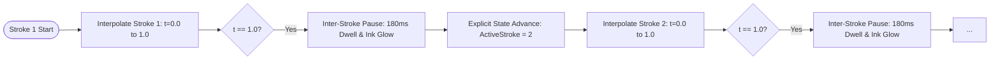
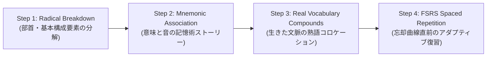
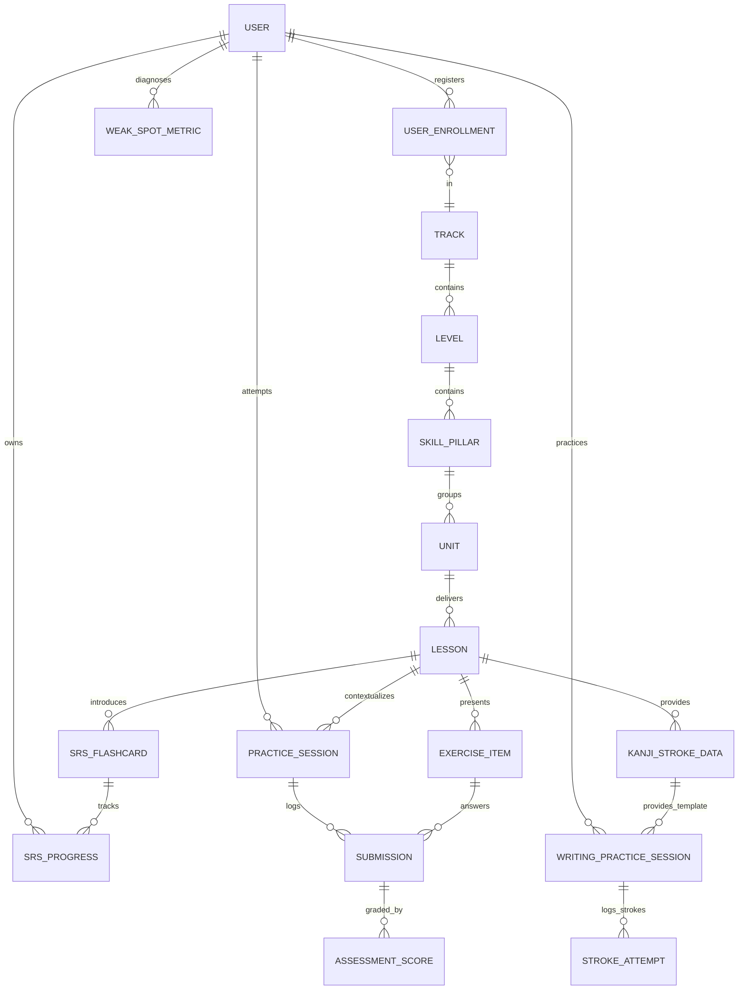

# DOMAIN BLUEPRINT: DUAL-TRACK LANGUAGE PROFICIENCY PLATFORM
## English (IELTS Academic & General) & Japanese (Kana Syllabary & JLPT N5–N1 Progression)

---

## 1. Executive Domain Summary & Architecture

This document establishes the authoritative domain blueprint for a high-stakes, production-grade language learning and test-preparation platform. The platform is architected around two rigorous international standardized assessment ecosystems:

1. **English Track**: The **International English Language Testing System (IELTS)** — covering both **Academic** and **General Training** modules across all 4 core language pillars (Listening, Reading, Writing, Speaking).
2. **Japanese Track**: The **Japanese-Language Proficiency Test (JLPT)** — targeting the intermediate-to-advanced progression ladder (**N3 $\rightarrow$ N2 $\rightarrow$ N1**) across Language Knowledge (Kanji, Vocabulary, Grammar), Reading Comprehension, and Listening Comprehension.

### Dual-Track Architectural Philosophy & Strict Track / Level Isolation
Unlike generic language apps that rely on trivial gamification or unstructured flashcard decks, this platform operates on an **outcome-driven competency model** with **uncompromising track and level isolation**:
* **Strict Track Isolation (Zero Cross-Track Pollution)**:
  * The Japanese Track (`ja_jlpt` / `ja_kana`) and English Track (`en_ielts`) are architecturally segregated at database, API, state management, and UI rendering layers.
  * Under no circumstances can a Japanese lesson, kanji character, or vocabulary item appear in an IELTS view, nor can IELTS reading passages or essays appear in a JLPT view.
  * Contextual query parameters (`trackId`) enforce strict SQL/ORM scoping (`WHERE track_id = ?`).
* **Strict Level Isolation (No Level Fallbacks)**:
  * Selecting a level (e.g., `N4`, `N3`, `N2`, `N1`) strictly queries and displays curriculum units, flashcards, kanji, and exercises authored specifically for that exact level.
  * The system strictly prohibits falling back to lower levels (e.g. falling back to N5 content when an N3 or N2 user opens curriculum or practice). If a level is chosen, the learner interacts with authentic, dedicated content for that level.
* **Equivalence & Alignment**: Every content item, exercise, scoring rule, and rubric strictly adheres to the official standards defined by the IELTS Partners (British Council, IDP, Cambridge Assessment English) and the Japan Foundation / Japan Educational Exchanges and Services (JEES).
* **Dual Mastery Engine**: Combines a modern **Spaced Repetition System (SRS)** (FSRS/SM-2 hybrid) for discrete lexical and grammatical acquisition with **Criterion-Referenced Rubric Evaluators** and **Item Response Simulation** for integrative productive tasks (Writing/Speaking) and receptive timed sections (Reading/Listening).
* **Continuous Diagnostics**: Converts every study session and test event into granular mastery metrics, projecting official band scores (0.0–9.0) and JLPT scaled scores (0–180) with sectional cutoff risk warnings.

---

## 2. Domain Standards & Taxonomy

### 2.1 English IELTS Framework

#### 2.1.1 Test Modules & Structure
IELTS is administered in two distinct test versions:
* **Academic**: Designed for university admissions, professional registration (medical, legal), and high-skilled migration. Emphasizes intellectual discourse, academic prose, data synthesis, and formal argumentation.
* **General Training**: Designed for immigration (e.g., Express Entry to Canada, Australia general migration) and secondary education/work experience. Emphasizes survival social English, workplace communications, and general interest texts.

| Skill Pillar | Module | Timing | Item Count | Structure & Content Characteristics |
| :--- | :--- | :--- | :--- | :--- |
| **Listening** | Shared (Academic & GT) | 30 min (+10 min transfer for paper, 2 min review for computer-delivered) | 40 items across 4 sections | **Section 1**: Everyday social dialogue (transactional, e.g., booking a venue).<br>**Section 2**: Everyday social monologue (e.g., local facility orientation).<br>**Section 3**: Academic/educational dialogue (up to 4 speakers, e.g., tutor and student).<br>**Section 4**: Academic monologue (university lecture). Audio played *once only*. |
| **Reading** | **Academic** | 60 minutes | 40 items across 3 sections | 3 long, complex academic texts (authentic extracts from books, journals, magazines, newspapers; descriptive, analytical, discursive; ~2,150–2,750 total words). |
| **Reading** | **General Training** | 60 minutes | 40 items across 3 sections | **Section 1**: 2–3 short factual texts (daily social survival).<br>**Section 2**: 2 factual workplace texts (staff training, contracts, facilities).<br>**Section 3**: 1 long, more complex general interest text. |
| **Writing** | **Academic** | 60 minutes | 2 tasks | **Task 1 (20 min, $\ge$150 words)**: Visual data report (graph, bar chart, pie chart, table, process diagram, or comparative map). Objective description; no personal opinion.<br>**Task 2 (40 min, $\ge$250 words)**: Formal discursive essay responding to a prompt (opinion, discussion, advantages/disadvantages, problem-solution, direct question). |
| **Writing** | **General Training** | 60 minutes | 2 tasks | **Task 1 (20 min, $\ge$150 words)**: Formal, semi-formal, or informal letter responding to a situation (explaining, requesting, complaining).<br>**Task 2 (40 min, $\ge$250 words)**: Discursive essay (similar structure to Academic Task 2, but prompts may touch more personal/practical angles). |
| **Speaking** | Shared (Academic & GT) | 11–14 minutes | 3 interactive parts | **Part 1 (4–5 min)**: Introduction & familiar topics (work, study, home, hobbies).<br>**Part 2 (3–4 min)**: Individual long turn (Cue card: 1 min preparation, 1–2 min monologue, 1–2 follow-up questions).<br>**Part 3 (4–5 min)**: In-depth abstract two-way discussion thematic to Part 2. |

#### 2.1.2 Official Band Descriptors & 4 Assessment Criteria
IELTS scores are reported on a 9-band scale in 0.5-band increments. Writing and Speaking are assessed across four equally weighted criteria (each scored 0–9):

##### Writing Assessment Criteria (Task 1 & Task 2)
1. **Task Achievement (TA - Task 1) / Task Response (TR - Task 2)**:
   * *Task 1*: Complete coverage of key features, accurate data synthesis, clear overview without irrelevant details.
   * *Task 2*: Clear position throughout, fully developed central ideas, addresses all parts of the prompt, supported arguments without overgeneralization.
2. **Coherence and Cohesion (CC)**:
   * Logical progression of ideas, clear paragraphing (one central topic per paragraph), varied and accurate cohesive devices without mechanical overuse or underuse, accurate referential pronouns.
3. **Lexical Resource (LR)**:
   * Breadth of vocabulary, precision in word choice, natural collocation, awareness of style and register, control of spelling and word formation, ability to paraphrase without distorting meaning.
4. **Grammatical Range and Accuracy (GRA)**:
   * Balance between simple and complex sentence structures, flexibility of clauses (relative, adverbial, conditional, passive), frequency of error-free sentences, accurate punctuation and tense consistency.

##### Speaking Assessment Criteria (Parts 1–3)
1. **Fluency and Coherence (FC)**:
   * Speech rate, rhythm, continuity, absence of hesitation/self-correction, use of discourse markers and connectives, logical topic development.
2. **Lexical Resource (LR)**:
   * Range of general and specialized vocabulary, idiom and colloquial awareness, circumlocution ability when struggling for words.
3. **Grammatical Range and Accuracy (GRA)**:
   * Variety of grammatical structures, frequency of error-free utterances, systematic vs non-systematic errors.
4. **Pronunciation (PR)**:
   * Intelligibility, control of phonological features: sentence stress, word stress, rhythm, chunking/pausing, intonation contours, and individual consonant/vowel accuracy.

#### 2.1.3 CEFR (Common European Framework of Reference) Mapping
* **Band 9.0**: Expert User $\rightarrow$ **C2** (Mastery)
* **Band 8.0 – 8.5**: Very Good User $\rightarrow$ **C1 / C2**
* **Band 7.0 – 7.5**: Good User $\rightarrow$ **C1** (Effective Operational Proficiency)
* **Band 6.0 – 6.5**: Competent User $\rightarrow$ **B2** (Vantage / Independent)
* **Band 5.0 – 5.5**: Modest User $\rightarrow$ **B1** (Threshold)
* **Band 4.0 – 4.5**: Limited User $\rightarrow$ **A2** (Waystage)
* **Band $\le$ 3.5**: Extremely Limited / Intermittent User $\rightarrow$ **A1 / Below**

---

### 2.2 Japanese JLPT Framework (N5 $\rightarrow$ N4 $\rightarrow$ N3 $\rightarrow$ N2 $\rightarrow$ N1)

The JLPT tests Japanese communicative, lexical, orthographic, and academic competence across 5 hierarchical levels. This platform provides full curriculum and pedagogical support across all five tiers, establishing a seamless learning corridor from foundational literacy (N5/N4) to upper-intermediate practical competence (N3) and advanced corporate/academic fluency (N2/N1).

#### 2.2.1 Level Profiles & Competency Definitions
* **N5 (Beginner / Elementary Literacy)**:
  * *Target*: Ability to comprehend foundational Japanese, including hiragana, katakana, and elementary daily kanji.
  * *Kanji*: ~100 kanji.
  * *Vocabulary*: ~800 words.
  * *Reading*: Ability to read and comprehend typical expressions, daily phrases, and basic sentences written in hiragana, katakana, and elementary kanji.
  * *Listening*: Ability to listen and comprehend short, spoken conversations about familiar daily topics and classroom interactions when spoken slowly and clearly.
* **N4 (Upper Elementary / Basic Everyday Fluency)**:
  * *Target*: Ability to understand basic Japanese used in daily life, routine personal activities, and familiar public contexts.
  * *Kanji*: ~300 kanji.
  * *Vocabulary*: ~1,500 words.
  * *Reading*: Ability to read and comprehend passages on familiar daily topics written in basic vocabulary and kanji, as well as notices, basic schedules, and everyday instructions.
  * *Listening*: Ability to comprehend everyday dialogues spoken at slightly slower than natural speed, grasping basic relational context and core action items.
* **N3 (Bridge to Intermediate)**:
  * *Target*: Ability to understand Japanese used in everyday situations to a certain degree.
  * *Kanji*: ~650 kanji.
  * *Vocabulary*: ~3,750 words.
  * *Reading*: Ability to read and understand passages on everyday topics, grasp headlines in newspapers, comprehend summary information.
  * *Listening*: Ability to listen and comprehend coherent conversations in everyday situations spoken at near-natural speed, following relationships and main ideas.
* **N2 (Business & Academic Fluency)**:
  * *Target*: Ability to understand Japanese used in everyday situations, and in a variety of circumstances to a certain degree. Prerequisite for Japanese corporate employment and most university admissions.
  * *Kanji*: ~1,000 kanji.
  * *Vocabulary*: ~6,000 words.
  * *Reading*: Ability to read articles, commentaries, and critiques in newspapers and magazines on general topics, comprehend narrative intent, logical structure, and underlying nuances.
  * *Listening*: Ability to comprehend oral reports, conversations, and news broadcasts spoken at natural speed in diverse situations.
* **N1 (Mastery & High Nuance)**:
  * *Target*: Ability to understand Japanese used in a variety of complex, abstract, and nuanced circumstances.
  * *Kanji*: ~2,136+ (full Jōyō Kanji inventory).
  * *Vocabulary*: ~10,000+ words.
  * *Reading*: Highly sophisticated academic prose, editorials, abstract essays, literary critiques; extracting implicit subtext, subtle tone, and rhetorical devices.
  * *Listening*: Lectures, debates, and complex business/political negotiations at natural or fast speed, grasping nuances, speaker stances, and implicit conclusions.

#### 2.2.2 Test Structure, Scoring Scale & Cutoffs
JLPT uses **Scaled Scoring** based on Item Response Theory (IRT) rather than raw points. Total points range from **0 to 180 points**.

To pass the JLPT, an examinee must satisfy **two independent conditions simultaneously**:
1. **Total Scaled Score** $\ge$ **Overall Pass Threshold**.
2. **Each Individual Sectional Score** $\ge$ **Sectional Cutoff Threshold**. Failure on even one section results in automatic test failure, regardless of total score.

##### Critical Scoring Structure Distinction: 2 Scored Sections (N5 & N4) vs 3 Scored Sections (N1–N3)
* **Foundational Corridor (N5 & N4)**: Official scoring combines Language Knowledge (Vocabulary/Grammar) and Reading into a single **0–120 point** scaled section. Sectional passing requires $\ge 38$ points out of 120 (31.7%). Listening is scored as an independent **0–60 point** section with a cutoff of $\ge 19$ points (31.7%).
* **Intermediate & Advanced Corridor (N1, N2, N3)**: Official scoring splits the test into three independent **0–60 point** sections: Language Knowledge, Reading, and Listening. Each section enforces an individual cutoff of $\ge 19$ points out of 60 (31.7%).

| Level | Test Section 1 (Timing) | Test Section 2 (Timing) | Test Section 3 (Timing) | Total Score | Total Pass Mark | Sectional Cutoff Thresholds |
| :--- | :--- | :--- | :--- | :--- | :--- | :--- |
| **N5** | **Language Knowledge (Vocab)** (20 min) | **Language Knowledge (Grammar) & Reading** (40 min) $\rightarrow$ *Combined scaled to 0–120* | **Listening** (30 min) $\rightarrow$ *Scaled to 0–60* | 180 pts | **80 / 180** (44.4%) | **Lang Knowledge / Reading: 38 / 120** (31.7%)<br>**Listening: 19 / 60** (31.7%) |
| **N4** | **Language Knowledge (Vocab)** (25 min) | **Language Knowledge (Grammar) & Reading** (55 min) $\rightarrow$ *Combined scaled to 0–120* | **Listening** (35 min) $\rightarrow$ *Scaled to 0–60* | 180 pts | **90 / 180** (50.0%) | **Lang Knowledge / Reading: 38 / 120** (31.7%)<br>**Listening: 19 / 60** (31.7%) |
| **N3** | **Language Knowledge (Kanji & Vocab)** (30 min) | **Language Knowledge (Grammar) & Reading** (70 min) $\rightarrow$ *Combined scaled to 0–60 for Vocab/Grammar, 0–60 for Reading* | **Listening** (40 min) $\rightarrow$ *Scaled to 0–60* | 180 pts | **95 / 180** (52.8%) | **Lang Knowledge: 19 / 60** (31.7%)<br>**Reading: 19 / 60** (31.7%)<br>**Listening: 19 / 60** (31.7%) |
| **N2** | **Language Knowledge (Kanji, Vocab, Grammar) & Reading** (105 min) $\rightarrow$ *Scored separately: Lang Knowledge 0–60, Reading 0–60* | — | **Listening** (50 min) $\rightarrow$ *Scaled to 0–60* | 180 pts | **90 / 180** (50.0%) | **Lang Knowledge: 19 / 60** (31.7%)<br>**Reading: 19 / 60** (31.7%)<br>**Listening: 19 / 60** (31.7%) |
| **N1** | **Language Knowledge (Kanji, Vocab, Grammar) & Reading** (110 min) $\rightarrow$ *Scored separately: Lang Knowledge 0–60, Reading 0–60* | — | **Listening** (55 min) $\rightarrow$ *Scaled to 0–60* | 180 pts | **100 / 180** (55.6%) | **Lang Knowledge: 19 / 60** (31.7%)<br>**Reading: 19 / 60** (31.7%)<br>**Listening: 19 / 60** (31.7%) |

#### 2.2.3 JLPT Item Types Breakdown
* **Language Knowledge (Vocabulary/Kanji)**:
  * *Kanji Reading (漢字読み)*: Select hiragana reading for underlined kanji compound.
  * *Orthography / Kanji Writing (表記)* (N3/N2): Select correct kanji for underlined hiragana.
  * *Word Formation (語形成)* (N2): Prefixes/suffixes (e.g., 最〜, 不〜, 〜感, 〜化).
  * *Contextually Defined Expressions (文脈規定)*: Choose best fit word in a sentence blank.
  * *Paraphrases / Synonyms (言い換え類義)*: Choose sentence closest in meaning.
  * *Usage (用法)*: Identify the sentence where a specified word is used grammatically and naturally.
* **Language Knowledge (Grammar)**:
  * *Grammar Form Selection (文法形式の判断)*: Clause connector or particle selection.
  * *Sentence Composition / Star Sentence (文の組み立て)*: Reorder 4 fragments; identify the item placed at the star $(\star)$ position.
  * *Text-Level Grammar (文章の文法)*: Cohesion and conjunctions in a continuous passage.
* **Reading Comprehension**:
  * *Short Passages (短文)* (~200 words, 1 question each).
  * *Medium Passages (中文)* (~500 words, 3 questions each).
  * *Long Passages (長文)* (~900–1000 words, 3–4 questions each).
  * *Integrated Comprehension / Dual Text (統合理解)* (N2/N1, comparison of two texts on one topic).
  * *Thematic / Editorial Assertion (主張理解)* (N1, grasping author’s philosophical stance).
  * *Information Retrieval (情報検索)* (Flyers, tables, official rules, notices).
* **Listening Comprehension**:
  * *Task-Based Comprehension (課題理解)*: What should the person do next?
  * *Key Point Comprehension (ポイント理解)*: Why did it happen?
  * *General Outline (概要理解)*: Monologue summary / topic identification.
  * *Quick Response (即時応答)*: Real-time turn-taking conversational reply.
  * *Integrated Comprehension (統合理解)* (N2/N1): Multi-person dialogue with synthesis task.

#### 2.2.4 Japanese Orthography, Stroke Order Standards (Hitsujun 筆順) & Stroke Topology

To achieve authentic, production-grade Japanese writing pedagogy, the platform implements strict compliance with the **Hitsujun (筆順)** orthographic standards established by the Japanese Ministry of Education (文部科学省 - MEXT) and codified in the *Hitsujun Shidō no Tebiki (筆順指導の手引)*. Correct stroke order is not merely calligraphic etiquette; it directly governs character balance (字形), aesthetic proportion, radical recognition, and stroke count verification in dictionary lookups.

##### 1. The 9 Core Hitsujun Principles (筆順の基本原則)
The stroke order verification engine validates learner input against nine deterministic topological rules:

1. **Top to Bottom (上から下へ)**:
   * Strokes placed in upper zones must precede lower zones.
   * *Canonical Examples*: `三` (upper horizontal $\rightarrow$ middle $\rightarrow$ lower), `言`, `高`.
2. **Left to Right (左から右へ)**:
   * Left-hand components (radicals/偏 - hen) are drawn prior to right-hand components (旁 - tsukuri).
   * *Canonical Examples*: `川` (left vertical $\rightarrow$ middle $\rightarrow$ right), `州`, `側`, `明` (日 $\rightarrow$ 月).
3. **Horizontal Before Vertical When Crossing (横先縦後)**:
   * When a horizontal stroke intersects a vertical stroke, the horizontal stroke is drawn first.
   * *Canonical Examples*: `十` (horizontal `一` $\rightarrow$ vertical `丨`), `井`, `支`.
   * *Special Exception*: Bottom baseline horizontal stroke that terminates/supports a piercing vertical is drawn last (e.g., `土`, `士`, `王`, `工`).
4. **Center Axis Before Flanking Wings (中先両側)**:
   * For bilaterally symmetrical structures where a strong center trunk exists, the center stroke is drawn first, followed by the left and right flanking elements.
   * *Canonical Examples*: `小` (center hook $\rightarrow$ left dot $\rightarrow$ right dot), `水` (center hook $\rightarrow$ left hook $\rightarrow$ right sweeping strokes), `当`, `糸`.
5. **Exterior Enclosure Before Interior Contents (外側先内側後)**:
   * Outer boundary or box framing strokes are initiated first to establish the character's bounding frame before filling inner radicals.
   * *Canonical Examples*: `国` (outer frame left vertical + top-right corner $\rightarrow$ `玉` $\rightarrow$ bottom close), `風`, `同`, `司`.
6. **Close Bottom Enclosure Last (底・閉じる線は最後)**:
   * In enclosed or three-sided box kanji (構え - kamae), the bottom horizontal baseline stroke is executed only after all interior content is completed.
   * *Canonical Examples*: `口` (left vertical $\rightarrow$ top-right bent stroke $\rightarrow$ bottom horizontal close), `日`, `田`, `目`, `四`.
7. **Piercing Through-Strokes Last (貫く線は最後)**:
   * A stroke that bisects, penetrates, or pierces through multiple previously drawn strokes is placed last.
   * *Canonical Examples*: `中` (box `口` completed $\rightarrow$ vertical piercing stroke last), `車` (horizontal and box elements $\rightarrow$ vertical bisecting spine last), `事`, `半`.
8. **Left-Falling Slant Precedes Right-Falling Slant (左払い先右払い後)**:
   * When diagonal slants cross or converge at an apex, the left-falling stroke (hidari-harai) is executed before the right-falling stroke (migi-harai).
   * *Canonical Examples*: `人` (left slant $\rightarrow$ right slant), `八`, `文`, `父`, `木`.
9. **Top/Inner Accent Dots First; Outer/Bottom Dots Last (点の位置順序)**:
   * Structural apex dots or internal dots are placed early (e.g., `犬` has radical dot last; `主` has top crown dot first; `寸` has interior dot last; `代` and `式` have upper-right floating dot last).

##### 2. Stroke Classification & Topology (The 6 Canonical Stroke Categories)
Every kanji stroke is mapped to one of six morphological stroke types, adapted from the classical *Eight Principles of Yong (永字八法 - Eiji Happō)*:

| Stroke Type | Japanese Nomenclature | Kanji / Radical Example | Direction Vector | Termination Dynamic | Geometric Criteria |
| :--- | :--- | :--- | :--- | :--- | :--- |
| **Horizontal** | 横画 (*yokogaku*) | `一` (ichi), top of `天` | Left $\rightarrow$ Right ($0^\circ$ to $+8^\circ$ upward tilt) | Stop (*tome*) with slight press | Straight trajectory, consistent stroke width, minimal y-variance. |
| **Vertical** | 縦画 (*tategaku*) | `丨`, spine of `十`, `中` | Top $\rightarrow$ Bottom ($85^\circ$ to $95^\circ$ downward) | Stop (*tome*) or Taper (*harai*) | Perpendicular spine, minimal x-variance, upright posture. |
| **Left-Falling** | 左払い (*hidari-harai*) / 撇 | `丿`, left of `人`, `八` | Top-Right $\rightarrow$ Bottom-Left ($\approx 210^\circ - 240^\circ$) | Gradual acceleration to thin feather taper | Curved concave path, smooth velocity increase, thinning end. |
| **Right-Falling** | 右払い (*migi-harai*) / 捺 | `乀`, right of `人`, `木` | Top-Left $\rightarrow$ Bottom-Right ($\approx 300^\circ - 330^\circ$) | Swell/press followed by horizontal release | Flat sweep, prominent weight inflection point, flat horizontal exit. |
| **Dot** | 点 (*ten*) | `丶`, apex of `立`, dots in `雨` | Short directional tap ($\approx 100^\circ - 315^\circ$) | Clean lift or short teardrop tail | Compact bounding box ($< 15\%$ canvas height), sharp entry point. |
| **Hook & Bent** | 跳ね (*hane*) / 折れ (*ore*) | `亅`, `乛`, `乙`, `マ` | Dual-vector: Primary line $\rightarrow$ Sharp vertex $\rightarrow$ Flick | Sudden direction deflection ($45^\circ - 120^\circ$) with tapered exit | Definite corner point ($p_{\text{vertex}}$), continuous single stroke, brisk lift. |

---

#### 2.2.5 Global Full-Application Furigana Engine (全画面ふりがな表示エンジン) & W3C Ruby Standards

To eliminate cognitive friction for non-native learners and address beginner literacy anxiety across the entire user journey, the platform provides a **Global Full-Application Furigana Engine**. Rather than confining reading aids to isolated curriculum cards, phonetic Hiragana subtext is an omnipresent, cross-cutting application capability.

##### 1. Primary Global Navigation Header Toggle Architecture
* **Top Navigation Bar Control**: The global application header (Navbar) hosts a persistent, high-visibility switch button:
  * Label: `ふりがな (Furigana / Hiragana Subtext): ON / OFF` (accompanied by calligraphic subtext glyph icon).
  * Scope: Universal across all top-level application screens, sub-views, and modals.
* **Persistent Client State & Storage**:
  * State key: `lingua_furigana_enabled` (boolean).
  * Storage: Persisted in browser `localStorage`.
  * Initial State: Defaults to `true` for all Japanese track learners (N5 through N2), preserving accessibility. Can be toggled at any moment with immediate reactive propagation.
* **DOM State Synchronization**:
  * The root HTML element dynamically reflects the global preference via attribute binding:
    ```html
    <html data-furigana="on" lang="ja"> <!-- or data-furigana="off" -->
    ```
  * Centralized React Context (`FuriganaContext` / custom hook `useFurigana()`) broadcasts changes across all mounted tree components with zero full-page reload.

##### 2. Comprehensive View-by-View Furigana Scaffolding Matrix
When `lingua_furigana_enabled = true`, phonetic Hiragana ruby annotations/subtext render cleanly above or alongside all Kanji ideograms across all 6 core functional modules:

| Platform Module | Route | Furigana Integration Scope & Typography Examples |
| :--- | :--- | :--- |
| **Dashboard / Study Hub** | `/dashboard` | • Target milestone badges: `<ruby>日本語<rt>にほんご</rt>能力<rt>のうりょく</rt>試験<rt>しけん</rt></ruby> N5`<br>• "Next Up" hero banner: `<ruby>次<rt>つぎ</rt></ruby>のおすすめステップ`<br>• Linear daily task cards: `<ruby>第<rt>だい</rt>2<ruby>段階<rt>だんかい</rt></ruby>: <ruby>基本<rt>きほん</rt>文型<rt>ぶんけい</rt></ruby>`<br>• Weak-spot radar labels: `<ruby>語彙<rt>ごい</rt></ruby>・<ruby>文字<rt>もじ</rt></ruby> (Vocabulary / Characters)` |
| **Track & Curriculum Navigator** | `/curriculum` | • 6-Stage Roadmap Stepper: `<ruby>文字<rt>もじ</rt></ruby>の<ruby>土台<rt>どだい</rt></ruby>`, `<ruby>動詞<rt>どうし</rt></ruby>と<ruby>格助詞<rt>かくじょし</rt></ruby>`<br>• Unit headers: `<ruby>初級<rt>しょきゅう</rt>文法<rt>ぶんぽう</rt></ruby> (Elementary Grammar)`<br>• Lesson items: `<ruby>指示代名詞<rt>しじだいめいし</rt></ruby> (Demonstratives: これ・それ・あれ)`<br>• Competency descriptors: `<ruby>自己紹介<rt>じこしょうかい</rt></ruby>ができる` |
| **Practice & Mock Exam Runner** | `/practice/:lessonId` | • Question stems: `<ruby>次<rt>つぎ</rt></ruby>の<ruby>文<rt>ぶん</rt></ruby>の★に<ruby>入<rt>はい</rt></ruby>るものはどれですか。`<br>• Star reordering tokens: `[1: <ruby>図書館<rt>としょかん</rt></ruby>で] [2: <ruby>本<rt>ほん</rt></ruby>を] [*: <ruby>借<rt>か</rt></ruby>りて] [4: <ruby>読<rt>よ</rt></ruby>みました]`<br>• Reading comprehension passages: Multi-paragraph texts rendered with line-height compensated ruby.<br>• Multiple-choice answer options: `<ruby>学生<rt>がくせい</rt></ruby>`, `<ruby>会社員<rt>かいしゃいん</rt></ruby>` |
| **Production Writing & Speaking Studio** | `/studio` | • Composition prompts: `<ruby>作文<rt>さくぶん</rt></ruby>テーマ: <ruby>留学生<rt>りゅうがくせい</rt></ruby>の<ruby>生活<rt>せいかつ</rt></ruby>`<br>• Genko yoshi formatting instructions: `<ruby>段落<rt>だんらく</rt></ruby>の<ruby>冒頭<rt>ぼうとう</rt></ruby>は1マス<ruby>空<rt>あ</rt></ruby>ける`<br>• Evaluation criteria labels: `<ruby>課題達成<rt>かだいたっせい</rt></ruby> (Task Fulfillment)`, `<ruby>言語資源<rt>げんごしげん</rt></ruby> (Lexical Resource)`<br>• Benchmark sample essays with full interactive furigana annotations. |
| **SRS Flashcard Reviewer** | `/srs/review` | • Front prompt: Target word or context cloze phrase.<br>• Back revelation: Phonetic reading in ruby + English definition + audio trigger.<br>• Example sentences: `<ruby>私<rt>わたし</rt></ruby>は<ruby>毎朝<rt>まいあさ</rt>新聞<rt>しんぶん</rt></ruby>を<ruby>読<rt>よ</rt></ruby>みます。` |
| **Handwriting & Kanji Studio** | `/kanji` | • Target ideogram reading banners: 音読み (`オン`) & 訓読み (`くん`)<br>• Radical breakdown names: `氵` = `<ruby>水<rt>みず</rt></ruby> (さんずい)`, `扌` = `<ruby>手<rt>て</rt></ruby> (てへん)`<br>• High-frequency vocabulary compounds: `<ruby>把握<rt>はあく</rt></ruby>`, `<ruby>握手<rt>あくしゅ</rt></ruby>`, `<ruby>水曜日<rt>すいようび</rt></ruby>` |

##### 3. W3C Semantic HTML5 Ruby Standards & Zero-Jank CSS Toggle Mechanics
* **Semantic HTML5 `<ruby>` Specification**:
  ```html
  <ruby>
    漢字<rp>(</rp><rt>かんじ</rt><rp>)</rp>
  </ruby>
  ```
  * `<ruby>`: Parent container grouping the ideogram and phonetic annotation.
  * `<rt>`: Ruby text element containing the Hiragana reading.
  * `<rp>`: Ruby parentheses providing backward fallback for legacy or plain-text parsers (e.g. screen readers).
* **Instantaneous Zero-Jank CSS Switching**:
  * Switching Furigana OFF requires zero DOM mutation or network roundtrips:
    ```css
    /* Instantaneous global furigana suppression */
    html[data-furigana="off"] rt,
    body[data-furigana="off"] rt {
      display: none !important;
    }
    
    /* Clean line-height balance when furigana is active */
    html[data-furigana="on"] ruby {
      display: inline-flex;
      flex-direction: column-reverse;
      vertical-align: bottom;
      line-height: 1.25;
    }
    
    html[data-furigana="on"] rt {
      font-size: 0.58em;
      line-height: 1.0;
      text-align: center;
      color: var(--color-text-secondary);
      user-select: none;
    }
    ```
* **Phonetic Alignment & Okurigana Exclusion Rules**:
  * **Mono-Ruby Alignment**: Where syllables cleanly segment, each kanji ideogram is paired directly to its own reading (e.g., `<ruby>短<rt>たん</rt>文<rt>ぶん</rt></ruby>`).
  * **Okurigana Separation**: Conjugated trailing kana is NEVER wrapped in ruby tags (e.g., `<ruby>食<rt>た</rt></ruby>べる`, never `<ruby>食べる<rt>たべる</rt></ruby>`).
  * **Authentic Adult Orthography**: When toggled OFF, ruby annotations vanish cleanly, allowing N2/N1 advanced learners to simulate official JLPT testing conditions where Furigana is prohibited on tested kanji.

---

## 3. Business Logic & Algorithms

### 3.1 SRS (Spaced Repetition System) Engine Formulation

The platform implements an enhanced **FSRS / SM-2 Adaptive Algorithm** tailored for language acquisition (kanji stroke/meaning/reading, vocabulary collocations, and grammar patterns).

#### 3.1.1 Card States & Lifecycle
A flashcard exists in one of four states:
1. `NEW`: Item never reviewed by the learner.
2. `LEARNING`: Item in short-term acquisition steps before entering mature intervals.
3. `REVIEW`: Item graduated to standard spaced repetition intervals.
4. `RELEARNING`: Item forgotten during review (rated `AGAIN`), recycled through learning steps.

#### 3.1.2 User Rating Scale
Learner selects one of four responses after card reveal:
* `1 = AGAIN` (Complete recall failure, blanked out or wrong).
* `2 = HARD` (Recalled with intense effort or hesitation).
* `3 = GOOD` (Recalled successfully with normal effort).
* `4 = EASY` (Instantaneous, effortless recall).

#### 3.1.3 Mathematical Formulation (Enhanced Algorithm)
For each SRS item, the engine tracks:
* $S$: Stability (predicted time in days for recall probability to decline from 100% to 90%).
* $D$: Difficulty (range $[1.0, 10.0]$, where 1.0 is trivial and 10.0 is hardest).
* $EF$: Ease Factor (legacy SM-2 compatibility, initialized at $2.5$, bounded $[1.3, 3.0]$).
* $R$: Repetition count (consecutive successful reviews).
* $I$: Current Interval (in days or minutes).
* $Laps$: Number of lapses (times rated `AGAIN` after graduating).

##### State Transitions & Interval Logic:

**1. Learning Phase (Steps: 1 min, 10 min):**
* Initial Step 0: User rates `AGAIN` $\rightarrow$ next review in $1\text{ min}$.
* Step 1: User rates `GOOD` $\rightarrow$ next review in $10\text{ min}$.
* Step 2: User rates `GOOD` $\rightarrow$ Graduates to `REVIEW` state with initial interval $I_1 = 1\text{ day}$.
* If rated `EASY` during Learning $\rightarrow$ Skips remaining steps, graduates immediately with $I_1 = 3\text{ days}$.

**2. Review Phase:**
When in `REVIEW`, for review $n$ with rating $q \in \{1, 2, 3, 4\}$:

* **If $q = 1$ (AGAIN):**
  $$\text{State} \leftarrow \text{RELEARNING}$$
  $$Laps \leftarrow Laps + 1$$
  $$R \leftarrow 0$$
  $$EF \leftarrow \max(1.3, EF - 0.20)$$
  $$I \leftarrow 1\text{ min (Learning step)}$$

* **If $q = 2$ (HARD):**
  $$EF \leftarrow \max(1.3, EF - 0.15)$$
  $$I_{n} \leftarrow \max(I_{n-1} + 1, \text{round}(I_{n-1} \times 1.20))$$
  $$R \leftarrow R + 1$$

* **If $q = 3$ (GOOD):**
  $$EF \leftarrow EF + (0.1 - (5 - q) \times (0.08 + (5 - q) \times 0.02)) \equiv EF$$
  $$\text{If } R = 0: I_1 = 1$$
  $$\text{If } R = 1: I_2 = 6$$
  $$\text{If } R \ge 2: I_n = \text{round}(I_{n-1} \times EF)$$
  $$R \leftarrow R + 1$$

* **If $q = 4$ (EASY):**
  $$EF \leftarrow \min(3.0, EF + 0.15)$$
  $$\text{If } R = 0: I_1 = 3$$
  $$\text{If } R = 1: I_2 = 10$$
  $$\text{If } R \ge 2: I_n = \text{round}(I_{n-1} \times EF \times 1.30)$$
  $$R \leftarrow R + 1$$

* **Fuzz Factor**: To prevent card clustering, apply a random variance $I_{\text{fuzzed}} = \text{round}(I \times (1 + \text{Uniform}(-0.05, 0.05)))$ for $I \ge 5\text{ days}$.

* **Retrievability Formula**:
  $$R(t) = \exp\left( - \frac{\ln(0.9) \times t}{S} \right)$$
  Where $t$ is days elapsed since last review. Cards with $R(t) < 0.90$ are flagged as overdue.

---

### 3.2 IELTS Scoring Algorithms

#### 3.2.1 Receptive Skills (Listening & Reading) Raw-to-Band Mapping
Each Listening and Reading test consists of exactly 40 questions. Each correct answer carries 1 mark. Raw marks are converted to Band Scores according to the standard non-linear conversion matrix:

```
+-----------+----------------+---------------------+--------------------+
| Band      | Listening      | Academic Reading    | GT Reading         |
| Score     | Raw Score (/40)| Raw Score (/40)     | Raw Score (/40)    |
+-----------+----------------+---------------------+--------------------+
| 9.0       | 39 - 40        | 39 - 40             | 40                 |
| 8.5       | 37 - 38        | 37 - 38             | 39                 |
| 8.0       | 35 - 36        | 35 - 36             | 37 - 38            |
| 7.5       | 32 - 34        | 33 - 34             | 36                 |
| 7.0       | 30 - 31        | 30 - 32             | 34 - 35            |
| 6.5       | 26 - 29        | 27 - 29             | 32 - 33            |
| 6.0       | 23 - 25        | 23 - 26             | 30 - 31            |
| 5.5       | 18 - 22        | 19 - 22             | 27 - 29            |
| 5.0       | 16 - 17        | 15 - 18             | 23 - 26            |
| 4.5       | 13 - 15        | 13 - 14             | 19 - 22            |
| 4.0       | 10 - 12        | 10 - 12             | 15 - 18            |
| 3.5       | 8 - 9          | 8 - 9               | 12 - 14            |
| <= 3.0    | 0 - 7          | 0 - 7               | 0 - 11             |
+-----------+----------------+---------------------+--------------------+
```

#### 3.2.2 Productive Skills (Writing & Speaking) Rubric Aggregation
1. **Writing Sectional Score**:
   * Evaluator / Rubric engine assigns 4 integers or half-bands $(0.0 - 9.0)$ for each criterion:
     * $T_1 = \frac{TA + CC + LR + GRA}{4}$
     * $T_2 = \frac{TR + CC + LR + GRA}{4}$
   * Task 2 carries **twice the weight** of Task 1 in official scoring:
     $$\text{Writing Raw} = \frac{T_1 + (2 \times T_2)}{3}$$
   * The final Writing Band is rounded to the nearest half-band using standard IELTS rounding.

2. **Speaking Sectional Score**:
   * Evaluator assigns 4 criteria scores: Fluency & Coherence ($FC$), Lexical Resource ($LR$), Grammatical Range & Accuracy ($GRA$), Pronunciation ($PR$).
   $$\text{Speaking Raw} = \frac{FC + LR + GRA + PR}{4}$$
   * Rounded to nearest half-band.

#### 3.2.3 Overall Band Score Rounding Rules (The Official 0.25 / 0.75 Rule)
Let $S_{\text{avg}} = \frac{\text{Listening} + \text{Reading} + \text{Writing} + \text{Speaking}}{4}$.
The overall band score is calculated by the following mathematical rounding logic:
* Fractional remainder $r = S_{\text{avg}} - \lfloor S_{\text{avg}} \rfloor$:
  * If $r < 0.25 \implies \text{Overall} = \lfloor S_{\text{avg}} \rfloor$
  * If $0.25 \le r < 0.75 \implies \text{Overall} = \lfloor S_{\text{avg}} \rfloor + 0.5$
  * If $r \ge 0.75 \implies \text{Overall} = \lceil S_{\text{avg}} \rceil$

*Examples*:
* Listening 6.5, Reading 6.5, Writing 6.0, Speaking 6.0 $\rightarrow$ Avg 6.25 $\rightarrow$ **Overall Band 6.5**.
* Listening 7.0, Reading 8.0, Writing 7.0, Speaking 6.5 $\rightarrow$ Avg 7.125 $\rightarrow$ **Overall Band 7.0** ($0.125 < 0.25$).
* Listening 7.5, Reading 8.0, Writing 7.5, Speaking 8.0 $\rightarrow$ Avg 7.75 $\rightarrow$ **Overall Band 8.0** ($0.75 \ge 0.75$).

---

#### 3.2.4 Japanese Composition & Essay Rubric Engine (Sakubun / Ronsetsu N5–N1)

While the official multiple-choice JLPT exam evaluates receptive language knowledge and reading, elite professional fluency requires productive writing competence (*Sakubun* 作文 and *Shoronbun* 小論文). The platform provides a dedicated Japanese Writing Studio with level-calibrated composition tasks and a 4-criterion diagnostic evaluation rubric:

##### 1. The 4 Japanese Writing Diagnostic Assessment Criteria (Each Scored 0–100 or 1.0–5.0)
1. **Task Fulfillment & Logical Development (課題達成・論理展開 - TL)**:
   * Addresses all prompt directives, maintains a consistent thesis/theme, presents clear arguments with supporting evidence, and adheres to the specified target character length ($\pm 10\%$).
2. **Grammar & Sentence Complexity (文法・文構造の正確性と多様性 - GRA)**:
   * Syntactic accuracy of verb/adjective inflections, particle usage (`は`/`が`, `に`/`で`, `を`), subordinate clause subordination, and mastery of level-appropriate grammar patterns without ungrammatical drift.
3. **Orthography, Register & Keigo (表記・文体・待遇表現 - ORK)**:
   * Consistency in stylistic register: strict separation of polite register (*Desu/Masu* です・ます) for N5/N4 daily correspondence vs formal written expository register (*Da/Dearu* だ・である) for N3–N1 argumentative essays.
   * Accurate kanji orthography (kanji compound usage vs unnecessary hiragana phonetic spelling), appropriate furigana, punctuation (`、` and `。`), and genko yoshi formatting.
4. **Lexical Richness & Natural Collocation (語彙・連語の自然さ - LR)**:
   * Breadth of vocabulary, authentic Japanese collocations (*Kanyōku* 慣用句, compound verbs, four-character idioms *Yojijukugo* 四字熟語 for N1/N2), and avoidance of unnatural direct-translation loan phrasing.

##### 2. Character Length Boundaries & Target Registers Across Tiers
* **N5**: 150–250 characters (`です・ます体` Polite Copula). Simple daily themes: self-introduction, daily routine, favorite places.
* **N4**: 250–350 characters (`です・ます体` / `だ・である体` mixed guided). Personal experiences, requests, travel plans, favor exchange (*Te-morau/kureru*).
* **N3**: 400–500 characters (`だ・である体` Written Expository). Structured opinion essay: thesis $
ightarrow$ reason $
ightarrow$ counter-perspective $
ightarrow$ conclusion.
* **N2**: 500–650 characters (`だ・である体` Formal Analytical). Short thesis (*Shoronbun*): pros/cons debate on social phenomena, business decisions, technology adoption.
* **N1**: 700–900 characters (`だ・である体` Academic/Philosophical). Editorial critique: abstract conceptual argumentation, linguistic nuance, cultural critique with formal rhetoric.

---

### 3.3 JLPT Scaled Scoring & Pass/Fail Determination Logic

#### 3.3.1 IRT Scaled Score Simulation
In official JLPT administration, raw scores are converted to a 0–60 scale per section using a 2-parameter/3-parameter logistic Item Response Theory model so that scores are independent of exam difficulty.
In this platform, mock test items are calibrated with item discrimination $a_i$ and item difficulty $b_i$:
$$P_i(\theta) = \frac{1}{1 + e^{-a_i (\theta - b_i)}}$$
Where $\theta$ is learner latent proficiency. Scaled score per section $S_{\text{sec}}$ is projected:
$$S_{\text{sec}} = \text{clamp}\left( 60 \times \frac{1}{1 + e^{-1.7 \times (\theta_{\text{est}} - \mu_{\text{level}})}}, 0, 60 \right)$$
For standard exercises, a calibrated lookup function converts the raw question percentage $p_{\text{raw}}$:
$$S_{\text{sec}} = \text{round}(60 \times (0.15 + 0.85 \times p_{\text{raw}})) \quad \text{for } p_{\text{raw}} > 0, \quad S_{\text{sec}} = 0 \text{ if } p_{\text{raw}} = 0$$

#### 3.3.2 Pass/Fail Evaluator Function
```python
def evaluate_jlpt_result(level: str, scores: dict[str, float]) -> dict:
    """
    Evaluates JLPT result against official JEES/Japan Foundation scoring rules.
    Supports N1, N2, N3 (3 independent sections) and N4, N5 (2 combined sections).

    For N1, N2, N3:
      scores = {
        'language_knowledge': float (0-60),
        'reading': float (0-60),
        'listening': float (0-60)
      }
    For N4, N5:
      scores can be supplied either as combined:
        'language_knowledge_reading': float (0-120),
        'listening': float (0-60)
      or with separate sub-scores (which are automatically summed):
        'language_knowledge': float (0-60),
        'reading': float (0-60),
        'listening': float (0-60)
    """
    THRESHOLDS = {
        'N1': {'total_pass': 100, 'sections': {'language_knowledge': 19, 'reading': 19, 'listening': 19}},
        'N2': {'total_pass': 90,  'sections': {'language_knowledge': 19, 'reading': 19, 'listening': 19}},
        'N3': {'total_pass': 95,  'sections': {'language_knowledge': 19, 'reading': 19, 'listening': 19}},
        'N4': {'total_pass': 90,  'sections': {'language_knowledge_reading': 38, 'listening': 19}},
        'N5': {'total_pass': 80,  'sections': {'language_knowledge_reading': 38, 'listening': 19}},
    }
    
    if level not in THRESHOLDS:
        raise ValueError(f"Unsupported JLPT level: {level}")
        
    cfg = THRESHOLDS[level]
    sectional_failures = []
    normalized_sectional_scores = {}
    
    if level in ['N4', 'N5']:
        # Combine Language Knowledge and Reading into single 0-120 section
        if 'language_knowledge_reading' in scores:
            s_lkr = float(scores['language_knowledge_reading'])
        else:
            s_lkr = float(scores.get('language_knowledge', 0.0)) + float(scores.get('reading', 0.0))
        s_ls = float(scores['listening'])
        
        normalized_sectional_scores['language_knowledge_reading'] = s_lkr
        normalized_sectional_scores['listening'] = s_ls
        total_score = s_lkr + s_ls
        
        if s_lkr < cfg['sections']['language_knowledge_reading']:
            sectional_failures.append(('Language Knowledge & Reading', s_lkr, cfg['sections']['language_knowledge_reading']))
        if s_ls < cfg['sections']['listening']:
            sectional_failures.append(('Listening Comprehension', s_ls, cfg['sections']['listening']))
    else:
        # N1, N2, N3: 3 distinct 0-60 sections
        s_lk = float(scores['language_knowledge'])
        s_rd = float(scores['reading'])
        s_ls = float(scores['listening'])
        
        normalized_sectional_scores['language_knowledge'] = s_lk
        normalized_sectional_scores['reading'] = s_rd
        normalized_sectional_scores['listening'] = s_ls
        total_score = s_lk + s_rd + s_ls
        
        if s_lk < cfg['sections']['language_knowledge']:
            sectional_failures.append(('Language Knowledge', s_lk, cfg['sections']['language_knowledge']))
        if s_rd < cfg['sections']['reading']:
            sectional_failures.append(('Reading Comprehension', s_rd, cfg['sections']['reading']))
        if s_ls < cfg['sections']['listening']:
            sectional_failures.append(('Listening Comprehension', s_ls, cfg['sections']['listening']))
            
    has_total_passed = total_score >= cfg['total_pass']
    has_sectional_passed = len(sectional_failures) == 0
    passed = has_total_passed and has_sectional_passed
    
    status_reason = "PASSED" if passed else (
        "FAILED_SECTIONAL_CUTOFF" if has_total_passed and not has_sectional_passed else
        "FAILED_TOTAL_SCORE" if not has_total_passed and has_sectional_passed else
        "FAILED_BOTH"
    )
    
    return {
        'level': level,
        'total_score': round(total_score, 1),
        'passing_score_required': cfg['total_pass'],
        'sectional_scores': normalized_sectional_scores,
        'passed': passed,
        'status_reason': status_reason,
        'sectional_failures': sectional_failures,
        'margin_to_pass': max(0.0, round(cfg['total_pass'] - total_score, 1))
    }
```

---

### 3.4 Weak-Spot Diagnosis & Mastery Index Calculation

#### 3.4.1 Sub-Skill Competency Tree
Each exercise item is tagged with a fine-grained taxonomy tag:
* **IELTS Tags**:
  * `IELTS:L:DETAIL` (Listening detail identification, dates, numbers)
  * `IELTS:L:MULTISPEAKER` (Listening multi-speaker perspective tracking)
  * `IELTS:R:TFNG` (Reading True/False/Not Given verification)
  * `IELTS:R:HEADINGS` (Reading Paragraph Heading matching)
  * `IELTS:R:INFERENCE` (Reading Author tone and implicit claim)
  * `IELTS:W:COHESION` (Writing cohesive devices and referencing)
  * `IELTS:W:TASK1_OVERVIEW` (Writing Task 1 key feature overview)
  * `IELTS:S:FLUENCY_HESITATION` (Speaking filler words and pauses)
* **JLPT Tags**:
  * `JLPT:KANJI:ONYOMI_CONFUSION` (Similar on-yomi differentiation)
  * `JLPT:VOCAB:COLLOCATION` (Verb-noun specific collocations e.g., 責任を負う)
  * `JLPT:GRAMMAR:STAR_ORDER` (Sentence restructuring star items)
  * `JLPT:READING:EDITORIAL_INTENT` (Extracting author's main assertion)
  * `JLPT:LISTENING:TASK_NEXT` (Determining immediate next action)

#### 3.4.2 Mastery Index Formula
For any skill node $k$, the **Mastery Index** $M_k \in [0.0, 1.0]$ is computed using an exponentially decaying weighted accuracy combined with SRS card stability:
$$M_k = w_{\text{practice}} \times \left( \sum_{j=1}^{N} \lambda^{(t_{\text{now}} - t_j)} \cdot c_j \Bigg/ \sum_{j=1}^{N} \lambda^{(t_{\text{now}} - t_j)} \right) + w_{\text{srs}} \times \bar{R}_k$$
Where:
* $c_j \in \{0, 1\}$ is item correctness on attempt $j$.
* $\lambda = 0.95^{\Delta \text{days}}$ is the time-decay factor (recency weight).
* $\bar{R}_k$ is the average estimated retrievability of SRS cards tagged with node $k$.
* $w_{\text{practice}} = 0.60$, $w_{\text{srs}} = 0.40$.

**Weak Spot Trigger**: Any node with $M_k < 0.65$ after at least 8 attempts is flagged as a **Critical Weak Spot**, triggering targeted micro-drills in the daily study recommendations.

---

### 3.5 Real-Time Kanji Stroke Verification & Handwriting Recognition Algorithm

The platform features an in-browser, high-precision vector verification engine for handwritten Japanese kanji and kana. Unlike crude OCR/image classifiers that only examine the final static image bitmap (which cannot detect whether a character was written in the proper order or backwards), our engine monitors the **temporal vector trajectory** $(x, y, t)$ of every single stroke in real-time at 60 FPS on the canvas.

```
+---------------------------------------------------------------------------------------------------+
|                                 TEMPORAL STROKE VERIFICATION PIPELINE                             |
|                                                                                                   |
|  [Stylus/Touch Input]                                                                             |
|         |                                                                                         |
|         v                                                                                         |
|  1. Stream Sampling & Smoothing  -->  Raw P = {(x_0, y_0, t_0), ... (x_m, y_m, t_m)}             |
|         |                                                                                         |
|         v                                                                                         |
|  2. Spatial Normalization         -->  Transform to canonical [0, 1000] x [0, 1000] canvas         |
|         |                                                                                         |
|         v                                                                                         |
|  3. Equidistant Resampling        -->  Interpolate into N = 64 uniform points Q = {q_0 ... q_63}  |
|         |                                                                                         |
|         v                                                                                         |
|  4. Topological & Vector Match    -->  Evaluate Start/End Proximity, Tangent Angle, DTW Distance  |
|         |                                                                                         |
|         +---> Reversed Direction?  --> [Alert: Reverse Direction] (Draw start -> end)            |
|         +---> Out-of-Order Stroke? --> [Alert: Wrong Sequence] (Shows expected stroke ghost)     |
|         +---> Shape Deviation?     --> [Alert: Shape Error] (Try again with guidance)             |
|         +---> Valid Target Stroke  --> [ACCEPTED: Snap Ink, Trigger Chime, Advance Index i++]    |
+---------------------------------------------------------------------------------------------------+
```

#### 3.5.1 Mathematical Trajectory Preprocessing & Normalization

##### 1. Coordinate Normalization
User input captured on an arbitrary screen canvas of dimensions $W_{\text{canvas}} \times H_{\text{canvas}}$ is mapped into a canonical square coordinate space $[0, 1000] \times [0, 1000]$ with aspect-ratio preservation and padding:
$$x_{\text{canon}} = \frac{x_{\text{raw}} - x_{\text{offset}}}{\text{scale}} \times 1000, \quad y_{\text{canon}} = \frac{y_{\text{raw}} - y_{\text{offset}}}{\text{scale}} \times 1000$$
where $\text{scale} = \max(W_{\text{canvas}}, H_{\text{canvas}})$.

##### 2. Arc-Length Spatial Resampling
Human writing speeds vary widely. To establish scale- and speed-invariant comparison, raw point sequences are resampled into exactly $N = 64$ equidistant points along cumulative path length:
$$L = \sum_{k=1}^{m} \| p_k - p_{k-1} \|_2$$
The step interval is $\Delta \ell = \frac{L}{N - 1}$. New points $Q = \{q_0, q_1, \dots, q_{N-1}\}$ are interpolated along original segments so that $\| q_k - q_{k-1} \|_2 = \Delta \ell$.

#### 3.5.2 Multi-Factor Real-Time Stroke Validation Engine

For each drawn stroke candidate $Q = \{q_0, \dots, q_{N-1}\}$ and target reference stroke $\hat{S} = \{\hat{s}_0, \dots, \hat{s}_{N-1}\}$:

##### 1. Endpoint Tolerance Gate (Start & End Anchors)
Japanese calligraphy strictly enforces specific landing and lifting positions:
$$D_{\text{start}} = \| q_0 - \hat{s}_0 \|_2, \quad D_{\text{end}} = \| q_{N-1} - \hat{s}_{N-1} \|_2$$
* **Threshold**: Must satisfy $D_{\text{start}} \le \tau_{\text{point}}$ and $D_{\text{end}} \le \tau_{\text{point}}$ (default $\tau_{\text{point}} = 90$ units in $1000\times1000$ space, relaxing to $120$ for complex cursive strokes).

##### 2. Direction & Tangent Vector Alignment
To verify whether the stroke flows in the authentic direction (e.g. left-to-right, not right-to-left):
* Let $\mathbf{v}_k = q_{k+1} - q_k$ and $\hat{\mathbf{v}}_k = \hat{s}_{k+1} - \hat{s}_k$ be local tangent direction vectors.
* The local angular error at point $k$ is:
  $$\theta_k = \arccos\left( \frac{\mathbf{v}_k \cdot \hat{\mathbf{v}}_k}{\|\mathbf{v}_k\| \|\hat{\mathbf{v}}_k\| + \epsilon} \right)$$
* The mean trajectory angular deviation is:
  $$\bar{\theta}_{\text{diff}} = \frac{1}{N-1} \sum_{k=0}^{N-2} \theta_k$$
* **Reversal Detection**: If $\bar{\theta}_{\text{diff}} > 135^\circ$ (or if $\cos(\theta_{\text{start-to-end}}) < -0.5$), the system immediately flags:
  $$\text{Status} = \mathbf{REVERSED\_DIRECTION}$$
  *Guidance message*: *"Stroke drawn backwards! In Japanese hitsujun, this stroke must flow from start to finish."*

##### 3. Dynamic Time Warping (DTW) & Fréchet Curvature Distance
To evaluate geometric curvature (e.g. hooks, bends, sweeps) without penalizing subtle hand tremors, DTW finds the optimal non-linear warping alignment:
$$D_{\text{DTW}}(Q, \hat{S}) = \min_{\pi} \left[ \sum_{(i,j) \in \pi} \| q_i - \hat{s}_j \|_2 \right]$$
The normalized geometric similarity score $\text{Sim}_{\text{geom}} \in [0.0, 1.0]$ is:
$$\text{Sim}_{\text{geom}}(Q, \hat{S}) = \exp\left( - \frac{D_{\text{DTW}}(Q, \hat{S})}{2 \sigma_{\text{dtw}}^2} \right)$$
where default bandwidth $\sigma_{\text{dtw}} = 140.0$.

#### 3.5.3 Step-by-Step Sequence Verification State Machine

Let a Kanji character consist of $M$ ordered target strokes $(\hat{s}_1, \hat{s}_2, \dots, \hat{s}_M)$.
The user is currently expected to draw stroke $i \in \{1, \dots, M\}$.

When the user lifts the stylus (`pointerup` / `touchend`), candidate stroke $U$ is evaluated:

1. **Check Against Target Stroke $i$**:
   * If endpoints, angle, and DTW satisfy tolerances:
     $$\text{Result} = \mathbf{CORRECT\_STROKE} \implies \text{Advance } i \leftarrow i + 1$$
     *Feedback*: Green/gold ink snap, pleasant subtle audio chime, update progress badge to `Stroke i of M`.
2. **Check Against Reverse of Target Stroke $i$**:
   * If inverted candidate $U^{\text{rev}}$ matches $\hat{s}_i$:
     $$\text{Result} = \mathbf{REVERSED\_DIRECTION}$$
     *Feedback*: Amber flash, animated arrow illustrating proper starting point and direction. Stroke rejected.
3. **Check Against Out-of-Order Future Strokes**:
   * If $U$ matches any future stroke $\hat{s}_j$ where $j > i$:
     $$\text{Result} = \mathbf{WRONG\_ORDER\_EARLY}$$
     *Feedback*: Red pulse, message: *"Out of Order: You drew Stroke j ahead of time! Standard Hitsujun requires Stroke i next."* System pulses a subtle ghost overlay of stroke $i$. Stroke rejected.
4. **Check Against Previously Completed Strokes**:
   * If $U$ matches a stroke $\hat{s}_k$ where $k < i$:
     $$\text{Result} = \mathbf{DUPLICATE\_REDUNDANT}$$
     *Feedback*: *"Stroke already completed. Proceed with Stroke i."* Stroke rejected.
5. **Shape / Topological Mismatch**:
   * If $U$ does not match any recognized stroke:
     $$\text{Result} = \mathbf{SHAPE\_MISMATCH}$$
     *Feedback*: *"Stroke shape or position unrecognized. Check grid guides and try again."*

#### 3.5.4 Overall Character Accuracy & Scoring Formula

Upon completing all $M$ strokes of a character, the system computes the aggregate character mastery score $S_{\text{char}} \in [0.0, 100.0\%]$:

$$S_{\text{char}} = w_{\text{order}} \times \text{Score}_{\text{hitsujun}} + w_{\text{geom}} \times \text{Score}_{\text{geometry}}$$

Where:
* $w_{\text{order}} = 0.40$ (Hitsujun sequence discipline)
* $w_{\text{geom}} = 0.60$ (Aesthetic and geometric stroke fidelity)
* **Stroke Order Score**:
  $$\text{Score}_{\text{hitsujun}} = \max\left( 0.0, \, 100.0 - 20.0 \times N_{\text{order\_violations}} - 15.0 \times N_{\text{reversals}} \right)$$
* **Stroke Geometry Score**:
  $$\text{Score}_{\text{geometry}} = \frac{100.0}{M} \sum_{k=1}^{M} \text{Sim}_{\text{geom}}(U_k, \hat{s}_k)$$

##### Mastery Tier Badges
* **$S_{\text{char}} \ge 90\%$**: **"達人 (Master / Gold)"** $\rightarrow$ Rated as `EASY` in SRS repetition schedule.
* **$75\% \le S_{\text{char}} < 90\%$**: **"合格 (Proficient / Green)"** $\rightarrow$ Rated as `GOOD` in SRS repetition schedule.
* **$60\% \le S_{\text{char}} < 75\%$**: **"要復習 (Needs Practice / Amber)"** $\rightarrow$ Rated as `HARD`.
* **$S_{\text{char}} < 60\%$**: **"不合格 (Unsuccessful / Red)"** $\rightarrow$ Rated as `AGAIN`, resets interval.

---


#### 3.5.5 Smooth Stroke Demonstration Architecture (No-Skip Animation Pipeline)

To guarantee that demonstration animations never jump, skip from stroke 1 to 2, or clip during playback, the animation pipeline implements a **Deterministic Micro-Step Interpolation State Machine**:



##### 1. Mathematical Path Interpolation & Micro-Step Continuity
* Each stroke $\hat{S}_i$ is represented as a parametric Bezier / polyline spline $C_i(u)$ where $u \in [0.0, 1.0]$.
* Frame rendering runs locked to `requestAnimationFrame` with high-resolution delta timing ($\Delta t = t_{	ext{now}} - t_{	ext{prev}}$).
* The normalized stroke completion parameter $u$ advances monotonically:
  $$u(t + \Delta t) = u(t) + rac{\Delta t}{T_{	ext{stroke}}}$$
  where base stroke duration $T_{	ext{stroke}} = 	ext{clamp}(450 	ext{ms} 	imes rac{L_i}{500}, 300	ext{ms}, 800	ext{ms})$ scaled by speed multiplier ($0.5	imes, 1.0	imes, 2.0	imes$).
* **No-Skip Clamping Guarantee**: $u$ is clamped strictly to $[0.0, 1.0]$. The renderer *must* draw the final point $C_i(1.0)$ with end-taper/stop before transitioning.

##### 2. Guaranteed Inter-Stroke Dwell Phase (180ms)
* Between stroke $i$ and stroke $i+1$, the engine forces an asynchronous dwell phase of $T_{	ext{dwell}} = 180	ext{ms}$.
* During the dwell phase:
  * Stroke $i$ is fully committed into the background accumulated SVG/canvas layer.
  * A subtle golden beacon / halo pulse highlights the upcoming anchor $(x, y)$ of Stroke $i+1$.
  * State transition event `STROKE_DEMO_COMPLETED(strokeIndex: i)` fires, guaranteeing UI counters update to `Stroke i of M` synchronously before stroke $i+1$ begins.
* **Frame Drop Resilience**: If browser frame rates dip, the clock-based step-size advances proportionally, but transitions *never bypass* the dwell check or skip stroke indexes.

### 3.6 The 4-Step Kanji Mastery Formula Architecture (4段階漢字習得メソッド)

Rote memorization of thousands of arbitrary stroke sequences inevitably triggers rapid forgetting curves and cognitive exhaustion. To solve this pedagogical bottleneck, LinguaMastery formalizes the **4-Step Kanji Mastery Formula**, a structured neurological pipeline transforming complex ideograms into interconnected conceptual networks:



#### Step 1: Radical Breakdown (部首・基本構成要素の分解)
* **Principle**: Minimize working-memory cognitive load by decomposing every kanji into its constituent semantic primitives, Kangxi radicals (214部首), and phonetic components rather than individual unconnected strokes.
* **Structural Topology**: Identifies the primary radical (Hen 偏, Tsukuri 旁, Kanmuri 冠, Ashi 脚, Tare 垂, Nyou 繞, Kamae 構) and secondary phonetic/semantic elements (e.g., `握` $
ightarrow$ Left: Hand `扌` [3 strokes] + Right Upper: Flag/Corpse `尸` [3 strokes] + Right Lower: Arrival `至` [6 strokes]).

#### Step 2: Mnemonic Association (意味と音の記憶術ストーリー)
* **Principle**: Establish dual semantic and phonetic associative anchors in episodic memory.
* **Meaning Story**: Vivid visual narrative connecting the constituent radicals to the core English gloss (e.g., for `休` [Person `亻` + Tree `木`]: *"A weary traveler leans against a shady tree to rest."*).
* **Reading Mnemonic (On/Kun)**: Auditory-phonetic narrative linking the On'yomi sound to the image (e.g., for `館` [Kan]: *"The GRAND HOTEL (館) is so massive you CAN (カン) see it from miles away."*).

#### Step 3: Real Vocabulary Compounds (生きた文脈の熟語コロケーション)
* **Principle**: Kanji are never learned as isolated graphemes or detached character lists. True acquisition occurs through high-frequency, natural Japanese *Jukugo* (熟語) compounds and authentic sentence collocations.
* **Contextual Anchor Sets**: Each kanji is immediately tethered to 2–4 practical, level-appropriate compound words:
  * Primary On-yomi compound (e.g., `対` $
ightarrow$ `対象` *taishō* [target/subject]).
  * Contrastive or Kun-yomi collocation (e.g., `対比` *taihi* [contrast] / `向かい合う` *mukaiau*).

#### Step 4: FSRS Spaced Repetition Integration (FSRS同期・適正インターバル配信)
* **Principle**: Automate memory consolidation right before synaptic decay occurs.
* **Direct Deck Pipeline**: Upon completing Steps 1–3 and validating interactive handwriting, the character and its core compounds are automatically provisioned as active SRS cards in the user's `ja_jlpt` review queue.
* **Adaptive Interval Pacing**:
  * **Sustainable Habit Mode**: 3 to 6 new kanji per day (~15–20 min study time). Designed for steady long-term retention with zero review backlog panic.
  * **Accelerated Recognition Mode**: 10 to 25 new kanji per day (~45–60 min study time). Designed for intensive JLPT exam preparation sprints.

---

### 3.7 The 6-Stage Guided Progressive Corridor & Pedagogy ("Where to Start / How to Learn")

#### 1. Pedagogical Consensus: Deconstructing Beginner Confusion
A pervasive cognitive trap for novice Japanese self-directed learners is the **Dictionary Paralysis Paradox**:
> *"Do I have to learn all words first before I start grammar? Do I have to memorize all 2,136 Kanji before reading?"*

Authoritative pedagogical methodologies (synthesized from *Genki I & II*, *Minna no Nihongo*, *Marugoto*, and *WaniKani*) offer a decisive, evidence-based answer: **EMPHATICALLY NO.**
* **The Pitfall of Lexical Vacuum Learning**: Memorizing isolated word lists without syntactic context causes immediate cognitive overload, rapid memory decay, and zero communicative utility. Words only retain meaning when slotted into real syntactic relationships.
* **The Pitfall of Kanji-First Isolation**: Attempting to memorize thousands of ideograms without knowing how they sound in real speech or combine into everyday compounds induces learner burnout.
* **The Tripartite Synchronized Acquisition Model (三位一体・並行学習モデル)**:
  1. **Kana First (Phonetic Anchor)**: Eliminate all Latin alphabet (Romaji) immediately. All sound representations must occur in Hiragana/Katakana.
  2. **Core Sentence Frames (Syntactic Anchor)**: Learn basic sentence skeletons ($A$ は $B$ です) alongside a minimal set of 15 high-frequency survival words.
  3. **Kanji in Parallel (Visual-Semantic Anchor)**: Introduce foundational kanji in bite-sized batches (e.g. 10 anchor kanji) only *after* or *in tandem with* the words they represent.

```
       [ Stage 1: Kana Literacy ]
          (46 Hiragana + 46 Katakana)
                     │
                     ▼
       [ Stage 2: Core Sentence Frame ]
          (Topic は + Polite Copula です + 15 Survival Words)
                     │
                     ▼
       [ Stage 3: First 10 Anchor Kanji ]
          (日, 本, 人, 一, 二, 三, 月, 木, 水, 火 in Context)
                     │
                     ▼
       [ Stage 4: Action Verbs & Case Particles ]
          (〜ます + を, に, で, へ + 10 Daily Verbs)
                     │
                     ▼
       [ Stage 5: Applied Reading & Listening ]
          (Authentic Campus Notices & Conversational Dialogues)
                     │
                     ▼
       [ Stage 6: Star Reordering Milestone Drill ]
          (Official JLPT Syntax Verification [★] Gate)
```

---

#### 2. The 6-Stage Linear Corridor Specifications

##### Stage 1: Kana Literacy (文字の土台: 平仮名・片仮名)
* **Pedagogical Objective**: Complete eradication of Romaji reliance; establishing muscular and visual muscle memory for the 46 Hiragana and 46 Katakana graphemes.
* **Curriculum Elements**:
  * 46 Basic Hiragana + 46 Basic Katakana.
  * 25 Dakuten/Handakuten (が・ざ・だ・ば・ぱ).
  * 33 Contracted Sounds / Yōon (きゃ・しゅ・ちょ).
  * Smooth stroke sequence demonstration (180ms per stroke dwell time) with real-time vector canvas tracing.
* **Pedagogical Rule**: Latin Romaji is strictly prohibited on all exercise cards. All pronunciation aids use native audio phonemes and IPA hints.
* **Exit Milestone Gate**: 100% recognition accuracy on random Kana flashcard drill with $< 1.2	ext{s}$ latency per character.

##### Stage 2: Core Sentence Structure & Polite Copula (基本文型: わたしは〜です)
* **Pedagogical Objective**: Internalizing the fundamental Japanese Topic-Comment syntactic structure ($X$ は $Y$ です) and basic identity/predication.
* **Target Grammar Patterns**:
  * Topic marker particle `は` (pronounced *wa*).
  * Polite present affirmative copula `です` (*desu*).
  * Polite negative copula `ではありません` / `じゃありません` (*dewa arimasen*).
  * Question particle `か` (*ka*) without changing word order.
  * Demonstrative pronouns: `これ` (this near me), `それ` (that near you), `あれ` (that over there), `どれ` (which).
* **Survival Lexicon (First 15 Words)**:
  1. `私` (`わたし` - I/me)
  2. `学生` (`がくせい` - Student)
  3. `先生` (`せんせい` - Teacher)
  4. `日本` (`にほん` - Japan)
  5. `会社員` (`かいしゃいん` - Office worker)
  6. `名前` (`なまえ` - Name)
  7. `国` (`くに` - Country)
  8. `友達` (`ともだち` - Friend)
  9. `はい` (Yes)
  10. `いいえ` (No)
  11. `誰` (`だれ` - Who)
  12. `何` (`なん/なに` - What)
  13. `本` (`ほん` - Book)
  14. `車` (`くるま` - Car)
  15. `日本語` (`にほんご` - Japanese language)
* **Exit Milestone Gate**: Successfully construct 5 error-free self-introduction and identification sentences (e.g., `私は学生です`, `田中さんは日本人ではありません`, `これは本ですか`).

##### Stage 3: First 10 Foundational Kanji (生活基本漢字 10字: 日, 本, 人, 一, 二, 三, 月, 木, 水, 火)
* **Pedagogical Objective**: De-mystifying ideograms by connecting them directly to the words acquired in Stage 2, learning how radicals combine, and practicing stroke discipline.
* **Target 10 Anchor Kanji & Radical Decompositions**:
  1. **日** (Sun / Day - 4 strokes) - Radical `日` (#72). Mnemonic: A window through which the radiant sun shines.
  2. **本** (Book / Origin - 5 strokes) - Radical `木` (#75). Mnemonic: A tree with a horizontal line marking its roots/origin.
  3. **人** (Person - 2 strokes) - Radical `人` (#9). Mnemonic: Two legs walking forward supporting each other.
  4. **一** (One - 1 stroke) - Radical `一` (#1). Mnemonic: A single horizontal brush stroke.
  5. **二** (Two - 2 strokes) - Radical `二` (#7). Mnemonic: Two horizontal parallel lines.
  6. **三** (Three - 3 strokes) - Radical `一` (#1). Mnemonic: Three horizontal strokes representing heaven, earth, and humanity.
  7. **月** (Moon / Month - 4 strokes) - Radical `月` (#74). Mnemonic: A crescent moon with clouds passing across.
  8. **木** (Tree / Wood - 4 strokes) - Radical `木` (#75). Mnemonic: A central trunk with spreading branches and roots.
  9. **水** (Water - 4 strokes) - Radical `水` (#85). Mnemonic: A stream of water cascading around a central river rock.
  10. **火** (Fire - 4 strokes) - Radical `火` (#86). Mnemonic: A leaping flame with sparks flickering on either side.
* **Real Contextual Compounds Acquired**:
  * `日本` (*nihon* - Japan)
  * `日本人` (*nihonjin* - Japanese person)
  * `一日` (*tsuitachi* / *ichinichi* - 1st of month / one day)
  * `一月` (*ichigatsu* - January)
  * `二月` (*nigatsu* - February)
  * `三月` (*sangatsu* - March)
  * `三人` (*sannin* - Three people)
  * `月曜日` (*getsuyōbi* - Monday)
  * `火曜日` (*kayōbi* - Tuesday)
  * `水曜日` (*suiyōbi* - Wednesday)
  * `木曜日` (*mokuyōbi* - Thursday)
* **Exit Milestone Gate**: 10/10 stroke order and reading recall test on the 60 FPS interactive kanji canvas.

##### Stage 4: Action Verbs & Core Case Particles (動詞と格助詞: を, に, で, へ + 〜ます)
* **Pedagogical Objective**: Moving from static identity statements to dynamic human action descriptions and spatial-temporal relationships.
* **Target Grammar Patterns**:
  * Polite verb suffix: `〜ます` (affirmative), `〜ません` (negative), `〜ました` (past), `〜ませんでした` (past negative).
  * Case Particle `を` (*o*): Marks direct object of a transitive action (`本を読みます`).
  * Case Particle `で` (*de*): Marks location of action (`図書館で勉強します`) or instrument/means (`バスで行きます`).
  * Case Particle `に` (*ni*): Marks specific time (`七時に起きます`), destination of arrival (`学校に着きます`), or indirect recipient (`友達に会います`).
  * Case Particle `へ` (*e*): Marks direction of movement (`東京へ行きます`).
* **High-Frequency Action Verbs (10 Verbs)**:
  1. `食べます` (`たべます` - to eat)
  2. `飲みます` (`のみます` - to drink)
  3. `行きます` (`いきます` - to go)
  4. `来ます` (`きます` - to come)
  5. `帰ります` (`かえります` - to return home)
  6. `見ます` (`みます` - to watch/see)
  7. `聞きます` (`ききます` - to listen/hear)
  8. `読みます` (`よみます` - to read)
  9. `書きます` (`かきます` - to write)
  10. `買います` (`かいます` - to buy)
* **Exit Milestone Gate**: Formulate dynamic daily routine descriptions combining time, place, direct object, and polite verb inflection.

##### Stage 5: Applied Reading & Listening (短文読解と対話聴解)
* **Pedagogical Objective**: Testing receptive synthesis in realistic, pragmatic everyday communication scenarios.
* **Reading Formats**:
  * Campus announcements & library notice boards (e.g. opening hours, holiday closures).
  * Short personal email messages (e.g. meeting up with a classmate at the station).
  * Simple menus and transit timetable notices.
* **Listening Formats**:
  * Short campus dialogues (2 turns per speaker, natural conversational pacing).
  * Train station platform announcements (`まもなく 2番線に...`).
* **Exit Milestone Gate**: Score $\ge 80\%$ on 3 reading and 3 listening comprehension items under authentic timed conditions (60 seconds per item).

##### Stage 6: Star Reordering Milestone Drill (語順スター実戦演習)
* **Pedagogical Objective**: Formal syntactic verification using official JLPT Sentence Reordering (`文の組み立て`) methodology.
* **Pedagogical Value**: Scrambled sentence drills test pure structural intuition, exposing false confidence and proving that particles and word order have been truly internalized.
* **Star Drill Exercise Architecture**:
  * Prompt Format: `Sentence start ______ ______ ___★___ ______ sentence end.`
  * 4 Scrambled Options: Must be ordered $[1], [2], [3], [4]$ to make a grammatically flawless, natural Japanese sentence.
  * User Goal: Identify the exact token that falls into the star position ($★$).
  * Benchmark Drill:
    * Prompt: `わたしは 昨日 ______ ______ ___★___ ______ 映画を見ました。`
    * Options: `[1] 友達と` / `[2] 新宿の` / `[3] 映画館で` / `[4] 一緒に`
    * Correct Syntactic Sequence: `[1: 友達と] → [4: 一緒に] → [2: 新宿の] → [3: 映画館で]`
    * Star Position ($★$ = slot 3): Option `[2] 新宿の`.
* **Exit Milestone Gate**: Score 4/5 on star reordering challenge items without hint usage, officially unlocking the JLPT N5 Mock Exam Runner.

---

#### 3. Linear Progression State Machine & Dynamic "Next Up" Resolution Engine
The platform dynamically tracks the learner's journey through a finite state machine:

```typescript
export interface GuidedRoadmapStageRecord {
  stageId: 'stage_ja_1' | 'stage_ja_2' | 'stage_ja_3' | 'stage_ja_4' | 'stage_ja_5' | 'stage_ja_6';
  stageNumber: 1 | 2 | 3 | 4 | 5 | 6;
  titleJa: string;
  titleEn: string;
  status: 'locked' | 'current' | 'completed';
  completionPercentage: number; // 0 to 100
  totalLessons: number;
  completedLessons: number;
  primaryActionRoute: string; // e.g. "/practice/les_n5_gram_1"
  primaryActionLabel: string; // "ここから始める" or "復習する"
}
```

* **Dynamic "Next Up" Resolution Rules**:
  1. Find the earliest stage where `status !== 'completed'`.
  2. Mark that stage as `current`, and all subsequent stages as `locked`.
  3. Resolve the stage's first uncompleted lesson module as the global "Next Up" recommendation.
  4. Display the `"次のおすすめステップ (Next Up)"` Hero Banner prominently on the Dashboard with a single-click `"ここから始める (Start Here / Continue)"` CTA button.

---

## 4. Information Architecture & Data Entities

### 4.1 Entity Relationship Diagram



### 4.2 Data Entity Schema Definitions

#### 4.2.1 Content Hierarchy Entities & Track Isolation Schema
```typescript
interface Track {
  id: 'en_ielts_academic' | 'en_ielts_general' | 'ja_kana' | 'ja_jlpt';
  title: string; // 'IELTS Academic' | 'IELTS General Training' | 'Kana Syllabary' | 'JLPT Track'
  targetLanguage: 'en' | 'ja';
  description: string;
  supportedLevels: string[];
}

interface Level {
  id: string; // 'ielts_acad_5_5' | 'ielts_acad_7_0' | 'ielts_acad_8_5' | 'ielts_gen_clb7' | 'kana_foundation' | 'jlpt_n5' | 'jlpt_n4' | 'jlpt_n3' | 'jlpt_n2' | 'jlpt_n1'
  trackId: 'en_ielts_academic' | 'en_ielts_general' | 'ja_kana' | 'ja_jlpt';
  code: 'KANA' | 'N5' | 'N4' | 'N3' | 'N2' | 'N1' | 'BAND_5_5' | 'BAND_7_0' | 'BAND_8_5';
  name: string; // 'JLPT N2 (Upper Intermediate)'
  cefrEquivalent: 'A1' | 'A2' | 'B1' | 'B2' | 'C1' | 'C2';
  targetScoreDescription: string;
  displayOrder: number;
  isIsolated: true; // Invariant: Level queries strictly filter where level_id = :levelId AND track_id = :trackId
}

interface SkillPillar {
  id: string; // e.g. 'jlpt_n2_reading' | 'ielts_acad_writing'
  levelId: string;
  trackId: 'en_ielts_academic' | 'en_ielts_general' | 'ja_kana' | 'ja_jlpt';
  pillarCode: 'LISTENING' | 'READING' | 'WRITING' | 'SPEAKING' | 'LANGUAGE_KNOWLEDGE' | 'KANA_ORTHOGRAPHY';
  weightInTotalScore: number;
}

interface Unit {
  id: string;
  pillarId: string;
  levelId: string; // Direct foreign key ensuring zero cross-level leakage
  trackId: 'en_ielts_academic' | 'en_ielts_general' | 'ja_kana' | 'ja_jlpt';
  title: string;
  synopsis: string;
  sequenceOrder: number;
  lessons: Lesson[];
}

interface Lesson {
  id: string;
  unitId: string;
  levelId: string; // Direct level anchor
  trackId: 'en_ielts_academic' | 'en_ielts_general' | 'ja_kana' | 'ja_jlpt';
  title: string;
  lessonType: 'CONCEPT_LECTURE' | 'GUIDED_DRILL' | 'TIMED_SIMULATION' | 'SRS_DECK' | 'HANDWRITING_STUDIO';
  estimatedMinutes: number;
  contentBodyMarkdown: string;
  exerciseItems: ExerciseItem[];
  srsCards: SRSFlashcard[];
}
```

#### 4.2.2 Assessment & Interaction Entities
```typescript
interface ExerciseItem {
  id: string;
  lessonId: string;
  itemFormat: 
    | 'MULTIPLE_CHOICE'
    | 'TRUE_FALSE_NOT_GIVEN'
    | 'MATCHING_HEADINGS'
    | 'STAR_SENTENCE_ORDER'
    | 'TEXT_ENTRY_ESSAY'
    | 'AUDIO_RECORDING_MONOLOGUE';
  promptMarkdown: string;
  stimulusReference?: {
    passageText?: string;
    audioUrl?: string;
    chartImageUrl?: string;
  };
  options?: Array<{ key: string; text: string }>;
  correctAnswerPayload: any; // String, Array, or Order Sequence
  explanationMarkdown: string;
  tagId: string; // 'IELTS:R:TFNG' or 'JLPT:GRAMMAR:STAR_ORDER'
  difficultyWeight: number; // 1.0 to 3.0
}

interface SRSFlashcard {
  id: string;
  lessonId: string;
  trackId: string;
  cardType: 'KANJI' | 'VOCABULARY' | 'GRAMMAR_PATTERN' | 'LEXICAL_COLLOCATION';
  frontPrompt: string; // Kanji/Word or Cloze Sentence
  backReading: string; // Hiragana / Furigana / IPA
  backMeaning: string; // English definition & nuances
  contextSentence: string;
  contextSentenceTranslation: string;
  audioPronunciationUrl?: string;
  grammaticalNotes?: string;
}
```

#### 4.2.3 Learner State & Diagnostic Entities

##### Zero Synthetic Data & True 0% Empty State Policy (Mandatory)
* **Zero Dummy / Placeholder Progress**: Newly created user profiles and uninitiated tracks must initialize strictly with 0% completion and zeroed metrics. Synthetic placeholder progress numbers (such as arbitrary 65% completion or simulated test score lines) are strictly prohibited.
* **Baseline Initial Values**:
  * `completionRate = 0.0`
  * `itemsMastered = 0`
  * `streakDays = 0`
  * `timeSpentSeconds = 0`
  * `predictedScaledScore = null`
  * `predictedBand = null`
* **True 0% Rendering**: If there is no verified user study history, dashboards, dials, and analytics widgets must render a true 0% empty state with welcoming onboarding prompts instead of fake activity metrics.

```typescript
interface UserStudyProgress {
  id: string;
  userId: string;
  trackId: 'en_ielts' | 'ja_jlpt';
  level: 'N5' | 'N4' | 'N3' | 'N2' | 'N1' | 'Band 5.5' | 'Band 7.0' | 'Band 8.0+';
  completionRate: number; // Strictly 0.0 until lessons or reviews are completed
  itemsMastered: number; // Strictly 0 initially
  totalItemsInLevel: number;
  streakDays: number; // 0 initially
  timeSpentSeconds: number; // 0 initially
  predictedScaledScore?: number | null; // null initially until diagnostic threshold met
  predictedBand?: number | null; // null initially
  status: 'UNSTARTED' | 'IN_PROGRESS' | 'MASTERED';
}

interface SRSProgress {
  id: string;
  userId: string;
  cardId: string;
  state: 'NEW' | 'LEARNING' | 'REVIEW' | 'RELEARNING';
  stability: number; // in days
  difficulty: number; // 1.0 to 10.0
  easeFactor: number; // SM-2 EF, default 2.5
  intervalDays: number;
  repetitionCount: number;
  lapses: number;
  lastReviewedAt?: Date;
  dueAt: Date;
}

interface PracticeSession {
  id: string;
  userId: string;
  lessonId: string;
  sessionMode: 'PRACTICE' | 'TIMED_EXAM';
  timeLimitSeconds?: number;
  timeSpentSeconds: number;
  startedAt: Date;
  completedAt?: Date;
  status: 'IN_PROGRESS' | 'COMPLETED' | 'ABANDONED';
}

interface Submission {
  id: string;
  sessionId: string;
  exerciseItemId: string;
  userAnswerPayload: any; // User selection or written essay text or speech audio URL
  isCorrect?: boolean;
  scoreAwarded?: number;
}

interface AssessmentScore {
  id: string;
  submissionId: string;
  evaluatorType: 'AUTOMATED_DETERMINISTIC' | 'RUBRIC_AI_EVALUATOR' | 'HUMAN_EXPERT';
  criteriaScores: {
    criterionName: string; // 'Task Achievement' | 'Coherence & Cohesion' | etc.
    score: number; // 0.0 - 9.0
    feedbackMarkdown: string;
  }[];
  overallSectionBand: number;
  detailedAnalysisMarkdown: string;
}

interface WeakSpotMetric {
  id: string;
  userId: string;
  tagId: string;
  sampleCount: number;
  correctCount: number;
  masteryIndex: number; // 0.0 - 1.0
  isCriticalWeakSpot: boolean;
  lastUpdated: Date;
}
```

#### 4.2.4 Interactive Handwriting, Radical & Full Joyo Kanji Entities
```typescript
interface JoyoKanjiRecord {
  id: string; // e.g., 'kanji_n3_07_tai'
  character: string; // '対'
  jlptLevel: 'N5' | 'N4' | 'N3' | 'N2' | 'N1';
  grade: number; // MEXT Elementary 1-6 or Secondary Jōyō Grade
  strokeCount: number; // 7
  primaryRadical: {
    radicalChar: string; // '寸'
    kangxiNumber: number; // 41
    japaneseName: string; // 'すん (寸)'
    englishMeaning: string; // 'inch, measurement'
    position: 'HEN' | 'TSUKURI' | 'KANMURI' | 'ASHI' | 'TARE' | 'NYOU' | 'KAMAE' | 'ISOLATED';
  };
  constituentRadicals: {
    primitiveId: string;
    primitiveName: string; // '文 variant / left component'
    strokeCount: number;
    visualPosition: string; // 'left'
  }[];
  onYomi: string[]; // ['タイ', 'ツイ']
  kunYomi: string[]; // ['こた.える', 'なら.ぶ', 'むか.う']
  meanings: string[]; // ['vis-a-vis', 'opposite', 'contrast', 'equal', 'pair']
  mnemonic: {
    meaningStory: string; // Mnemonic narrative explaining radicals
    readingStory?: string; // Mnemonic assisting on/kun recall
  };
  vocabularyCompounds: {
    compound: string; // '対象'
    reading: string; // 'たいしょう'
    meaning: string; // 'target, subject of study'
    furiganaHtml: string; // '<ruby>対<rt>たい</rt>象<rt>しょう</rt></ruby>'
    commonnessRating: number; // 1 to 5 stars
  }[];
  hitsujunRuleSummary: string; // Official MEXT stroke order guidelines
  canvasViewBox: string; // '0 0 1000 1000'
  strokes: StrokeDefinition[];
}

interface StrokeDefinition {
  strokeIndex: number; // 1-indexed
  strokeType: 'HORIZONTAL' | 'VERTICAL' | 'LEFT_FALLING' | 'RIGHT_FALLING' | 'DOT' | 'HOOK_BENT' | 'CURVE_HOOK';
  japaneseTypeName: string; // '横画', '縦画', '左払い', '跳ね', '折れ'
  canonicalStart: { x: number; y: number };
  canonicalEnd: { x: number; y: number };
  expectedAngleDegrees: number;
  dtwReferencePolyline: [number, number][]; // 64 equidistant points in 1000x1000 space
  hitsujunRuleKey: string; // e.g., 'TOP_TO_BOTTOM', 'LEFT_TO_RIGHT', 'CENTER_FIRST'
  anatomicalGuidance: string; // Pedagogical coaching tip
}
```


#### 4.2.5 Global Furigana Engine & Guided Roadmap State Schemas

```typescript
/**
 * Global Furigana Subtext Preference State
 */
export interface GlobalFuriganaPreference {
  enabled: boolean;                      // Persistent toggle state (default: true)
  targetLevelDefault: Record<string, boolean>; // e.g. { 'n5': true, 'n4': true, 'n3': true, 'n2': false, 'n1': false }
  displayMode: 'ruby' | 'subtext_pill';  // HTML5 ruby or inline subtext badge
  updatedAt: string;                     // ISO-8601 timestamp
}

/**
 * 6-Stage Guided Progressive Roadmap Record
 */
export interface GuidedStageRecord {
  stageId: string;                       // e.g. "stage_ja_1"
  stageNumber: 1 | 2 | 3 | 4 | 5 | 6;
  trackId: 'ja_jlpt';
  levelId: 'N5';
  titleJa: string;                       // e.g. "文字の土台: 平仮名・片仮名"
  titleEn: string;                       // e.g. "Kana Literacy: Hiragana & Katakana"
  pedagogicalSynopsis: string;           // Clear instruction for why this stage matters
  iconKey: string;                       // "kana_brush" | "copula_pill" | "kanji_origin" | "verb_motion" | "reading_mail" | "star_syntax"
  prerequisiteStageId?: string;
  associatedUnitIds: string[];           // Linked units in Curriculum
  requiredKanjiIds?: string[];           // Linked anchor kanji
  starDrillLessonId?: string;            // Verification drill
  milestonePassingCriteria: {
    minScorePercentage: number;          // e.g. 80%
    maxLatencySecondsPerItem?: number;   // e.g. 1.2s for Kana
  };
}

/**
 * User Progress Tracking Across the 6 Guided Stages
 */
export interface UserGuidedStageProgress {
  userId: string;
  stageId: string;
  status: 'locked' | 'current' | 'completed';
  progressPercentage: number;            // 0 - 100
  completedLessonIds: string[];
  lastAccessedAt?: string;
  milestonePassedAt?: string;
}
```

---
## 5. Realistic Seed Content Specification

### 5.1 English IELTS Seed Curriculum

#### 5.1.1 Academic Reading: Full Passage & Item Set
* **Module**: Academic Reading Section 3
* **Passage Title**: *The Cognitive Architecture of Bilingualism: Executive Function, Inhibitory Control, and Late-Age Neuroplasticity*
* **Word Count**: ~700 words
* **Stimulus Text**:
```markdown
[Paragraph 1]
For much of the twentieth century, conventional pedagogical consensus viewed bilingualism 
in early childhood with overt skepticism. Educators and clinical psychologists posited 
that simultaneous acquisition of two linguistic codes burdened the infant brain, 
inducing syntactic interference, delayed vocabulary acquisition, and persistent cognitive 
fatigue. However, the paradigm underwent a decisive rupture in the early 1960s with the 
empirically controlled investigations of Elizabeth Peal and Wallace Lambert at McGill 
University. By rigorously controlling for socioeconomic status, parental educational 
attainment, and cultural background, their findings revealed that bilingual children 
outperformed their unilingual peers not merely across verbal tasks, but across non-verbal 
measures of symbol manipulation and divergent thought.

[Paragraph 2]
Contemporary cognitive neuroscience attributes this mental agility to the mechanism 
termed "Inhibitory Control" and the broader architecture of Executive Function (EF). 
Executive Function comprises a suite of top-down cognitive processes coordinated by the 
prefrontal cortex, including working memory updating, task switching, and selective 
attention. When a bilingual individual communicates, both lexical systems remain 
simultaneously activated in the sub-conscious linguistic repertoire. For example, when an 
English-Spanish bilingual perceives the word "apple," the neural representation for 
"manzana" also experiences sub-threshold activation. Consequently, to utter a coherent 
sentence in one language, the brain must continually suppress the competing phonemes and 
syntactic rules of the irrelevant language.

[Paragraph 3]
This lifelong requirement to arbitrate between competing linguistic representations acts 
as a high-intensity gymnasium for the dorsal lateral prefrontal cortex and the anterior 
cingulate cortex. As Dr. Ellen Bialystok has demonstrated through extensive Flanker task 
and Simon task experiments, bilinguals consistently display faster response latencies and 
markedly reduced interference costs when encountering visual incongruities. Importantly, 
this cognitive advantage is not domain-specific to linguistic challenges; it transfers 
seamlessly to non-verbal tasks demanding rapid conflict resolution and spatial-pattern 
reconfiguration.

[Paragraph 4]
Perhaps the most socially consequential ramification of lifelong bilingualism manifests 
in late adulthood, specifically within the etiology of neurodegenerative pathologies. 
Epidemiological cohorts tracked across North America and Europe indicate that bilingual 
individuals diagnosed with Alzheimer’s dementia manifest clinical symptoms—such as memory 
loss and temporal disorientation—approximately four to five years later than unilingual 
patients presenting identical neuropathological progression. Post-mortem structural 
analyses corroborate that the brains of bilingual patients often exhibit equivalent or 
even more advanced amyloid-beta plaque deposition and cortical atrophy despite having 
retained independent functional living skills years longer.

[Paragraph 5]
This discrepancy between physiological brain pathology and manifest clinical behavior 
exemplifies "cognitive reserve"—the brain’s resilience against structural damage through 
the recruitment of alternative neural pathways and enhanced synaptic density. It is 
essential to underscore that bilingualism does not immunize the biological substrate 
against cellular degeneration; rather, it provides a neuroarchitectural compensation 
network that delays symptomatic onset. While debate persists regarding the consistency of 
the "bilingual advantage" across younger, homogenous adult cohorts, the neuroprotective 
dividend in geriatric cohorts remains one of the most robust findings in cognitive science.
```

##### Seed Exercise Items for Passage:
**Item 1: Matching Headings (Paragraphs 1–4)**
* *Options*:
  * i. The anatomical reality of brain decay without behavioral deficits
  * ii. Historical pedagogical fallacies and the Lambert-Peal paradigm shift
  * iii. The constant suppression of latent lexical competitors
  * iv. Reallocating linguistic budgets in educational systems
  * v. Cross-domain transfer of conflict resolution agility
  * vi. Pharmaceutical interventions in late-onset dementia
* *Key & Mapping*:
  * Paragraph 1 $\rightarrow$ **ii**
  * Paragraph 2 $\rightarrow$ **iii**
  * Paragraph 3 $\rightarrow$ **v**
  * Paragraph 4 $\rightarrow$ **i**

**Item 2: True / False / Not Given (3 Questions)**
* **Question 5**: *Elizabeth Peal and Wallace Lambert’s study contradicted the prevailing mid-twentieth-century consensus regarding bilingual language acquisition.*
  * *Answer*: **TRUE**
  * *Explanation*: Paragraph 1 states that the previous consensus viewed bilingualism with skepticism, but Peal and Lambert's study was a "decisive rupture" showing bilingual children outperformed unilingual peers.
* **Question 6**: *Bilingual individuals completely deactivate their secondary language when engaging in an extended conversation in their primary tongue.*
  * *Answer*: **FALSE**
  * *Explanation*: Paragraph 2 explicitly states that "both lexical systems remain simultaneously activated" and when speaking one language, the other experiences "sub-threshold activation."
* **Question 7**: *Recent neurological studies have proven that lifelong bilingualism halts the biological accumulation of amyloid-beta plaques in the brain.*
  * *Answer*: **FALSE**
  * *Explanation*: Paragraph 4 notes brains exhibit "equivalent or even more advanced amyloid-beta plaque deposition," and Paragraph 5 emphasizes "bilingualism does not immunize the biological substrate against cellular degeneration."

---

#### 5.1.2 Academic Writing Task 2: High-Scoring Benchmark
* **Prompt**:
  > *Some people believe that artificial intelligence and automation will eliminate white-collar professional careers, while others argue that AI will simply augment human labor and foster higher productivity. Discuss both views and give your own opinion.*

* **Model Essay (Band 8.5 Benchmark)**:
```markdown
The rapid acceleration of artificial intelligence and autonomous generative systems has 
ignited an intense debate regarding the trajectory of high-skilled labor. While technophobic 
critics contend that algorithmic automation will render white-collar professions obsolete, 
I contend that AI functions primarily as an augmenting force that eliminates rote tasks, 
thereby elevating human practitioners toward higher-order strategic and ethical cognition.

On the one hand, apprehensions regarding workforce displacement are not entirely unfounded. 
Modern machine learning models demonstrate unprecedented capabilities in parsing vast legal 
jurisprudence, diagnosing radiological scans with superhuman precision, and generating 
syntactically flawless software code. Consequently, entry-level analytical roles that 
previously served as foundational training grounds for junior paralegals, financial analysts, 
and programmers face genuine contraction. If corporations can leverage automated pipelines 
to execute data synthesis and document collation in seconds, the conventional economic demand 
for intermediate clerical and diagnostic personnel will diminish, potentially precipitating 
structural white-collar unemployment in vulnerable sectors.

Nevertheless, equating administrative task automation with the outright extinction of complex 
professions reflects a fundamental misunderstanding of professional discretion. True expertise 
in medicine, jurisprudence, and strategic management relies not merely on algorithmic 
pattern recognition, but on ethical accountability, empathetic stakeholder negotiation, and 
contextual wisdom. A diagnostic neural network can identify an oncological anomaly, but it 
cannot navigate the psychological delicacy required to communicate terminal prognoses, nor 
can it weigh moral culpability in a multifaceted court case. By unburdening professionals 
from mundane paperwork, AI empowers clinicians, attorneys, and educators to devote their 
mental bandwidth to individualized patient care, innovative case strategy, and bespoke 
pedagogy.

In conclusion, although the automation of clerical and entry-level analytical responsibilities 
will enforce a painful restructuring of professional hierarchies, it will not obliterate 
the human white-collar workforce. Provided educational institutions adapt by prioritizing 
ethical judgment, creative problem-solving, and socio-emotional acumen, artificial 
intelligence will emerge not as an existential adversary, but as an indispensable cognitive 
collaborator.
```

##### Evaluator Rubric Breakdown (Band 8.5):
* **Task Response (TR - Band 8.5)**: Fully addresses both sides of the prompt. Articulates a clear, consistent, and nuanced personal thesis throughout. Body paragraphs are thoroughly elaborated without speculative departures.
* **Coherence & Cohesion (CC - Band 8.5)**: Effortless logical progression. Skilfully uses cohesive devices (*"On the one hand," "Consequently," "Nevertheless," "In conclusion"*) and referential chaining (*"this discrepancy," "such algorithmic efficiency"*). Each paragraph contains a distinct topical core.
* **Lexical Resource (LR - Band 9.0)**: Sophisticated, precise academic vocabulary utilized naturally (*"technophobic critics," "jurisprudence," "oncological anomaly," "structural unemployment," "socio-emotional acumen"*). Zero spelling or morphological errors.
* **Grammatical Range & Accuracy (GRA - Band 8.5)**: Extensive repertoire of complex structures (conditional clauses, passive nominalizations, participle clauses). Error-free sentence rate exceeds 90%.

---

#### 5.1.3 Academic Writing Task 1: Comparative Data Synthesis & Process Report
* **Stimulus Type**: Comparative Bar Chart & Process Flowchart
* **Prompt**:
  > *The chart below shows the proportion of energy generated from renewable versus fossil fuel sources in four European nations in 2010 and 2020. The diagram illustrates the stages in producing electricity from an offshore tidal barrage.*
  > *Summarise the information by selecting and reporting the main features, and make comparisons where relevant.*
* **Model Report (Band 8.5 Benchmark - 185 words)**:
```markdown
The bar chart details the percentage distribution of electricity generated from renewables 
and fossil fuels across four European nations—Germany, Spain, Sweden, and Poland—between 2010 
and 2020, while the flow diagram delineates the operational mechanism of a tidal barrage 
system for electric power generation.

Overall, Sweden and Spain witnessed substantial expansions in their renewable energy yields, 
whereas Poland remained overwhelmingly reliant on carbon-intensive fossil fuels throughout 
the decade. Simultaneously, the tidal mechanism relies on an alternating cyclical process 
driven by oceanic lunar ebbs and flows.

In 2010, Sweden led renewable integration at 48%, surging to 62% by 2020, while its fossil 
share fell correspondingly to 38%. Spain experienced a comparable trajectory, nearly 
doubling its green energy output from 22% to 41%. In sharp contrast, Poland generated 92% 
of its electrical grid power from fossil fuels in 2010, experiencing merely a nominal decline 
to 86% by 2020.

Regarding the tidal barrage, the process commences during high tide when oceanic seawater 
passes through one-way sluice gates into an inland estuary basin. During this ingress phase, 
the incoming hydraulic pressure drives submerged bi-directional turbine blades connected 
to central generator dynamos. Once peak hydrostatic equilibrium is achieved, the sluice 
gates are locked. As the oceanic tide recedes, the trapped reservoir head-water is released 
through outflow conduits, spinning the generator turbines a second time to produce 
secondary grid current before dissipating into the sea.
```

##### Evaluator Rubric Breakdown (Task 1 - Band 8.5):
* **Task Achievement (TA 8.5)**: Accurately identifies key overarching trends across all four nations, highlights critical contrasts (Sweden vs. Poland), and presents a clear step-by-step technical synthesis of the tidal inflow/outflow mechanism without speculative commentary.
* **Coherence & Cohesion (CC 8.5)**: Logical structural segmentation into overview, comparative data analysis, and process sequencing. Fluent transitions (*"Overall," "In sharp contrast," "Regarding the tidal barrage," "During this ingress phase"*).
* **Lexical Resource (LR 9.0)**: Exceptionally rich mechanical and analytical terminology (*"carbon-intensive," "nominal decline," "estuary basin," "hydraulic pressure," "hydrostatic equilibrium," "bi-directional turbine"*).
* **Grammatical Range & Accuracy (GRA 8.5)**: Impeccable complex sentence architecture combining non-finite clauses, passive technical constructions, and compound comparatives.

---

#### 5.1.4 General Training Reading: Workplace Notices & Daily Survival Texts
* **Module**: General Training Section 1 & Section 2
* **Stimulus 1: Workplace Ergonomics & Repetitive Strain Protocol (Section 2 - 240 words)**:
```markdown
MEMORANDUM: OCCUPATIONAL HEALTH & DESK ERGONOMICS PROTOCOL
All workstation personnel must adhere to the updated occupational musculoskeletal standards:
1. Display Positioning: Primary monitors must be positioned at direct eye level, approximately 
   arm’s length (50–70 cm) from the user's seated position to eliminate neck flexion.
2. Chair Adjustment: Lumbar support must be firmly aligned with the curve of the lower back. 
   Thighs should remain parallel to the floor, with knees bent at a 90-degree angle and feet 
   planted flat on the floor or on an approved footrest.
3. Micro-Breaks: Under the '20-20-20 Rule', every 20 minutes, workers must look at an object 
   at least 20 feet (6 meters) away for 20 seconds to prevent ciliary muscle eye strain. 
   Continuous keyboard operation must not exceed 50 minutes without a mandatory 5-minute 
   postural stretch away from the terminal.
4. Symptom Escalation: Discomfort, persistent numbness in wrists, or lumbar ache must be 
   formally reported to the designated Safety Officer within 48 hours for immediate ergonomic audit.
```

* **Stimulus 2: Commercial Lease Notice & Building Regulations (Section 1 - 180 words)**:
```markdown
TENANT NOTICE: COMMENCEMENT OF CENTRAL HVAC SERVICING & DUCT SANITIZATION
Tenants of North Tower Floors 4–12 are hereby notified that routine quarterly servicing 
of the central heating, ventilation, and air conditioning (HVAC) systems will commence 
this Saturday at 07:00 and conclude by Sunday at 18:00.
During this window, ambient office airflow will be intermittently suspended, and mild 
acoustic resonance may emanate from ceiling vents. Access to emergency fire stairwells 
will remain unobstructed throughout.
Please ensure all individual desktop terminals, monitors, and sensitive paperwork are 
covered or stowed away, as minor dust agitation may occur during duct filter replacements. 
Direct any urgent operational concerns to Building Management Extension #4402 before 
17:00 Friday.
```

##### Seed Exercise Items for General Training Texts:
* **Item 1 (TFNG - Ergonomics)**: *Employees experiencing wrist numbness are permitted to delay reporting symptoms until their annual medical appraisal.*
  * *Answer*: **FALSE** (Explicitly requires formal report to Safety Officer within 48 hours).
* **Item 2 (Short Answer - HVAC)**: *What must tenants do to protect desktop monitors and paperwork during weekend servicing?*
  * *Answer*: **Cover or stow away** (Duct filter replacement may cause dust agitation).

---

#### 5.1.5 General Training Writing Task 1: Formal & Semi-Formal Correspondence
* **Prompt**:
  > *You recently purchased a major electrical appliance from a local store, but upon delivery, you discovered that the item was damaged and several accessories were missing. The store customer service department has failed to respond to your phone calls.*
  > *Write a letter to the store manager. In your letter:*
  > * Explain the details of your purchase and delivery
  > * Describe the damage and missing accessories
  > * State what action you expect the manager to take immediately.

* **Model Letter (Band 8.5 Benchmark - Formal Register - 195 words)**:
```markdown
Dear Sir or Madam,

I am writing to register an urgent complaint regarding a recent purchase made at your downtown 
branch and the subsequent failure of your after-sales customer service department to address 
the matter.

On November 14th, I purchased a top-tier inverter washing machine (Model Ref: #WM-8820X, 
Receipt #49281) with guaranteed next-day home installation. When the courier team unboxed 
the unit on the afternoon of November 15th, I immediately discovered severe structural 
denting along the right lateral chassis panel, accompanied by deep enamel abrasions. 
Furthermore, the high-pressure inlet hose assembly, drainage bracket, and manufacturer’s 
warranty registration card were entirely absent from the packaging.

Despite logging four telephone inquiries with your customer support line over the past forty-eight 
hours, each call was abruptly terminated after extended periods on hold. This acute lack of 
accountability is unacceptable for a reputable retailer.

I expect a replacement of the damaged appliance with an immaculate, fully inspected unit 
inclusive of all missing accessories within three business days. Failing this, I shall exercise 
my statutory rights under consumer protection regulations to demand a full monetary refund.

Yours faithfully,

Marcus Vance
```

---

#### 5.1.6 Speaking Part 2 & 3 Seed Module
* **Part 2 Cue Card**:
  > **Describe an important environmental policy or initiative you learned about.**
  > *You should say:*
  > * What the initiative is and who introduced it
  > * How it operates in practice
  > * What obstacles it faced during implementation
  > * And explain why you believe it is effective or ineffective.

* **Sample High-Band Audio Script**:
```markdown
"I’d like to speak about the municipal ban and tax levy on single-use plastics and non-recyclable 
packaging that was spearheaded by our city council roughly three years ago.

Under this framework, local retail outlets and major supermarket chains were legally prohibited 
from distributing free plastic bags and polystyrene containers. Instead, merchants are mandated 
to provide either biodegradable cassava-based alternatives or charge a substantial fee for 
reusable canvas totes. Furthermore, the policy imposed a closed-loop collection mechanism 
where commercial eateries must return organic compostables to a regional biogas processing plant.

Initially, the initiative encountered considerable public friction. Small food vendors argued 
that compostable alternatives were cost-prohibitive, threatening their razor-thin margins. 
Simultaneously, consumers frequently complained about the inconvenience of carrying their own 
containers for impromptu shopping.

However, after a concerted public education campaign and temporary municipal subsidies that 
lowered wholesale packaging costs for vendors, compliance skyrocketed. In my view, the measure 
has been remarkably effective. It shifted social norms overnight, transforming eco-conscious 
behavior from a fringe choice into the default baseline. Most tangibly, our local waterways 
and stormwater canals have seen a noticeable reduction in plastic debris."
```

* **Part 3 Follow-Up Abstract Questions**:
  1. *Do you believe international environmental agreements are genuinely enforceable, or are domestic policies the only realistic catalyst for change?*
  2. *To what extent should high-income nations bear greater fiscal responsibility for global decarbonization compared to emerging economies?*

---

### 5.2 Japanese Kana & JLPT Curriculum (Kana $\rightarrow$ N5 $\rightarrow$ N1)

#### 5.2.1 Foundational Japanese Kana Syllabary Curriculum (Hiragana & Katakana)

Before embarking on N5–N1 kanji and grammar, learners acquire foundational fluency across the 46 standard Hiragana (平仮名) and 46 standard Katakana (片仮名) syllabary graphemes. Each character is codified with official Ministry of Education (MEXT) *Hitsujun* stroke order, directional vectors, stroke counts, and Hepburn romaji.

##### 1. Full 46-Character Hiragana (平仮名) Syllabary Matrix

| Gojūon Row | Kana Glyphs, Romaji & Official Stroke Counts | Pedagogical Hitsujun Guidelines & Visual Mnemonics |
| :--- | :--- | :--- |
| **A-Row (あ行)** | **あ** (`a`, 3 strokes)・**い** (`i`, 2 strokes)・**う** (`u`, 2 strokes)・**え** (`e`, 2 strokes)・**お** (`o`, 3 strokes) | • `あ`: Top horizontal $\rightarrow$ vertical curve $\rightarrow$ sweeping bottom loop.<br>• `い`: Left curved spine with hook $\rightarrow$ shorter right balance stroke.<br>• `う`: Upper slanted dot $\rightarrow$ curved C-shaped body.<br>• `え`: Top accent dot $\rightarrow$ continuous Z-like zig-zag ending in wave baseline.<br>• `お`: Horizontal bar $\rightarrow$ vertical dropping into wide loop $\rightarrow$ detached upper-right accent dot. |
| **Ka-Row (か行)**| **か** (`ka`, 3)・**き** (`ki`, 4)・**く** (`ku`, 1)・**け** (`ke`, 3)・**こ** (`ko`, 2) | • `か`: Left curved drop with hook $\rightarrow$ right diagonal slash $\rightarrow$ upper-right accent mark.<br>• `き`: Top horizontal $\rightarrow$ parallel horizontal $\rightarrow$ bisecting slant $\rightarrow$ detached lower crescent bowl.<br>• `く`: Single continuous acute leftward angle ($<70^\circ$).<br>• `け`: Left vertical curve with hook $\rightarrow$ right horizontal $\rightarrow$ sweeping vertical spine.<br>• `こ`: Top horizontal curved bar $\rightarrow$ bottom parallel baseline bar. |
| **Sa-Row (さ行)**| **さ** (`sa`, 3)・**し** (`shi`, 1)・**す** (`su`, 2)・**せ** (`se`, 3)・**そ** (`so`, 1) | • `さ`: Top horizontal $\rightarrow$ diagonal cross with bottom hook $\rightarrow$ detached lower curve.<br>• `し`: Single sweeping vertical dipping into upward rounded bowl.<br>• `す`: Top horizontal $\rightarrow$ central vertical with looped knot $\rightarrow$ downward tail.<br>• `せ`: Horizontal cross $\rightarrow$ right vertical with hook $\rightarrow$ left enclosing vertical baseline.<br>• `そ`: Single continuous stroke: top horizontal $\rightarrow$ diagonal down $\rightarrow$ lower horizontal $\rightarrow$ wide bottom crescent curve. |
| **Ta-Row (た行)**| **た** (`ta`, 4)・**ち** (`chi`, 2)・**つ** (`tsu`, 1)・**て** (`te`, 1)・**と** (`to`, 2) | • `た`: Horizontal $\rightarrow$ diagonal slant $\rightarrow$ interior two-stroke `こ`-like element.<br>• `ち`: Horizontal bar $\rightarrow$ diagonal spine bending into wide bottom loop.<br>• `つ`: Single expanding horizontal curve dipping into broad wave.<br>• `て`: Horizontal bar bending into wide rounded open bowl.<br>• `と`: Short diagonal slant $\rightarrow$ rounded open lower crescent loop. |
| **Na-Row (な行)**| **な** (`na`, 4)・**に** (`ni`, 3)・**ぬ** (`nu`, 2)・**ね** (`ne`, 2)・**の** (`no`, 1) | • `な`: Horizontal $\rightarrow$ diagonal hook $\rightarrow$ top dot $\rightarrow$ lower fishhook loop.<br>• `に`: Left vertical spine $\rightarrow$ right two parallel horizontal lines.<br>• `ぬ`: Diagonal spine $\rightarrow$ looping curve twisting into tight tail knot.<br>• `ね`: Left vertical upright $\rightarrow$ Z-zig-zag rising and tying into lower-right knot.<br>• `の`: Single continuous sweeping spiral starting center-right curving up and around. |
| **Ha-Row (は行)**| **は** (`ha`, 3)・**ひ** (`hi`, 1)・**ふ** (`fu`, 4)・**へ** (`he`, 1)・**ほ** (`ho`, 4) | • `は`: Left vertical with hook $\rightarrow$ horizontal $\rightarrow$ loop knot and base.<br>• `ひ`: Single stroke: left rise $\rightarrow$ dip bowl $\rightarrow$ right upward flourish.<br>• `ふ`: Top drop $\rightarrow$ center curved hook $\rightarrow$ left sweeping dot $\rightarrow$ right sweeping dot.<br>• `へ`: Single upward slant $\rightarrow$ sharp peak $\rightarrow$ longer downward slant.<br>• `ほ`: Left vertical $\rightarrow$ top horizontal $\rightarrow$ lower horizontal $\rightarrow$ vertical looping knot. |
| **Ma-Row (ま行)**| **ま** (`ma`, 3)・**み** (`mi`, 2)・**む** (`mu`, 3)・**め** (`me`, 2)・**も** (`mo`, 3) | • `ま`: Top horizontal $\rightarrow$ parallel horizontal $\rightarrow$ vertical dropping into looped knot.<br>• `み`: Horizontal slanted loop $\rightarrow$ sweeping diagonal stroke across.<br>• `む`: Horizontal $\rightarrow$ vertical dropping into wide bottom loop and upward flick $\rightarrow$ top-right dot.<br>• `め`: Slanted left diagonal $\rightarrow$ sweeping curved loop crossing body.<br>• `も`: Vertical curved hook first $\rightarrow$ upper horizontal cross $\rightarrow$ lower horizontal cross. |
| **Ya-Row (や行)**| **や** (`ya`, 3)・**ゆ** (`yu`, 2)・**よ** (`yo`, 2) | • `や`: Curved arch with hook $\rightarrow$ left angled slash $\rightarrow$ right downward spine.<br>• `ゆ`: Vertical down into wide bottom loop $\rightarrow$ long vertical bisecting stroke.<br>• `よ`: Short horizontal $\rightarrow$ vertical looping to left into knot $\rightarrow$ flat baseline. |
| **Ra-Row (ら行)**| **ら** (`ra`, 2)・**り** (`ri`, 2)・**る** (`ru`, 1)・**れ** (`re`, 2)・**ろ** (`ro`, 1) | • `ら`: Top short slant $\rightarrow$ large curved open loop.<br>• `り`: Left short vertical with hook $\rightarrow$ right long elegant downward curve.<br>• `る`: Single continuous stroke: horizontal $\rightarrow$ diagonal $\rightarrow$ circular curve terminating in looped knot.<br>• `れ`: Left vertical upright $\rightarrow$ continuous Z-step ending in sweeping outward wave.<br>• `ろ`: Single continuous stroke: horizontal $\rightarrow$ diagonal $\rightarrow$ circular open curve (no knot). |
| **Wa/N (わ行/ん)**| **わ** (`wa`, 2)・**を** (`wo`, 3)・**ん** (`n`, 1) | • `わ`: Left vertical upright $\rightarrow$ continuous sweeping open circular belly.<br>• `を`: Horizontal $\rightarrow$ vertical-left slant $\rightarrow$ lower crescent arc crossing spine.<br>• `ん`: Single flowing cursive line: diagonal down $\rightarrow$ sharp wave crest $\rightarrow$ sweeping tail. |

##### 2. Full 46-Character Katakana (片仮名) Syllabary Matrix

| Gojūon Row | Kana Glyphs, Romaji & Official Stroke Counts | Pedagogical Hitsujun Guidelines & Visual Mnemonics |
| :--- | :--- | :--- |
| **A-Row (ア行)** | **ア** (`a`, 2 strokes)・**イ** (`i`, 2 strokes)・**ウ** (`u`, 3 strokes)・**エ** (`e`, 3 strokes)・**オ** (`o`, 3 strokes) | • `ア`: Top horizontal with left bend $\rightarrow$ left sweeping curve.<br>• `イ`: Left-falling slant $\rightarrow$ vertical upright.<br>• `ウ`: Top center dot $\rightarrow$ left vertical dot $\rightarrow$ top-right bent stroke.<br>• `エ`: Top horizontal $\rightarrow$ central vertical stem $\rightarrow$ bottom wide baseline.<br>• `オ`: Horizontal bar $\rightarrow$ vertical hook piercing spine $\rightarrow$ left-falling diagonal slash. |
| **Ka-Row (カ行)**| **カ** (`ka`, 2)・**キ** (`ki`, 3)・**ク** (`ku`, 2)・**ケ** (`ke`, 3)・**コ** (`ko`, 2) | • `カ`: Horizontal bend with inner hook $\rightarrow$ sweeping left slant.<br>• `キ`: Upper horizontal $\rightarrow$ lower horizontal $\rightarrow$ diagonal piercing spine.<br>• `ク`: Left-falling slant $\rightarrow$ horizontal bending down-left.<br>• `ケ`: Left-falling slant $\rightarrow$ horizontal bar $\rightarrow$ long left-sweeping curve.<br>• `コ`: Top horizontal with right corner bend $\rightarrow$ bottom baseline horizontal. |
| **Sa-Row (サ行)**| **サ** (`sa`, 3)・**シ** (`shi`, 3)・**ス** (`su`, 2)・**セ** (`se`, 2)・**ソ** (`so`, 2) | • `サ`: Horizontal bar $\rightarrow$ left vertical slant $\rightarrow$ right vertical drop.<br>• `シ`: Top dot $\rightarrow$ lower-left dot $\rightarrow$ upward-sweeping slash from bottom-left to top-right.<br>• `ス`: Horizontal bending down-left $\rightarrow$ intersecting diagonal sweep.<br>• `セ`: Horizontal bending down-left $\rightarrow$ vertical hooked base.<br>• `ソ`: Top-left dot $\rightarrow$ top-right to bottom-left downward slash. |
| **Ta-Row (タ行)**| **タ** (`ta`, 3)・**チ** (`chi`, 3)・**ツ** (`tsu`, 3)・**テ** (`te`, 3)・**ト** (`to`, 2) | • `タ`: Left-falling slant $\rightarrow$ horizontal bending down $\rightarrow$ interior dot.<br>• `チ`: Top-left horizontal slash $\rightarrow$ horizontal cross $\rightarrow$ vertical sweeping curve.<br>• `ツ`: Top-left dot $\rightarrow$ top-middle dot $\rightarrow$ downward sweeping slash from top-right to bottom-left.<br>• `テ`: Top short horizontal $\rightarrow$ lower longer horizontal $\rightarrow$ left-falling sweeping spine.<br>• `ト`: Vertical spine $\rightarrow$ right downward diagonal branch. |
| **Na-Row (ナ行)**| **ナ** (`na`, 2)・**ニ** (`ni`, 2)・**ヌ** (`nu`, 2)・**ネ** (`ne`, 4)・**ノ** (`no`, 1) | • `ナ`: Horizontal bar $\rightarrow$ left-falling diagonal stroke.<br>• `ニ`: Upper horizontal $\rightarrow$ lower longer horizontal baseline.<br>• `ヌ`: Horizontal bending down-left $\rightarrow$ intersecting right drop.<br>• `ネ`: Top dot $\rightarrow$ horizontal-to-slant fold $\rightarrow$ vertical spine $\rightarrow$ right accent dot.<br>• `ノ`: Single smooth left-falling diagonal slash ($220^\circ$). |
| **Ha-Row (ハ行)**| **ハ** (`ha`, 2)・**ヒ** (`hi`, 2)・**フ** (`fu`, 1)・**ヘ** (`he`, 1)・**ホ** (`ho`, 4) | • `ハ`: Left diagonal drop $\rightarrow$ right diagonal drop.<br>• `ヒ`: Left horizontal bar $\rightarrow$ continuous vertical bending into upward hook.<br>• `フ`: Single stroke: top horizontal bending into left-falling slant.<br>• `ヘ`: Single angled roof stroke: up-slope $\rightarrow$ down-slope.<br>• `ホ`: Horizontal cross $\rightarrow$ vertical hook $\rightarrow$ left diagonal dot $\rightarrow$ right diagonal dot. |
| **Ma-Row (マ行)**| **マ** (`ma`, 2)・**ミ** (`mi`, 3)・**ム** (`mu`, 2)・**メ** (`me`, 2)・**モ** (`mo`, 3) | • `マ`: Horizontal bending down-left $\rightarrow$ lower right accent dot.<br>• `ミ`: Three parallel downward-right diagonal strokes (top $\rightarrow$ middle $\rightarrow$ bottom).<br>• `ム`: Diagonal-left bending into flat horizontal $\rightarrow$ upper-right accent dot.<br>• `メ`: Left-falling diagonal slant $\rightarrow$ intersecting downward-right diagonal stroke.<br>• `モ`: Top horizontal $\rightarrow$ middle horizontal $\rightarrow$ central vertical hook. |
| **Ya-Row (ヤ行)**| **ヤ** (`ya`, 2)・**ユ** (`yu`, 2)・**ヨ** (`yo`, 3) | • `ヤ`: Top horizontal bending down-left $\rightarrow$ long vertical slant crossing through.<br>• `ユ`: Vertical bending into horizontal baseline $\rightarrow$ vertical dropping down.<br>• `ヨ`: Top horizontal with right vertical corner $\rightarrow$ middle horizontal $\rightarrow$ bottom horizontal baseline. |
| **Ra-Row (ラ行)**| **ラ** (`ra`, 2)・**リ** (`ri`, 2)・**ル** (`ru`, 2)・**レ** (`re`, 1)・**ロ** (`ro`, 3) | • `ラ`: Top horizontal $\rightarrow$ lower curved hook stroke.<br>• `リ`: Left vertical $\rightarrow$ right longer curved vertical.<br>• `ル`: Left-falling slant $\rightarrow$ right vertical bending into upward curved hook.<br>• `レ`: Single stroke: vertical dropping down into sharp rightward flick.<br>• `ロ`: Left vertical $\rightarrow$ top horizontal bending into right vertical $\rightarrow$ bottom closing horizontal. |
| **Wa/N (ワ行/ン)**| **ワ** (`wa`, 2)・**ヲ** (`wo`, 3)・**ン** (`n`, 2) | • `ワ`: Left vertical dot $\rightarrow$ top horizontal bending down-left.<br>• `ヲ`: Top horizontal $\rightarrow$ lower horizontal $\rightarrow$ left-falling slant intersecting.<br>• `ン`: Top-left dot $\rightarrow$ upward-sweeping slash from bottom-left to top-right. |

---

##### 3. Seed Kana Vector Handwriting Specifications (Hitsujun Topology)

The platform includes canonical vector specifications, coordinate anchors in $[0, 1000]^2$, stroke categories, and Hitsujun guidance across core Hiragana and Katakana anchor sets (5 Hiragana + 5 Katakana):

###### 3.1 Kana Seed: あ (Hiragana - 3 Strokes)
* **Character**: `あ` | **Syllabary**: Hiragana | **Romaji**: `a` | **Total Strokes**: 3
* **Hitsujun Governing Rules**:
  * *Stroke 1*: Short horizontal bar left to right across upper quadrant.
  * *Stroke 2*: Central vertical curving slightly leftward down the spine.
  * *Stroke 3*: Continuous open cursive loop starting top-middle, looping around spine, and expanding into large lower bowl.

| Stroke # | Stroke Type | Canonical Start $(x,y)$ | Canonical End $(x,y)$ | Expected Angle | Hitsujun Rule & Anatomical Guidance |
| :---: | :--- | :---: | :---: | :---: | :--- |
| **1** | **Horizontal (横画)** | $(220, 260)$ | $(760, 240)$ | $\approx 358^\circ$ | Gentle upward horizontal crossbeam. |
| **2** | **Vertical Curve (縦画)**| $(490, 140)$ | $(460, 840)$ | $\approx 92^\circ$ | Piercing central spine descending slightly curved left. |
| **3** | **Cursive Loop (曲線)** | $(360, 420)$ | $(780, 720)$ | Cursive Loop | Sweeps down-left across spine, loops up and around in broad counter-clockwise circle. |

---

###### 3.2 Kana Seed: い (Hiragana - 2 Strokes)
* **Character**: `い` | **Syllabary**: Hiragana | **Romaji**: `i` | **Total Strokes**: 2
* **Hitsujun Governing Rules**:
  * *Stroke 1*: Left spine starting high, curving downward, terminating in upward-right *hane* flick.
  * *Stroke 2*: Shorter right balancing stroke starting slightly lower, curving gently downward.

| Stroke # | Stroke Type | Canonical Start $(x,y)$ | Canonical End $(x,y)$ | Expected Angle | Hitsujun Rule & Anatomical Guidance |
| :---: | :--- | :---: | :---: | :---: | :--- |
| **1** | **Vertical Hook (跳ね)**| $(310, 220)$ | $(280, 760) \rightarrow (360, 680)$ | $\approx 95^\circ \rightarrow 315^\circ$ | Left dominant curve ending with distinct upward-right hook. |
| **2** | **Curved Slant (払い)** | $(680, 320)$ | $(740, 640)$ | $\approx 80^\circ$ | Shorter right stroke providing bilateral balance. |

---

###### 3.3 Kana Seed: う (Hiragana - 2 Strokes)
* **Character**: `う` | **Syllabary**: Hiragana | **Romaji**: `u` | **Total Strokes**: 2
* **Hitsujun Governing Rules**:
  * *Stroke 1*: Short diagonal apex dot sloping down-right.
  * *Stroke 2*: Sweeping curved C-shaped arch descending to lower-left baseline.

| Stroke # | Stroke Type | Canonical Start $(x,y)$ | Canonical End $(x,y)$ | Expected Angle | Hitsujun Rule & Anatomical Guidance |
| :---: | :--- | :---: | :---: | :---: | :--- |
| **1** | **Dot (点)** | $(480, 160)$ | $(540, 260)$ | $\approx 120^\circ$ | Top apex accent dot. |
| **2** | **C-Curve (曲線)** | $(360, 360)$ | $(380, 840)$ | Cursive Arch | Starts left, sweeps up-right in rounded curve, then arcs down-left. |

---

###### 3.4 Kana Seed: え (Hiragana - 2 Strokes)
* **Character**: `え` | **Syllabary**: Hiragana | **Romaji**: `e` | **Total Strokes**: 2
* **Hitsujun Governing Rules**:
  * *Stroke 1*: Short diagonal apex dot.
  * *Stroke 2*: Continuous polyline Z-shaped zig-zag ending in a sweeping wave baseline.

| Stroke # | Stroke Type | Canonical Start $(x,y)$ | Canonical End $(x,y)$ | Expected Angle | Hitsujun Rule & Anatomical Guidance |
| :---: | :--- | :---: | :---: | :---: | :--- |
| **1** | **Dot (点)** | $(480, 160)$ | $(530, 250)$ | $\approx 120^\circ$ | Top crown accent dot. |
| **2** | **Z-Wave (曲線/折れ)** | $(310, 360)$ | $(820, 820)$ | Multi-Vector | Down-right slant $\rightarrow$ up-right return $\rightarrow$ vertical drop $\rightarrow$ horizontal baseline wave. |

---

###### 3.5 Kana Seed: お (Hiragana - 3 Strokes)
* **Character**: `お` | **Syllabary**: Hiragana | **Romaji**: `o` | **Total Strokes**: 3
* **Hitsujun Governing Rules**:
  * *Stroke 1*: Horizontal bar left to right.
  * *Stroke 2*: Central vertical dropping into a tight knot and swinging around into a large bottom loop.
  * *Stroke 3*: Detached upper-right accent dot.

| Stroke # | Stroke Type | Canonical Start $(x,y)$ | Canonical End $(x,y)$ | Expected Angle | Hitsujun Rule & Anatomical Guidance |
| :---: | :--- | :---: | :---: | :---: | :--- |
| **1** | **Horizontal (横画)** | $(210, 320)$ | $(640, 300)$ | $\approx 357^\circ$ | Top horizontal crossbeam. |
| **2** | **Looped Spine (曲線)**| $(440, 180)$ | $(780, 680)$ | Spine Loop | Vertical drop through stroke 1 $\rightarrow$ inner knot $\rightarrow$ wide bottom belly. |
| **3** | **Dot (点)** | $(740, 260)$ | $(820, 360)$ | $\approx 130^\circ$ | Upper-right floating balance dot. |

---

###### 3.6 Kana Seed: ア (Katakana - 2 Strokes)
* **Character**: `ア` | **Syllabary**: Katakana | **Romaji**: `a` | **Total Strokes**: 2
* **Hitsujun Governing Rules**:
  * *Stroke 1*: Top horizontal bar extending right, bending sharply back down-left.
  * *Stroke 2*: Sweeping left-falling diagonal arc starting from underneath stroke 1.

| Stroke # | Stroke Type | Canonical Start $(x,y)$ | Canonical End $(x,y)$ | Expected Angle | Hitsujun Rule & Anatomical Guidance |
| :---: | :--- | :---: | :---: | :---: | :--- |
| **1** | **Hook & Bent (折れ)** | $(240, 250)$ | $(760, 250) \rightarrow (620, 520)$ | $\approx 0^\circ \rightarrow 240^\circ$ | Horizontal top edge with sharp inward angle bend. |
| **2** | **Left-Falling (左払い)**| $(480, 380)$ | $(200, 850)$ | $\approx 238^\circ$ | Long graceful leftward curve descending to baseline. |

---

###### 3.7 Kana Seed: イ (Katakana - 2 Strokes)
* **Character**: `イ` | **Syllabary**: Katakana | **Romaji**: `i` | **Total Strokes**: 2
* **Hitsujun Governing Rules**:
  * *Stroke 1*: Left-falling diagonal slant starting top-center sloping down-left.
  * *Stroke 2*: Vertical upright starting from midpoint of stroke 1 descending to baseline.

| Stroke # | Stroke Type | Canonical Start $(x,y)$ | Canonical End $(x,y)$ | Expected Angle | Hitsujun Rule & Anatomical Guidance |
| :---: | :--- | :---: | :---: | :---: | :--- |
| **1** | **Left-Falling (左払い)**| $(560, 160)$ | $(280, 540)$ | $\approx 235^\circ$ | Diagonal left-falling upper spine. |
| **2** | **Vertical (縦画)** | $(440, 360)$ | $(440, 860)$ | $\approx 90^\circ$ | Straight vertical trunk supporting character. |

---

###### 3.8 Kana Seed: ウ (Katakana - 3 Strokes)
* **Character**: `ウ` | **Syllabary**: Katakana | **Romaji**: `u` | **Total Strokes**: 3
* **Hitsujun Governing Rules**:
  * *Stroke 1*: Short vertical apex dot.
  * *Stroke 2*: Short left vertical accent.
  * *Stroke 3*: Continuous horizontal extending right, bending sharply into leftward diagonal slant.

| Stroke # | Stroke Type | Canonical Start $(x,y)$ | Canonical End $(x,y)$ | Expected Angle | Hitsujun Rule & Anatomical Guidance |
| :---: | :--- | :---: | :---: | :---: | :--- |
| **1** | **Dot (点)** | $(500, 150)$ | $(500, 280)$ | $\approx 90^\circ$ | Top central crown dot. |
| **2** | **Vertical (縦画)** | $(280, 340)$ | $(260, 510)$ | $\approx 95^\circ$ | Left vertical shoulder. |
| **3** | **Hook & Bent (折れ)** | $(280, 350)$ | $(760, 350) \rightarrow (420, 840)$ | $\approx 0^\circ \rightarrow 230^\circ$ | Top horizontal bending sharply into leftward diagonal sweep. |

---

###### 3.9 Kana Seed: エ (Katakana - 3 Strokes)
* **Character**: `エ` | **Syllabary**: Katakana | **Romaji**: `e` | **Total Strokes**: 3
* **Hitsujun Governing Rules**:
  * *Stroke 1*: Top horizontal crossbeam.
  * *Stroke 2*: Central vertical stem connecting top and bottom.
  * *Stroke 3*: Wide bottom horizontal baseline.

| Stroke # | Stroke Type | Canonical Start $(x,y)$ | Canonical End $(x,y)$ | Expected Angle | Hitsujun Rule & Anatomical Guidance |
| :---: | :--- | :---: | :---: | :---: | :--- |
| **1** | **Horizontal (横画)** | $(260, 240)$ | $(740, 230)$ | $\approx 358^\circ$ | Upper horizontal crossbeam. |
| **2** | **Vertical (縦画)** | $(500, 240)$ | $(500, 760)$ | $\approx 90^\circ$ | Central vertical stem. |
| **3** | **Horizontal (横画)** | $(180, 770)$ | $(820, 760)$ | $\approx 359^\circ$ | Wide baseline supporting character. |

---

###### 3.10 Kana Seed: オ (Katakana - 3 Strokes)
* **Character**: `オ` | **Syllabary**: Katakana | **Romaji**: `o` | **Total Strokes**: 3
* **Hitsujun Governing Rules**:
  * *Stroke 1*: Top horizontal bar.
  * *Stroke 2*: Piercing vertical spine with decisive bottom-left hook.
  * *Stroke 3*: Left-falling diagonal slant branching from intersection.

| Stroke # | Stroke Type | Canonical Start $(x,y)$ | Canonical End $(x,y)$ | Expected Angle | Hitsujun Rule & Anatomical Guidance |
| :---: | :--- | :---: | :---: | :---: | :--- |
| **1** | **Horizontal (横画)** | $(220, 310)$ | $(780, 290)$ | $\approx 358^\circ$ | Upper horizontal crossbeam. |
| **2** | **Vertical Hook (跳ね)**| $(510, 160)$ | $(510, 850) \rightarrow (410, 780)$ | $\approx 90^\circ \rightarrow 215^\circ$ | Piercing central spine with bottom-left hook. |
| **3** | **Left-Falling (左払い)**| $(490, 360)$ | $(210, 820)$ | $\approx 240^\circ$ | Sweeping left-falling diagonal branch. |

---
#### 5.2.2 JLPT N5 Core Curriculum Module: Elementary Grammar, Daily Dialogues & Kanji
* **Level ID**: `jlpt_n5` (Track: `ja_jlpt`) | **Prerequisites**: Mastered Hiragana & Katakana Syllabaries
* **Target Foundation**: ~100 Kanji, ~800 Vocabulary items, ~60 Core Grammar Patterns.
* **Grammar Pillar**:
  * **Pattern 1: Polite Copula System (〜は〜です / 〜ではありません / 〜でした / 〜ではありませんでした)**
    * *Formation*: [Noun A + は + Noun B + です/ではありません]
    * *Collocation Example*: わたしは留学生です。(I am an international student.)
  * **Pattern 2: Fundamental Case Particles (は, が, を, に, で, へ, と, から, まで)**
    * *は*: Topic framing ("As for X...").
    * *が*: Specific subject marker / grammatical subject with existence (`あります / います`) or potential/adjectives (`すき / きらい`).
    * *を*: Direct object marker with transitive action verbs (`ご飯を食べます`).
    * *に*: Specific time point (`７時に起きます`), destination goal (`東京に行きます`), or indirect object (`田中さんに電話します`).
    * *で*: Location of active event (`教室で勉強します`) or instrument/means (`バスで通います`).
  * **Pattern 3: Verb Masu Conjugation & Te-Form Requests (〜てください / 〜てはいけません)**
    * *Formation*: [Verb て-form + ください] (Polite request) / [Verb て-form + はいけません] (Prohibition).
    * *Example*: ここに名前を書いてください。(Please write your name here.)
* **Kanji Focus (Compounds & Readings)**:
  * `日` (ニチ, ジツ / ひ, か): 毎日 (`まいにち` - every day), 日曜日 (`にちようび` - Sunday), 日本 (`にほん` - Japan).
  * `本` (ホン / もと): 本棚 (`ほんだな` - bookshelf), 日本語 (`にほんご` - Japanese language).
  * `人` (ジン, ニン / ひと): 日本人 (`にほんじん`), 三人 (`さんにん` - 3 people), 一人 (`ひとり` - 1 person).
  * `水` (スイ / みず): 水曜日 (`すいようび` - Wednesday), 冷たい水 (`つめたいみず` - cold water).
  * `火` (カ / ひ): 火曜日 (`かようび` - Tuesday), 花火 (`はなび` - fireworks).
* **Listening Comprehension Dialogue (Task-Based / 課題理解 - 140 words)**:
```japanese
男の人と女の人が話しています。男の人は明日、何時にどこで女の人と会いますか。

男：すみません、明日の映画ですが、何時に行きましょうか。
女：映画は午後２時から始まりますから、１時半に駅の改札口で会いましょうか。
男：そうですね。でも、お昼ご飯は一緒に食べませんか。駅の近くに美味しいラーメン屋がありますよ。
女：いいですね！じゃあ、少し早めにして、１２時にそのラーメン屋の前で待ち合わせしましょう。
男：わかりました。では、明日１２時にラーメン屋の前で。

質問：男の人は明日、何時にどこで女の人と会いますか。
選択肢：
1. 12時に駅の改札口で会う。
2. 12時にラーメン屋の前で会う。
3. 1時半に駅の改札口で会う。
4. 2時に映画館で会う。
正解：2
```
* **Reading Comprehension (Information Retrieval - Official Campus Notice)**:
```japanese
【留学生交流お茶会のお知らせ】
日時：12月15日（日）午後2時〜4時
場所：国際交流センター 2階 第1会議室
参加費：無料（お茶とお菓子があります）
持ち物：筆記用具、学生証
申し込み方法：12月10日（火）の午後5時までに、1階の受付で名前を書いてください。
定員：先着30名まで。定員になり次第、締め切ります。
```
  * *Question*: お茶会に参加したい学生は、どうしなければなりませんか。
  * *Correct Answer*: 12月10日の午後5時までに、1階の受付で名前を書かなければならない。
* **SRS Flashcard Set (Vocabulary & Cloze)**:
  * Front: 毎朝、７時（　　）起きます。 | Back: `に` (Particle specifying precise clock time).
  * Front: 図書館（　　）本を読みます。 | Back: `で` (Particle marking location of active event).

---

#### 5.2.3 JLPT N4 Core Curriculum Module: Potentiality, Social Favors & Conditional Living
* **Level ID**: `jlpt_n4` (Track: `ja_jlpt`) | **Prerequisites**: Passed or Mastered JLPT N5
* **Target Foundation**: ~300 Kanji, ~1,500 Vocabulary items, ~80 Grammar Patterns.
* **Grammar Pillar**:
  * **Pattern 1: Potential Verb Inflection (可能形 - Verb Can Do)**
    * *Group 1 (Godan)*: Final `u` vowel transitions to `e` + `る` (書く $\rightarrow$ 書ける `kakeru`, 飲む $\rightarrow$ 飲める `nomeru`).
    * *Group 2 (Ichidan)*: Stem + `られる` (食べる $\rightarrow$ 食べられる `taberareru`, 見る $\rightarrow$ 見られる `mirareru`).
    * *Irregulars*: する $\rightarrow$ できる (`dekiru`), 来る (くる) $\rightarrow$ 来られる (こられる `korareru`).
    * *Particle Shift Rule*: Transitive `を` shifts to `が` (漢字**を**書く $\rightarrow$ 漢字**が**書ける).
  * **Pattern 2: Benefactive Auxiliaries (授受表現 - 〜てあげる / 〜てもらう / 〜てくれる)**
    * *〜てあげる*: Speaker gives favor to equal/subordinate.
    * *〜てもらう*: Speaker or subject receives a favor with gratitude from someone (`友達に手伝ってもらった`).
    * *〜てくれる*: In-group or speaker receives unsolicited favor (`山田さんが駅まで送ってくれた`).
  * **Pattern 3: Conditionals (〜たら vs 〜と vs 〜ば)**
    * *〜たら*: General chronological condition / hypothetical ("Once X happens, then Y").
    * *〜と*: Natural law, machine operation, inevitable consequence ("Press this button, and the ticket comes out").
    * *〜ば*: Conditional hypothetical premise ("If the price is cheap, I will buy it").
* **Kanji Focus (Compounds & Readings)**:
  * `会` (カイ, エ / あ.う): 会社 (`かいしゃ` - company), 会話 (`かいわ` - conversation), 会議 (`かいぎ` - business meeting).
  * `社` (シャ / やしろ): 社長 (`しゃちょう` - company president), 社会 (`しゃかい` - society), 神社 (`じんじゃ` - Shinto shrine).
  * `言` (ゲン, ゴン / い.う, こと): 言語 (`げんご` - language), 伝言 (`でんごん` - message), 一言 (`ひとこと` - a single word).
  * `店` (テン / みせ): 店員 (`てんいん` - store clerk), 喫茶店 (`きっさてん` - coffee shop), 書店 (`しょてん` - bookstore).
  * `電` (デン): 電車 (`でんしゃ` - electric train), 電話 (`でんわ` - telephone), 電気 (`でんき` - electricity).
* **Listening Comprehension Dialogue (Task & Action Sequence - 180 words)**:
```japanese
会社で、課長と新入社員の女性が話しています。女性はこの後、まず何をしなければなりませんか。

課長：佐藤さん、明日の企画会議の準備はどこまで進んでいる？
佐藤：はい、会議室の予約とプロジェクターの動作確認はすでに終わっています。
課長：そうか、ありがとう。あとは参加者に配る資料だね。もう印刷した？
佐藤：まだです。部長が午後の会議までに修正点を確認するとおっしゃっていたので、待っているところです。
課長：あ、さっき部長からメールがあって、修正は特にないそうだよ。じゃあ、先にその資料を２０部コピーして、ホチキスで留めておいてくれる？
佐藤：かしこまりました。お茶の準備はどういたしましょうか。
課長：お茶は会議の直前でいいよ。まずは資料をお願いね。
佐藤：はい、すぐに取り掛かります。

質問：女性はこの後、まず何をしなければなりませんか。
選択肢：
1. 会議室の予約をする。
2. 部長に修正点を確認する。
3. 資料を２０部コピーしてホチキスで留める。
4. お茶の準備をする。
正解：3
```
* **Reading Comprehension (Living Instructions & Apartment Sorting)**:
```japanese
【アパートのゴミの分別と出し方についてのお知らせ】
住人の皆様へ
住環境を清潔に保つため、以下の規則に従ってゴミ出しを行ってください。

1. 燃えるゴミ（生ゴミ、紙くず、衣類）：
   毎週「火曜日」と「金曜日」の朝8時30分までに出してください。
2. プラスチック製容器包装（ペットボトルのキャップ、食品トレイ）：
   毎週「水曜日」の朝8時30分までに出してください。
3. ビン・カン・ペットボトル（リサイクル資源）：
   毎月「第2・第4木曜日」に回収します。ペットボトルは必ずラベルを剥がし、中を水で洗ってから透明な袋に入れて出してください。

※注意事項：
前日の夜にゴミステーションへ出すと、カラスや野良猫が袋を破って散らかす原因になります。必ず「当日の朝8時30分まで」に出してください。ルールが守られていないゴミは回収されません。
```
* **SRS Flashcard Set (Vocabulary & Cloze)**:
  * Front: ひらがなだけでなく、簡単な漢字も（　　）ようになりました。 | Back: `よめる` (読める - potential form of 読む).
  * Front: 友達が空港まで車で荷物を（　　）くれました。 | Back: `はこんで` (運んで - benefactive favorable action).

---

#### 5.2.4 JLPT N3 Core Curriculum Module: Intermediate Contrast, Nuance Traps & Workplace
* **Level ID**: `jlpt_n3` (Track: `ja_jlpt`) | **Prerequisites**: Passed or Mastered JLPT N4
* **Target Foundation**: ~650 Kanji, ~3,750 Vocabulary items, ~110 Grammar Patterns.
* **Grammar Pillar**:
  * **Pattern 1: Contrastive Conjunctions (〜に対して vs 〜反面)**
    * *〜に対して (ni taishite)*: Contrast between two distinct, opposing entities or external direction ("Whereas A is X, B is Y").
    * *〜反面 (hanmen)*: Two contradictory, coexisting characteristics within the *same* subject or entity ("On the one hand..., but on the other hand...").
    * *Formation*: [Plain Verb/Adj + 反面] / [Na-Adj + な・である + 反面] / [Noun + に対して].
  * **Pattern 2: Intermediate Modals & Expressive Nuance (〜わけにはいかない vs 〜べきだ)**
    * *〜わけにはいかない*: Cannot do something due to moral, social, or psychological inhibitions ("It is impossible for me to... as a responsible person").
    * *〜べきだ*: Moral duty or strong common-sense recommendation ("One should / ought to do...").
  * **Pattern 3: Progressive Certainty & Transition (〜につれて vs 〜にしたがって)**
    * Proportionate natural change: "As X progresses, Y correspondingly changes."
* **Kanji Focus (Compounds & Readings)**:
  * `対` (タイ, ツイ / こた.える, なら.ぶ): 対象 (`たいしょう` - target/subject), 対比 (`たいひ` - contrast), 反対 (`はんたい` - opposition).
  * `面` (メン / おも, おもて, つら): 反面 (`はんめん`), 面接 (`めんせつ` - job interview), 方面 (`ほうめん` - direction/field).
  * `政` (セイ, ショウ / まつりごと): 政治 (`せいじ` - politics), 政府 (`せいふ` - government), 政策 (`せいさく` - policy).
  * `経` (ケイ, キョウ / へ.る): 経済 (`けいざい` - economy), 経験 (`けいけん` - experience), 経営 (`けいえい` - management).
  * `済` (サイ, ザイ / す.む): 経済学 (`けいざいがく`), 返済 (`へんさい` - repayment), 済む (`すむ` - to conclude).
* **Listening Comprehension Dialogue (Integrated Workplace Negotiation - 220 words)**:
```japanese
職場で、プロジェクトリーダーの女性と担当者の男性が新商品の広告スケジュールについて相談しています。

女：田中さん、来月発売予定の新製品プロモーションの件だけど、ウェブ広告とSNSキャンペーンの時期はどうなっている？
男：はい、当初の計画では、ウェブ広告を発売の２週間前から開始して、発売日当日にSNSのインフルエンサー投稿を一斉に行う予定でした。
女：うーん、競合他社が今週末に似たような商品を前倒しでリリースするらしいのよ。今のスケジュールだと少し遅れを取ってしまうかもしれないわ。
男：そうですか。でしたら、ウェブ広告を１週間前倒しにして、来週の月曜日からスタートさせましょうか。ただ、SNS動画の編集がまだ最終段階なので、SNS施策は予定通り発売日合わせにするのが安全かと思いますが。
女：そうね。無理に全部を早めてクオリティが落ちたら逆効果だものね。じゃあ、ウェブ広告だけ来週月曜からに繰り上げましょう。デザイナーチームに今すぐその旨を伝えてくれる？
男：承知いたしました。すぐに連絡を取って、修正スケジュールを共有します。

質問：二人は新商品の広告スケジュールをどのように変更することにしましたか。
選択肢：
1. ウェブ広告とSNSキャンペーンの両方を１週間前倒しにする。
2. ウェブ広告の開始日だけを１週間早め、SNSは予定通り発売日に行う。
3. SNSキャンペーンだけを早め、ウェブ広告は発売日に行う。
4. クオリティを保つため、当初のスケジュールを一切変更しない。
正解：2
```
* **Reading Comprehension (Medium Commentary - 400 characters)**:
```japanese
近年、働き方改革の一環として「フレックスタイム制」を導入する企業が増加している。
出退勤の時間を個人の裁量に委ねることで、満員電車のストレスを回避し、ワークライフバランス
を大幅に向上させることができるという点が最大の利点として強調されてきた。
しかし、その一方で、社員同士の勤務時間が一致しないことによる「業務連絡の遅延」や、
「帰属意識の希薄化」といった組織運営上の弊害を指摘する声も少なくない。

自由度を高める制度は、一見すると労働者に有利なように思えるが、裏を返せば、自律的な
自己管理能力が極めて厳格に求められることを意味している。時間配分を誤れば、業務の
効率化どころか、私生活との境界線が曖昧になり、かえって精神的な疲弊を招く危険性を
孕んでいるのである。
```
* **SRS Flashcard Set (Vocabulary & Star Sentence)**:
  * Prompt: 兄は 外向的で誰とでもすぐに仲良くなれる $\underline{\quad}$ $\underline{\quad}$ $\underline{\star}$ $\underline{\quad}$ 人見知りで静かな場所を好む。
  * Fragments: 1: のに対して | 2: 弟は | 3: まったく | 4: 社交的な
  * Correct Order: 4 $\rightarrow$ 1 $\rightarrow$ 2 $\rightarrow$ 3 | Star Item: **2 (弟は)**

---

#### 5.2.5 JLPT N2 Core Curriculum Module: Advanced Discourse, Corporate Nuance & Logic
* **Level ID**: `jlpt_n2` (Track: `ja_jlpt`) | **Prerequisites**: Passed or Mastered JLPT N3
* **Target Foundation**: ~1,000 Kanji, ~6,000 Vocabulary items, ~150 Grammar Patterns.
* **Grammar Pillar**:
  * **Pattern 1: Decisive Cause & Inevitability (〜にほかならない / 〜にすぎない)**
    * *〜にほかならない (ni hoka naranai)*: "Is nothing other than...", "Is precisely because of...". Used for resolute authorial assertion of core truth.
    * *〜にすぎない (ni suginai)*: "Is merely / nothing more than...". Downplays importance.
  * **Pattern 2: Unavoidable Emotional/Psychological Reaction (〜を禁じ得ない / 〜ざるを得ない)**
    * *〜を禁じ得ない (o kinjienai)*: Cannot suppress spontaneous emotions (anger, tears, sympathy).
    * *〜ざるを得ない (zaru o enai)*: Forced to do something contrary to inclination ("Have no choice but to...").
  * **Pattern 3: Conditional Causation (〜を踏まえて / 〜を皮切りに / 〜を契機に)**
    * *〜を踏まえて*: "Taking into account / building upon..." (`前回の失敗を踏まえて改善策を練る`).
* **Kanji Focus (Compounds & Readings)**:
  * `把` (ハ, ワ / と.る, たば): 把握 (`はあく` - thorough grasp/comprehension).
  * `握` (アク / にぎ.る, つか.む): 握手 (`あくしゅ` - handshake), 掌握 (`しょうあく` - seizure of power/command).
  * `契` (ケイ / ちぎ.る): 契約 (`けいやく` - legal contract), 契機 (`けいき` - trigger/turning point).
  * `概` (ガイ / おおむ.ね): 概念 (`がいねん` - concept), 概況 (`がいきょう` - general situation), 概要 (`がいよう` - summary overview).
  * `妥` (ダ): 妥協 (`だきょう` - compromise), 妥当 (`だとう` - proper/valid).
* **Listening Comprehension Dialogue (Complex Business Conference Synthesis - 260 words)**:
```japanese
役員会議で、新規事業展開について営業本部長と開発本部長が討議しています。二人の意見の相違点は何ですか。

営業本部長：今回の東南アジア市場へのクラウドERPシステムの展開についてですが、我が社のシェア拡大を狙うなら、競合他社が本格参入する前の第２四半期中にサービスをローンチすべきだと考えます。現地の引き合いは非常に強く、先行者利益を確保することが最優先課題です。
開発本部長：営業側の焦りは理解できますが、現地拠点のデータ保護法制や通信インフラの安定性に関する検証がまだ不十分です。セキュリティの脆弱性を残したまま拙速にリリースすれば、万が一のシステム障害やデータ漏洩時に企業の社会的信用を失墜させるリスクがあります。まずはパイロット版を限定導入し、半年間の負荷テストを経てから正式展開すべきです。
営業本部長：しかし、半年も待っていては、すでに現地で認知度を高めている欧米企業に市場を独占されてしまいますよ。
開発本部長：シェアを奪われても後から巻き返すことは可能ですが、一度失ったセキュリティへの信頼は二度と取り戻せません。

質問：新規事業展開の進め方について、開発本部長はどのような点を最も懸念していますか。
選択肢：
1. 競合他社に先行者利益を奪われること。
2. 現地での営業人員が不足していること。
3. セキュリティやインフラ検証が不十分なまま拙速に展開し、信頼を失うこと。
4. クラウドERPシステムの導入コストが高すぎること。
正解：3
```
* **Reading Comprehension Passage (Medium Commentary - 450 characters)**:
```japanese
近年、リモートワークの普及に伴い、「コミュニケーションの希薄化」を嘆く声が各方面
から上がっている。確かに、同じオフィスで顔を合わせることで生まれる偶発的な雑談や、
相手の表情から察する微妙な空気感は、画面越しのやり取りでは得難いものかもしれない。
しかし、ここで見落としてはならないのは、従来の対面型コミュニケーションが、往々にして
「同調圧力」や「空気を読むこと」に過度に依存していたという事実である。

物理的な距離が生じたことによって、私たちはかえって、曖昧な感情論ではなく、明確な
論理と言葉によって自らの考えを他者に伝える必要性に迫られている。すなわち、リモート化
が突きつけているのは、コミュニケーションの質の低下などではなく、私たちがこれまで
言語化を怠ってきたという本質的な課題の露呈にほかならないのである。
```
* **SRS Flashcard Set (Vocabulary & Collocation)**:
  * Front: 企業の経営幹部は、市場の動向とリスク要因を正確に（　　）しなければならない。 | Back: `把握` (はあく - haaku).
  * Front: 今回のプロジェクトの成功は、チーム全員の献身的な努力（　　）ほかならない。 | Back: `に` (〜にほかならない: is nothing other than).

---

#### 5.2.6 JLPT N1 Core Curriculum Module: High-Register Prose, Subtle Stance & Philosophy
* **Level ID**: `jlpt_n1` (Track: `ja_jlpt`) | **Prerequisites**: Passed or Mastered JLPT N2
* **Target Foundation**: ~2,136+ Jōyō Kanji, ~10,000+ Vocabulary items, Full Advanced Syntax Inventory.
* **Grammar Pillar**:
  * **Pattern 1: Extreme Degree & Evaluative Severity (〜極まりない / 〜極まる)**
    * *Meaning*: "Exceedingly / extremely..." (Expresses severe negative evaluation or heightened emotional critique).
    * *Formation*: [Na-Adj stem + 極まりない] / [Noun + 極まりない].
  * **Pattern 2: Disdainful Dismissal & Rhetorical Refusal (〜であれ / 〜と相まって / 〜をものともせずに)**
    * *〜と相まって (to aimatte)*: "Coupled with...", "In synergy with..." (Multiplying effects of factors).
    * *〜をものともせずに*: "In sheer defiance of...", "Braving insurmountable hardships..." (`猛吹雪をものともせずに救助に向かった`).
  * **Pattern 3: Inseparable Relation & Mutual Dependency (〜なくしては / 〜なしには)**
    * *Meaning*: "Without X, Y is completely impossible" (`国民の不断の努力なくしては、真の民主主義は維持し得ない`).
* **Kanji Focus (Compounds & Readings)**:
  * `示` (シ, ジ / しめ.す): 示唆 (`しさ` - subtle suggestion/implication), 指示 (`しじ` - directive/instructions), 教示 (`きょうじ` - pedagogical guidance).
  * `唆` (サ / そそのか.す): 唆す (`そそのかす` - instigate), 示唆する (`しさする`).
  * `緻` (チ): 緻密 (`ちみつ` - meticulous/rigorous), 精緻 (`せいち` - exquisite/precision-engineered).
  * `擁` (ヨウ): 擁護 (`ようご` - vindicate/defend), 抱擁 (`ほうよう` - embrace).
  * `軋` (アツ): 軋轢 (`あつれき` - friction/discord/clash).
* **Listening Comprehension Dialogue (Abstract Academic Lecture & Tone Synthesis - 300 words)**:
```japanese
大学のシンポジウムで、科学哲学の教授が「人工知能と人間の倫理的判断」について講演しています。

教授：近代合理主義のパラダイムにおいて、私たちは倫理的判断を「客観的な効用の最大化」あるいは「普遍的定言命法への整合」として形式化しようと試みてきました。現在の自律型AIモデルの台頭は、まさにこの計算主義的倫理観の極致と言えます。アルゴリズムは数百万件の判例や道徳的ジレンマをミリ秒単位で重み付けし、一見すると極めて最適かつ無謬な解を導出します。
しかし、ここで私たちが忘却してはならないのは、人間の道徳性の真髄とは、無矛盾な計算可能性にあるのではなく、まさに「割り切れなさ」の引き受けにあるという点です。どちらを選択しても何らかの倫理的痛みを免れない悲劇的アポリアにおいて、沈黙し、躊躇し、自らの有限性に引き裂かれながらも責任を引き受ける——この脆弱性の自覚こそが、倫理を単なる論理的最適化ルーチンと峻別する決定的な分水嶺なのです。
したがって、AIが判断を代行する社会において真に警戒すべきは、機械の過誤ではなく、人間が自らの倫理的苦悩をアルゴリズムの客観性という神話に安易に外部委託してしまう態度そのものにほかならないのです。

質問：教授は、倫理的判断において人間と人工知能を分かつ本質的な要素は何であると主張していますか。
選択肢：
1. 膨大なデータと過去の判例を迅速に処理する計算速度。
2. 客観的効用を最大化し、無矛盾な結論を導出する能力。
3. 解決不能なジレンマにおいて、割り切れない痛みと責任を引き受ける人間の有限性と苦悩。
4. アルゴリズムの過誤を未然に察知し、プログラムを修正する工学的技術。
正解：3
```
* **Reading Comprehension (Dual-Text Integrated Comparison - 550 characters)**:
```japanese
[テキストA]
言語の習得とは、本質的にその共同体が共有する「思考の枠組み」の追認にほかならない。
ある言語体系を選択することは、世界を分節化する固有の格子縞を受け入れることであり、
その意味で母語話者は自らの言語の文法規範に拘束された囚人であると言える。独自の
思索を展開しているつもりであっても、その実、あらかじめ言語構造によって穿たれた
水路を思考の奔流がなぞっているにすぎない。

[テキストB]
言語が思考を規定するという決定論は、生きた言語実践の創造性を見誤っている。確かに
言語は既存の語彙体系と統語規則を提供するが、詩的直観や哲学的思索の尖端において、
人間は常にその既成の枠組みを侵犯し、言語の限界を拡張してきた。新たな隠喩の創出や
構文の組み替えを通じて、私たちは思考の拘束衣であったはずの言語を、未知の領野を
切り拓くための強力な武器へと変容させるのである。
```
  * *Item*: 筆者Aと筆者Bは、言語と思考の関係についてどのように論じているか。
  * *Options*:
    1. Aは言語が思考の進歩を妨げると主張し、Bは母語の文法を完全に破棄すべきだと論じている。
    2. Aは思考が言語構造の枠組みに本質的に規定されると捉え、Bは人間が創造的な言語実践によってその枠組みを乗り越えられると捉えている。
    3. 両者とも言語が思考に及ぼす影響を否定し、普遍的な認識能力を至上のものと位置づけている。
    4. Aは詩的直観の重要性を説き、Bは言語規範の厳格な遵守こそが自由な思索を可能にすると説く。
  * *Correct Answer*: **2**
* **Star Sentence Drill (High Register Editorial)**:
  * Prompt: 国民の信頼を背負う立場にある公人が、重大な汚職疑惑に対して $\underline{\quad}$ $\underline{\quad}$ $\underline{\star}$ $\underline{\quad}$ 極まりない。
  * Fragments: 1: 不誠実 | 2: 「記憶にない」と | 3: 繰り返す態度は | 4: うそぶいて
  * Correct Order: 2 $\rightarrow$ 4 $\rightarrow$ 3 $\rightarrow$ 1 | Star Item: **3 (繰り返す態度は)**

---
### 5.2.7 Complete 2,136 Jōyō Kanji Inventory & Multi-Tier Syllabus Architecture (N5 $\rightarrow$ N1)

To ensure the platform provides complete, uncompromised Japanese literacy and exam readiness (wholly superseding apps that offer only token 50-character micro-sets), LinguaMastery codifies the **Full Official 2,136 Jōyō Kanji Inventory (常用漢字)** established by the Japanese Ministry of Education (文部科学省 - MEXT).

#### 1. Jōyō Kanji Distribution & Pedagogical Scope Across JLPT Corridors

| JLPT Tier | Target Mastery Profile | Official Jōyō Allocation | Core Semantic Domains | Target Daily Pacing (Sustainable vs Sprint) |
| :---: | :--- | :---: | :--- | :---: |
| **JLPT N5** | **Elementary Literacy & Foundations** | **103 Kanji** | Numbers, calendar/time, basic directions, human anatomy, basic actions, elements, elementary schooling. | 3 kanji/day (~34 days) vs 10 kanji/day (~10 days) |
| **JLPT N4** | **Basic Everyday Living & Work** | **181 Kanji** | Transportation, dining, commerce, daily social relations, health, simple geography, domestic routine. | 4 kanji/day (~45 days) vs 12 kanji/day (~15 days) |
| **JLPT N3** | **Intermediate Abstract Concepts** | **370 Kanji** | Social systems, workplace communication, governance, travel, media headlines, emotional and physical states. | 5 kanji/day (~74 days) vs 15 kanji/day (~25 days) |
| **JLPT N2** | **Advanced Business & Civic Fluency** | **382 Kanji** | Corporate finance, legal contracts, journalistic commentary, science, political debate, industrial manufacturing. | 5 kanji/day (~76 days) vs 15 kanji/day (~25 days) |
| **JLPT N1** | **Mastery, Philosophy & High Nuance** | **1,100 Kanji** | Academic prose, literary nuance, classical Japanese heritage, philosophy, critical social analysis, rare idioms. | 6 kanji/day (~183 days) vs 20 kanji/day (~55 days) |
| **Total** | **Complete Official Jōyō Inventory** | **2,136 Kanji** | **Full Japanese Linguistic and Literary Coverage** | **~1 year sustainable vs ~4 months sprint** |

---

#### 2. Representative Core Matrices Across the 5 Tiers (50 High-Yield Canonical Anchors with Full 4-Step Pedagogy)

##### JLPT N5: Foundational Everyday Kanji (Sample Core 10 of 103)
| Kanji | Strokes | Primary Radical | Decomposition | On / Kun Readings | English Meanings | 4-Step Mnemonic Association | High-Yield Vocabulary Compounds |
| :---: | :---: | :--- | :--- | :--- | :--- | :--- | :--- |
| **日** | 4 | 日 (Sun/Day, #72) | Box enclosure `日` | ニチ, ジツ / ひ, か | Sun, day, Japan | A round sun framed with a window beam shining light every day. | 日本 (`にほん`), 毎日 (`まいにち`), 日曜日 (`にちようび`) |
| **本** | 5 | 木 (Tree/Root, #75) | Tree `木` + Base line `一` | ホン / もと | Book, origin, tree trunk | A line marking the origin roots at the bottom of a tree trunk. | 本棚 (`ほんだな`), 日本語 (`にほんご`), 基本 (`きほん`) |
| **人** | 2 | 人 (Person, #9) | Left leg + Right leg | ジン, ニン / ひと | Person, human being | Two legs supporting a person standing firmly on the earth. | 日本人 (`にほんじん`), 三人 (`さんにん`), 人口 (`じんこう`) |
| **一** | 1 | 一 (One, #1) | Single horizontal | イチ, イツ / ひと, ひと.つ | One, first | A single finger extended horizontally counting "one". | 一日 (`ついたち`), 一人 (`ひとり`), 一番 (`いちばん`) |
| **二** | 2 | 二 (Two, #7) | Upper and lower bar | ニ / ふた, ふた.つ | Two, double | Two parallel strokes counting "two". | 二月 (`にがつ`), 二人 (`ふたり`), 二十才 (`はたち`) |
| **三** | 3 | 一 (One, #1) | Three horizontal bars | サン / み, み.つ | Three | Three parallel lines stacked together representing "three". | 三月 (`さんがつ`), 三日 (`みっか`), 三角 (`さんかく`) |
| **月** | 4 | 月 (Moon, #74) | Crescent frame + 2 rungs | ゲツ, ガツ / つき | Moon, month | A crescent moon shining with two clouds passing across it. | 今月 (`こんげつ`), 月曜日 (`げつようび`), 一か月 (`いっかげつ`) |
| **木** | 4 | 木 (Tree, #75) | Trunk + branches + roots | ボク, モク / き, こ- | Tree, wood | A tall trunk with spreading canopy branches and deep roots. | 木曜日 (`もくようび`), 樹木 (`じゅもく`), 木綿 (`もめん`) |
| **水** | 4 | 水 (Water, #85) | Center stream + splashes | スイ / みず | Water, Wednesday | A surging river current splashing drops on left and right banks. | 水曜日 (`すいようび`), 水道 (`すいどう`), 水泳 (`すいえい`) |
| **火** | 4 | 火 (Fire, #86) | Center flame + sparks | カ / ひ, ほ- | Fire, Tuesday | A blazing campfire with crackling sparks leaping out. | 火曜日 (`かようび`), 火事 (`かじ`), 花火 (`はなび`) |

##### JLPT N4: Daily Living, Society & Action Kanji (Sample Core 10 of 181)
| Kanji | Strokes | Primary Radical | Decomposition | On / Kun Readings | English Meanings | 4-Step Mnemonic Association | High-Yield Vocabulary Compounds |
| :---: | :---: | :--- | :--- | :--- | :--- | :--- | :--- |
| **会** | 6 | 亼 (Roof, #9) | Roof `亼` + Cloud/say `云` | カイ, エ / あ.う | Meet, society, party | People gathering together under a shared roof to converse. | 会社 (`かいしゃ`), 会話 (`かいわ`), 会議 (`かいぎ`) |
| **社** | 7 | 礻 (Altar, #113)| Spirit `礻` + Earth `土` | シャ / やしろ | Company, shrine, society| An altar built upon the sacred soil bringing a community together. | 社長 (`しゃちょう`), 社会 (`しゃかい`), 神社 (`じんじゃ`) |
| **言** | 7 | 言 (Speech, #149)| Mouth `口` + 4 sound bars | ゲン, ゴン / い.う, こと | Word, speech, say | Sound waves of honest words emerging from a speaking mouth. | 言語 (`げんご`), 伝言 (`でんごん`), 一言 (`ひとこと`) |
| **店** | 8 | 广 (Shelter, #53)| Canopy `广` + Fortune `占` | テン / みせ, たな | Store, shop | A fortune-teller displaying their wares under an awning shop roof. | 店員 (`てんいん`), 喫茶店 (`きっさてん`), 書店 (`しょてん`) |
| **電** | 13 | 雨 (Rain, #173) | Rain `雨` + Tail `申` | デン / - | Electricity, electric | Sudden flashes of lightning arcing out of a rain cloud storm. | 電車 (`でんしゃ`), 電話 (`でんわ`), 電気 (`でんき`) |
| **車** | 7 | 車 (Cart, #159) | Axle + wheels + chassis | シャ / くるま | Car, vehicle, wheel | An aerial view of a wooden two-wheeled cart with a center axle. | 自動車 (`じどうしゃ`), 自転車 (`じてんしゃ`), 駐車場 (`ちゅうしゃじょう`) |
| **道** | 12 | 辶 (Walk, #162) | Road `辶` + Head `首` | ドウ, トウ / みち | Road, street, way | Keeping your head upright while journeying along the moral path. | 道路 (`どうろ`), 歩道 (`ほどう`), 水道 (`すいどう`) |
| **買** | 12 | 貝 (Shell, #154)| Net `罒` + Cowrie `貝` | バイ / か.う | Buy, purchase | Gathering valuable ancient cowrie shells in a net to buy goods. | 買い物 (`かいもの`), 売買 (`ばいばい`), 買収 (`ばいしゅう`) |
| **飲** | 12 | 飠 (Food, #184) | Food `飠` + Yawn `欠` | イン / の.む | Drink, imbibe | Opening your mouth wide like a yawn after finishing hearty food to drink. | 飲み物 (`のみもの`), 飲食店 (`いんしょくてん`), 飲酒 (`いんしゅ`) |
| **思** | 9 | 心 (Heart, #61) | Field `田` + Heart `心` | シ / おも.う | Think, consider, reflect| Sowing fertile ideas in your mind like planting rice fields from the heart. | 思い出 (`おもいで`), 思考 (`しこう`), 不思議 (`ふしぎ`) |

##### JLPT N3: Intermediate Abstract Concepts & Governance (Sample Core 10 of 370)
| Kanji | Strokes | Primary Radical | Decomposition | On / Kun Readings | English Meanings | 4-Step Mnemonic Association | High-Yield Vocabulary Compounds |
| :---: | :---: | :--- | :--- | :--- | :--- | :--- | :--- |
| **対** | 7 | 寸 (Inch, #41)  | Left `文` var + Measure `寸`| タイ, ツイ / こた.える, なら.ぶ | Opposite, contrast, pair| Measuring two opposing sides inch by inch to see if they balance. | 対象 (`たいしょう`), 対比 (`たいひ`), 反対 (`はんたい`) |
| **面** | 9 | 面 (Face, #176) | Eye `目` + frame | メン / おも, おもて, つら | Face, mask, aspect | Looking directly through a framed mask at the true face of reality. | 反面 (`はんめん`), 面接 (`めんせつ`), 方面 (`ほうめん`) |
| **政** | 9 | 攵 (Strike, #66)| True `正` + Action `攵` | セイ, ショウ / まつりごと| Politics, governance | Taking firm decisive action to keep government policies upright and correct. | 政治 (`せいじ`), 政府 (`せいふ`), 政策 (`せいさく`) |
| **経** | 11 | 糸 (Thread, #120)| Silk `糸` + Underground `圣`| ケイ, キョウ / へ.る | Manage, longitude, pass through| Weaving continuous economic threads through time and space. | 経済 (`けいざい`), 経験 (`けいけん`), 経営 (`けいえい`) |
| **済** | 11 | 氵 (Water, #85) | Water `氵` + Equal `斉` | サイ, ザイ / す.む, す.ます | Settle, relieve, finish | Water washing debts clean until accounts are settled and level. | 経済学 (`けいざいがく`), 返済 (`へんさい`), 救済 (`きゅうさい`) |
| **関** | 14 | 門 (Gate, #169) | Gate `門` + Intertwine `𢆶`| カン / せき, かか.わる | Connection, gateway, barrier| Securing the border gate locks that link two allied kingdoms. | 関係 (`かんけい`), 関心 (`かんしん`), 玄関 (`げんかん`) |
| **係** | 9 | 人 (Person, #9) | Person `亻` + Connect `系`| ケイ / かか.る, かかり | In charge, connection | A designated person holding the cords of duty connecting the team. | 係員 (`かかりいん`), 関係 (`かんけい`), 連係 (`れんけい`) |
| **現** | 11 | 玉 (Jewel, #96) | Jewel `王` + See `見` | ゲン / あらわ.れる | Present, existing, actual| Polishing raw jade until its true dazzling colors appear to the eye. | 現在 (`げんざい`), 現状 (`げんじょう`), 表現 (`ひょうげん`) |
| **状** | 7 | 犬 (Dog, #94)   | Split wood `爿` + Dog `犬` | ジョウ / - | Status, condition, letter | A faithful guard dog inspecting the physical condition of the estate. | 状況 (`じょうきょう`), 状態 (`じょうたい`), 症状 (`しょうじょう`) |
| **定** | 8 | 宀 (Roof, #40)  | Roof `宀` + Foot/stop `疋` | テイ, ジョウ / さだ.める | Determine, fix, establish| Planting your feet firmly under the household roof to settle an agreement. | 予定 (`よてい`), 安定 (`あんてい`), 定員 (`ていいん`) |

##### JLPT N2: Advanced Business, Civic & Academic Discourse (Sample Core 10 of 382)
| Kanji | Strokes | Primary Radical | Decomposition | On / Kun Readings | English Meanings | 4-Step Mnemonic Association | High-Yield Vocabulary Compounds |
| :---: | :---: | :--- | :--- | :--- | :--- | :--- | :--- |
| **把** | 7 | 扌 (Hand, #64)  | Hand `扌` + Clench `巴` | ハ, ワ / と.る, たば | Grasp, bundle, seize | Reaching out with a hand to grasp a coiled situation firmly. | 把握 (`はあく`), 把持 (`はじ`) |
| **握** | 12 | 扌 (Hand, #64)  | Hand `扌` + Room/roof `屋`| アク / にぎ.る, つか.む | Grip, clench, seize | Shaking hands warmly under the office roof to finalize terms. | 把握 (`はあく`), 握手 (`あくしゅ`), 掌握 (`しょうあく`) |
| **契** | 9 | 大 (Big, #37)   | Carve marks + Big `大` | ケイ / ちぎ.る | Contract, pledge, covenant | Carving an indelible covenant mark before the high tribunal. | 契約 (`けいやく`), 契機 (`けいき`), 契印 (`けいいん`) |
| **約** | 9 | 糸 (Silk, #120) | Silk `糸` + Ladle `勺` | ヤク / - | Promise, approximate, shrink | Tying a fine silk thread around your finger as a reminder of a solemn promise. | 約束 (`やくそく`), 契約 (`けいやく`), 要約 (`ようやく`) |
| **概** | 14 | 木 (Tree, #75)  | Wood `木` + Leveling peg `既`| ガイ / おおむ.ね | Outline, general, approximate | Smoothing timber with a carpenter's leveling peg to get the general contour. | 概念 (`がいねん`), 概況 (`がいきょう`), 概要 (`がいよう`) |
| **念** | 8 | 心 (Heart, #61) | Now `今` + Heart `心` | ネン / - | Thought, sentiment, desire | Keeping a burning conviction in your heart at this very present moment. | 概念 (`がいねん`), 理念 (`りねん`), 専念 (`せんねん`) |
| **妥** | 7 | 女 (Woman, #38) | Claw `爫` + Woman `女` | ダ / - | Compromise, gentle, proper | Reaching consensus gently without aggressive claws. | 妥協 (`だきょう`), 妥当 (`だとう`), 妥結 (`だけつ`) |
| **協** | 8 | 十 (Ten, #24)   | Cross `十` + 3x Power `劦` | キョウ / - | Cooperate, collaborate | Ten individuals uniting their triple physical powers toward one shared goal. | 妥協 (`だきょう`), 協力 (`きょうりょく`), 協議 (`きょうぎ`) |
| **推** | 11 | 扌 (Hand, #64)  | Hand `扌` + Bird `隹` | スイ / お.す | Infer, push forward, deduce | Guiding a carrier pigeon forward by hand to extrapolate direction. | 推測 (`すいそく`), 推進 (`すいしん`), 推薦 (`すいせん`) |
| **測** | 12 | 氵 (Water, #85) | Water `氵` + Rule `則` | ソク / はか.る | Measure, fathom, gauge | Lowering a calibrated measuring ruler into deep waters to gauge depth. | 推測 (`すいそく`), 測定 (`そくてい`), 観測 (`かんそく`) |

##### JLPT N1: High-Register Prose, Philosophy, Nuance & Rhetoric (Sample Core 10 of 1,100)
| Kanji | Strokes | Primary Radical | Decomposition | On / Kun Readings | English Meanings | 4-Step Mnemonic Association | High-Yield Vocabulary Compounds |
| :---: | :---: | :--- | :--- | :--- | :--- | :--- | :--- |
| **示** | 5 | 示 (Altar, #113)| Altar top + 3 divine rays | シ, ジ / しめ.す | Show, indicate, manifest | An altar table revealing sacred signs shining down to human eyes. | 示唆 (`しさ`), 指示 (`しじ`), 教示 (`きょうじ`) |
| **唆** | 10 | 口 (Mouth, #30) | Mouth `口` + Footstep `夋` | サ / そそのか.す | Instigate, tempt, suggest | Whispering persuasive words into someone's ear to spur their footsteps. | 示唆 (`しさ`), 教唆 (`きょうさ`) |
| **緻** | 15 | 糸 (Silk, #120) | Silk `糸` + Arrival `致` | チ / - | Meticulous, fine, close | Weaving delicate silk threads with exquisite mathematical precision. | 緻密 (`ちみつ`), 精緻 (`せいち`) |
| **擁** | 16 | 扌 (Hand, #64)  | Hand `扌` + Bird `雝` | ヨウ / - | Embrace, protect, vindicate| Shielding an injured wild bird tenderly within both cupped hands. | 擁護 (`ようご`), 抱擁 (`ほうよう`), 擁立 (`ようりつ`) |
| **軋** | 8 | 車 (Cart, #159) | Cart `車` + Bend `乚` | アツ / きし.る | Friction, squeak, grate | Heavy iron cart wheels bending under load, grinding with friction. | 軋轢 (`あつれき`), 軋折 (`あっせつ`) |
| **轢** | 19 | 車 (Cart, #159) | Cart `車` + Gravel `樂` | レキ / きし.る, ひ.く | Run over, clash, grind | An iron war chariot rumbling roughly over shattered cobblestones. | 軋轢 (`あつれき`), 轢死 (`れきし`) |
| **萌** | 11 | 艹 (Grass, #140)| Grass `艹` + Bright `明` | ホウ / も.える, きざ.す | Sprout, dawn of signs | Tender green grass shoots bursting into bright morning sunlight. | 萌芽 (`ほうが`), 萌生 (`ほうせい`) |
| **芽** | 8 | 艹 (Grass, #140)| Grass `艹` + Fang `牙` | ガ / め | Sprout, seedling, germ | A sharp green seedling pushing up through the hard earth like an ivory tooth. | 萌芽 (`ほうが`), 発芽 (`はつが`) |
| **隘** | 13 | 阝 (Mound, #170)| Hill `阝` + Benefit `益` | アイ / せま.い | Narrow, choke-point, cramped | A precarious narrow canyon passage between two looming rocky bluffs. | 狭隘 (`きょうあい`), 隘路 (`あいろ`) |
| **諧** | 16 | 言 (Speech, #149)| Words `言` + Together `皆` | カイ / - | Harmony, joke, humor | Witty, humorous words that bring everyone together in shared laughter. | 諧謔 (`かいぎゃく`), 和諧 (`わかい`) |

---

#### 3. Vector-Calibrated Interactive Handwriting Anchor Kanji Set (Hitsujun Topology Across N5–N1)

### 5.2.9 Realistic Seed Data: The 6-Stage Guided Progressive Corridor (JLPT N5 Onboarding)

To immediately resolve learner confusion upon first launch, the database seeds the complete 6-Stage Guided Roadmap with curated lesson bindings:

```json
[
  {
    "stageId": "stage_ja_1",
    "stageNumber": 1,
    "trackId": "ja_jlpt",
    "levelId": "N5",
    "titleJa": "文字の土台: 平仮名・片仮名",
    "titleEn": "Kana Literacy: 46 Hiragana & 46 Katakana",
    "pedagogicalSynopsis": "ローマ字を完全に排除し、日本語の純粋な音声と文字の繋がりを体に叩き込む基礎土台。",
    "iconKey": "kana_brush",
    "associatedUnitIds": ["unit_kana_hira", "unit_kana_kata"],
    "milestonePassingCriteria": { "minScorePercentage": 100, "maxLatencySecondsPerItem": 1.2 },
    "primaryActionRoute": "/practice/les_hira_vowels",
    "primaryActionLabel": "ここから始める (Start Hiragana)"
  },
  {
    "stageId": "stage_ja_2",
    "stageNumber": 2,
    "trackId": "ja_jlpt",
    "levelId": "N5",
    "titleJa": "基本文型: わたしは〜です",
    "titleEn": "Core Sentence Structure: Topic & Polite Copula",
    "pedagogicalSynopsis": "単語を丸暗記せず、主題の『は』と丁寧な『です』を使って15の最重要語で自己表現を始める。",
    "iconKey": "copula_pill",
    "prerequisiteStageId": "stage_ja_1",
    "associatedUnitIds": ["unit_n5_u1_identity"],
    "milestonePassingCriteria": { "minScorePercentage": 85 },
    "primaryActionRoute": "/practice/les_n5_gram_1",
    "primaryActionLabel": "文型を学ぶ (Learn Copula)"
  },
  {
    "stageId": "stage_ja_3",
    "stageNumber": 3,
    "trackId": "ja_jlpt",
    "levelId": "N5",
    "titleJa": "生活基本漢字 10字: 日・本・人・一〜三・月・木・水・火",
    "titleEn": "First 10 Anchor Kanji: Roots & Everyday Compounds",
    "pedagogicalSynopsis": "部首の成り立ちとイメージ連想を用い、すでに知っている単語（日本・日本人・月曜日）と漢字を結びつける。",
    "iconKey": "kanji_origin",
    "prerequisiteStageId": "stage_ja_2",
    "associatedUnitIds": ["unit_n5_u2_kanji_basics"],
    "requiredKanjiIds": ["kanji_日", "kanji_本", "kanji_人", "kanji_一", "kanji_二", "kanji_三", "kanji_月", "kanji_木", "kanji_水", "kanji_火"],
    "milestonePassingCriteria": { "minScorePercentage": 90 },
    "primaryActionRoute": "/kanji?char=日",
    "primaryActionLabel": "漢字に触れる (Explore Kanji)"
  },
  {
    "stageId": "stage_ja_4",
    "stageNumber": 4,
    "trackId": "ja_jlpt",
    "levelId": "N5",
    "titleJa": "動詞と格助詞: を, に, で, へ + 〜ます",
    "titleEn": "Action Verbs & Essential Post-Position Particles",
    "pedagogicalSynopsis": "静止した紹介から動的な生活描写へ。『〜ます』形と助詞で場所・時間・対象を自由につなげる。",
    "iconKey": "verb_motion",
    "prerequisiteStageId": "stage_ja_3",
    "associatedUnitIds": ["unit_n5_u3_actions"],
    "milestonePassingCriteria": { "minScorePercentage": 85 },
    "primaryActionRoute": "/practice/les_n5_gram_2",
    "primaryActionLabel": "動詞を動かす (Practice Verbs)"
  },
  {
    "stageId": "stage_ja_5",
    "stageNumber": 5,
    "trackId": "ja_jlpt",
    "levelId": "N5",
    "titleJa": "短文読解と対話聴解: 学内掲示・日常会話",
    "titleEn": "Applied Reading & Listening: Real-World Notices & Dialogues",
    "pedagogicalSynopsis": "駅の案内、店舗の営業時間、友人のメールなど、実践的な日本語を自然なスピードで理解する。",
    "iconKey": "reading_mail",
    "prerequisiteStageId": "stage_ja_4",
    "associatedUnitIds": ["unit_n5_u4_reading_applied"],
    "milestonePassingCriteria": { "minScorePercentage": 80 },
    "primaryActionRoute": "/practice/les_n5_read_1",
    "primaryActionLabel": "実践読解へ (Start Reading)"
  },
  {
    "stageId": "stage_ja_6",
    "stageNumber": 6,
    "trackId": "ja_jlpt",
    "levelId": "N5",
    "titleJa": "語順スター実戦演習: 文の組み立て",
    "titleEn": "Star Reordering Milestone Drill: Official Syntax Gate",
    "pedagogicalSynopsis": "JLPT公式の4択並べ替え★問題で文法構造の真の理解度を検証し、模擬試験の受験資格を開放する。",
    "iconKey": "star_syntax",
    "prerequisiteStageId": "stage_ja_5",
    "associatedUnitIds": ["unit_n5_u5_star_synthesis"],
    "starDrillLessonId": "les_n5_star_synthesis",
    "milestonePassingCriteria": { "minScorePercentage": 80 },
    "primaryActionRoute": "/practice/les_n5_star_synthesis",
    "primaryActionLabel": "総仕上げテスト (Star Gate Drill)"
  }
]
```

---
## 6. Engineering Hand-off & Architecture Notes

1. **Deterministic Grading Separation**:
   * Listening and Reading items (MCQ, Heading Matching, TFNG, Fill-in-Blank, Star Sentence) must be processed through deterministic server-side validator pipelines with zero reliance on LLMs for grading, ensuring 100% reproducible test scoring.
2. **AI Rubric Grading Sandbox**:
   * Writing essays and Speaking audio transcriptions feed into an asynchronous assessment worker implementing the official 4-criterion band rubric prompt chains.
3. **SRS Queue Worker**:
   * SRS state transitions and due-date scheduling must calculate using epoch millisecond math, pre-caching overdue review sets in Redis to guarantee $< 50\text{ms}$ flashcard flip response times.
4. **Data Isolation**:
   * Content schema isolates language tracks (`en_ielts` vs `ja_jlpt`) cleanly while sharing the core SRS repetition tables, practice session orchestrator, and analytics event logging.
5. **Client-Side 60fps Vector Math & Stroke Validator**:
   * The interactive Japanese writing canvas processes pointer/stylus events locally via HTML5 `<canvas>` or hardware-accelerated SVG. Raw coordinates are normalized to $[0, 1000]^2$, smoothed via Catmull-Rom splines, and resampled to $N=64$ equidistant points on `pointerup`.
   * Real-time verification runs in $< 5\text{ms}$ on the client thread, evaluating start/end anchors, tangent vector orientation, and DTW distance before updating the Hitsujun state machine and transmitting session telemetry to `/api/writing/stroke-attempt`.

---
*End of Domain Blueprint.*
