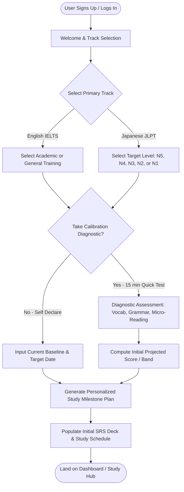
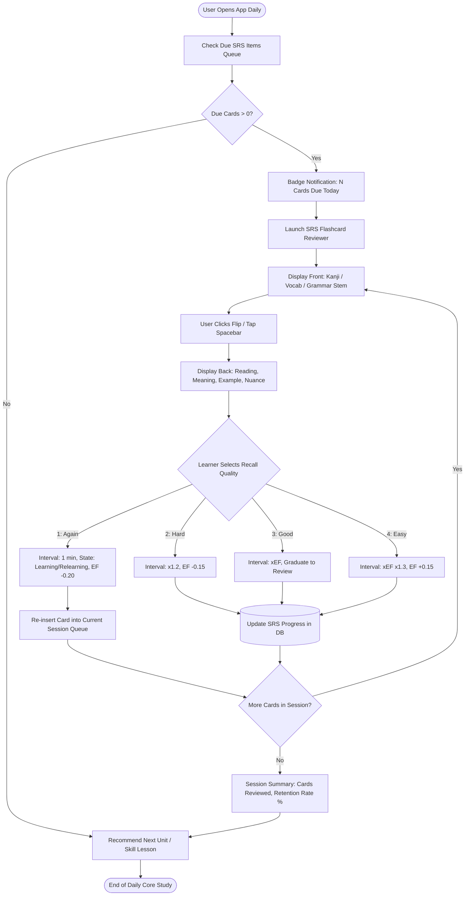
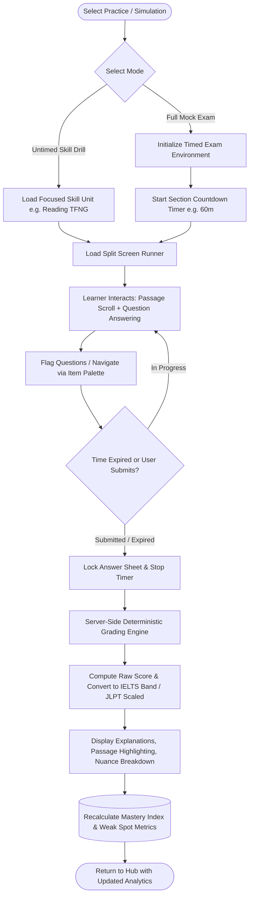
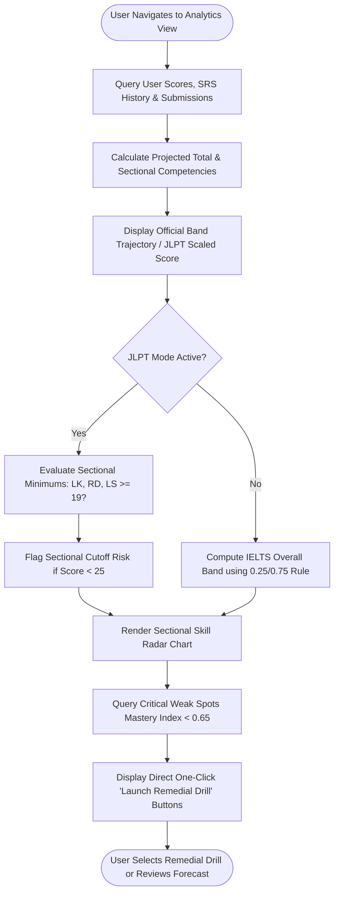
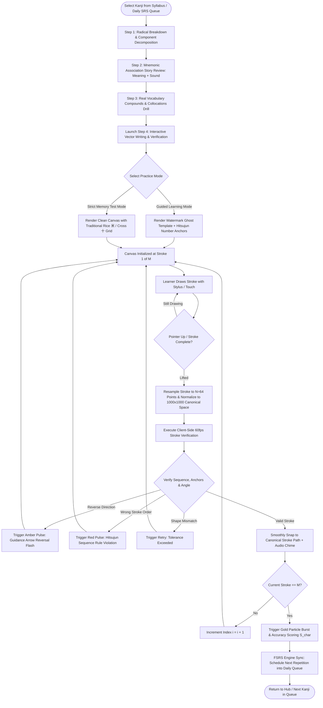

# USER FLOWS & EXPERIENCE SPECIFICATION
## Dual-Track Language Platform (English IELTS & Japanese Kana / JLPT N5–N1 Full Progression)

---

## 1. User Personas & Core Jobs-to-be-Done (JTBD)

### 1.1 Persona A: "The Postgraduate Aspirant" (Elena)
* **Demographics**: 24, Civil Engineering graduate from Vietnam, applying for Master's programs in the UK / Canada.
* **Current State**: IELTS Academic overall 6.5 (Listening: 7.0, Reading: 7.0, Writing: 5.5, Speaking: 6.0).
* **Target Goal**: Overall **7.5** with **no sub-band below 6.5** within 12 weeks.
* **Core Pains**:
  * Writing Task 2 repeatedly gets stuck at Band 5.5 due to informal tone and poor cohesive paragraphing.
  * Lack of objective, criterion-based feedback before submitting paid tests ($250 per attempt).
  * Anxiety over unfamiliar academic reading passages under strict 60-minute time pressure.
* **Job-to-be-Done**:
  > *"When I practice writing and speaking, I want immediate diagnostic evaluation against the official IELTS 4-criteria rubrics with concrete vocabulary suggestions, so that I can eliminate Band 5.5 habits and secure my university unconditional offer."*

### 1.2 Persona B: "The Global Software Engineer" (Kenji / Marcus)
* **Demographics**: 29, Full-stack developer in Berlin, preparing to relocate to Tokyo on a Highly Skilled Professional visa.
* **Current State**: Self-studied Japanese up to casual conversational level (~N4/N3 boundary). Struggles with formal business vocabulary and complex sentence structures.
* **Target Goal**: Pass **JLPT N2** in the July test cycle (minimum 90/180 total and $\ge 19$ in every section).
* **Core Pains**:
  * Kanji and business vocabulary memorization leaks quickly without daily active recall.
  * Reading comprehension fails on long editorials because of unfamiliar grammar patterns and trap questions.
  * Constant fear of failing the strict 19-point sectional cutoff on Reading or Language Knowledge.
* **Job-to-be-Done**:
  > *"When I have 25 minutes of daily commute time, I want a frictionless, high-yield SRS review queue for N2 Kanji/Grammar combined with real JLPT reading trap drills, so that I can systematically pass the N2 exam on my first attempt."*

### 1.3 Persona C: "The Nuance & Career Climber" (Aoi / Priya)
* **Demographics**: 32, Operations Manager at a multinational in Tokyo, currently holding N2 certification.
* **Target Goal**: Pass **JLPT N1** (Pass mark 100/180) to qualify for senior executive promotion.
* **Core Pains**:
  * N1 grammar patterns (e.g., 〜極まりない, 〜を皮切りに) feel abstract and interchangeable.
  * Reading section time management: running out of time on long-form philosophical critiques and paired comparison texts.
* **Job-to-be-Done**:
  > *"When I study advanced Japanese, I want star-sentence ordering drills and editorial nuance analysis that teach subtle register differences, so that I can reliably conquer the most difficult JLPT N1 sections."*

### 1.4 Persona D: "The Foundational Beginner" (David)
* **Demographics**: 22, Computer Science undergraduate starting Japanese from zero, preparing for an internship in Kyoto.
* **Target Goal**: Pass **JLPT N5** (80/180 pass threshold) and rapidly progress to **JLPT N4** (90/180 pass threshold) within 6 months.
* **Core Pains**:
  * Easily overwhelmed by stroke directions, character balance, and confusing particle nuances (`は` vs `が`, `に` vs `で`).
  * Frustrated by platforms that show fake, synthetic progress meters or cluttered interfaces instead of honest, step-by-step progress.
* **Job-to-be-Done**:
  > *"When I start learning Japanese from scratch, I want clean, minimalist stroke-by-stroke kanji handwriting practice with instant Hitsujun feedback, accompanied by true 0%-to-100% progress tracking with zero fake placeholder data, so that I can build rock-solid foundational literacy with total confidence."*

---

## 2. End-to-End System Flowcharts

### 2.1 Onboarding & Track / Level Calibration Flow



---

### 2.2 Daily Study & SRS Spaced Repetition Loop



---

### 2.3 Deep Skill Practice & Timed Exam Simulation Flow



---

### 2.4 Productive Writing & Speaking Rubric Evaluation Flow

```mermaid
flowchart TD
    WStart([Launch Studio: /studio/writing or /studio/speaking]) --> TrackDetect{Active Track}
    
    TrackDetect -->|ja_jlpt| JapStudio[Japanese Writing Studio: N5-N1 Sakubun/Shoronbun with Genko Yoshi]
    TrackDetect -->|en_ielts Writing| IELTSWriteStudio[IELTS Writing Studio: Task 1 Visuals or Task 2 Discursive]
    TrackDetect -->|en_ielts Speaking| IELTSSpeakStudio[IELTS Speaking Studio: Parts 1, 2, 3 Simulation]
    
    IELTSWriteStudio --> SplitLayout[Render Split-Pane: Visual Stimulus/Prompt Left | Editor Right]
    SplitLayout --> ModeToggle{Mode Selection}
    ModeToggle -->|Timed Mode| SetTimer[Start 20m / 40m Countdown + Periodic Autosave]
    ModeToggle -->|Untimed Mode| FreePractice[Deliberate Practice Mode: No Auto-Submit]
    
    SetTimer --> LiveEditor[Candidate Drafts Essay]
    FreePractice --> LiveEditor
    
    LiveEditor --> WordGuard[Real-Time Tokenizer & Threshold Monitor]
    WordGuard -->|W < 150/250w| AmberBadge[Amber Indicator: Underlength Penalty Active]
    WordGuard -->|W >= 150/250w| GreenBadge[Emerald Badge: Compliant Word Count]
    
    AmberBadge --> SubmitAction[Candidate Clicks 'Kirim untuk Evaluasi']
    GreenBadge --> SubmitAction
    
    SubmitAction --> LengthCheck{Meets Minimum Threshold?}
    LengthCheck -->|W < 100 words| BlockModal[Confirmation Modal: Severe Penalty Warning]
    BlockModal -->|Revise| LiveEditor
    BlockModal -->|Proceed Anyway| DispatchWorker[Submit Payload to AI Assessment Engine]
    LengthCheck -->|W >= 100 words| DispatchWorker
    
    DispatchWorker --> NLPParser[Tokenization, Dependency Parsing, Sentence Segmentation & AWL Matching]
    NLPParser --> CriteriaEvaluation[Score 4 Cambridge Criteria: TA/TR, CC, LR, GRA]
    NLPParser --> DiagnosticAnnotator[Generate Sentence-Level Annotations: Grammar, Collocation, Vocab, Cohesion]
    NLPParser --> MetricCalculator[Compute Quantitative Metrics: AWL%, EFSR%, TTR, CSR]
    
    CriteriaEvaluation --> ScoreAggregator[Apply 1/3 Task 1 + 2/3 Task 2 Weighting & 0.25/0.75 Cambridge Rounding]
    DiagnosticAnnotator --> ScorecardAssembly[Assemble Diagnostic Report]
    MetricCalculator --> ScorecardAssembly
    ScoreAggregator --> ScorecardAssembly
    
    ScorecardAssembly --> RenderReport[Display Diagnostic Scorecard & Interactive Diff Review]
    RenderReport --> RadarView[Render 4-Criteria Radar Chart & Overall Band Badge]
    RenderReport --> AnnotatedCanvas[Render Highlighted Essay Text with Color-Coded Spans]
    RenderReport --> ModelDiff[Render Side-by-Side Band 8.5 Model Answer Comparison]
    
    AnnotatedCanvas --> PopoverClick[Learner Clicks Highlighted Span]
    PopoverClick --> ShowPopover[Open Floating Inline Feedback Popover: Rule Rationale & 1-Click Replace]
    ShowPopover --> ReDraft([Learner Applies Feedback in Revision])
```

---

### 2.5 Performance Analytics & Mastery Progression Flow



---

### 2.6 Interactive Kanji Stroke Writing & The 4-Step Mastery Formula Flow



---

## 3. Screen-by-Screen Blueprint (Core v1)

### Screen 1: Dashboard / Study Hub
* **Route**: `/dashboard`
* **Purpose**: Primary mission control for the learner. Surfaces the **"Next Up (次のおすすめステップ)"** guided pedagogical action, today's critical tasks, SRS backlog, current projected proficiency, and provides global access to the Furigana engine.
* **Key UI Components**:
  * *Global Top Navigation Bar (Navbar)*:
    * Track Switcher (e.g. `IELTS Academic` $\leftrightarrow$ `JLPT N2`).
    * **Global Furigana Switch (`ふりがな: ON / OFF`)**: Persistent application-wide toggle controlling phonetic Hiragana subtext rendering across all modules.
    * Streak Counter (`14 Days`), Daily Goal Progress Bar (`65%`), User Profile / Theme Switcher.
  * *Next Up (次のおすすめステップ) Hero Banner*:
    * High-visibility top banner dynamically driven by the **6-Stage Guided Progressive Corridor**:
      - Current Stage Badge: e.g. `Stage 2: 基本文型 (Core Sentence Structure)` with visual indicator badge `Current (現在)`.
      - Stage Progress Bar: Visual metric (e.g. `60% Complete - 3 of 5 lessons finished`).
      - Bite-Sized Immediate Task Summary: `<ruby>指示代名詞<rt>しじだいめいし</rt></ruby> (Demonstratives: これ・それ・あれ) - 15 min`.
      - Primary CTA Button: Prominent button with label **"ここから始める (Start Here / Continue)"** routing directly into the active lesson runner.
  * *Score Projection & Milestone Card*: Current Projected Band / Scaled Score Card with confidence interval (e.g., "Projected JLPT N5: 110/180 [Pass Margin: +30]" with Furigana annotations when enabled).
  * *Quick Action SRS Queue Widget*: Floating card showing due reviews with "Start Review (34 Due)" primary call to action.
  * *Weak-Spot Radar Alert*: Compact alert card highlighting lowest sub-skill with phonetic subtext (e.g., `<ruby>格助詞<rt>かくじょし</rt></ruby> (Case Particles) — Mastery 52%`).
* **User Actions**:
  * Click "Start SRS Review" $\rightarrow$ Navigates to Screen 3 (`/srs/review`).
  * Click "Resume Lesson" $\rightarrow$ Navigates to Screen 4 (`/practice/:lessonId`).
  * Switch Track $\rightarrow$ Reloads dashboard context for alternative language track.
* **Data Displayed**:
  * `streakDays`: Integer (e.g. 14 days).
  * `srsDueCount`: Integer (e.g. 34 items).
  * `projectedScore`: Numerical representation + status badge (On Track / At Risk).
  * `dailyProgress`: Percentage of target daily study minutes completed (e.g. 35/45 min).
* **Explicit States**:
  * *Empty (Strict 0% True Empty State Policy)*:
    * First login or unstarted track $\rightarrow$ All progress bars and metric indicators strictly render **0% (0 / N units completed)**, streak displays **0 Days**, and SRS queue displays **0 cards due**.
    * **Zero Dummy / Placeholder Data Rule**: No synthetic or mocked progress numbers (e.g., fake 65% completion or simulated score lines) are displayed.
    * Hero card cleanly displays: *"Welcome to LinguaMastery! No study sessions completed yet (0% Progress). Select your foundational unit or start calibration to begin."*
    * Primary CTA: *"Begin Lesson 1: Foundational Orientation"*.
    * SRS Queue widget displays a clean zero-state illustration: *"Review Queue Clear (0 Due)"*.
  * *Loading*: Skeleton loaders for metric widgets and lesson roadmap.
  * *Active*: Standard operational dashboard with live counts and active streak.
  * *Completed*: All daily goals achieved $\rightarrow$ Confetti banner, "Daily Target Met! SRS queue clear. Want extra practice?".
  * *Error*: Toast notification if SRS queue fails to load; fallback to cached offline summary.

---

### Screen 2: Track & Curriculum Navigator (With 6-Stage Japanese Roadmap & Comprehensive IELTS Lecture Curriculum)
* **Route**: `/curriculum?track=:trackId&level=:levelId`
* **Purpose**: Comprehensive hierarchical view of the syllabus structure (Track $
ightarrow$ Level $
ightarrow$ Skill Pillars $
ightarrow$ Units $
ightarrow$ Lessons). Provides two completely isolated world-class learning tracks:
  1. **Japanese Track (`ja_jlpt`)**: Features the **6-Stage Guided Progressive Roadmap** stepper ("Where to start / How to learn"), Kana literacy foundations, Joyo Kanji inventory, and the Global Furigana Engine.
  2. **English Track (`en_ielts_academic` / `en_ielts_general`)**: Features the **Comprehensive Cambridge / British Council IELTS Lecture Curriculum**, organizing authoritative lectures and skill-building units across all 4 pillars (Listening, Reading, Writing, Speaking) and Academic Word List (AWL) vocabulary.
* **Strict Track & Level Isolation Rules**:
  * **Track Isolation**: When `trackId = ja_jlpt` (or `ja_kana`), the navigator renders ONLY Japanese modules. English IELTS modules are strictly excluded from state, DOM, and queries. Conversely, in `trackId = en_ielts_academic` or `en_ielts_general`, only IELTS modules appear.
  * **Zero Level Fallback**: When user selects a specific target band tier (`Band 5.5`, `Band 6.5`, `Band 7.5`, `Band 8.5+`), the view displays ONLY units and lessons authored specifically for that selected band.
* **Key UI Components**:
  * *Top Track Switcher Ribbon*: Explicit toggle between `Japanese (Kana & JLPT)` and `English (IELTS Academic / General)`.
  * *English IELTS Curriculum Matrix Toolbar*:
    * **Target Band Selector Tabs**: `Foundation (Band 5.0–5.5)`, `Competence (Band 6.0–6.5)`, `Mastery (Band 7.0–7.5)`, `Elite / Native-Like (Band 8.0–9.0)`.
    * **Pillar Filter Chips**: `All Pillars`, `Listening (4 Tiers)`, `Academic Reading (3 Passages)`, `Writing Task 1 (Data Synthesis)`, `Writing Task 2 (Discursive Essays)`, `Speaking (Parts 1–3)`, `AWL & Grammar`.
    * **Lecture Module Card Structure**:
      - Lecture Title (e.g., `lec_read_m1_02`: *True / False / Not Given Demystified*).
      - Core Strategy Synopsis (e.g. *Demarcating explicit contradiction vs absence of verification*).
      - Estimated Duration (e.g. `25 min lecture + 15 min diagnostic drill`).
      - Competency Badge: `Strategy Video`, `Guided Practice Drill`, `Authentic Timed Section`.
      - Completion Status: `Locked`, `Available`, `Mastered` (with score percentage).
  * *Global Furigana Synchronization Indicator (Japanese Track Only)*:
    * Linked directly to the primary Navbar Furigana toggle (`ふりがな: ON / OFF`). Active only when on the Japanese track; cleanly unmounted on the English track.
  * *おすすめの学習順序 (Guided Learning Roadmap) Stepper (Japanese Track Only)*:
    * Interactive 6-Stage Stepper widget with reassurance callout and stage status badges (`Current`, `Completed`, `Upcoming`).
* **User Actions**:
  * Filter IELTS modules by skill pillar $
ightarrow$ In-memory instantaneous filtering without losing band context.
  * Click any IELTS lecture card $
ightarrow$ Opens the interactive video/text lecture and accompanying strategy drill runner.
  * Click "Full Mock Exam" $
ightarrow$ Launches Screen 4 in Strict Examination Mode.
* **5 Explicit States**:
  * *Empty*: Handled gracefully; displays 0% completion bar with welcome prompt: *"Start Lecture L-01: Form Filling & Alphanumeric Accuracy"*.
  * *Loading*: Shimmer skeleton accordion cards matching exact level structure.
  * *Active*: Interactive lecture tree showing unlocked and in-progress units.
  * *Completed*: All level units mastered $
ightarrow$ Official Full-Length Simulation Exam unlocked.
  * *Error*: Network disconnect alert with retry button.

---

### Screen 3: SRS Flashcard Reviewer
* **Route**: `/srs/review`
* **Purpose**: High-throughput, distraction-free active recall study runner optimized for keyboard ergonomics and rapid repetition.
* **Key UI Components**:
  * *Global Furigana Rendering*: Front prompts, back readings, and context example sentences dynamically display Hiragana ruby annotations when the global Navbar switch is ON.
  * *Session Progress Header*: Progress bar (Reviewed / Remaining), Undo Last Button, Exit Button.
  * *Flashcard Surface*:
    * *Front Face*: Large centered prompt (Kanji, Vocabulary word, or Cloze sentence). Audio pronunciation trigger button.
    * *Furigana / Script Toggle*: Floating icon to hide/show readings (essential for JLPT Kanji testing).
    * *Flip Trigger*: "Show Answer" button or `Spacebar` / `Enter` hotkey.
    * *Back Face (Revealed on Flip)*:
      * Phonetic reading / Furigana.
      * Concise primary meaning and formal definitions.
      * Collocation box (e.g. 現状を把握する).
      * Authentic contextual example sentence with target word highlighted.
      * Grammatical usage caveat or IELTS lexical nuance note.
  * *Rating Action Bar (Appears upon Flip)*:
    * 4 distinct buttons color-coded with keyboard bindings (`1`, `2`, `3`, `4`):
      1. `Again (1)` (Red) — Interval preview: `<1m`
      2. `Hard (2)` (Amber) — Interval preview: `+1d` or `x1.2`
      3. `Good (3)` (Blue) — Interval preview: `+3d` or `xEF`
      4. `Easy (4)` (Green) — Interval preview: `+7d` or `xEFx1.3`
* **User Actions**:
  * Press `Spacebar` to flip card.
  * Press `1`, `2`, `3`, or `4` to submit rating.
  * Press `A` to replay audio.
  * Click "Undo" to revert accidental rating.
* **Data Displayed**:
  * Active card data (front, back, audio URL, context).
  * Dynamic interval preview calculated on-the-fly based on card’s current stability and ease factor.
  * Queue counters: New (Blue), Learn (Orange), Review (Green).
* **Explicit States**:
  * *Empty*: No cards due $\rightarrow$ Celebration graphic: "Deck is clear! 0 reviews due. Next reviews scheduled in X hours."
  * *Loading*: Card spinner while pre-fetching next 20 items.
  * *Active*: Card visible, awaiting flip or rating.
  * *Completed*: Last card rated $\rightarrow$ Session recap screen: Total cards reviewed, accuracy %, time spent, next review countdown.
  * *Error*: Audio playback failure $\rightarrow$ Graceful fallback to text phonetic indicator; card interaction remains functional.

---

### Screen 4: Interactive Practice & Mock Exam Runner (Multi-Mock Battery Engine: Packs 1–5)
* **Routes**:
  * Practice Drill: `/practice/:lessonId`
  * Mock Exam Hub: `/exam?track=:trackId&level=:levelId`
  * Active Battery Runner: `/exam/runner?batteryId=:batteryId`
* **Purpose**: Realistic, computer-delivered testing environment simulating official test-center conditions for both **Computer-Delivered IELTS (CD-IELTS)** and **JLPT Exam Simulations**. Provides a master inventory of **5 completely distinct official mock exam batteries (Packs 1–5)** per level, strictly enforcing the **Zero Task Duplication Rule**, rigorous anti-cheating proctoring, and full Indonesian localization in ID mode.
* **The Master Mock Battery Selector Hub (`/exam`)**:
  * **Interactive Battery Grid**: Displays 5 distinct mock exam cards per track/level:
    1. **Pack 1**: *Diagnostic Baseline Battery* (`ielts_mock_pack_01` / `jlpt_mock_pack_01`) — Baseline diagnostic assessment.
    2. **Pack 2**: *Core Competence Battery* (`ielts_mock_pack_02` / `jlpt_mock_pack_02`) — Evaluates core grammatical flexibility and lexical breadth.
    3. **Pack 3**: *Advanced Academic & Specialized Discourse Battery* (`ielts_mock_pack_03` / `jlpt_mock_pack_03`) — Focuses on complex humanities, technology, and specialized terminology.
    4. **Pack 4**: *High-Cognitive-Density Battery* (`ielts_mock_pack_04` / `jlpt_mock_pack_04`) — Fast conversational shifts, intricate tables, and subtle distractor traps.
    5. **Pack 5**: *Final Readiness & Peak Performance Battery* (`ielts_mock_pack_05` / `jlpt_mock_pack_05`) — Authentic exam-day difficulty simulation with strict official timing.
  * **Rich Battery Package Metadata Card**:
    - Title: e.g. `IELTS Academic Official Simulation Pack 3` (in ID mode: `Simulasi Resmi IELTS Akademik Paket 3`).
    - Thematic Badges: e.g. `Phytolith Archaeology`, `Linguistic Relativity`, `Epigenetics`.
    - Total Duration & Items: `166 min | 40 Reading + 40 Listening + 2 Writing + 3 Speaking`.
    - Difficulty Profile & CEFR Alignment: `Advanced Academic (C1 / Band 7.5 Target)`.
    - Previous Attempt History Badge: `Unattempted (Belum Dikerjakan)`, `In Progress (Sedang Berjalan)`, or `Completed (Selesai: Band 7.5 / 142/180)`.
    - Action CTA: Primary button `"Mulai Ujian Resmi (Start Official Simulation)"` with full-screen warning prompt.
* **Mode Selector Ribbon**:
  * **Practice Mode**: Untimed self-study, scrubbable audio player with speed options ($0.75	imes, 1.0	imes, 1.25	imes$), instant item feedback, and line-by-line evidence citations.
  * **Strict Exam Mode (Full-Length Simulation)**: Enforces authentic test-center conditions:
    - Full-screen lock (`requestFullscreen()`).
    - Tab switch & window blur detection with a 2-strike maximum.
    - Relentless countdown timer with automatic hard submission at `00:00`.
    - Single-play audio for Listening (no pause, seek, or rewind).
    - Irreversible sequential section lockouts: Listening (32 min) $
ightarrow$ Reading (60 min) $
ightarrow$ Writing (60 min) $
ightarrow$ Speaking (14 min) with zero retroactive navigation.
* **Deterministic Default Lesson Resolution Matrix**:
  * Direct clicks on "Practice Exam" or `/exam` without URL parameters resolve deterministically to active production tests:
    * **IELTS Academic**: `ielts_acad_mock_01` (Full-Length Academic Reading 40-item test, ~2,600 words across 3 passages)
    * **IELTS General Training**: `ielts_gt_mock_01` (Full-Length General Training Reading test, 40 items)
    * **JLPT N5**: `les_n5_gram_1` or `les_n5_read_1`
    * **JLPT N4**: `les_n4_gram_1` or `les_n4_read_1`
    * **JLPT N3**: `les_n3_gram_1` or `les_n3_read_1`
    * **JLPT N2**: `les_n2_gram_1` or `les_n2_read_1`
    * **JLPT N1**: `les_n1_gram_1` or `les_n1_read_1`
* **Key UI Components (Computer-Delivered IELTS Layout)**:
  * *Top Status Header*:
    * Test Title: e.g. `IELTS Academic Official Mock Exam 1 (Section 2: Reading)`.
    * Mode Badge: `STRICT EXAM SIMULATION` (amber pulsing indicator).
    * Integrity Status Indicator: `Proctoring Active (0 Strikes)`.
    * Persistent Relentless Countdown Timer: Synchronized high-resolution countdown with prominent amber warning at 5 minutes remaining.
    * Section Finalize Button: `"Submit Section"`.
  * *Split-Pane Layout (Desktop CD-IELTS Standard)*:
    * *Left Pane (Stimulus Viewport)*:
      - Resizable container with authentic full-length reading passages (~750–1,000 words per passage).
      - Native Text Highlighter (Yellow, Green, Blue) and Margin Note Annotator.
      - Text size controls (`A-` / `A+`).
      - Tabbed passage switcher (`Passage 1`, `Passage 2`, `Passage 3`).
    * *Right Pane (Interactive Question Workspace)*:
      - Scrollable container rendering official question typologies:
        * True / False / Not Given & Yes / No / Not Given (radio selection).
        * Matching Headings & Information (interactive dropdown selection / drag-and-drop).
        * Matching Features & Classifications (matrix radio table).
        * Sentence & Summary Completion with Word Bank (keyboard input with strict word limit validation).
        * Multiple Choice (Single and Multiple selection).
        * Flowchart & Diagram Labelling (interactive hotspot callouts).
  * *Bottom Question Navigator Palette (The Official 40-Item Ribbon)*:
    * 40 interactive numbered pills organized into 3 passage blocks ($1$ to $13$, $14$ to $26$, $27$ to $40$).
    * Status styling:
      - *Unanswered*: Subtle outline.
      - *Answered*: Solid accent background with contrast numeral.
      - *Flagged for Review*: Corner badge indicator for quick revisitation.
    * Review Summary Drawer: Displays total answered (e.g. `38 of 40 completed - 2 flagged`) before confirmation dialog.
* **Strict Anti-Cheating & Integrity State Machine**:
  * *Window Blur Event (`window.onblur`)*: Triggered when user navigates away from the window, switches tabs, or minimizes the application. Immediately freezes test interaction and displays a modal warning:
    > *"Focus Loss Detected. You are under strict examination conditions. Strike logged (1 of 2). A second violation will automatically terminate and submit your examination."*
  * *2-Strike Termination*: Upon the 2nd focus violation, all inputs lock, the exam is tagged with `flagged_integrity_violation`, and current answers are submitted to the scoring server.
  * *Clipboard Lockout*: Pasting (`e.preventDefault()` on `paste`) and right-click context menus (`contextmenu`) are strictly disabled.
  * *Irreversible Section Lockout*: Once a candidate submits a section or time runs out, answers are encrypted in local state and synced. Navigation back to earlier sections is physically blocked.
* **User Actions**:
  * Click any question pill in the 40-item palette $
ightarrow$ Viewport smoothly scrolls right pane to that question while maintaining passage context.
  * Select text in the stimulus $
ightarrow$ Floating popover provides "Highlight" and "New Note" options.
  * Flag question $
ightarrow$ Adds bookmark pin on the question pill in the bottom ribbon.
  * Click "Submit Section" $
ightarrow$ Modal displays warning if unanswered questions remain; on confirmation, transitions irreversibly to the next section.
* **5 Explicit States**:
  * *Empty*: Deterministic resolver loads official mock package (`ielts_acad_mock_01`), never throwing 404 or empty states.
  * *Loading*: Shimmer skeleton layout for stimulus passage and 40 question cards.
  * *Active*: Interactive test running with encrypted local autosaving every 5 seconds.
  * *Integrity Alert*: Modal dialog displaying focus violation warning with strike counter.
  * *Completed (Post-Submission)*: Detailed diagnostic analysis showing overall band, sectional bands, raw score (/40), official 0.25/0.75 rounding computation, and line-by-line passage evidence citations.
  * *Error*: Network disconnect alert with cached local offline storage ensuring test progress is never lost.

---

### Screen 5: Production Writing, Speaking & Listening Studio (Multi-Studio Architecture)
* **Routes**:
  * Writing Studio: `/studio/writing?track=:trackId&level=:levelId`
  * Speaking Studio: `/studio/speaking?track=:trackId&level=:levelId`
  * Listening Studio: `/studio/listening?track=:trackId&level=:levelId`
* **Purpose**: Dedicated productive composition and oral discourse testing studios with 100% strict track isolation.
  * In the **Japanese Track (`ja_jlpt`)**: Renders the **Japanese Writing Studio (作文・小論文スタジオ)**, dynamically adapting prompts and rubrics across N5–N1 (*Sakubun / Shoronbun*) with genko yoshi formatting, character counters, and zero English leakage.
  * In the **English Track (`en_ielts`)**: Renders the **IELTS Writing Studio** (Academic Task 1/2 or GT Letters) and the **Interactive IELTS Speaking Studio** (Part 1 Personal Q&A, Part 2 Long Turn Cue Card with 60s scratchpad/120s timer, and Part 3 Two-Way Discussion with AI Examiner).

---

#### 5A. Production Writing Studio & AI Diagnostic Essay Assessment Engine (`/studio/writing`)

The Production Writing Studio provides an authentic, high-fidelity computer-delivered environment mirroring Cambridge/IDP exam testing conditions alongside an AI Diagnostic Essay Assessment Engine.

##### 5A.1 Writing Studio Interface (`/studio/writing/editor`)

* **Contextual Track & Level Mode Switching**:
  * **When Active Track = `ja_jlpt` (or `ja_kana`)**:
    * Displays **Japanese Writing Studio (作文・小論文スタジオ)**.
    * Prompts and benchmarks adapt strictly to the learner's active level:
      * **N5**: 自己紹介と日課の作文 (Self-Introduction & Routine, 150–250 chars, `です・ます体`).
      * **N4**: 週末の出来事と思い出に残る旅行 (Weekend & Travel Narrative, 250–350 chars, `です・ます体`).
      * **N3**: オンライン学習の利点と課題についての意見文 (Online Learning Opinion Essay, 400–500 chars, `だ・である体`).
      * **N2**: 企業のAI導入と雇用の未来に関する小論文 (Corporate AI & Labor Shoronbun, 500–650 chars, `だ・である体`).
      * **N1**: 言語と自己認識、および文化的多様性に関する学術論説 (Language & Cultural Diversity Critical Essay, 700–900 chars, `だ・である体`).
    * Evaluates against the 4 Japanese Writing Criteria: Task Fulfillment (TL), Grammar & Sentence Complexity (GRA), Orthography & Register (ORK), and Lexical Richness (LR).
    * Zero IELTS Task 1 or Task 2 prompts are ever visible.
  * **When Active Track = `en_ielts_academic` or `en_ielts_general`**:
    * Displays **IELTS Writing Studio (Academic Task 1 Visuals, GT Letters, and Task 2 Discursive Essays)**.
    * Word count thresholds: 150 words for Task 1; 250 words for Task 2.
    * Zero Japanese prompts or genko yoshi formatting are ever visible.

* **Split-Pane Ergonomic Layout (Dual-Column Workspace)**:
  * **Left Pane (Prompt & Stimulus Visual)**:
    - *Task Header*: Displays Task Number (Task 1 or Task 2), Suggested Time (20 min or 40 min), Minimum Word Count (150w or 250w), and Official Task Weighting (1/3 for Task 1, 2/3 for Task 2).
    - *Visual Stimulus Canvas*: For Academic Task 1, renders interactive high-resolution SVG/vector visuals (Line Graphs, Bar Charts, Proportional Pie Charts, Data Tables, Process Flowcharts, or Chronological Maps) with zoom and pan controls.
    - *Prompt Directive & Key Requirements*: Highlighted question prompt, essential bullet points (for GT letters), and key instructional reminders (*"Summarise the information by selecting and reporting the main features, and make comparisons where relevant"*).
  * **Right Pane (Distraction-Free Writing Canvas)**:
    - *Header Toolbar*:
      - **Timed / Untimed Toggle**: Switch between official timed exam simulation (20-min countdown for Task 1; 40-min countdown for Task 2) with persistent digital timer, and untimed deliberate practice mode.
      - **Autosave Heartbeat**: Displays `"Tersimpan otomatis"` (Autosaved) indicator, caching keystrokes to browser storage every 15 seconds.
    - *Real-Time Word Counter with Minimum Threshold Indicator*:
      - Prominent badge displaying live word count, character count, and paragraph count.
      - **Threshold Compliance State Machine**:
        * **Underlength (< 150w for T1 or < 250w for T2)**: Badge glows in soft Amber with alert: *"Kurang dari 150 kata (Potensi penalti TA: -0.5 Band)"* / *"Kurang dari 250 kata (Potensi penalti TR: -0.5 Band)"*, displaying the remaining words required to avoid penalty.
        * **Compliant (>= 150w for T1 or >= 250w for T2)**: Badge transitions smoothly to Emerald Green: *"Target kata terpenuhi: 178 kata (Bebas penalti)"*.
    - *Rich Writing Input Area*: Ergonomic monospace/sans font stack with comfortable line-height ($1.6$), clipboard paste interception guard in strict exam mode, and smooth scrolling.
    - *Action Footer*:
      - `"Bersihkan Draft"` (Reset Draft) with confirmation guard.
      - `"Simpan Sebagai Draf"` (Save as Draft).
      - `"Kirim untuk Evaluasi AI"` (Submit for AI Evaluation). If word count is severely deficient ($< 100$ words), triggers a pre-submission modal: *"Peringatan Panjang Esai: Tulisan Anda hanya memiliki 84 kata. Evaluasi resmi Cambridge memotong skor secara drastis untuk esai di bawah batas minimum. Tetap kirimkan?"*.

##### 5A.2 Diagnostic Scorecard & Interactive Diff Review (`/studio/writing/report/:submissionId`)

Upon submitting an essay, the candidate is transitioned to the comprehensive Diagnostic Scorecard:

* **1. Master Band Banner & Cambridge 4-Criteria Radar Chart**:
  * *Overall Projected Band Badge*: Large typography hero displaying the projected official Writing Band (e.g., `Band 7.0 (Good User)`), CEFR equivalent (`C1`), and breakdown formula: `Score = 1/3(Task 1) + 2/3(Task 2)`.
  * *4-Criteria Diagnostic Radar Chart*:
    - Interactive 4-axis SVG/Canvas radar visualization:
      * **Axis 1**: Task Achievement (TA) / Task Response (TR) (0.0 to 9.0)
      * **Axis 2**: Coherence & Cohesion (CC) (0.0 to 9.0)
      * **Axis 3**: Lexical Resource (LR) (0.0 to 9.0)
      * **Axis 4**: Grammatical Range & Accuracy (GRA) (0.0 to 9.0)
    - Plotted Polygons: Candidate's Current Attempt (Indigo polygon) vs Target Requirement (Emerald reference ring, e.g., 7.5) vs Global Cohort Average (Dotted gray).

* **2. Criterion Breakdown Deep-Dive Accordion**:
  * Four collapsible cards corresponding to each criterion:
    - *Sub-score Pill*: Exact score (e.g., `7.5 / 9.0`).
    - *Official Cambridge Descriptor Citation*: Direct quote from Cambridge band rubric explaining why this level was awarded.
    - *Key Strengths Identified*: Bulleted list of positive elements observed in candidate's submission.
    - *Actionable Growth Vectors*: Explicit structural or lexical fixes required to ascend to the next half-band.

* **3. Diagnostic Metric Badges Panel**:
  * **Academic Word List (AWL) Density**: Quantitative badge displaying percentage (e.g., `8.7% - Sangat Baik (C1/C2)`), comparing against the $8.5\%$ benchmark for Band 7.5+.
  * **Error-Free Sentence Ratio (EFSR)**: Percentage of sentences completely free of syntactic or punctuation errors (e.g., `68.4% (13 dari 19 kalimat bebas kesalahan)`).
  * **Lexical Diversity (Type-Token Ratio & Guiraud's Index)**: Guiraud Index $R$ (e.g., `R = 8.9 - Variasi kosakata tinggi`).
  * **Complex Sentence Ratio (CSR)**: Proportion of complex vs simple sentences (e.g., `62.5%`).

* **4. Interactive Annotated Essay Canvas & Diff Review**:
  * The full candidate essay is rendered in a clean document view, with errors, stylistic improvements, and lexical upgrades highlighted inline using a 4-color categorization scheme:
    - **Red Underline (`category: 'grammar_error'`)**: Subject-verb agreement errors, tense shifts, missing articles, comma splices.
    - **Yellow Highlight (`category: 'collocation_suggestion'`)**: Awkward L1 literal phrasing, unnatural adjective-noun or verb-noun partnerships.
    - **Purple Dashed (`category: 'vocabulary_enhancement'`)**: Basic/generic terms eligible for Academic Word List (AWL) or C1/C2 elevation.
    - **Blue Dotted (`category: 'cohesive_marker_feedback'`)**: Overused mechanical linkers (*"Firstly"*, *"In a nutshell"*), ambiguous pronoun references, missing logical transitions.
  * **Interactive Floating Inline Feedback Popover**:
    - Clicking any highlighted span opens a floating popover card positioned dynamically above the target token:
      * *Category Badge*: Displays category tag (e.g., `Tata Bahasa`, `Kolokasi Alami`, `Peningkatan Kosakata AWL`, `Kohesi & Transisi`).
      * *Original vs Suggested Diff*: Side-by-side or strikethrough preview (e.g., `shows` $\rightarrow$ `show` or `a lot` $\rightarrow$ `substantially`).
      * *Pedagogical Rationale*: Clear explanation of the underlying linguistic rule in both English and Indonesian.
      * *1-Click Action*: `"Pratinjau Penggantian"` (Preview Replacement) button that temporarily applies the suggested correction inline so the candidate can observe the improved sentence cadence.

* **5. Side-by-Side Model Answer Comparison Drawer**:
  * Collapsible side-by-side or tabbed comparator:
    - *Left Tab*: Candidate's Annotated Submission.
    - *Right Tab*: Verified Band 8.5 Cambridge Benchmark Model Answer with highlighted thesis statements, topic sentences, and advanced concessive clauses.
    - *Structural Comparison Notes*: Highlights the architectural divergence between the candidate's draft and the benchmark response.

---

#### 5B. Interactive IELTS Speaking Studio (`/studio/speaking`)
* **Purpose**: Comprehensive, computer-delivered simulation of the official 11–14 minute Cambridge / British Council oral interview. Features virtual examiner voice prompts, live microphone capture, real-time waveform visualization, an interactive 60-second preparation scratchpad, and automated 9-Band speech evaluation.
* **The 5-Phase Interactive Speaking Workflow**:

```
[ Phase 1: Microphone Calibration & Mode Selection ]
        │
        ▼
[ Phase 2: Part 1 Interactive Familiar Q&A (4–5 min) ]
        │  • Examiner audio prompts (5 Topic Sets)
        │  • Auto-record on audio completion; 15–30s response target
        ▼
[ Phase 3: Part 2 Cue Card Long Turn (3–4 min) ]
        │  • Task card display across 4 categories (People, Places, Objects, Experiences)
        │  • 60s Digital Scratchpad (keywords outline)
        │  • 120s Uninterrupted Speech Recording with live pacing gauge
        ▼
[ Phase 4: Part 3 In-Depth Analytical Discussion (4–5 min) ]
        │  • Thematic extension to macro-societal, past vs present, future trends
        │  • 2-way conversational debate
        ▼
[ Phase 5: 9-Band Diagnostic Evaluation & Actionable Review ]
        │  • Overall Band (1.0–9.0 with 0.25/0.75 rounding)
        │  • 4-Criterion Radar Matrix (FC, LR, GRA, PR)
        │  • Words-Per-Minute (WPM) & Hesitation Heatmap
        │  • Synchronized Audio Playback & Transcribed Text Annotations
```

* **Key UI Components**:
  * *Studio Navigation & Mode Ribbon*:
    * Mode Toggle: `Full 3-Part Official Simulation (11–14 min)` vs `Targeted Skill Drill` (Practice Part 1, Part 2, or Part 3 independently).
    * Topic / Category Selector: Browse 5 Part 1 topic sets (Work/Study, Hometown, Habits, Technology, Daily Routine) and 8 Part 2 Cue Cards (People, Places, Objects, Experiences).
  * *Examiner Voice & Avatar Console*:
    * High-fidelity audio player streaming examiner prompts with realistic British, Australian, and North American accents.
    * Live waveform animation indicating when the virtual examiner is speaking.
    * Automatic state handoff: Recording triggers immediately when the examiner finishes speaking.
  * *Live Speech Recording Viewport*:
    * Browser `MediaRecorder` integration capturing clean audio (`audio/webm;codecs=opus`).
    * Real-time Canvas Audio Visualizer rendering frequency bars or oscilloscope wave.
    * Microphone Input Level Indicator with clipping/noise-floor warnings.
    * Live Speech-to-Text Transcription Preview (utilizing Web Speech Recognition or post-turn Whisper model).
  * *Part 2 Interactive Long Turn Console*:
    * Prominently displayed Task Card with official bullet prompts.
    * **60-Second Preparation Scratchpad**:
      - Visible countdown timer (`00:59`, `00:58`...).
      - Interactive text box for rapid keyword mind-mapping.
      - "Tips" accordion illustrating high-scoring temporal scaffolding (Past $
ightarrow$ Present $
ightarrow$ Future).
    * **120-Second Uninterrupted Speaking Gauge**:
      - Large circular progress indicator with color thresholds:
        * Red (`0:00 - 1:00`): Under-time penalty zone ($< 1$ min).
        * Amber (`1:00 - 1:30`): Acceptable minimum.
        * Green (`1:30 - 2:00`): Optimal Band 7–9 sustained discourse zone.
        * Flashing Amber (`2:00`): Time ceiling reached; auto-stops recording.
  * *Comprehensive 9-Band Diagnostic Evaluation Dashboard*:
    * **Overall Projected Band Score**: Prominent badge (e.g. `Band 7.5 [Good User]`) computed via official 0.25/0.75 rounding.
    * **4-Criteria Radar Chart & Score Cards**:
      1. *Fluency & Coherence (FC)*: Score (e.g. `7.5`), WPM gauge (`136 WPM - Optimal Cadence`), Silent Pause counter (`3 pauses > 1.2s`), Acoustic Fillers (`2 "um"`), and Discourse Markers recognized (`4 used: "As far as I'm concerned", "Moving on to"`).
      2. *Lexical Resource (LR)*: Score (e.g. `7.0`), Type-Token Ratio (`0.68`), AWL headwords highlighted in amber, natural collocations identified in green.
      3. *Grammatical Range & Accuracy (GRA)*: Score (e.g. `7.5`), Complex Clause Ratio (`64%`), tense consistency audit, detected syntactic errors with correction tags.
      4. *Pronunciation (PR)*: Score (e.g. `7.5`), Intelligibility Index (`88%`), thought-group chunking efficiency score.
    * **Interactive Synchronized Transcript**:
      - Full transcribed text with clickable timestamp words (clicking a sentence plays back candidate audio from that exact second).
      - Red strikethroughs on grammatical lapses with hover tooltips showing native corrections.
      - Green pills over advanced idiomatic phrases and collocations.
    * **Actionable Improvement Roadmap**: Bulleted prioritized feedback per criterion (e.g., *"Expand Part 2 closing with speculative conditionals to boost GRA from 7.0 to 8.0"*).
    * **Band 8.5 Model Audio Comparison**: Audio player allowing the candidate to listen to an authentic native-like response to the same prompt.
* **User Actions**:
  * Grant microphone permissions $
ightarrow$ System conducts 3-second ambient noise test.
  * Click "Start Speaking Test" $
ightarrow$ Examiner audio delivers initial prompt.
  * Speak response into microphone $
ightarrow$ Visualizer pulses in real time.
  * In Part 2: Type keywords in scratchpad during 60s prep; speak continuously when 120s timer starts.
  * Click "Complete & Evaluate" $
ightarrow$ Pipeline runs speech diagnostics and renders results within $< 3	ext{ seconds}$.
* **5 Explicit States**:
  * *Empty / Ready*: Studio loaded with chosen prompt, microphone calibrated, examiner standing by.
  * *Examiner Speaking*: Examiner audio playing, candidate microphone muted, animated wave active.
  * *Candidate Recording*: Candidate microphone active, countdown/elapsed timer running, live waveform pulsating.
  * *Evaluating*: Shimmer loading state: *"Transcribing speech... Analyzing phonological cadence & WPM... Parsing syntactic complexity... Aggregating 9-Band descriptors..."*
  * *Completed*: Diagnostic dashboard displayed with audio playback, transcript annotations, and actionable tips.
  * *Error*: Microphone access denied, audio payload corrupted, or network disconnect $
ightarrow$ Explicit error card with browser permission guide and cached recording recovery.

---


#### 5C. Interactive IELTS Listening Studio (`/studio/listening`)
* **Purpose**: Authentic computer-delivered oral comprehension simulation reproducing official Cambridge / British Council CD-IELTS listening test environments. Integrates single-play audio streaming, multi-regional native accent synthesis, synchronized question auto-scrolling, interactive spatial map labelling, and deterministic distractor diagnostic scorecards.
* **The 4-Stage Interactive Listening Flow**:

```
[ Stage 1: Battery Selection & Skill Focus ]
  ├── Mode A: Full Official Cambridge Simulation Battery (Sections 1–4, 40 items, 32 min)
  ├── Mode B: Daily Social Survival Battery (Sections 1–2, 20 items, 15 min)
  └── Mode C: Academic Research & Lecture Battery (Sections 3–4, 20 items, 17 min)
        │
        ▼
[ Stage 2: Audio Setup & Multi-Accent Preview ]
  ├── Headphone check & audio chime output verification
  ├── Master volume calibration slider
  └── Native Accent Preview Switcher (British RP, Australian, Scottish, General American)
        │
        ▼
[ Stage 3: Sections 1–4 Interactive Streaming & Answering ]
  ├── Single-Play Audio Stream (scrub bar locked in Exam mode)
  ├── Synchronized Question Auto-Scroll (viewport follows audio timecodes)
  ├── Section 2 Interactive Spatial Map Labelling (drag-and-drop letter pins A–H)
  ├── Section 3 Voice Attribution Matrix (matching speakers to research claims)
  └── 40-item Question Navigation Ribbon with answered/flagged indicators
        │
        ▼
[ Stage 4: Submission & Band Diagnostic Scorecard ]
  ├── Official Raw Score (/40) mapped to 9-Band scale with CEFR badge
  ├── Audio Replay Markers (scrub to exact mistake timestamps with -5s pre-roll)
  ├── Distractor Analysis Breakdown (conversational trap pivots demystified)
  └── 100% Indonesian Localization Toggle (Panduan & Evaluasi Bahasa Indonesia)
```

* **Key UI Components**:
  * *Top Status & Audio Control Header*:
    * Track Title: e.g. `IELTS Listening Official Simulation 1 (Section 2: Community Arts Complex)`.
    * Mode Indicator: `EXAM MODE (Single-Play Lock)` vs `PRACTICE MODE (Speed & Seek Active)`.
    * In Practice Mode: Playback Speed Selector (`0.8x`, `1.0x`, `1.2x`) with pitch-preservation (`preservesPitch: true`), scrubber slider, and $\pm 5\text{s}$ skip buttons.
    * In Exam Mode: Scrub bar and seek buttons disabled via CSS and event blockers; persistent countdown timer synchronized to stream.
    * Language Mode Switcher: `English` $\leftrightarrow$ `Bahasa Indonesia (100% Terjemahan)`.
  * *Audio Setup & Accent Preview Modal (Pre-Test)*:
    * Interactive test sound chime button to verify stereo output.
    * Accent Selector Drawer with 4 sample sound clips:
      - *British RP*: Standard Southern British accent (clear plosives, non-rhotic).
      - *Australian English*: Broad Australian cadence (vowel shifts, rising inflection).
      - *Scottish English*: Lowland Scottish lilt (rhotic tap, monophthongs).
      - *General American*: Standard American collegiate lecture delivery (rhoticity, flapped 't').
  * *Split-Pane / Synchronized Answering Layout*:
    * *Audio Waveform & Timecode Banner*: Visual stream progress bar indicating Section milestones (Pre-reading 30s $\rightarrow$ Audio Playing $\rightarrow$ Mid-break 30s $\rightarrow$ Final review).
    * *Auto-Scrolling Question Canvas*:
      - Automatically scrolls the active question group into the candidate's primary viewport based on audio timecodes (e.g. at $t = 55\text{s}$, smooth scrolls to Questions 1–5; at $t = 240\text{s}$, scrolls to Questions 6–10).
      - User can override auto-scroll via manual mouse/touch scroll without breaking audio sync.
    * *Section 2 Interactive Spatial Map Labelling Viewport*:
      - High-resolution SVG architectural floor plan / campus map.
      - Draggable letter pills (`A`, `B`, `C`, `D`, `E`, `F`, `G`, `H`) located on a floating side dock.
      - Hotspot drop zones on the map displaying compass rose (North/South/East/West), highlighted entry gates, and corridors.
      - Click-to-place fallback for mobile touchscreens: tapping a question item activates target mode, tapping a map zone assigns the letter.
    * *Section 3 Voice Attribution Matrix*:
      - Clean grid pairing academic claims with speakers (`Dr. Henderson`, `Marcus`, `Chloe`).
  * *Bottom 40-Item Question Palette*:
    * Numbered pills 1 to 40 organized into 4 distinct section clusters.
    * Visual states: Unanswered (subtle border), Answered (solid indigo), Flagged (amber flag).
  * *Submission & Diagnostic Scorecard*:
    * **Overall Score Card**: Raw Score (/40), Official Band Score (e.g. `Band 7.5`), CEFR descriptor (`C1 - Operational Proficiency`).
    * **Audio Replay Markers**:
      - Next to every incorrect answer, an *"Audio Replay"* button appears.
      - Clicking the button loads the audio stream starting exactly 5 seconds before the answer was mentioned, with the transcript line highlighted.
    * **Conversational Distractor Analysis Panel**:
      - Detailed breakdown explaining why wrong choices were seductive traps (e.g., *"The speaker initially suggested Tuesday the 14th, but subsequently corrected it to Thursday the 16th due to flight schedules"*).
    * **Morphological & Word-Count Error Tags**:
      - Clear error labels: `[WORD_LIMIT_EXCEEDED: Max 2 Words]`, `[PLURAL_FORM_MISSING: Expected 'laboratories', received 'laboratory']`.
* **100% Indonesian Localization (Mode Bahasa Indonesia)**:
  * When `languageMode = 'id'`, all UI chrome, instructional banners, error explanations, and diagnostic feedback render in natural, professional Indonesian:
    - *"Ujian Mendengarkan IELTS Resmi - Bagian 1: Percakapan Sosial Sehari-hari"*
    - *"Waktu Membaca Soal: 30 Detik Tersisa"*
    - *"Peringatan Batas Kata: Maksimal 2 kata dan/atau 1 angka. Jawaban 3 kata otomatis bernilai 0."*
    - *"Analisis Jebakan Percakapan: Pembicara meralat tanggal keberangkatan dari tanggal 14 ke tanggal 16."*
* **User Actions**:
  * Select battery mode (Social vs Academic vs Full Simulation).
  * Run audio test & preview regional accents.
  * Listen to audio and enter answers in real-time.
  * In Section 2, drag letter pins onto the architectural SVG map.
  * Submit exam $\rightarrow$ Examine diagnostic scorecard with audio replay markers.
* **5 Explicit States**:
  * *Setup / Ready*: Headphone check completed, volume calibrated, audio stream pre-buffered.
  * *Streaming & Active*: Audio playing, single-play lock enforced in Exam mode, question auto-scroll tracking.
  * *Mid-Section Pause*: Audio paused by narration for 30 seconds: *"You now have half a minute to check your answers."*
  * *Review Phase*: 2-minute final review countdown active at the conclusion of Section 4.
  * *Diagnostic Review*: Full scorecard rendered with raw score, band conversion, audio replay markers, and distractor audits.
  * *Error*: Audio file 404, Web Audio decode failure, or network drop $\rightarrow$ Error alert with offline cached audio fallback.

---

### Screen 6: Mastery & Readiness Analytics (Longitudinal Multi-Mock Progression Cockpit)
* **Route**: `/analytics`
* **Purpose**: Comprehensive diagnostic cockpit tracking official score trajectories, sectional strengths/vulnerabilities, JLPT cutoff safeguards, longitudinal multi-mock progression across Packs 1–5, and SRS retention curves.
* **Key UI Components**:
  * *Multi-Mock Progression Trajectory Card (Packs 1 -> 5 Growth Graph)*:
    - Step-line chart mapping score evolution from initial baseline (Pack 1) to final readiness (Pack 5).
    - Longitudinal comparison table displaying:
      * Pack Number & Battery Title (e.g. `Pack 1: Baseline` $
ightarrow$ `Pack 3: Advanced Discourse`).
      * Test Date & Time Spent.
      * Final Score & Target Delta ($\Delta_{	ext{target}}$): e.g. `Band 6.5 (+0.0) -> Band 7.0 (+0.5) -> Band 7.5 (+1.0)`.
      * Weighted Readiness Index ($WRI$): Exponentially recency-weighted projection estimating official test-day performance.
  * *Score Trajectory Chart*: Multi-line historical graph showing official projected band (or JLPT scaled points) over the past 30/60/90 days against target benchmark.
  * *JLPT Sectional Safeguard Gauge*: 3 horizontal progress bars for Language Knowledge, Reading, and Listening. Highlights the critical 19-point cutoff threshold with an amber warning zone if projected score $< 25$.
  * *Skill Radar Chart*: 5-axis polygonal visualization comparing student mastery against Band 7.5 / N1 standard across discrete competencies.
  * *Critical Weak-Spot Drill-Down Table*:
    * Sub-skill tag (e.g., `IELTS:R:TFNG`, `JLPT:GRAMMAR:STAR_ORDER`).
    * Sample size and historical accuracy %.
    * Computed Mastery Index ($M_k$).
    * Direct "Practice Weak Spot" CTA button.
  * *SRS Memory Health Forecast*: Bar chart showing scheduled upcoming review load for next 7 days and estimated retention probability (e.g. 91.4%).
* **User Actions**:
  * Toggle time range (Last 7 Days, 30 Days, All Time).
  * Filter weak spots by skill pillar.
  * Click "Practice Weak Spot" $\rightarrow$ Launches targeted 5-item micro-drill.
* **Data Displayed**:
  * Projected scores, confidence intervals, sectional breakdowns, weak-spot lists.
* **Explicit States**:
  * *Empty (Strict True Empty State Policy)*:
    * All sectional gauges and radar charts initialize at exact baseline **0%**.
    * Overall readiness dial displays **0% Mastery** with zero artificial score curves or synthetic history dots.
    * Weak-Spot table displays: *"No practice sessions logged yet. Complete at least 1 mock exam or 3 practice drills to generate authentic diagnostic predictions."*
    * Zero placeholder/sample statistics are rendered.
  * *Loading*: Chart skeletons rendering.
  * *Active*: Fully populated charts with interactive hover tooltips.
  * *Completed*: All competencies $\ge 85\%$ mastery $\rightarrow$ "Exam Ready" gold certificate banner.
  * *Error*: Data sync failure $\rightarrow$ Fallback to last locally cached analytics snapshot.

---

### Screen 7: Interactive Kana & Kanji Handwriting Studio (The 4-Step Mastery Studio)
* **Route**: `/canvas/:characterType/:charId` (where `characterType` $\in$ `hiragana`, `katakana`, `kanji`)
* **Purpose**: Fluid, paint-like interactive digital writing studio for Japanese Hiragana, Katakana, and all 2,136 Jōyō Kanji. Integrates the **4-Step Mastery Formula** directly into the studio workspace (Radical Breakdown $\rightarrow$ Mnemonic Story $\rightarrow$ Vocabulary Compounds $\rightarrow$ Interactive Handwriting & FSRS Sync).
* **The 4-Step Interactive Workspace Panels**:
  1. **Tab 1: Radical Breakdown (部首分解)**:
     * Interactive visual decomposition cards displaying primary radical (with Kangxi name, meaning, position) and sub-primitives.
  2. **Tab 2: Mnemonic Association (記憶術)**:
     * Illustrated narrative card linking constituent radicals to the core meaning, plus phonetic storytelling for On/Kun readings.
  3. **Tab 3: Real Vocabulary Compounds (生きた熟語)**:
     * Audio-enabled collocations list with furigana ruby annotations, English glosses, and commonness frequency ratings.
  4. **Tab 4: Practice Canvas (書道キャンバス)**:
     * High-resolution, responsive HTML5 vector canvas with sub-pixel rendering and anti-aliasing.
     * Traditional Calligraphic Grid Guides (米-Grid, 十-Grid, Blank Grid).
     * Strict No-Skip Demonstration State Machine (180ms dwell phase).
     * Human-Friendly Adaptive Tolerances ($	au_{\text{effective}} = 160$–$216$ units, $\pm 55^\circ$ angular window).
* **Key UI Components**:
  * *Global Furigana Rendering*: Radical component names, mnemonic reading hooks, and Tab 3 vocabulary compounds dynamically render semantic <ruby> / <rt> Hiragana annotations when the global Navbar switch is ON.
  * *Character Metadata Header*: Large glyph font, JLPT tier badge (N5 to N1), stroke count, radical pill, and stroke progress counter (`Stroke i of M`).
  * *Pacing Selector (Habit vs Sprint)*: Toggle between "Sustainable Habit" (3–6 kanji/day) and "Accelerated Sprint" (10–25 kanji/day) for queue provisioning.
  * *Canvas Viewport*: 1:1 aspect-ratio container with `touch-action: none;` preventing viewport bounce and scroll gestures.
  * *Toolbar Ribbon*: Mode Switcher (`Guided Learning` vs `Strict Memory Test`), Animate Demonstration (speed `0.5x`, `1.0x`, `2.0x`), Undo, Clear, Toggle Ghost, Toggle Numbers.
* **5 Explicit States**:
  * *Empty*: Canvas initialized with selected grid guide, metadata loaded, stroke index at 1.
  * *Drawing / Active*: Pointer down, rendering 60 FPS fluid ink trail with velocity-based width.
  * *Stroke Accepted*: Pointer lifted, vector engine validates stroke within adaptive tolerances; snaps to canonical path with audio chime; index advances $i \leftarrow i + 1$.
  * *Stroke Rejected / Error*: Pointer lifted, stroke violates Hitsujun sequence or direction; flashes red/amber, shows animated corrective guide arrow, index stays at $i$.
  * *Character Complete with Accuracy Badge*: Final stroke validated; celebratory gold particle burst; completion modal displays composite score ($S_{\text{char}}$), commits FSRS stability, and unlocks next character.

---

## 4. Acceptance Criteria (Given / When / Then)

### 4.1 Onboarding & Calibration
* **Scenario 1: New learner selects JLPT track with calibration test**
  * **Given** a newly registered user arrives on the onboarding screen,
  * **When** they select "Japanese (JLPT)", choose "N2", and click "Take Calibration Diagnostic",
  * **Then** the system launches a 15-minute 12-item micro-assessment (4 Kanji, 4 Grammar, 4 Reading), evaluates raw correctness, calculates an initial scaled score estimate, initializes an N2 syllabus roadmap, and redirects to `/dashboard` with an active Day 1 study plan.

* **Scenario 2: User skips calibration and self-declares target**
  * **Given** an existing IELTS candidate enters onboarding,
  * **When** they choose "IELTS Academic", select current baseline "6.0", target "7.5", and target exam date "in 8 weeks",
  * **Then** the system calculates a daily requirement of 45 study minutes, creates an initial SRS vocabulary deck of 20 high-frequency academic words, and renders the Dashboard with target milestone indicators.

### 4.2 SRS Flashcard Mechanics & Algorithms
* **Scenario 3: Anki/SM-2 rating state transition for a New card**
  * **Given** an SRS card is in the `NEW` state,
  * **When** the user flips the card and selects rating `3 = GOOD`,
  * **Then** the card transitions to `LEARNING`, the next interval is scheduled for 10 minutes, and the card is re-queued in the active session.

* **Scenario 4: Graduation from Review on rating Easy**
  * **Given** an SRS card in `REVIEW` with current interval $I = 6	ext{ days}$ and Ease Factor $EF = 2.5$,
  * **When** the user rates `4 = EASY`,
  * **Then** the system updates $EF = \min(3.0, 2.5 + 0.15) = 2.65$, calculates next interval $I_{	ext{next}} = 	ext{round}(6 	imes 2.5 	imes 1.30) = 20	ext{ days}$, updates `dueAt` in the database, and increments repetition count by 1.

* **Scenario 5: Lapse handling on rating Again**
  * **Given** a mature card in `REVIEW` state with $I = 30	ext{ days}$,
  * **When** the user fails recall and selects `1 = AGAIN`,
  * **Then** the state shifts to `RELEARNING`, lapse count increases by 1, repetition count resets to 0, Ease Factor decreases by 0.20 (bounded at $\ge 1.3$), and interval resets to 1 minute.

### 4.3 Timed Practice & Sectional Scoring
* **Scenario 6: IELTS Academic Reading mock test submission and band calculation**
  * **Given** a user is completing an Academic Reading timed session (40 items, 60 minutes),
  * **When** the user answers 34 questions correctly and clicks "Submit Section",
  * **Then** the server grades all items deterministically, maps raw score 34/40 to **Band 7.5** according to the Academic Reading lookup table, saves the session as `COMPLETED`, updates user reading mastery metrics, and opens the answer review screen showing item justifications.

* **Scenario 7: JLPT sectional cutoff failure handling**
  * **Given** a user completes a JLPT N2 timed mock exam,
  * **When** their scores are: Language Knowledge: 45/60, Reading: 42/60, Listening: 17/60 (Total: 104/180),
  * **Then** the system verifies total score $104 \ge 90$ (Pass Mark) BUT identifies Listening $17 < 19$ (Sectional Cutoff), marks final test status as **FAILED_SECTIONAL_CUTOFF**, displays an amber warning badge highlighting the listening deficit, and logs a critical weak-spot recommendation.

### 4.4 Writing Evaluation & Rubric Feedback
* **Scenario 8: IELTS Task 2 submission with minimum word count enforcement**
  * **Given** a user is in the Writing Studio attempting a Task 2 essay,
  * **When** the essay contains 180 words and the user clicks "Submit for Evaluation",
  * **Then** the UI displays an advisory warning: *"Task 2 requires at least 250 words. Submitting underlength will incur a Task Response penalty. Proceed anyway or continue writing?"*

* **Scenario 9: Complete rubric evaluation of Task 2 submission**
  * **Given** a valid 280-word Task 2 essay is submitted,
  * **When** the evaluation worker executes,
  * **Then** it returns 4 criterion scores (e.g. TR: 7.0, CC: 7.0, LR: 8.0, GRA: 7.0), calculates sectional Writing Band as $7.25 
ightarrow \mathbf{7.5}$, highlights specific grammatical issues with suggested fixes, and logs the score to the user's historical trajectory.

### 4.5 Interactive Kanji Stroke Writing & Verification
* **Scenario 10: Guided stroke execution with outline snap and audio chime**
  * **Given** a user is in Guided Learning Mode practicing N3 Kanji `対` (7 strokes) on Stroke 1,
  * **When** they trace the top crown dot from $(280, 180)$ to $(310, 260)$ within endpoint tolerance $	au_{	ext{point}} \le 160$ and mean angular difference $ar{	heta}_{	ext{diff}} \le 55^\circ$,
  * **Then** the drawn gesture snaps to the canonical solid black SVG path, triggers a subtle auditory chime, increments the HUD counter to `"Stroke 2 of 7"`, and highlights the starting anchor for Stroke 2.

* **Scenario 11: Out-of-order stroke detection with pedagogical correction in Memory Test Mode**
  * **Given** a user is in Strict Memory Test Mode for N1 Kanji `示` (5 strokes) having completed strokes 1 and 2,
  * **When** the user prematurely draws the left flanking dot (Stroke 4) instead of the center vertical spine (Stroke 3),
  * **Then** the stroke verification engine detects $U \equiv \hat{s}_4$ with $4 > 3$, rejects the stroke by flashing red ink and fading it over 300ms, plays a low error tone, displays the alert: *"Out of Order! In Hitsujun rule '中先両側' (Center Before Wings), the central vertical hook must precede flanking side dots"*, and leaves the progress counter at `"Stroke 3 of 5"`.

* **Scenario 12: Reverse-direction stroke rejection with animated guide arrow**
  * **Given** a user is practicing N2 Kanji `把` on Stroke 2 (piercing vertical spine of `扌`),
  * **When** the user draws the vertical line from bottom to top (opposite to authentic Hitsujun downward flow),
  * **Then** the engine identifies `REVERSED_DIRECTION`, wipes the drawn gesture, displays an amber corrective banner: *"Reverse Direction! Vertical strokes in Japanese must flow downward from top to bottom"*, and flashes a pulsing downward guide arrow over the target path for 2.0 seconds.

* **Scenario 13: Character completion, composite accuracy calculation, and SRS scheduling**
  * **Given** a user completes all 7 strokes of `対` with 0 out-of-order violations, 0 reversals, and an average DTW geometric similarity of $92.4\%$,
  * **When** the 7th stroke is accepted,
  * **Then** the system computes $S_{	ext{char}} = 0.40 	imes 100\% + 0.60 	imes 92.4\% = 95.4\%$, awards the gold **"達人 (Master)"** badge with celebratory particle burst, displays the completion modal, records the telemetry to `/api/writing/stroke-attempt`, and schedules the kanji card in SRS as `EASY`.

### 4.6 Strict Track & Level Isolation Verification
* **Scenario 14: Zero Cross-Track Leakage**
  * **Given** a user selects the Japanese Track (`ja_jlpt`),
  * **When** the Curriculum Navigator or Practice Runner renders,
  * **Then** 100% of visible modules, units, and exercises are Japanese language items; zero IELTS reading passages, listening files, or writing prompts appear in the DOM, state, or network responses.
* **Scenario 15: Zero Level Fallback (N4, N3, N2, N1 Distinctness)**
  * **Given** a user clicks on Level Tab `N2` (or `N3`, `N4`, `N1`),
  * **When** the curriculum loads,
  * **Then** the system returns only authentic lessons authored specifically for `jlpt_n2`; the system never falls back to N5 content or displays duplicate N5 lessons under higher level tabs.

### 4.7 True Empty State & Zero Synthetic Data Verification
* **Scenario 16: Initial Dashboard State on Fresh Account**
  * **Given** a new learner registers and creates an account without completing any lessons,
  * **When** the learner visits the Dashboard (`/dashboard`),
  * **Then** all completion meters display strictly `0%`, SRS due count displays `0`, streak displays `0 Days`, and no synthetic progress data or dummy charts are rendered.
* **Scenario 17: Analytics Zero-State**
  * **Given** a user has not submitted any diagnostic or practice exercises,
  * **When** the user visits Analytics (`/analytics`),
  * **Then** radar charts, score trajectories, and weak-spot tables display true empty states with prompts to begin Lesson 1, with zero placeholder score lines.

### 4.8 Kana Syllabary Verification & Hitsujun Order
* **Scenario 18: Hiragana Stroke Sequence & Direction Validation**
  * **Given** a learner is practicing Hiragana `あ` (3 strokes) on Stroke 1,
  * **When** the learner draws the top horizontal stroke from left to right within angular tolerance ($\le 55^\circ$),
  * **Then** Stroke 1 is verified and accepted, and the UI counter advances to `"Stroke 2 of 3"`.
* **Scenario 19: Katakana Reversal Detection**
  * **Given** a learner is practicing Katakana `ア` (2 strokes) on Stroke 2,
  * **When** the learner draws the left-falling stroke backwards (from bottom-left to top-right),
  * **Then** the engine rejects the stroke with `REVERSED_DIRECTION`, pulses an amber directional arrow from top-right to bottom-left, and keeps the active index at Stroke 2.

### 4.9 Stroke Demonstration Continuity & Mobile-First Touch Responsiveness
* **Scenario 20: Smooth Demonstration Sequence (No Skip / No Jump)**
  * **Given** a user clicks "Animate Demonstration" on Hiragana `あ` or Kanji `対`,
  * **When** Stroke 1 finishes drawing its trajectory ($u = 1.0$),
  * **Then** the engine enters the mandatory 180ms dwell phase, updates the stroke counter to Stroke 1, and only then smoothly initiates Stroke 2 without skipping or jumping frames.
* **Scenario 21: Mobile Viewport Touch Stability (375px–430px)**
  * **Given** a user opens the handwriting studio on an iPhone or Android mobile device (viewport width $375	ext{px}$–$430	ext{px}$),
  * **When** the user drags their finger across the canvas surface,
  * **Then** the canvas draws fluid ink at 60 FPS without triggering browser viewport scrolling, page rubber-banding, or pinch-zoom gestures (`touch-action: none`).

### 4.11 Japanese Writing Studio Track Isolation & Level Calibration
* **Scenario 24: Japanese Track Writing Studio Mode**
  * **Given** a user is currently studying the Japanese Track (`ja_jlpt`) at level `N3`,
  * **When** the user clicks "Writing Studio" in the navigation bar,
  * **Then** the studio loads the Japanese composition interface with prompt *"オンライン学習の利点と課題についての意見文"* (Target: 400–500 characters, `だ・である体`), displays Japanese character counting mechanics, and displays zero IELTS Task 2 essay prompts.
* **Scenario 25: IELTS Writing Studio Mode**
  * **Given** a user is on the English IELTS Track,
  * **When** the user opens "Writing Studio",
  * **Then** the studio displays the IELTS essay prompt (e.g. AI Automation Task 2), English word counting mechanics (min 250 words), and zero Japanese text.

### 4.12 Practice Exam Default Resolution & In-View Level Switcher
* **Scenario 26: Practice Exam Direct Navigation Without Preselected Lesson**
  * **Given** an N2 learner clicks "Practice Exam" from the global navigation without preselecting a lesson from the curriculum,
  * **When** the view loads,
  * **Then** the system automatically resolves the active level to `les_n2_gram_1` (or `les_n2_read_1`), loads 25 authentic N2 questions, and displays the Level Exam Selector Ribbon highlighting "JLPT N2" with zero 404 errors.
* **Scenario 27: Direct Level Exam Switching**
  * **Given** a user is inside the Exam Runner,
  * **When** the user clicks "JLPT N1" on the Level Exam Selector Ribbon,
  * **Then** the runner immediately reinitializes and loads `les_n1_gram_1` test items with updated time limits and questions.

### 4.10 Minimalist Dual-Theme (Light & Dark) Switching & WCAG Contrast
* **Scenario 22: Seamless Theme Toggle**
  * **Given** a user is viewing any screen or actively writing on the 60 FPS Kanji canvas,
  * **When** the user toggles between Light Mode and Dark Mode,
  * **Then** the UI tokens transition smoothly without canvas state reset, maintaining WCAG AAA/AA text contrast ratios ($\ge 7:1$ for body text, $\ge 4.5:1$ for large text).
* **Scenario 23: Kanji Canvas Sumi-Ink Theme Adaptability**
  * **Given** the user is drawing on the interactive kanji canvas in Dark Mode,
  * **When** strokes are recorded,
  * **Then** the canvas renders inverted calligraphic ink (`#F8FAFC` strokes on `#0B0F17` obsidian background with muted slate `#334155` guidelines), preserving full Hitsujun validation accuracy.

---### 4.13 Furigana / Hiragana Subtext Toggle Verification
* **Scenario 28: Enabling Furigana in Curriculum Navigator**
  * **Given** a learner is viewing the Japanese Curriculum Navigator with Kanji titles (e.g., `"日本語の文法"` or `"短文読解"`),
  * **When** the learner toggles the `"ふりがな (Furigana / Hiragana Subtext)"` control to ON,
  * **Then** the DOM dynamically activates ruby annotations, displaying `"にほんごのぶんぽう"` and `"たんぶんどっかい"` as readable subtext directly aligned to the kanji compounds, without layout distortion or component re-mounting.
* **Scenario 29: Disabling Furigana for Adult Test-Simulation Readiness**
  * **Given** an advanced N2 or N1 learner is preparing for official exam conditions with Furigana enabled,
  * **When** the learner toggles Furigana OFF,
  * **Then** all ruby subtext annotations are hidden immediately, presenting authentic unassisted kanji orthography for realistic exam simulation.

### 4.14 4-Step Kanji Mastery Formula Verification
* **Scenario 30: Completing the 4-Step Learning Pipeline for a New Jōyō Kanji**
  * **Given** a learner selects JLPT N2 Kanji `握` (Grip / Seize, 12 strokes),
  * **When** the learner steps through the studio tabs,
  * **Then**:
    1. **Step 1 (Radical Breakdown)** displays Left Hand `扌` (3 strokes) and Right `屋` (9 strokes).
    2. **Step 2 (Mnemonic Association)** renders the visual story: *"Shaking hands warmly under the office roof to finalize a contract."*
    3. **Step 3 (Real Vocabulary)** presents authentic compounds `把握` (*haaku*) and `握手` (*akushu*) with audio and furigana.
    4. **Step 4 (Handwriting & FSRS Sync)** validates all 12 strokes against Hitsujun rules on the interactive canvas and provisions an active card into the learner's FSRS review deck.
* **Scenario 31: Daily Study Pacing Selection**
  * **Given** an N1 learner is configuring their daily study load,
  * **When** they switch from "Sustainable Habit" (6 kanji/day) to "Accelerated Sprint" (20 kanji/day),
  * **Then** the daily curriculum queue automatically calibrates to present 20 new kanji per day while adjusting upcoming SRS review loads.

## 5. Scope Boundary: Core v1 vs Future Phases

To ensure a razor-sharp, production-ready engineering execution, features are strictly segmented:

### 5.1 Core v1 (Must-Have Production Scope)
* **Track Support**: Full dual-track architecture supporting English IELTS (Academic & General Training) and Japanese JLPT across all five levels (N5, N4, N3, N2, N1).
* **Deterministic Test Runner**: Split-screen Reading/Listening runner with audio playback, paragraph highlighters, question navigation palette, and timer.
* **Deterministic Grading Engine**: 100% server-side automated grading for all receptive questions (MCQ, TFNG, Headings, Star Sentences, Fill-in-blanks).
* **Full SRS Engine**: FSRS / SM-2 spaced repetition runner for Kanji, Vocabulary, Collocations, and Grammar patterns with keyboard shortcuts (`1`, `2`, `3`, `4`, `Spacebar`).
* **Writing Diagnostic Studio**: Rich text editor with live word count, length guard, and automated rubric evaluation across the 4 IELTS criteria (TR, CC, LR, GRA).
* **Interactive Kanji Stroke Writing & Canvas Verification Engine**: Paint-like 60 FPS HTML5 vector canvas with Bézier/Catmull-Rom smoothing, 米-grid / 十-grid guides, real-time Hitsujun stroke order sequence state machine, reversal detection, DTW shape similarity scoring, step-by-step stroke guidance, and animated stroke demos for JLPT kanji.
* **Analytics & Scoring Cockpit**: Official Band calculator (with 0.25/0.75 rounding), JLPT 180-point scaled score projector with 19-point sectional cutoff alarms, and Mastery Index weak-spot diagnostics.
* **Production Seed Content**: Complete seed units for IELTS Reading, Task 2 Writing, Speaking Part 2/3, JLPT N5, N4, N3, N2, N1 Kanji/Grammar/Reading, and full vector stroke datasets for seed Kanji (`日`, `本`, `会`, `社`, `対`, `把`, `握`, `示`).
* **Zero Synthetic Progress Architecture**: Deterministic 0% true empty state across all dashboards and analytics widgets.
* **Minimalist Dual-Theme UI System**: Full light and dark mode design token implementation.

### 5.2 Future Phases (Post-v1 Roadmap)
* **Phase 1.1**: Real-time AI Conversational Speaking Examiner with live voice stream (WebRTC) and acoustic pronunciation scoring (phoneme-level spectrogram analysis).
* **Phase 1.2**: Native Mobile Apps (iOS Swift / Android Kotlin) with offline SRS synchronization and lock-screen review widgets.
* **Phase 1.3**: Community Peer Review Exchange (Learners evaluate peer essays using structured rubric checklists with reputation rewards).
* **Phase 1.4**: Personalized AI Study Plan Generator that dynamically re-allocates weekly unit schedules based on real-time calendar availability.
* **Phase 1.5**: Official Test Registration Integration (IDP/British Council API and JEES test date reminders).

---
*End of User Flows Specification.*


---

## 6. Minimalist Dual-Theme UI/UX Specification (Light & Dark Design Tokens)

### 6.1 Architectural Aesthetic & Design Philosophy
The platform's visual design embodies **Japanese Minimalist Aesthetics**:
* **Kanso (簡素 - Simplicity)**: Elimination of non-essential decorative clutter. Every border, badge, and element serves a concrete pedagogical function.
* **Shibui (渋味 - Subtle Restraint)**: Understated elegance with balanced, harmonious tones rather than garish saturated colors.
* **Ma (間 - Negative Space)**: Generous, deliberate white/dark space providing visual breathing room, reducing cognitive load during intensive language acquisition.
* **Dual-Theme Support**: Native first-class support for both **Light Mode ("Washi & Ink")** and **Dark Mode ("Midnight Sumi")** via CSS Custom Properties and Tailwind semantic variables.

---

### 6.2 Design Token Reference Tables

#### 1. Color Palette Tokens

| Token Name | Light Mode ("Washi & Ink") | Dark Mode ("Midnight Sumi") | Semantic Usage / UI Role |
| :--- | :--- | :--- | :--- |
| `--color-canvas-bg` | `#F8FAFC` (Slate-50 / Washi Off-White) | `#0B0F17` (Deep Obsidian Midnight) | Global page background |
| `--color-surface` | `#FFFFFF` (Pure White) | `#111827` (Charcoal Surface) | Primary cards, lesson tiles, panels |
| `--color-surface-elevated` | `#FFFFFF` (Shadowless, 1px border) | `#1E293B` (Elevated Slate) | Dropdowns, dialogs, popovers |
| `--color-border-subtle` | `#F1F5F9` (Slate-100) | `#1F2937` (Gray-800) | Inner card dividers, subtle separators |
| `--color-border-default` | `#E2E8F0` (Slate-200) | `#334155` (Slate-700) | Card boundaries, interactive input borders |
| `--color-border-strong` | `#CBD5E1` (Slate-300) | `#475569` (Slate-600) | Active focus rings, selected tabs |
| `--color-text-primary` | `#0F172A` (Slate-900 / Deep Sumi) | `#F8FAFC` (Slate-50 / Soft Paper White) | Headings, primary content, target kanji |
| `--color-text-secondary` | `#475569` (Slate-600) | `#94A3B8` (Slate-400) | Subtitles, metadata, descriptive labels |
| `--color-text-muted` | `#94A3B8` (Slate-400) | `#64748B` (Slate-500) | Inactive tabs, disabled hints, shortcuts |
| `--color-accent-indigo` | `#1E3A8A` (Japanese Aizome 藍染) | `#3B82F6` (Vibrant Indigo-Blue) | Primary CTA, active track badge, focus state |
| `--color-accent-vermilion`| `#DC2626` (Torii Shu-iro 朱色) | `#EF4444` (Vivid Vermilion Coral) | JLPT cutoff alert, critical weak-spot |
| `--color-success-take` | `#16A34A` (Bamboo Green 竹色) | `#22C55E` (Emerald Green) | Correct answer, validated stroke, passing score |
| `--color-warning-amber` | `#D97706` (Amber Orange) | `#F59E0B` (Golden Amber) | Sectional cutoff warning, review due soon |
| `--color-info-slate` | `#0284C7` (Sky Blue) | `#38BDF8` (Luminous Sky) | Informational tooltips, grammar notes |

---

#### 2. Interactive Kanji Handwriting Canvas Tokens (60 FPS Engine)

| Token Name | Light Mode | Dark Mode | Canvas Rendering Behavior |
| :--- | :--- | :--- | :--- |
| `--canvas-paint-bg` | `#FFFFFF` | `#0F172A` | Base drawing viewport fill |
| `--canvas-guide-grid` | `rgba(148, 163, 184, 0.28)` | `rgba(100, 116, 139, 0.28)` | Calligraphic 米-Grid and 十-Grid guide lines |
| `--canvas-ghost-template` | `rgba(203, 213, 225, 0.45)` | `rgba(71, 85, 105, 0.40)` | Watermark template in Guided Learning Mode |
| `--canvas-stroke-active` | `#0F172A` (Rich Sumi Ink) | `#F8FAFC` (Luminous Silver Ink) | Live stroke being drawn by learner stylus |
| `--canvas-stroke-accepted`| `#1E293B` | `#E2E8F0` | Previously verified and committed strokes |
| `--canvas-stroke-number` | `#2563EB` (White text on blue) | `#60A5FA` (Obsidian text on cyan)| Hitsujun order circular badge markers |
| `--canvas-flash-correct` | `rgba(22, 163, 74, 0.35)` | `rgba(34, 197, 94, 0.35)` | Micro-flash on valid Hitsujun stroke completion |
| `--canvas-flash-error` | `rgba(220, 38, 38, 0.35)` | `rgba(239, 68, 68, 0.35)` | Micro-pulse on direction/order violation |

---

#### 3. Typography Hierarchy & Font Stacks

* **Latin & System Font Stack**:
  `font-family: 'Inter', -apple-system, BlinkMacSystemFont, 'Segoe UI', Roboto, Helvetica, Arial, sans-serif;`
* **Japanese UI & Body Font Stack**:
  `font-family: 'Noto Sans JP', 'Hiragino Sans', 'Hiragino Kaku Gothic ProN', 'Yu Gothic UI', sans-serif;`
* **Japanese Calligraphic & Kanji Display Stack**:
  `font-family: 'Klee One', 'Noto Serif JP', 'Hiragino Mincho ProN', serif;`

| Typography Token | Font Size | Line Height | Weight | Letter Spacing | Usage |
| :--- | :--- | :--- | :--- | :--- | :--- |
| `text-display-kanji` | `72px / 4.5rem` | `1.0` | 500 (Medium) | Normal | Screen 7 Kanji handwriting target glyph |
| `text-title-xl` | `28px / 1.75rem` | `1.25` | 700 (Bold) | `-0.02em` | Main dashboard titles, test completion headers |
| `text-title-lg` | `20px / 1.25rem` | `1.35` | 600 (Semibold) | `-0.01em` | Unit card titles, screen section headers |
| `text-body` | `15px / 0.9375rem`| `1.6` | 400 (Regular) | `0.0em` | Reading passages, explanations, essay texts |
| `text-caption` | `13px / 0.8125rem`| `1.4` | 500 (Medium) | `+0.01em` | Metadata badges, timer counters, rubric sub-scores |
| `text-micro` | `11px / 0.6875rem`| `1.2` | 600 (Semibold) | `+0.05em` | Keyboard shortcuts (`[Space]`, `[1-4]`), level tags |

---

#### 4. Spatial Layout, Border Radius & Elevation Rules

* **Minimalist Border Philosophy**: To preserve Japanese calm and avoid noisy drop-shadows, UI elements rely on crisp 1px borders (`1px solid var(--color-border-default)`). Soft shadows are applied strictly to modal overlays and floating floating toast banners.
* **Border Radii**:
  * `--radius-sm`: `4px` (Small badges, keyboard shortcut chips).
  * `--radius-md`: `8px` (Standard buttons, form inputs, flashcard surfaces).
  * `--radius-lg`: `12px` (Cards, unit containers, kanji canvas frame).
  * `--radius-full`: `9999px` (Avatars, pill filter chips, status dots).
* **Grid Spacing System**:
  * Base increment: `4px` (`0.25rem`).
  * Standard padding: `p-4` (16px) for cards, `p-6` (24px) for screens, `gap-4` (16px) for responsive grids.


---

## 7. Mobile-First Responsive Design Specification (375px–430px Viewports)

### 7.1 Viewport Breakpoints & Form Factor Hierarchy
LinguaMastery is engineered with a strict **Mobile-First Paradigm**:
* **Mobile Standard (Base)**: `375px` to `430px` (iPhone SE, iPhone 14/15/16 Pro, Samsung Galaxy S23/S24).
* **Tablet / Foldable**: `640px` to `840px` (iPad Mini, iPad Air, Surface Go).
* **Desktop / Large Display**: `1024px` to `1440px+`.

---

### 7.2 Mobile Touch & Canvas Constraints
* **`touch-action: none;` Enforcement**: The interactive canvas container strictly enforces `touch-action: none;` in CSS. This disables default browser scroll gestures, double-tap zoom, and iOS rubber-band bouncing, ensuring 100% of touch events (`touchstart`, `touchmove`, `touchend`) are routed directly to the handwriting engine.
* **Responsive Canvas Sizing (1:1 Aspect Ratio)**:
  ```css
  .kanji-canvas-container {
    width: 100%;
    max-width: 400px;
    aspect-ratio: 1 / 1;
    margin: 0 auto;
    position: relative;
    touch-action: none;
    user-select: none;
    -webkit-user-select: none;
  }
  ```
* **Coordinate Mapping Resilience**: Canvas pixel dimensions match `getBoundingClientRect()` multiplied by `window.devicePixelRatio` (supporting Retina $2	imes$ and $3	imes$ displays) while internally normalizing all coordinates to canonical $[0, 1000]^2$ space.

---

### 7.3 Bottom Navigation Bar for Mobile Viewports
On mobile viewports ($< 640	ext{px}$), the desktop top-header collapses into an ergonomic **Bottom Navigation Bar** anchored above the iOS Home Indicator / Android system bar:
* **Height**: `64px` (`h-16`) + `env(safe-area-inset-bottom)`.
* **Background**: `var(--color-surface)` with `backdrop-filter: blur(12px)` and top border `1px solid var(--color-border-default)`.
* **5 Core Navigation Touch Targets** (minimum $48	ext{px} 	imes 48	ext{px}$ tap targets for accessibility):
  1. **Today / Hub** (`/dashboard`): Daily goals & SRS due badge.
  2. **Kana / Kanji** (`/canvas`): Handwriting studio selector (Hiragana, Katakana, JLPT Kanji).
  3. **Curriculum** (`/curriculum`): Syllabus modules and lessons.
  4. **Practice** (`/practice`): Timed drills and mock tests.
  5. **Analytics** (`/analytics`): Diagnostic cockpit & weak-spot radar.

---

### 7.4 Ergonomic Thumb Zone Layout
* Primary interactive actions (e.g. "Show Answer", "Animate", "Undo", "Clear", "Next Question") are positioned within the **Natural Thumb Reach Zone** in the lower 35% of the mobile screen.
* Secondary controls (mode switches, grid guides, audio toggles) occupy the upper toolbar where accidental thumb strikes are minimized.

### 4.15 Global Full-Application Furigana Engine Verification
* **Scenario 32: Global Navbar Toggle Activation Across All 6 Application Views**
  * **Given** a learner is logged into LinguaMastery and views the top navigation bar,
  * **When** the learner toggles the persistent Navbar button `"ふりがな (Furigana / Hiragana Subtext)"` to `ON`,
  * **Then** the application updates `data-furigana="on"` on the root DOM and saves `lingua_furigana_enabled: true` in `localStorage`, and phonetic Hiragana ruby annotations immediately render across:
    1. **Dashboard** (milestone badges, level titles, "Next Up" task cards),
    2. **Curriculum Navigator** (6-stage stepper headers, unit cards, lesson descriptions),
    3. **Practice Exam Runner** (question stems, star drill tokens, reading passages, multiple-choice options),
    4. **Writing Studio** (composition prompt headers, evaluation rubric criteria, sample drafts),
    5. **SRS Reviewer** (flashcard prompts, readings, example sentences),
    6. **Kanji Studio** (radical component names, mnemonics, compound vocabulary).
* **Scenario 33: Toggling Furigana OFF for Adult Exam-Condition Typography**
  * **Given** an advanced JLPT N2/N1 examinee is practicing under simulated test conditions with Furigana active,
  * **When** the examinee toggles the Navbar switch to `OFF`,
  * **Then** all `<rt>` ruby text elements across the entire application are instantly hidden via CSS (`display: none`) in $< 1	ext{ms}$ with zero DOM re-render or layout jitter, presenting authentic unassisted Japanese ideograms.
* **Scenario 34: LocalStorage Persistence Across Browser Sessions**
  * **Given** a learner sets Furigana to `ON` and closes the browser window,
  * **When** they return in a new session or refresh any URL route (`/dashboard`, `/practice/...`, `/studio`),
  * **Then** the client reads `lingua_furigana_enabled` from `localStorage` during initial hydration and initializes `<html data-furigana="on">`, ensuring consistent reading support without re-toggling.

### 4.16 6-Stage Guided Progressive Roadmap & Stepper Verification
* **Scenario 35: First-Time Beginner Onboarding & Stage 1 Stepper Display**
  * **Given** a total beginner selects the Japanese Track (`ja_jlpt`) with zero prior credits,
  * **When** the learner opens the Curriculum Navigator,
  * **Then** the view prominently displays the `"おすすめの学習順序 (Guided Learning Roadmap)"` stepper with pedagogical guidance callout (*"Do not memorize all words first; learn Kana, grammar, and Kanji in parallel"*), highlights Stage 1 (`文字の土台: 平仮名・片仮名`) with status `Current (現在)`, and marks Stages 2–6 as `Upcoming (次へ)`.
* **Scenario 36: Dashboard "Next Up" Banner & "ここから始める" CTA Resolution**
  * **Given** a learner has completed Stage 1 (Kana) and is currently at Stage 2 (Core Sentence Structure),
  * **When** the learner navigates to `/dashboard`,
  * **Then** the "Next Up (次のおすすめステップ)" Hero Banner displays `Stage 2: 基本文型 (Core Sentence Structure) — 40% Complete`, summarizes the next bite-sized task (`指示代名詞: これ・それ・あれ`), and clicking `"ここから始める"` routes directly to `/practice/les_n5_gram_1`.
* **Scenario 37: Sequential Milestone Unlocking & Star Syntax Gate**
  * **Given** a learner progresses through Stages 1 to 5,
  * **When** they achieve $\ge 80\%$ on the Stage 5 applied reading and listening drills,
  * **Then** Stage 6 (`語順スター実戦演習: 文の組み立て`) unlocks with badge `Current (現在)`, and achieving 4/5 on the Star Reordering milestone drill unlocks the full JLPT N5 Official Simulation Exam.

---

### 4.17 Comprehensive IELTS Lecture Curriculum Hierarchy Verification
* **Scenario 38: Exploring the Modular IELTS Lecture Series**
  * **Given** a learner selects the English IELTS Track (`en_ielts_academic`),
  * **When** they open the Curriculum Navigator,
  * **Then** the view renders the comprehensive lecture matrix organized across all 4 skill pillars:
    1. **Listening**: 16 core lecture modules across 4 tiers (Forms, Maps, Academic Colloquiums, Lectures).
    2. **Reading**: 20 core lecture modules across 3 passages (TFNG, Matching Headings, YNNG, Summary Completion).
    3. **Writing**: 18 core modules covering all 6 Task 1 visual data archetypes and 5 Task 2 essay archetypes.
    4. **Speaking**: 12 strategy modules covering Parts 1, 2, and 3.
    5. **AWL & Grammar**: Academic Word List Sublists 1–10 and high-band inversion/cleft sentence structures.
* **Scenario 39: Filtering Curriculum by Target Band Tier**
  * **Given** an intermediate candidate is aiming for a university requirement of Band 7.5,
  * **When** they click the `Mastery (Band 7.0–7.5)` filter tab,
  * **Then** the curriculum immediately filters to display advanced strategy lectures and diagnostic drills targeted specifically at Band 7.5 descriptors with zero basic introductory clutter.

### 4.18 Full-Length Authentic IELTS Mock Exam with Strict Exam Integrity Verification
* **Scenario 40: Launching Full-Length Academic Reading Mock Exam (`ielts_acad_mock_01`)**
  * **Given** a learner initiates the Academic Reading Mock Exam in Strict Exam Mode,
  * **When** the exam loads,
  * **Then** the system presents:
    1. A persistent, relentless 60-minute countdown timer operating on tamper-proof epoch time.
    2. Three full-length authentic academic passages totaling ~2,600 words:
       - Passage 1: *The Origins and Evolution of Chronometry* (~790 words).
       - Passage 2: *Ecosystem Resilience and Trophic Cascades* (~870 words).
       - Passage 3: *The Cognitive Architecture of Bilingualism* (~960 words).
    3. Exactly 40 questions spanning True/False/Not Given, Note Completion, Flowchart Completion, Matching Headings, Matching Features, Sentence Completion, Yes/No/Not Given, Multiple Choice, and Summary Completion.
    4. A 40-item interactive bottom question navigation palette with unanswered, answered, and review-flagged indicators.
* **Scenario 41: Anti-Cheating Focus Loss & 2-Strike Protocol Enforcement**
  * **Given** a candidate is actively taking an examination in Strict Exam Mode,
  * **When** the candidate navigates away from the exam tab or switches to another desktop application,
  * **Then** the system immediately detects `window.onblur`, displays the modal alert *"Focus Loss Detected. Strike 1 of 2 logged"*, and increments the strike counter.
  * **When** the candidate commits a 2nd focus violation,
  * **Then** the examination locks permanently, flags the session with `flagged_integrity_violation: true`, and automatically submits all current answers.
* **Scenario 42: Irreversible Section Lockout & Zero Backward Navigation**
  * **Given** a candidate has completed the 32-minute Listening module in the full mock exam package,
  * **When** the candidate clicks "Submit Section" and confirms submission,
  * **Then** the system permanently locks the Listening answers, transitions state to Reading, and blocks all backward navigation via browser back button or URL routing.
* **Scenario 43: Hard Lockout and Auto-Submission at 00:00**
  * **Given** a candidate is working on the Reading section and the countdown timer reaches `00:00`,
  * **When** the final second elapses,
  * **Then** the interface instantly disables all text inputs, radio buttons, and buttons with zero grace period, displays an amber *"Time Expired — Submitting..."* banner, and submits the test payload to the deterministic grading pipeline.

---

### 4.19 Interactive IELTS Speaking Studio Flow, Audio Capture & Timing Verification
* **Scenario 44: Audio Calibration & Microphone Initialization**
  * **Given** a learner navigates to `/studio/speaking` on the English IELTS Track,
  * **When** they click "Start Speaking Session",
  * **Then** the browser requests microphone permissions via `getUserMedia`, performs a 3-second noise-floor check, and transitions to the Examiner Greeting viewport without audio latency or clip distortion.
* **Scenario 45: Part 2 Cue Card 60-Second Scratchpad & 120-Second Monologue Enforcement**
  * **Given** a candidate begins Part 2 with Cue Card *1A (Inspiring Mentor)*,
  * **When** the prompt appears,
  * **Then** the system initiates a strict 60-second preparation countdown, unlocks the digital scratchpad for keyword notes, and automatically transitions to the 120-second recording window when the timer hits `00:00`.
  * **When** the candidate speaks continuously,
  * **Then** the circular gauge visually shifts from Red ($< 1$ min) to Amber ($1$–$1.5$ min) to Green ($1.5$–$2$ min), automatically terminating recording and saving the audio chunk when the 120-second ceiling is reached.
* **Scenario 46: Part 1 & Part 3 Examiner Audio Prompt Synchronization**
  * **Given** an interactive interview session is in progress,
  * **When** the virtual examiner delivers a question prompt (e.g. *"Has your hometown experienced substantial commercial changes?"*),
  * **Then** candidate microphone recording is paused until the examiner's audio stream finishes, whereupon recording activates automatically with an audible chime and live waveform indicator.

### 4.20 IELTS Speaking 9-Band Diagnostic Speech Evaluation & Rubric Feedback Verification
* **Scenario 47: Speech Metric Extraction & Criteria Scoring**
  * **Given** a candidate completes a 2-minute Part 2 monologue containing 270 words with two 1.5-second pauses, four complex subordinate clauses, and three academic collocations,
  * **When** the diagnostic evaluation runs,
  * **Then** the engine calculates:
    1. **Fluency & Coherence (FC)**: $	ext{WPM} = rac{270}{2.0} = 135	ext{ WPM}$ (within the optimal 125–145 Band 7.0–7.5 window).
    2. **Lexical Resource (LR)**: Detects academic terms and computes Type-Token Ratio ($TTR$).
    3. **Grammatical Range & Accuracy (GRA)**: Identifies clause complexity ($CCR > 60\%$).
    4. **Pronunciation (PR)**: Evaluates rhythm continuity and generates an aggregated overall band score using official 0.25/0.75 rounding.
* **Scenario 48: Interactive Transcript & Error Annotation Rendering**
  * **Given** the diagnostic results screen is rendered,
  * **When** the candidate reviews the transcribed text,
  * **Then** clicking any word plays back the candidate's recorded audio from that exact second, grammatical lapses are highlighted in red with suggested corrections, and advanced collocations are tagged in green.
* **Scenario 49: Strict Track Isolation in Speaking Studio**
  * **Given** a user is in `/studio/speaking`,
  * **When** viewing the interface,
  * **Then** the view renders 100% authentic English IELTS examiner audio, cue cards, and 9-Band metrics, with zero Japanese text, genko yoshi formatting, or Furigana toggles visible.

---
### 4.21 IELTS Listening Single-Play Audio & Examination Integrity Verification
* **Scenario 50: Strict Exam Mode Single-Play Lockout**
  * **Given** a candidate begins an IELTS Listening Mock Exam in Strict Exam Mode (`ielts_listen_mock_01`),
  * **When** the audio stream starts playing,
  * **Then** the seek bar, rewind buttons, pause button, and speed controls are strictly disabled ($N_{\text{play}} = 1$), and attempting to reload or navigate away triggers an immediate proctoring warning.
* **Scenario 51: Synchronized Question Auto-Scroll with Audio Timecodes**
  * **Given** an audio stream is actively progressing through Section 1,
  * **When** the audio narration reaches timecode $t = 55.0\text{s}$ (the beginning of Questions 1–5),
  * **Then** the question viewport smoothly auto-scrolls to bring Question 1 into the top visible third of the canvas, ensuring the candidate does not have to hunt for active fields while listening.
* **Scenario 52: Deterministic Grading: Word Limit Violations & Morphological Plurality**
  * **Given** Question 8 specifies *"NO MORE THAN TWO WORDS"* and Question 31 requires plural *"phonic lips"*,
  * **When** Candidate A enters *"pair of waterproof boots"* (3 words) for Question 8,
  * **Then** the grading engine scores it as **0 marks** with tag `[WORD_LIMIT_EXCEEDED]`, even though "waterproof boots" was included.
  * **When** Candidate B enters singular *"phonic lip"* for Question 31,
  * **Then** the grading engine scores it as **0 marks** with tag `[PLURAL_MORPHOLOGY_MISSING]`.

### 4.22 Multi-Regional Accent Streaming, Speed Pitch-Preservation & Interactive Spatial Map Labelling
* **Scenario 53: Multi-Regional Accent Streaming & Pitch-Preserving Speed Adjustment**
  * **Given** a learner is in Practice Mode on Section 2 (Scottish English) or Section 1 (Australian English),
  * **When** the learner toggles playback speed to $0.8\times$ or $1.2\times$,
  * **Then** the audio engine adjusts `playbackRate` while maintaining `preservesPitch = true`, allowing slower or faster audio streaming without frequency shift or voice distortion.
* **Scenario 54: Section 2 Interactive Spatial Map Labelling**
  * **Given** a candidate is on Section 2 Questions 11–15 with the Riverside Arts Complex map,
  * **When** the speaker states *"The Ceramics Workshop is located past the West Gallery at Location B"*,
  * **Then** the candidate drags the letter pin `B` into the target zone (or taps hotspot B on mobile), which snaps into place with a subtle haptic/visual confirmation and updates the Question 12 answer record to `B`.

### 4.23 Complete Indonesian Localization in ID Mode (Mode Bahasa Indonesia 100%)
* **Scenario 55: Complete UI & Feedback Localization in ID Mode**
  * **Given** an Indonesian learner switches language mode to `Bahasa Indonesia` (`mode: 'id'`),
  * **When** navigating through the Listening Studio,
  * **Then** all navigation ribbons, instructions, timer alerts, status badges, and diagnostic feedback cards render in grammatically flawless Indonesian with zero raw English interface strings (e.g. *"Sisa Waktu Pemeriksaan"*, *"Analisis Skor Band Diagnostik"*, *"Putar Ulang Audio"*).
* **Scenario 56: Bilingual Diagnostic Distractor Explanation in ID Mode**
  * **Given** a learner reviews their incorrect answer for Question 2 in ID mode,
  * **When** clicking on the distractor analysis drawer,
  * **Then** the system presents an exhaustive explanation in Indonesian:
    > *"Analisis Jebakan Percakapan: Anda memilih '12 Oktober', namun pembicara meralat jadwal dengan menyatakan bahwa penerbangan mereka mendarat pada tanggal 14 Oktober ('Actually, our flight lands on the 14th'). Jawaban yang benar adalah 14 Oktober."*

---

### 4.24 Multi-Mock Exam Battery Inventory & Zero Task Duplication Verification
* **Scenario 57: Distinct Stimuli and Question Isolation Across Packs 1 to 5**
  * **Given** an IELTS Academic candidate inspects the Reading sections of Mock Packs 1, 2, and 3,
  * **When** evaluating the reading passages and question pools,
  * **Then** the system verifies that:
    1. Pack 1 presents *Chronometry*, *Trophic Cascades*, and *Bilingualism* (~2,600 words).
    2. Pack 2 presents *Deep Tunnel Sewerage*, *Oceanic Paleoclimatology*, and *High-Frequency Trading* (~2,670 words).
    3. Pack 3 presents *Maize Domestication*, *Linguistic Relativity*, and *Epigenetic Inheritance* (~2,710 words).
    4. There is 0% question overlap, 0% stimulus repetition, and 100% unique distractor matrices across all 5 packs.
* **Scenario 58: JLPT Track 5-Battery Inventory Across All 5 Levels (N5 to N1)**
  * **Given** an N2 learner accesses the Exam Battery Selector Hub,
  * **When** viewing available batteries for N2,
  * **Then** the hub displays 5 distinct packages (`jlpt_n2_mock_pack_01` to `05`) spanning unique Moji/Goi sets, distinct Dokkai commentary articles, and independent Chokai audio situations with zero duplicate questions.

### 4.25 Exam Battery Selector Hub & Longitudinal Trajectory Tracking Verification
* **Scenario 59: Selecting and Launching an Official Exam Package**
  * **Given** a learner opens `/exam?track=en_ielts_academic&level=Band_7.5`,
  * **When** viewing the Battery Selector Hub,
  * **Then** each card displays rich metadata (difficulty profile, themes, item count, duration, and completion status), and clicking `"Mulai Ujian Resmi"` for Pack 3 launches the test runner in full-screen Strict Exam Mode with Pack 3 assets pre-cached.
* **Scenario 60: Longitudinal Multi-Attempt Progression Tracking**
  * **Given** a candidate has completed Pack 1 (Band 6.5) and Pack 2 (Band 7.0), and subsequently completes Pack 3 (Band 7.5),
  * **When** navigating to `/analytics`,
  * **Then** the Multi-Mock Progression Trajectory card renders the 3-point progression curve, calculates the Weighted Readiness Index ($WRI = 7.18 \implies \text{Band } 7.5$), and displays a positive readiness headroom of $+0.5$ Band over the target requirement.

### 4.26 Complete Indonesian Localization of Multi-Mock Hub & Results in ID Mode
* **Scenario 61: 100% Indonesian Interface in Battery Hub & Diagnostic Scorecard**
  * **Given** a learner selects `Mode Bahasa Indonesia` (`mode: 'id'`),
  * **When** viewing the Exam Hub and exam results,
  * **Then** all titles, difficulty labels, themes, sectional reviews, and error analysis cards render in natural Indonesian:
    - *"Paket 1: Baterai Diagnostik Awal (Baseline)"*
    - *"Paket 2: Baterai Kompetensi Inti"*
    - *"Paket 3: Wacana Akademik Lanjutan"*
    - *"Indeks Kesiapan Terbobot (Weighted Readiness Index): Band 7.5"*
    - *"Peringatan Ambang Batas Minimal: Bahasa Jepang Bagian Pengetahuan Bahasa memenuhi batas kelulusan 19/60."*
    - Zero untranslated English or Japanese strings in UI chrome.

### 4.27 Writing Studio Interface, Stimulus Layout & Real-Time Word Count Constraints
* **Scenario 62: Split-Pane Stimulus Layout & Word Count Threshold Guard**
  * **Given** an IELTS Academic candidate launches Writing Studio for Task 1 (`/studio/writing?task=task1_academic`),
  * **When** viewing the interface,
  * **Then** the screen renders a responsive split-pane layout:
    1. Left Pane: Displays the visual stimulus (Bar Chart / Line Graph / Table) with pan/zoom controls and full task instructions.
    2. Right Pane: Displays the text canvas, real-time word counter badge, and timed/untimed toggle.
  * **And when** the candidate types 120 words,
  * **Then** the word counter displays an Amber warning badge: *"Kurang dari 150 kata (30 kata lagi untuk batas aman)"*.
  * **And when** the word count reaches 150 words,
  * **Then** the badge turns Emerald Green: *"Target kata terpenuhi: 150 kata (Bebas penalti)"*.

* **Scenario 63: Timed Exam Mode vs Untimed Practice Mode Toggle**
  * **Given** a learner opens Task 2 Discursive Essay in Timed Mode,
  * **When** the session starts,
  * **Then** a 40:00 countdown timer activates in the top ribbon, pulses amber at 5:00, turns red with an alert chime at 1:00, and auto-submits the essay at 00:00.
  * **And when** the learner toggles to Untimed Mode,
  * **Then** the countdown timer is replaced with an elapsed time counter, and no auto-submission lockout occurs.

### 4.28 Cambridge 4-Criteria Diagnostic Scoring & Radar Chart Visualization
* **Scenario 64: Official Cambridge 4-Criteria Band Calculation & 1/3 + 2/3 Aggregation**
  * **Given** a candidate submits both Task 1 (Score: 6.75) and Task 2 (Score: 7.25),
  * **When** the assessment engine compiles the diagnostic report,
  * **Then** it calculates the weighted score $\text{Writing}_{\text{raw}} = \frac{1}{3}(6.75) + \frac{2}{3}(7.25) = 7.0833$, applies Cambridge 0.25/0.75 rounding rule ($0.0833 < 0.25$), and awards an **Overall Writing Band 7.0**.
* **Scenario 65: Interactive 4-Criteria Radar Chart Rendering**
  * **Given** the Diagnostic Scorecard loads at `/studio/writing/report/:submissionId`,
  * **When** viewing the performance overview,
  * **Then** an interactive SVG radar chart renders four distinct axes: Task Achievement / Response, Coherence & Cohesion, Lexical Resource, and Grammatical Range & Accuracy, plotting the candidate's score polygon against a target Band 7.5 reference boundary and cohort average.

### 4.29 Sentence-Level Diagnostic Annotation & Interactive Diff Popover Review
* **Scenario 66: Four-Category Sentence-Level Diagnostic Highlights**
  * **Given** an essay contains grammar slips, colloquial terms, basic vocabulary, and mechanical transitions,
  * **When** viewing the Annotated Essay Canvas in the diagnostic scorecard,
  * **Then** each token span is highlighted according to its taxonomy:
    1. Grammar errors are marked with a Red underline (`grammar_error`).
    2. Unnatural collocations are marked with a Yellow highlight (`collocation_suggestion`).
    3. Basic words are marked with a Purple dashed underline (`vocabulary_enhancement`).
    4. Mechanical connectors are marked with a Blue dotted border (`cohesive_marker_feedback`).
* **Scenario 67: Floating Inline Feedback Popover & 1-Click Replacement Preview**
  * **Given** a learner clicks on the highlighted token `"shows"` with subject-verb agreement error,
  * **When** the popover opens,
  * **Then** it displays:
    1. Error category badge: `"Tata Bahasa (Subject-Verb Agreement)"`.
    2. Original vs Suggested text: `shows` $\rightarrow$ `show`.
    3. Linguistic explanation: *"Compound subject 'The provided line graph and table' requires the plural verb 'show'."*.
    4. Action button `"Pratinjau Penggantian"`.
  * **And when** the user clicks `"Pratinjau Penggantian"`,
  * **Then** the canvas temporarily substitutes the recommended word in place with a green highlight indicator.

### 4.30 Complete Indonesian Localization of AI Writing Diagnostic Engine
* **Scenario 68: 100% Indonesian Interface in Writing Studio & Diagnostic Scorecard**
  * **Given** a user activates `Mode Bahasa Indonesia` (`mode: 'id'`),
  * **When** interacting with the Writing Studio and reviewing the Diagnostic Scorecard,
  * **Then** all UI chrome, button labels, threshold warnings, criteria titles, and feedback explanations render in natural Indonesian:
    - *"Studio Penulisan IELTS Resmi"*
    - *"Pencapaian Tugas (Task Achievement)"*
    - *"Respon Tugas (Task Response)"*
    - *"Koherensi & Kohesi"*
    - *"Kekayaan Kosakata (Lexical Resource)"*
    - *"Rentang & Akurasi Tata Bahasa"*
    - *"Peringatan Batas Minimum Kata: Kurang dari 150/250 kata"*
    - *"Kepadatan Daftar Kosakata Akademik (AWL): 8.7%"*
    - *"Rasio Kalimat Bebas Kesalahan: 68.4%"*
    - Zero English or Japanese leakage in UI controls and diagnostic labels.

---

### 4.31 JLPT Official 5-Tier Mock Exam Engine (N5 through N1)
* **Scenario 69: JLPT Mock Exam Hub & 5-Level Selector (N5–N1)**
  * **Given** a learner accesses the Exam Hub on the Japanese Track (`ja_jlpt`),
  * **When** the page renders,
  * **Then** the hub displays 5 official JLPT level cards (N5, N4, N3, N2, N1), each indicating:
    1. Official session durations (e.g. N1: 110m + 60m, N5: 20m + 40m + 30m).
    2. Official Pass Mark (N1: 100/180, N2: 90/180, N3: 95/180, N4: 90/180, N5: 80/180).
    3. Sectional Cutoff Safeguard: *"Batas Minimum: 19/60 poin tiap seksi (Wajib lolos seluruh seksi)"*.
    4. Action button to launch exam battery.

* **Scenario 70: Dual-Mode Examination (Timed Official Simulation vs Practice Drill)**
  * **Given** an examinee selects JLPT N5 Mock Exam Battery,
  * **When** choosing between *"Simulasi Resmi (Strict Timed)"* and *"Mode Latihan Bebas (Untimed Drill)"*,
  * **Then**:
    1. In **Official Simulation Mode**: A strict countdown timer locks to official session minutes, auto-submits upon expiry, forbids viewing answer keys during the test, and enforces sequential session progression.
    2. In **Practice Drill Mode**: The timer is advisory/relaxed, candidates can reveal grammatical explanations and distractor rationales per question, and pause/resume at will.

* **Scenario 71: Digital Optical Mark Sheet (マークシート) Interaction**
  * **Given** an examinee is answering questions in the JLPT Exam Runner,
  * **When** interacting with the test questions,
  * **Then** an Optical Mark Sheet (マークシート) sidebar displays:
    1. Interactive bubble sheet with 4 bubbles `[1] [2] [3] [4]` for each item.
    2. Selecting an option in the question area instantly fills the corresponding bubble on the mark sheet in $< 1\text{ms}$.
    3. Clicking a bubble directly on the mark sheet jumps the viewport to that question and sets the selected answer.
    4. A "Ragu-ragu (Flag for Review)" toggle pins an amber indicator on both the question card and mark sheet grid.

* **Scenario 72: Interactive Star Reordering (★ 星マーク並べ替え)**
  * **Given** an examinee reaches a Sentence Grammar 2 (文の組み立て) question (e.g., `＿＿＿　＿＿＿　★　＿＿＿`),
  * **When** viewing the 4 scrambled grammatical chunks,
  * **Then**:
    1. Candidates can tap or drag chunks into the 4 numbered slots in order.
    2. The 3rd slot is prominently highlighted with a gold star badge (`★`).
    3. The answer submitted is automatically mapped to whichever chunk occupies the `★` slot.
    4. A 1-click "Reset Susunan" button restores chunks to the unassigned tray.

* **Scenario 73: Split-Pane Reading Comprehension (読解)**
  * **Given** an examinee enters the Dokkai (読解) section,
  * **When** rendering long or medium passages (and comparative dual-texts in N2/N1),
  * **Then**:
    1. The UI displays a split-pane layout: Left pane renders the full Japanese passage with line/paragraph numbers, and Right pane renders the question and options.
    2. On mobile viewports ($< 768\text{px}$), a responsive tab toggle allows seamless switching between *"Teks Bacaan (Passage)"* and *"Soal Ujian (Questions)"*.
    3. Text selection triggers an optional highlighter tool (Yellow/Green).

* **Scenario 74: Listening Audio Chime & Single-Play Audio Stimulus (聴解)**
  * **Given** an examinee begins the Chokai (聴解) section,
  * **When** an item starts,
  * **Then**:
    1. An official JLPT chime sound plays, followed by the question prompt.
    2. Under official test conditions, audio streams once without replay or pause.
    3. Visual waveform and timer indicate remaining audio duration.

* **Scenario 75: Official 180-Point Scaled Score Report (合否結果通知書)**
  * **Given** an examinee submits an official JLPT mock exam,
  * **When** the scoring engine evaluates the submission,
  * **Then** the report card displays:
    1. Official Verdict: **合格 (LULUS / PASSED)** or **不合格 (TIDAK LULUS / FAILED)**.
    2. Overall Scaled Score out of 180 points vs Level Pass Mark.
    3. Sectional Scaled Score Breakdown:
       - Language Knowledge (0–60 pts)
       - Reading Comprehension (0–60 pts)
       - Listening Comprehension (0–60 pts)
       *(For N4/N5: Combined Lang Knowledge/Reading 0–120 pts, Listening 0–60 pts)*.
    4. **Sectional Cutoff Safeguard Alert**: If any section scored $< 19$ points, the report displays a prominent red warning: *"Gagal memenuhi batas minimum seksi (19/60) - Ujian dinyatakan Tidak Lulus meskipun skor total mencukupi."*
    5. Sub-criteria diagnostics with radar chart: Vocabulary Breadth, Grammar Accuracy, Reading Speed & Inference, Listening Precision.
    6. Comprehensive question review with correct answers, candidate answers, and linguistic explanations.
